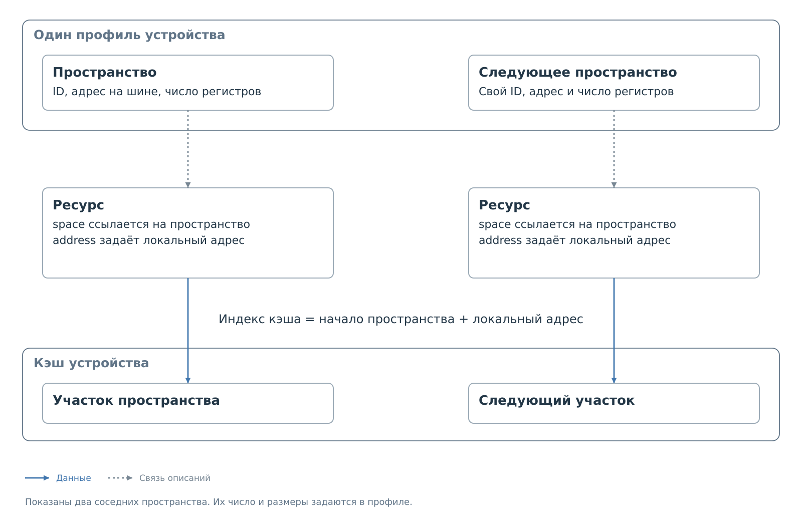

# Несколько адресных пространств

Одно физическое устройство может занимать несколько адресов на шине.
Каждый адрес открывает собственную группу регистров. Если выбранный
обработчик поддерживает такое подключение, BVSTK может объединить
эти группы в одном профиле через `transport.address_spaces`.

Устройство сохраняет одно имя, пакет файлов и политику. Пространство
указывает, к какой группе относится ресурс и какой адрес использовать
для обращения к нему. Так не приходится представлять части одного
устройства независимыми экземплярами.

## Адрес устройства, пространство и регистр

В `transport` вместо одиночного `address` указывается массив
`address_spaces`. Каждый элемент задаёт имя пространства, адрес
на шине и число регистров. В ресурсе появляется ссылка `space`.

*Рисунок 1. Адресные пространства одного профиля.*

Локальный адрес регистра отсчитывается от нуля внутри каждого
пространства. Поэтому одинаковые локальные адреса могут встречаться
несколько раз. Для выбора ресурса нужны и пространство, и локальный адрес.
ID ресурса при этом уникален во всём профиле.

Политика по-прежнему ссылается на ресурс по ID. Дублировать пространство
в правиле не требуется: оно уже определено в описании ресурса.
Тот же принцип применяется к начальным значениям кэша.

Список ресурсов должен покрывать весь диапазон каждого пространства.
В кэше эти диапазоны размещены подряд, в порядке массива
`address_spaces`. Начало пространства равно сумме размеров предыдущих,
а индекс записи — началу плюс локальный адрес.

Индекс кэша нужен программе для поиска значения. Устройству передаётся
локальный адрес ресурса с учётом параметров передачи. Подмена одного
другим приводит к обращению к неверному регистру.
Вычисление индексов с конкретными числами разобрано в
[примере двух пространств](examples/address-spaces.md).

## Обращение и отображение

Программный запрос выбирает устройство и пару «пространство — локальный
адрес». Ведомый обработчик выбирает пространство по адресу, к которому
обратился внешний ведущий. У каждого пространства свой указатель:
обращение к одному не перемещает указатель другого.

Формат адресного префикса и правила последовательного обмена общие
для устройства и задаются одним `protocol.transfer`.
Карта регистров также указывает `space`: для расшифровки интерфейс
сопоставляет пространство и локальный адрес с записью общего кэша.
Одного совпадения `address` между картой и профилем теперь недостаточно.

API может возвращать вычисленное поле `first`, начало пространства
в кэше. В JSON профиля его добавлять нельзя. Порядок пространств
определяет внутренние индексы, поэтому сохранять их отдельно
от соответствующего описания нельзя.

## Политика и маршрут

Режим белого или чёрного списка общий для устройства.
Отдельные правила относятся к ресурсам выбранных пространств.
Свойства доступа ресурса продолжают действовать независимо от политики:
разрешающее правило не отменяет запрет записи в ресурс, доступный только для чтения.

Все пространства могут находиться за коммутатором. `parent` и `channel`
задаются один раз в `transport`, и все адреса используют этот маршрут.
На носителе остаётся один пакет с одним профилем.

Адресные пространства описывают постоянные адреса, а не переключаемые
банки или страницы памяти. Они также не обеспечивают одновременное
чтение нескольких регистров. При отображении связанных значений нужно
учитывать, что данные могли быть получены в разное время.

Полный файл, ограничения обработчика и особенности доступности находятся
в [примере](examples/address-spaces.md), описание полей — в
[ветке адресных пространств](device-profile.md#Адресные%20пространства).
Далее рассмотрено [получение показателей из кэша](register-map.md).

Далее: [пример профиля с адресными пространствами](examples/address-spaces.md).
