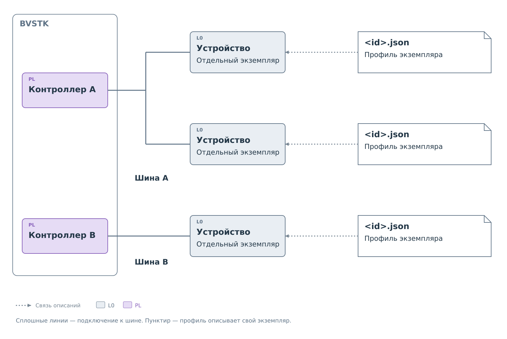
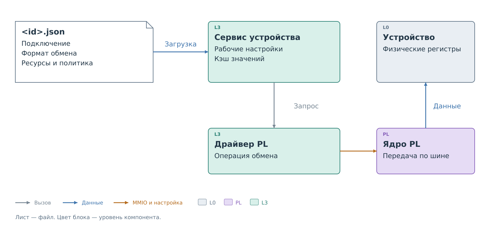

# Система профилей

BVSTK обращается к устройствам на шинах через программные сервисы и
аппаратные контроллеры. Контроллер умеет передавать данные, но одного
знания шины недостаточно для работы с устройством. Нужно знать его адрес,
способ выбора регистра, допустимые записи и особенности чтения.
Эти сведения задаются в **профиле устройства**.

Профиль описывает конкретный подключённый экземпляр. Два одинаковых
устройства могут находиться на разных адресах, иметь разные разрешения
и выполнять разные задачи. В BVSTK у каждого будет собственное имя
и собственный профиль.

На одной шине может быть несколько устройств, на другой — одно.
Набор профилей повторяет состав подключённых экземпляров.
При добавлении устройства добавляют его описание, а общий код
обслуживания шины продолжает работать с теми же интерфейсами.

На рисунках используются принятые в BVSTK
[цвета уровней абстракции](../system/system.md#уровни-абстракции).
Белые карточки обозначают данные, листы — файлы.

*Рисунок 1. Устройства и их профили. Шины показаны условно.*

## Профиль и программа

В программе уже есть обработчики поддерживаемых способов обмена.
Профиль выбирает обработчик и задаёт его параметры: как найти устройство,
как обратиться к его ресурсам и какие действия разрешены. Сам алгоритм
обмена остаётся в программе. Набор допустимых настроек определяется
возможностями выбранного обработчика.

*Рисунок 2. Место профиля в работе BVSTK.*

При запуске программа читает профиль и создаёт рабочие настройки в
оперативной памяти. Последующие запросы используют эти настройки.
Читать JSON заново перед каждым обращением к регистру не требуется.
Поэтому правка файла на носителе сама по себе ещё не меняет поведение
уже работающего сервиса.

Название модели в профиле нужно для описания устройства. Алгоритм выбирают
поля подключения и обмена. Если устройство требует операции, которой нет
в обработчике, сначала потребуется расширить программу. Произвольный
алгоритм в JSON записать нельзя.

## Пакет описания устройства

Устройство получает собственный каталог с именем его экземпляра в BVSTK.
Основной файл называется `<id>.json`. Он содержит профиль: подключение,
параметры обмена, ресурсы устройства и правила доступа к ним.

Если прочитанное состояние нужно представить пользователю, в ту же папку
добавляют **карту регистров**. Она объясняет, какие биты составляют поле,
что означает его код и как из него получить показатель для отображения.

*Рисунок 3. Файлы одного пакета и их использование.*

Веб-интерфейс умеет показывать показатели по карте без дополнительного
кода. Собственная **форма** `view.js` нужна, если требуется другое
расположение или представление этих показателей.

Вся папка называется пакетом устройства, или бандлом. Отдельного
документа с описанием бандла нет. Профиль содержит ссылки на карту
и форму, если они используются. Одного копирования дополнительных
файлов в папку недостаточно — их имена должны быть указаны в профиле.

Для обмена через сервис достаточно профиля. Карта и форма подключаются
по мере необходимости. Они обрабатывают уже полученные данные;
открытие показателей не запускает новое чтение регистров.

## Данные профиля и состояние устройства

Профиль задаёт допустимые действия. Правило записи применяется,
когда приходит запрос к соответствующему ресурсу. Загрузка или изменение
правила не выполняет запись: для неё нужен отдельный запрос.

Карта задаёт смысл возможных значений, но сама не сообщает о текущем
состоянии устройства. Сначала BVSTK
должна получить значение регистра. Оно попадает в **кэш** — память
последних значений с признаками достоверности и происхождения.
Затем веб-интерфейс расшифровывает его по карте.

Начните со [структуры профиля](device-profile.md). Полные файлы собраны
в [примерах](examples/examples.md), а дерево полей доступно отдельно:
[профиль](device-profile-tree.md) и [карта регистров](register-map-tree.md).
