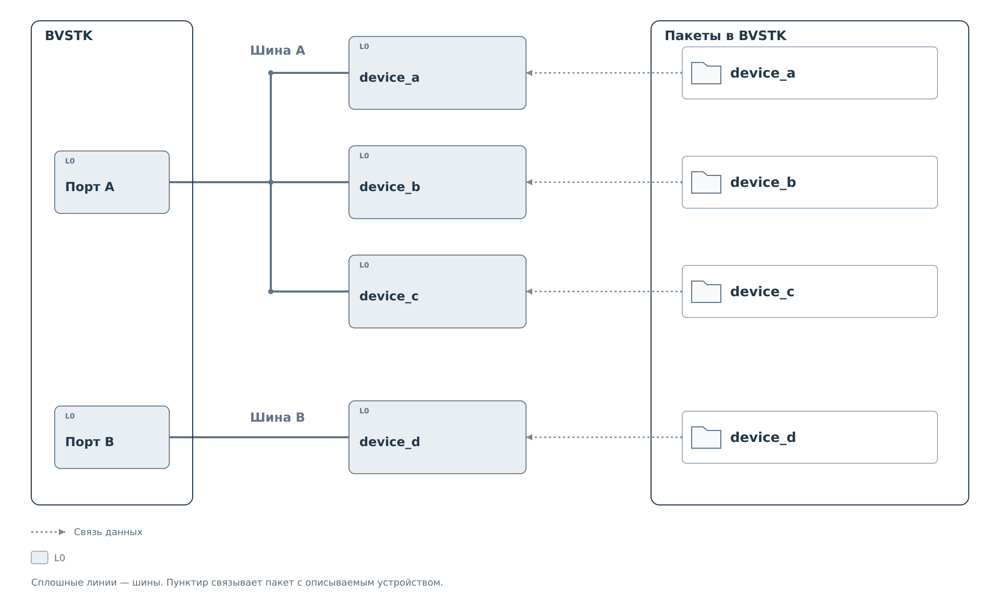
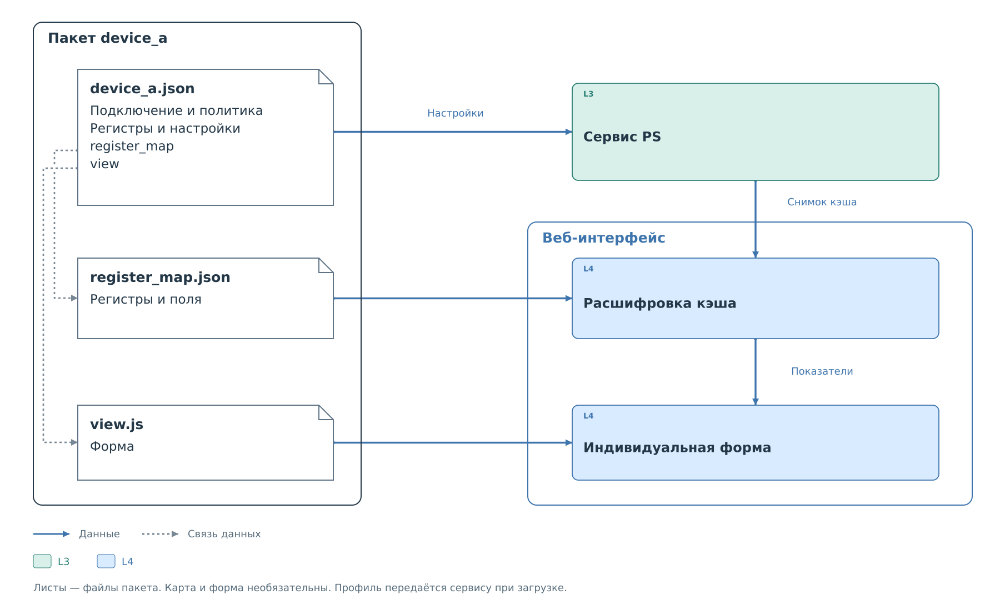

# Конфигурация BVSTK

Для каждого оконечного устройства BVSTK хранит **пакет описания**,
или **бандл**. Это папка с профилем устройства и дополнительными файлами,
которые описывают смысл его регистров и отображение данных. По этому
комплекту система определяет, как обращаться к устройству, какие операции
разрешены и как представить результат пользователю.

Конфигурация разделена по области действия. Параметры всей системы,
например адрес сети, хранятся отдельно. Подключение и правила одного
устройства находятся в его профиле. Описание битовых полей вынесено
в карту регистров, потому что оно нужно для расшифровки данных в интерфейсе.
Изменить подпись показателя можно независимо от политики обмена.

## Устройства на шинах

На шинах может быть разное количество устройств. Каждому настроенному
экземпляру соответствует свой профиль с подключением и правилами работы.

Цвета компонентов на схемах соответствуют
[уровням L0–L4](../system/system.md#уровни-абстракции).
Белые листы и значки папок обозначают файлы и каталоги.



*Рисунок 1. Соответствие между устройствами на шинах и пакетами их описания.*

Два устройства одной модели могут иметь одинаковое описание регистров,
но разные адреса и политики. Для них создают отдельные пакеты;
копию общей карты помещают в каждый из них.

Шины и устройства на рисунке условные. Фактический состав ограничен
аппаратным проектом и [поддерживаемыми обработчиками](reference/device-profile-v2.md#поддержка-в-текущей-прошивке).
Профиль передаёт параметры одному из этих обработчиков; новый способ
обмена требует поддержки в программе.

## Состав пакета устройства

В пакете `device_a` основной файл — `device_a.json`. Для работы сервиса
достаточно этого профиля. Карта регистров и форма нужны для отображения.

Бандл — весь каталог устройства. Отдельного файла с описанием бандла
не требуется: профиль указывает, какие дополнительные файлы использовать.
Все три файла могут лежать рядом, но каждый имеет свой формат и свою задачу.



*Рисунок 2. Состав одного пакета и использование его файлов.*

**Профиль** задаёт подключение, обработчик обмена, перечень регистров,
политику доступа и начальные значения кэша. Его читает программа на PS.

**Карта регистров** объясняет смысл чисел, полученных от устройства:
где находятся битовые поля, что означают их коды и как вычислить
отображаемую величину. Расшифровку выполняет веб-интерфейс.

**Индивидуальная форма** задаёт расположение показателей на странице
устройства. Это необязательный файл JavaScript. Без него веб-интерфейс
использует стандартное отображение карты.

Ссылку `register_map` добавляют в профиль, когда подготовлена карта
для этого устройства. Поле `view` добавляют при подключении собственной
формы; для неё уже должна быть указана карта. Если нужны только операции
сервиса, оба поля можно опустить. Наличие файла в каталоге само по себе
не подключает его к интерфейсу.

Профиль и карта описывают одни регистры, но используются разными частями
системы. Например, профиль задаёт адрес `reg_01` и правило записи в него,
а карта поясняет, что младший бит этого регистра означает готовность.
Сервис применяет правило при обмене. Интерфейс получает снимок кэша
и расшифровывает его по карте, без нового чтения устройства.

## Размещение и связи файлов

Пакеты хранятся в файловой системе платы, внутри каталога `config`.
Сначала они сгруппированы по подсистеме, затем по устройству.
В каждой папке устройства лежит один профиль. Имя основного JSON
совпадает с именем папки: `device_a/device_a.json`.


*Рисунок 3. Размещение пакетов тех же устройств в файловой системе.*

В пути `config/<подсистема>/device_a/device_a.json` каждый участок имеет
своё назначение. `config` — область сохранённых настроек платы.
Каталог подсистемы выбирает набор, который читает её загрузчик.
Папка `device_a` объединяет файлы одного экземпляра. Последнее имя
выбирает основной документ этого пакета.

Содержимое профиля задаётся явно. Например, его `id` записывает автор,
а контроллер и аппаратный адрес находятся в `transport`. Загрузчик
не вычисляет эти параметры по имени папки. В примерах имя каталога,
основа имени JSON и `id` совпадают, чтобы устройство было легко найти.

Для I²C со свитчом пакет потомка помещается прямо в пакет свитча:

```text
configs/i2c/
├── axp15060/                   # прямое подключение
│   ├── axp15060.json
│   ├── register_map.json
│   └── view.js
└── pca9545a/
    ├── pca9545a.json
    ├── register_map.json
    ├── view.js
    ├── pcf8563/
    │   ├── pcf8563.json
    │   ├── register_map.json
    │   └── view.js
    ├── p24c02a/
    │   ├── p24c02a.json
    │   ├── register_map.json
    │   └── view.js
    └── pca9555/
        ├── pca9555.json
        ├── register_map.json
        └── view.js
```

В профиле потомка `transport.parent` содержит ID свитча,
`transport.channel` — номер канала. Имя каталога, ID и имя основного
JSON совпадают; позиционные обозначения компонентов платы в них
не используются. Каждый потомок имеет самостоятельную политику,
карту и форму. Подробнее: [I²C со свитчами](i2c-topology.md).

Каталоги группируют самостоятельные профили. Политика из соседнего
пакета не распространяется на `device_a`; общие свойства регистров
задаются внутри самого `device_a.json`, в `defaults.register`.

Имена `<подсистема_a>` и `<подсистема_b>` условные. На плате здесь
используются каталоги поддерживаемых подсистем. Уровень каталога
для произвольного номера шины не предусмотрен; параметры подключения
находятся в самом профиле.

Полный путь к профилю зависит от среды выполнения:

| Среда | Путь на плате |
|---|---|
| FreeRTOS | `flash:/config/<подсистема>/<имя>/<имя>.json` |
| Нейтрино | `/flash/config/<подсистема>/<имя>/<имя>.json` |

Во FreeRTOS `flash:/` обозначает файловую систему QSPI.
В штатной конфигурации Нейтрино носитель доступен через `/flash`.
Карта и форма лежат рядом с JSON профиля.

У профиля есть явные ссылки на дополнительные файлы.
Фрагмент `device_a.json`, подключающий карту и форму:

```json
{
  "register_map": "register_map.json",
  "view": "view.js"
}
```

По ссылке `register_map.json` интерфейс выбирает файл именно из папки
`device_a`. Одноимённая карта в папке `device_c` — другой файл.
Ссылка на карту соседнего устройства, URL или вложенный путь
не допускаются. Если дополнительный файл не нужен, соответствующее
поле в профиле опускают. `view` требует наличия `register_map`.

Подробные ограничения имён приведены в
[таблице ссылок на файлы](reference/device-profile-v2.md#файлы-отображения).

Кодек проверяет допустимость этих ссылок при загрузке профиля. Саму карту
и скрипт позднее загружает веб-интерфейс. Поэтому успешно загруженный
профиль ещё не подтверждает наличие и правильность дополнительных файлов.
Пошаговое добавление карты и формы показано в
[примере сборки пакета](examples/package-assembly.md).

Каталог `configs` в репозитории содержит исходные профили для встроенного
набора. Изменение этих файлов на компьютере не обновляет конфигурацию
работающей платы. Подготовка начального набора и выбор сохранённых
профилей описаны в [порядке загрузки](lifecycle.md#файлы-и-источники-конфигурации).

У самой BVSTK также есть настройки, например параметры сети. Они
относятся к системе в целом и имеют
[отдельный формат](../network.md#сетевой-файл-freertos).

## Вложенность внутри документов

Внутри профиля информация снова делится по назначению. `device` описывает
модель, `transport` — подключение, `protocol` — обработчик. Массив
`resources` перечисляет регистры. Правила в `policy` и начальные значения
в `settings` ссылаются на элементы этого массива по ID.
Дерево объектов и массивов показано в
[структуре профиля](device-profile.md#корневой-объект).

Запись `settings.cache_seed[].resource` обозначает путь внутри одного
JSON: объект `settings`, массив `cache_seed`, поле `resource` каждого
элемента. Дополнительных файлов с такими именами нет. Ссылка на соседний
файл задаётся отдельно — полем `register_map` или `view`.

У карты собственная вложенность: `registers` содержит описания регистров,
каждый регистр — массив битовых полей `fields`. Показатели `summary`
ссылаются на эти поля. Версии документов также независимы: профиль имеет
`schema_version: 2`, карта — `schema_version: 1`. Это версии двух форматов,
а не порядок их загрузки. Связи показаны в
[главе карты регистров](register-map.md#структура-карты).

После разбора программа создаёт рабочие настройки и кэш. Ответ интерфейса
управления добавляет сведения об их состоянии. Поэтому JSON, полученный
по HTTP, и JSON на носителе могут содержать разные поля. Происхождение
этих данных разобрано в [главе загрузки](lifecycle.md#поля-рабочего-состояния-и-ответа).

## Порядок чтения

В [полных примерах](examples/full-profiles.md) можно увидеть профиль
целиком: минимальный файл, вариант с политикой и кэшем, параметры
другого обработчика. Разбор ниже объясняет связи, которые в этих JSON
записаны полями и вложенными объектами.

1. [Профиль устройства](device-profile.md) — связь подключения,
   ресурсов, политики и начальных значений.
2. [Загрузка, применение и сохранение](lifecycle.md) — переходы между
   файлом, рабочими настройками и кэшем.
3. [Карта регистров](register-map.md) — получение понятного показателя
   из значения регистра.
4. [Индивидуальная форма](view-api.md) — отображение готового снимка.

Точные определения вынесены в справочники
[профиля v2](reference/device-profile-v2.md)
и [карты регистров v1](reference/register-map-v1.md).

Самостоятельные разборы: [сборка пакета](examples/package-assembly.md),
[значения по умолчанию и сохранение](examples/defaults-and-save.md),
[ресурс и правило политики](examples/profile-and-policy.md),
[применение и сохранение](examples/apply-and-save.md),
[расшифровка регистров](examples/register-decoding.md).
