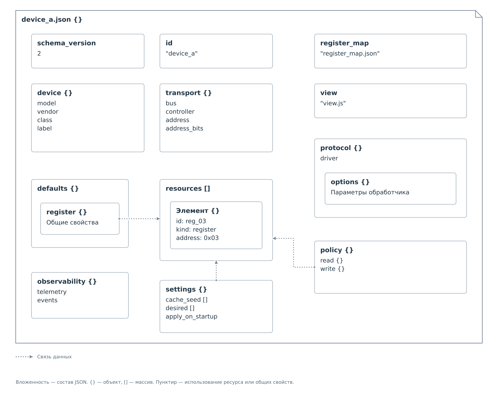
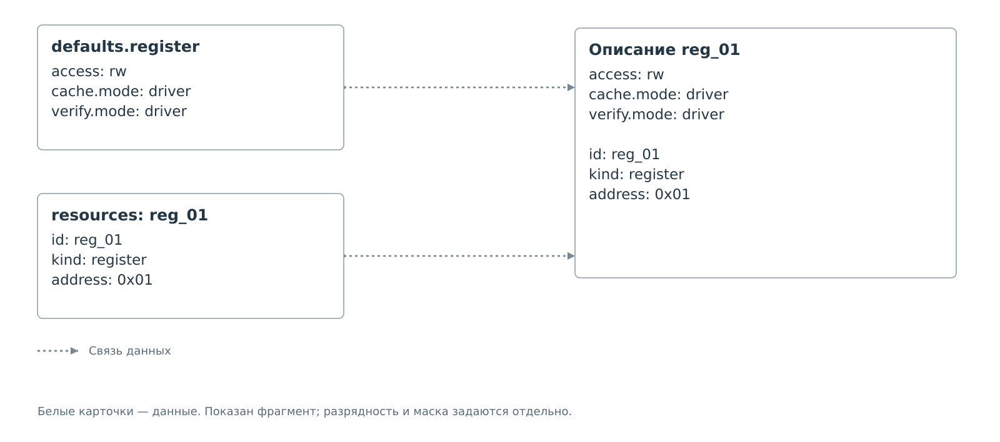
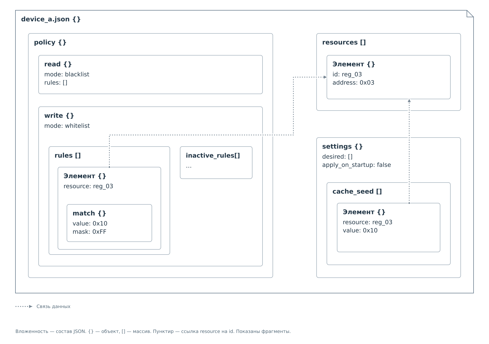
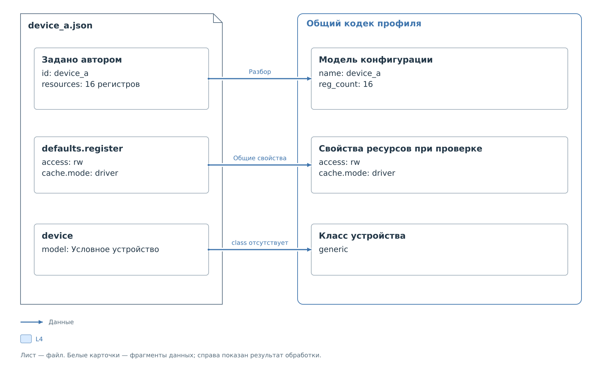

# Профиль устройства

Профиль — JSON-файл, описывающий один экземпляр устройства: его подключение,
регистры, правила доступа и начальные значения кэша. При загрузке BVSTK
по этому описанию заполняет конфигурацию сервиса. Чтобы подготовить файл,
нужно согласовать его разделы: правила должны ссылаться на существующие
регистры, а их свойства — соответствовать выбранному обработчику.

Ниже структура разобрана от корневого объекта к вложенным полям.
[Справочник v2](reference/device-profile-v2.md) содержит таблицы этих же
разделов с точными типами и ограничениями. Целые JSON-файлы находятся
в [примерах профилей](examples/full-profiles.md).

## Корневой объект

Весь файл представляет собой один объект. В его корне находятся
`schema_version` и `id`, объекты описания устройства, массив `resources`
и ссылки на дополнительные файлы. На схеме каждый блок внутри листа
соответствует полю JSON; вложенные блоки показывают его содержимое.

*Рисунок 1. Структура профиля устройства v2. В массиве показан один ресурс.*

Объект объединяет именованные поля: например, `transport` содержит
`bus`, `controller` и `address`. Массив содержит повторяющиеся элементы:
каждый объект в `resources` описывает отдельный регистр. На схемах
объекты отмечены `{}`, массивы — `[]`. Порядок ключей объекта не задаёт
порядок выполнения операций.

Запись `policy.write.rules[].match.mask` читается по вложенности:
корневой объект `policy`, внутри него `write`, затем каждый элемент
массива `rules`, его объект `match` и поле `mask`. Это путь к данным
в одном файле. Ключа с таким длинным именем в JSON нет.

`schema_version: 2` выбирает формат документа. Корневой `id` задаёт имя
экземпляра устройства, например `device_a`. Имя модели, аппаратный адрес
и идентификаторы регистров находятся в других разделах; ни один из них
не вычисляется из строки `device_a`.

Тип значения тоже является частью формата. Адреса и маски записываются
строками вида `"0x01"`, количество битов — числом, переключатели —
`true` или `false`. Произвольная замена строки числом недопустима.
Обязательность полей определяется форматом: например, профиль без
`settings` допустим, а без `resources` загрузить устройство нельзя.

Таблицы: [корневой объект](reference/device-profile-v2.md#корневой-объект),
[типы значений](reference/device-profile-v2.md#типы-значений).

## Описание устройства

В объекте `device` поле `model` называет модель, `vendor` — производителя,
`class` — категорию устройства, а `label` задаёт подпись для отображения
конкретного экземпляра. Поэтому два устройства одной модели могут иметь
одинаковый `model`, но разные корневые `id` и подписи `label`.

Если класс не указан, используется `generic`. При отсутствии `label`
интерфейс может показывать `id`; это не означает, что поле `label`
появится в сохранённом файле. Алгоритм обмена выбирается отдельно,
через `protocol.driver`. Изменение модели или класса само по себе
не выбирает другой обработчик.

Таблица: [поля `device` и классы](reference/device-profile-v2.md#описание-устройства).

## Подключение к шине

Объект `transport` определяет физическую цель обмена. `bus` выбирает шину,
`controller` — поддерживаемый контроллер, `address` — адрес устройства
на этой шине. Разрядность адреса `address_bits` используется обработчиком
I²C; для MDIO такого поля в профиле нет.

Адрес устройства и адрес регистра имеют разную область действия.
`transport.address` выбирает устройство, а `resources[].address` —
регистр внутри него. Для двух самостоятельных устройств создают
два профиля, даже если перечень регистров совпадает.

У одного устройства может быть несколько I²C-адресов. Тогда вместо
`address` задают массив `address_spaces`, а каждый ресурс связывают
с пространством через `space`. Устройство сохраняет один пакет,
политику и карточку в интерфейсе. Подробности и полный пример:
[несколько адресных пространств](address-spaces.md).

Для устройства за свитчом добавляют `parent` с ID свитча и `channel`
с номером его канала. Профиль помещают в соответствующий вложенный пакет.
Одинаковые адреса на разных каналах различаются по маршруту.

Таблица: [поля `transport`](reference/device-profile-v2.md#подключение-к-шине).

## Обработчик и параметры

Объект `protocol` содержит `driver` и вложенный объект `options`.
`driver` выбирает существующий в программе обработчик обмена.
`options` передаёт ему параметры. Набор этих параметров зависит
от обработчика, поэтому смена одного имени `driver` не превращает
профиль в описание устройства на другой шине.

У обработчика I²C `max_write_value` ограничивает числовое значение записи.
Этот предел проверяется вместе с остальными условиями операции;
разрешающее правило политики его не отменяет. Поле
`capture_cache_on_save` относится к сохранению действительных значений
кэша. В текущем формате оно допускает только `true`; подготовка сохраняемого
снимка зависит от [операции сохранения](lifecycle.md#сохранение-и-ошибки).

Дополнительный объект `protocol.transfer` описывает адресный префикс,
переход указателя, цикл записи, проверку результата и работу с кэшем.
Объект `protocol.switch` описывает выбор каналов. PS исполняет эти
параметры общим кодом; для нового устройства с поддерживаемым форматом
обмена достаточно добавить пакет JSON и файлов отображения.
Справочник: [обмен I²C](reference/device-profile-v2.md#обмен-i²c).

У обработчика MDIO параметры `autopoll_*` задают опрос. `autopoll_order`
содержит ID ресурсов в порядке обхода, `autopoll_enabled` включает этот
обход. `autopoll_reg_delay_ms` задаёт паузу между регистрами,
а `autopoll_cycle_delay_ms` — между циклами. Само включение регистра
в `resources` ещё не добавляет его в опрос. Например, профиль может
описывать 32 регистра, а в списке опроса использовать только пять.

Таблицы: [поддержка обработчиков](reference/device-profile-v2.md#поддержка-в-текущей-прошивке),
[параметры I²C](reference/device-profile-v2.md#обработчик-и-параметры-i²c),
[параметры MDIO](reference/device-profile-v2.md#обработчик-и-параметры-mdio).

## Регистры и общие свойства

Каждый элемент массива `resources` — объект с собственными `id`, `kind`
и `address`. В текущих обработчиках `kind` имеет значение `register`.
Идентификатор ресурса уникален внутри этого профиля; он связывает регистр
с политикой, начальными значениями и списком опроса. Имя `reg_03` само
по себе не задаёт адрес: соответствие устанавливает поле `address`.

Свойства ресурса определяют представление и обслуживание регистра.
`width_bits` задаёт разрядность значения. `access` и `write_mask` описывают
доступ, который предоставляет мост: `rw` и маску всего слова.
Для I²C также поддерживается `ro`, запрещающий запись на уровне сервиса.
Физический регистр при этом может иметь ограничения
или побочные эффекты. Их учитывают при выборе операций, политике записи
и описании [карты регистров](register-map.md).

У `cache` и `verify` есть собственное поле `mode`. Значение `driver`
передаёт управление кэшем и проверкой записи обработчику шины.
В этих объектах не хранятся текущие значения регистров. Поведение
обработчиков приведено в таблице [режима `driver`](reference/device-profile-v2.md#режим-driver).

Одинаковые свойства можно вынести в `defaults.register`. Тогда у ресурса
остаются его ID, тип, адрес и необходимые переопределения. При разборе
кодек сначала ищет свойство в самом ресурсе; если его нет, использует
одноимённое свойство из `defaults.register`.

*Рисунок 2. Общие и собственные свойства одного регистра.*

Например, `resources[3].cache.mode` находится в четвёртом элементе массива,
а `defaults.register.cache.mode` — в общем описании. После разрешения
общих свойств у каждого ресурса должно быть полное допустимое описание.
Если `width_bits` отсутствует в обоих местах, профиль отклоняется.
Вложенный объект заменяется целиком: частичного слияния его полей нет.

Поля `id`, `kind` и `address` указываются в каждом ресурсе; помещать их
в `defaults.register` нельзя. Общие свойства не создают новые регистры.
В массиве перечисляется весь непрерывный диапазон от нуля. Поэтому
в примере с 16 регистрами присутствуют все адреса от `0x00` до `0x0F`,
независимо от количества правил и начальных значений.

Таблица: [поля `resources` и правила `defaults.register`](reference/device-profile-v2.md#регистры-и-общие-свойства).

### Зарезервированные свойства

В справочнике также перечислены `read_effect`, `write_effect`, `refresh`,
`persist_mask` и `fields`. В текущей прошивке они допускаются только
в неактивном виде: маски равны нулю, списки пусты. По этим полям нельзя
настроить обработку побочных эффектов регистра или периодическое обновление.
Опрос MDIO задаётся параметрами `protocol.options`, описанными выше.

Непустое описание битовых полей находится в отдельной карте регистров.
Поле `resources[].fields` в самом профиле пока принимается только пустым.
Точные допустимые записи приведены в таблице
[зарезервированных свойств](reference/device-profile-v2.md#зарезервированные-свойства).

## Политики доступа

Корневой объект `policy` содержит отдельные объекты `read` и `write`.
В `write` поле `mode` выбирает режим, `rules` содержит активные правила,
а `inactive_rules` хранит правила противоположного режима. Элемент
каждого списка связывает ID ресурса с условием на записываемое значение.

*Рисунок 3. Разделы политики и настроек ссылаются на один ресурс. Показаны фрагменты массивов.*

В правиле `resource` — строка с ID уже объявленного регистра.
Объект `match` содержит `value` и `mask`: образец и биты, участвующие
в сравнении. Например, полная маска требует совпадения всего значения,
а маска младших четырёх битов проверяет только эту часть слова.
Поддерживаемые маски зависят от обработчика.

`match.mask` относится к сравнению в конкретном правиле.
`resources[].write_mask` относится к слову регистра, а
`protocol.options.max_write_value` ограничивает числовое значение записи
I²C. Совпадение правила не меняет этих свойств.

Белый список разрешает совпавшие записи, чёрный — запрещает.
Поэтому пустой белый список закрывает запись. Если весь `policy.write`
опущен, кодек создаёт именно такой список. При переключении режима
через интерфейс управления активный и неактивный списки меняются ролями.
При ручной правке одного `mode` в JSON содержимое списков остаётся
на прежних местах, и смысл правил меняется.

Раздел `policy.read` задаётся явно. Некоторые внешние чтения ядро PL
обслуживает самостоятельно из ведомого кэша, поэтому профиль текущих
мостов принимает только неограничивающую политику чтения.
Проверка политики PS применяется к операциям через сервис; привилегированный
доступ через MMIO и JTAG находится за её пределами.

Таблицы: [чтение](reference/device-profile-v2.md#чтение),
[запись](reference/device-profile-v2.md#запись),
[правило и маска](reference/device-profile-v2.md#правило-и-маска).
Разбор одного правила приведён в [примере политики](examples/profile-and-policy.md).

## Кэш и настройки

Объект `settings` содержит массив `cache_seed`. Каждый его элемент
задаёт пару `resource` и `value`: ID регистра и начальное значение кэша.
Это отдельный список. Регистр может иметь правило записи без начального
значения или начальное значение без разрешения на запись.

Например, `settings.cache_seed[0].resource` ссылается на ресурс,
а соседнее `value` задаёт число для начального кэша. При создании рабочей
среды сервис заносит его в память с источником `settings`. Физическая
запись в устройство при этом не выполняется. В рабочей записи кэша
сервис отдельно ведёт достоверность и время обновления; этих полей
в `cache_seed` нет.

Два других поля `settings` зарезервированы для физических настроек:
`desired` принимается только пустым, `apply_on_startup` — только `false`.
Если раздел `settings` отсутствует, списки в модели остаются пустыми.

Таким образом, `resources[].cache.mode` задаёт обслуживание кэша,
а `settings.cache_seed` — его начальные данные. Дальнейшие обновления
выполняет сервис при обмене; они разобраны
в [жизненном цикле кэша](lifecycle.md#начальные-значения-кэша).

Таблица: [поля `settings` и элемента `cache_seed`](reference/device-profile-v2.md#сохранённые-настройки).

## Телеметрия и события

Объект `observability` содержит флаги `telemetry` и `events`.
Они относятся к публикации доступных сервису наблюдений и событий.
В текущей реализации оба признака включены; кодек принимает только
`true` либо отсутствие полей. Отключить наблюдения через этот объект
сейчас нельзя. При сохранении оба значения записываются явно.

Таблица: [поля `observability`](reference/device-profile-v2.md#телеметрия-и-события).

## Файлы отображения

Корневые поля `register_map` и `view` содержат имена файлов в том же
пакете устройства. В них не вкладываются ни JSON карты, ни код формы.
`register_map` подключает расшифровку регистров, `view` — собственную
форму для уже расшифрованных данных. Поэтому `view` требует карты.

Оба поля необязательны. Для загрузки сервиса достаточно профиля;
последовательное подключение дополнительных файлов показано
в [примере сборки пакета](examples/package-assembly.md).

Таблица: [ссылки на файлы отображения](reference/device-profile-v2.md#файлы-отображения).

## Происхождение полей

При разборе кодек заполняет внутреннюю модель: переносит явно заданные
сведения, использует общие свойства ресурсов и предусмотренные форматом
значения по умолчанию. На схеме показано по одному случаю каждого вида.

*Рисунок 4. Происхождение данных в модели конфигурации.*

Корневой `id` становится именем устройства в модели. Число регистров
`reg_count` кодек получает из массива `resources`: добавлять это поле
в корень JSON v2 не нужно. Отсутствующий `device.class` получает значение
`generic`. Значения по умолчанию предусмотрены для определённых полей;
пропуск обязательных сведений приводит к ошибке загрузки.

Во время разбора исходный файл остаётся прежним. При сохранении кодек
строит JSON из модели, поэтому некоторые неуказанные ранее поля появляются
явно. Полный файл до и после такого преобразования приведён
в [примере сохранения](examples/defaults-and-save.md).

Допустимость ключей и значений проверяется для всего документа.
Неизвестное поле или ссылка на отсутствующий ресурс приводят к отказу.
Краткий перечень причин находится в [справочнике ошибок загрузки](reference/device-profile-v2.md#отказ-загрузки),
а выбор файлов и работа с носителем описаны в [порядке загрузки](lifecycle.md).
