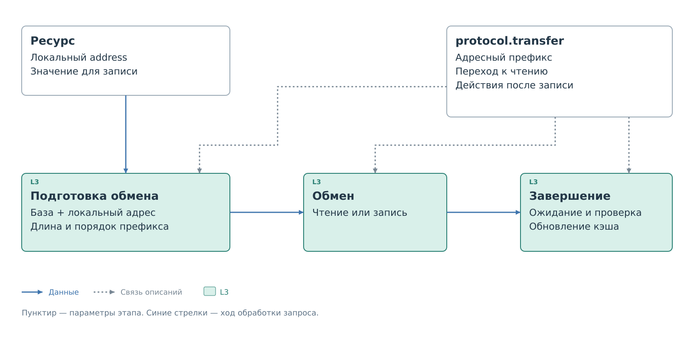
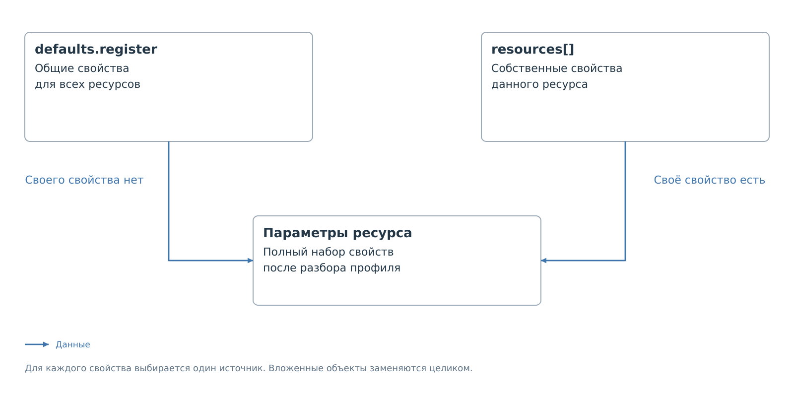
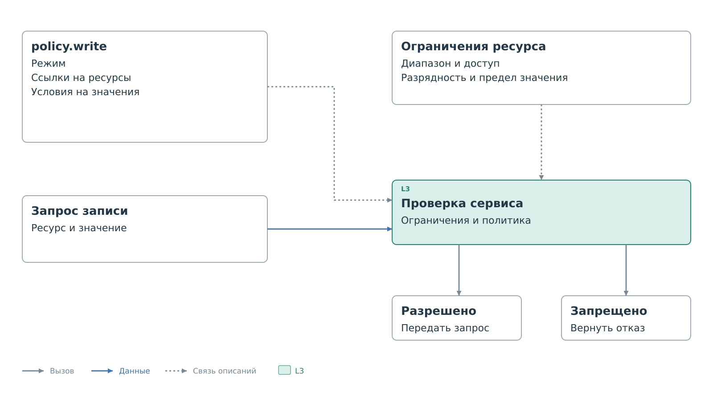

# Структура профиля

Профиль — один JSON-объект. Он описывает экземпляр устройства,
подключение, обмен, регистры и правила доступа. Разберём его от корня
к вложенным полям. Полные файлы с выбранными подключениями и настройками
собраны в [примерах](examples/examples.md).

Полное [дерево профиля](device-profile-tree.md) открывается отдельно.
Его ссылки ведут к разделам по названиям полей. Обозначения `{}` и `[]`
указывают объект и массив.
«Элемент массива» обозначает повторяющуюся запись; такого ключа в JSON нет.

Дерево объединяет поля поддерживаемых обработчиков. Это не набор,
который нужно целиком добавлять в каждый профиль. `transport` выбирает
подключение, `protocol.driver` — обработчик; вместе они определяют
допустимые ветки и значения. Неподдерживаемое поле не добавляет новую
возможность, а приводит к отказу загрузки. Здесь описаны назначение
и связи полей; сочетания для конкретных обработчиков разобраны в примерах.

В корне обязательны `schema_version`, `id`, `device`, `transport`,
`protocol`, `resources` и `policy`. Остальные разделы добавляют по мере
необходимости. Порядок ключей объекта не задаёт порядок работы системы:
сервис получает уже разобранные настройки.

**`schema_version`** — число `2`. Оно выбирает описанный здесь формат;
неизвестная явно указанная версия отклоняется.

**`id`** — имя экземпляра в BVSTK. Оно уникально
в своей подсистеме и согласуется с именем пакета на носителе. Название
модели находится отдельно, в `device.model`: у двух устройств одной
модели должны быть разные ID экземпляров.

Для ID устройства, ресурсов и пространств используются строки длиной
от 1 до 31 символа: первая буква строчная латинская, далее допустимы
строчные латинские буквы, цифры, `_` и `-`.

Файл записывается в UTF-8 без BOM. Предельный размер — 65536 байт,
вложенность объектов и массивов — 16 уровней с учётом корня.
Комментарии, завершающие запятые, неизвестные и повторяющиеся ключи
не допускаются. Пустая строка и `null` не заменяют отсутствующее поле.

Размеры, задержки и номера каналов записываются целыми JSON-числами,
без знака, дроби и экспоненты. Адреса, маски и значения
регистров — строками с префиксом `0x`. После префикса
допускается от 1 до 16 шестнадцатеричных цифр, но само значение должно
помещаться в предел конкретного поля. Эти способы записи не взаимозаменяемы.

## Описание устройства

Обязательный объект `device` содержит сведения для человека.
Эти строки не выбирают драйвер и не определяют адрес на шине.

**`model`** — обязательное название модели, до 64 байт UTF-8.
**`vendor`** — необязательное название изготовителя с тем же пределом.
**`label`** — необязательная подпись экземпляра, до 96 байт.
Указанная строка должна быть непустой и не содержать управляющих символов.
Размер считается после декодирования JSON: русская буква занимает
больше одного байта.

**`class`** задаёт категорию: `generic`, `phy`, `power`, `gpio`, `sensor`,
`memory`, `storage`, `bridge` или `serial`. При отсутствии используется
`generic`. Категория не добавляет устройству возможностей выбранной шины.

## Подключение

Обязательный объект `transport` определяет, через какой контроллер
и по какому адресу BVSTK найдёт устройство. Адрес устройства выбирает
участника обмена; адрес ресурса внутри него задаётся отдельно.

**`bus`** — обязательная строка, обозначающая тип шины.
**`controller`** — обязательный идентификатор контроллера в системе.
Их сочетание должно поддерживаться выбранным обработчиком.
Произвольная строка не создаёт контроллер и не меняет его аппаратные возможности.

**`address`** — адрес устройства, записанный шестнадцатеричной строкой.
Для устройства с одним адресом это обязательное поле. При нескольких
адресах вместо него используется `address_spaces`.
Необязательное **`address_bits`** задаёт разрядность адреса устройства,
если обработчик допускает её явное указание. Размер адреса ресурса
этим полем не задаётся.

Для подключения через коммутатор вместе добавляют **`parent`**
и **`channel`**. `parent` ссылается на ID непосредственного родителя:
его профиль должен быть загружен и содержать `protocol.switch`.
`channel` — целый неотрицательный индекс существующего элемента
`channels` родителя. Без этой пары устройство подключено напрямую.

Родитель сам может иметь родителя. При загрузке проверяются целостность
маршрута, отсутствие циклов и возможность однозначного выбора устройства.
Совпадающие адреса допустимы только при изоляции устройств разными
каналами общего коммутатора. Подробно этот механизм описан
в [главе топологии](topology.md).

Поддерживаемые имена контроллеров, пределы адресов и доступность маршрутов
указаны в [примерах подключений](examples/examples.md).

### Адресные пространства

`address_spaces` добавляется, когда один экземпляр устройства занимает
несколько адресов с отдельными группами регистров. Массив заменяет
`transport.address`: одновременно указать оба нельзя. Устройство
при этом сохраняет один профиль, одну политику и общий кэш.

Маршрут и параметры передачи относятся ко всему устройству.
Для этого способа подключения нужен обработчик с поддержкой пространств
и явный `protocol.transfer` с адресным префиксом. В текущем формате
сочетание с `protocol.switch` в одном профиле не поддерживается.
Переключаемые банки и процедуры выбора страниц этим массивом не задаются.

Ограничения числа пространств и ресурсов рассмотрены вместе
с [полным профилем](examples/address-spaces.md).

#### Описание пространства

В каждом элементе обязательны три поля:

- **`id`** — уникальное имя пространства внутри устройства.
- **`address`** — его адрес на шине, уникальный среди пространств профиля.
- **`register_count`** — положительное целое число регистров.

У каждого ресурса теперь требуется `space` со ссылкой на одно из этих
имён. Локальные адреса начинаются с нуля в каждом пространстве:
одинаковый адрес в разных пространствах обозначает разные ресурсы.

В кэше пространства размещаются последовательно, в порядке массива.
Начало очередного пространства равно сумме размеров предыдущих.
Индекс записи получается прибавлением локального адреса к этому началу.
В ответах API вычисленное начало называется `first`; в профиле такое
поле запрещено. Различие физических адресов и индексов разобрано
в [главе пространств](address-spaces.md).

## Обработчик обмена

Обязательный объект `protocol` выбирает программный обработчик
и задаёт его настройки. **`driver`** — обязательный идентификатор
реализованного обработчика. Его проверяют совместно с `transport`.
Название модели устройства на выбор алгоритма не влияет.

`options` содержит параметры обслуживания устройства.
`transfer` уточняет формат передачи, а `switch` описывает управление
коммутатором. Эти ветки заполняются по возможностям выбранного обработчика.

### Параметры обработчика

`options` объединяет настройки, которые относятся к обслуживанию
устройства целиком. У разных обработчиков состав этого объекта различается.
Одни поля ограничивают запись, другие задают опрос. Обязательность объекта,
допустимые сочетания и значения по умолчанию приведены рядом с
[полными примерами](examples/examples.md).

**`max_write_value`** — верхний числовой предел записываемого значения,
заданный шестнадцатеричной строкой. Это не маска битов.
Разрешение политики не отменяет этот предел.

**`capture_cache_on_save`** относится к подготовке начальных значений
при сохранении. В поддерживающем его обработчике поле принимает только
`true`; при отсутствии действует то же значение. Это не команда чтения
устройства. Перенос текущего кэша также зависит от способа сохранения,
что разобрано в [примере изменения настроек](examples/editing.md).

Для I²C в `options` можно описать безопасную проверку физического
присутствия устройства:

**`presence_check_enabled`** — включает фоновое чтение для проверки
присутствия. Значение по умолчанию — `true`.

**`presence_check_resource`** — ID ресурса из `resources`, который можно
читать без изменения состояния устройства. По умолчанию выбирается
`reg_00`. Проверка выполняется только чтением, обновляет достоверность
присутствия и выбранную запись кэша. Её операции не добавляются в
пользовательские журналы «Телеметрия» и «События».

Если для устройства нет безопасного регистра, укажите
`"presence_check_enabled": false`. В этом случае его состояние остаётся
«Ответ не проверен», пока не произойдёт обычное физическое чтение.

Фоновый опрос описывается следующими полями:

- **`autopoll_enabled`** — логический признак включения опроса.
- **`autopoll_order`** — массив ID существующих ресурсов без повторов,
  задающий порядок чтения.
- **`autopoll_reg_delay_ms`** — целая неотрицательная пауза между ресурсами.
- **`autopoll_cycle_delay_ms`** — целая неотрицательная пауза между проходами.

Наличие ресурса в `resources` само по себе не добавляет его в опрос.
Настройка опроса разобрана в [отдельном примере](examples/mdio-device.md).

### Параметры передачи

`transfer` задаёт обращение к ресурсу для обработчика с настраиваемым
адресным префиксом. Он связывает локальный адрес регистра с передаваемыми
данными, а также определяет действия после обмена.



*Рисунок 1. Использование параметров передачи.*

**`address_bytes`** — длина адресного префикса: 0, 1 или 2 байта,
по умолчанию 1. При нуле передаются только данные; такой профиль
допускает лишь один ресурс с нулевым адресом и нулевой базой.

**`address_base`** — база от `0x0000` до `0xFFFF`, по умолчанию `"0x0000"`.
Передаваемый адрес вычисляется как база плюс локальный адрес ресурса.
В разрядность префикса должен помещаться весь диапазон регистров.

**`address_order`** — порядок байтов префикса: `big` передаёт старший
первым, `little` — младший. По умолчанию `big`. Это порядок адреса,
а не разрядность значения регистра.

**`read_restart`** — логический признак способа перехода от передачи
префикса к чтению. При `true` начатый обмен сохраняется, при `false`
завершается перед отдельным чтением. По умолчанию `true`. Последовательность на шине
показана в [примере передачи](examples/direct-device.md#Передача%20на%20шине).

После записи возможны дополнительные действия:

- **`write_cycle_ms`** — ожидание внутреннего цикла устройства,
  целое число от 0 до 1000 мс, по умолчанию 0.
- **`verify_write`** — `none` или `readback`, по умолчанию `none`.
  `readback` читает записанный регистр и сравнивает результат.
  Несовпадение возвращает ошибку без повторной записи. Проверка требует
  допустимого чтения и пригодности значения для обратного сравнения.
- **`cache_after_write`** — `value` сохраняет переданное значение в кэше;
  `invalidate` снимает достоверность записи. По умолчанию `value`.

**`host_read`** управляет ответом внешнему ведущему. По умолчанию `cache`:
достоверное значение берётся из кэша, при промахе требуется физическое
чтение. `fresh` требует обновления от устройства. При явном `transfer`
начальное значение из `settings` не считается готовым ответом.

**`host_current_read`** разрешает чтение с текущего указателя без нового
префикса; по умолчанию `false`. Таймаут операции в профиль не входит:
его передаёт вызывающий код.

Отсутствующий `transfer` выбирает предусмотренный обработчиком режим
совместимости. Его нельзя автоматически приравнивать к объекту,
заполненному значениями по умолчанию. Различия разобраны
в [примере](examples/direct-device.md#Совместимость%20и%20границы%20обработчика).

#### Последовательность чтения

`read_sequence` задаёт перемещение указателя при последовательном чтении
внешним ведущим. В указанном объекте обязательно поле **`mode`**:

- `linear` увеличивает адрес; выход за диапазон является ошибкой.
- `fixed` оставляет адрес прежним.
- `wrap` возвращает указатель к началу текущей группы регистров.

При `wrap` можно добавить **`span`**, целое число от 0 до 256.
Ноль означает всё текущее адресное пространство. Ненулевой размер
должен делить без остатка размер каждого пространства и `address_base`.
У `linear` и `fixed` поле `span` запрещено, даже с нулевым значением.

Если `read_sequence` не указан, применяется `mode: "wrap"` с `span: 0`.
Если объект есть, но `span` пропущен, его значение равно 0.

#### Последовательность записи

У `write_sequence` те же **`mode`**, **`span`**, режимы и ограничения,
что при чтении. Отличается значение при отсутствии объекта: `linear`.

Обе последовательности описывают перемещение указателя внешнего ведущего.
Способ выполнения физических операций определяет обработчик;
разбор передачи находится в [примере](examples/direct-device.md#Передача%20на%20шине).

### Коммутатор

`switch` добавляется в профиль самого коммутатора. Устройство за ним
содержит `transport.parent` и `transport.channel`, а не копию `switch`.
Для коммутатора нужен явный `transfer`; адресные пространства запрещены.

**`resource`** — обязательный ID существующего регистра управления,
доступного для записи. **`select_mask`** — обязательная ненулевая
байтовая маска выбора каналов. **`preserve_mask`** — байтовая маска
сохраняемых битов, по умолчанию `"0x00"`. Маски не пересекаются.

Для прочитанного управления `old` и кода канала `select` перед обменом
записывается `(old & preserve_mask) | select`. Восстановление использует
`old & (select_mask | preserve_mask)`. Выбор проверяется политикой
коммутатора. Восстановление сохранённого состояния повторную проверку
политики не проходит. Ошибка восстановления делает маршрут неизвестным.

#### Каналы коммутатора

Обязательный массив `channels` содержит от 1 до 16 объектов.
Номер канала — индекс элемента с нуля; отдельного поля номера нет.
Именно этот индекс задаётся в `transport.channel` дочернего устройства.

В элементе обязательны **`select`**, байтовый код выбора, и
**`match_mask`**, ненулевая байтовая маска проверки. Оба значения
записываются шестнадцатеричными строками внутри `select_mask`.
Для прочитанного `control` активность проверяется условием
`(control & match_mask) == (select & match_mask)`.

Код должен изолированно выбирать свой канал. Полные профили находятся
в [примере маршрута](examples/routed-devices.md), порядок обмена
и восстановления — в [главе топологии](topology.md).

## Ресурсы

Обязательный непустой массив `resources` перечисляет элементы,
к которым обращаются политика, начальные значения и обработчик.
Сейчас поддержан один тип — `register`.

Адреса регистров покрывают непрерывный диапазон от нуля, без повторов.
При нескольких пространствах это правило действует отдельно в каждом.
Порядок элементов массива произвольный. Максимальное число ресурсов
и их разрядность задаёт обработчик.

### Описание регистра

**`id`** — обязательное уникальное имя ресурса. На все имена отведено
2048 байт, включая завершающие нулевые байты строк и служебный начальный
ноль. Длинные имена могут исчерпать этот предел раньше предела числа
регистров. При переименовании нужно обновить ссылки политики,
начальных значений, опроса и коммутатора.

**`kind`** обязателен и равен `"register"`.
**`address`** — обязательный локальный адрес в диапазоне ресурсов.
Имя ресурса не вычисляет его автоматически.
**`space`** ссылается на ID пространства: обязателен при
`transport.address_spaces`, иначе запрещён. ID ресурса уникален
во всём профиле, в том числе между пространствами.

Следующие свойства должны находиться у ресурса или в `defaults.register`:

- **`width_bits`** — положительное целое число битов значения.
  Должно совпадать с разрядностью, поддерживаемой обработчиком.
- **`access`** — `rw` для чтения и записи либо `ro` для чтения,
  если обработчик поддерживает такой режим. Запись в `ro` отклоняется
  независимо от разрешения политики.
- **`write_mask`** — шестнадцатеричная маска записываемых битов.
  Сейчас принимается только полная маска в разрядности ресурса.
  Она отличается от маски сравнения в правиле политики.
- **`cache`** и **`verify`** — объекты, описанные ниже.

Необязательное **`persist_mask`** допускает только нулевую
шестнадцатеричную строку, **`fields`** — только пустой массив.
При отсутствии действуют те же значения. Эти свойства зарезервированы;
битовые поля для отображения описываются в отдельной карте регистров.

#### Кэш ресурса

У `cache` одно обязательное поле **`mode`**, только `"driver"`.
Кэш обслуживается обработчиком. При поддержке настраиваемой передачи
действия после записи и при чтении внешнего ведущего задаются
в `protocol.transfer`. Здесь не хранятся ни значение
регистра, ни признак его достоверности.

#### Проверка записи ресурса

У `verify` обязательно **`mode: "driver"`**. Фактическую проверку
определяет обработчик. При настраиваемой передаче чтение после записи
выбирается через `protocol.transfer.verify_write`; `driver` сам
по себе не включает `readback`.

#### Обновление ресурса

Необязательный `refresh` зарезервирован. Допускаются только пустой массив
**`on`** и нулевое целое **`period_ms`**. Оба поля можно опустить.
Обновление этим объектом не запускается. Поддерживаемый обработчиком
фоновый опрос настраивается через `protocol.options`.

#### Эффекты чтения

Необязательный `read_effect` принимает **`clear_mask`**,
**`latch_high_mask`** и **`latch_low_mask`** только как нулевые
шестнадцатеричные строки. Пропущенные маски тоже равны нулю.
Ненулевыми значениями нельзя добавить эмуляцию побочных эффектов чтения:
эти свойства зарезервированы.

#### Эффекты записи

У необязательного `write_effect` тот же принцип: **`one_clear_mask`**,
**`one_set_mask`**, **`self_clear_mask`**, **`fixed_mask`** и
**`fixed_value`** принимают только нулевые шестнадцатеричные значения.
При отсутствии они равны нулю.

## Общие свойства

Одинаковые свойства регистров можно вынести в необязательный объект
`defaults`. В нём допускается только вложенный объект `register`.

### Общие свойства регистра

В `defaults.register` выносят свойства, одинаковые у нескольких ресурсов.
После разбора каждый ресурс получает полный набор параметров, даже если
в его собственном объекте записаны только отличающиеся значения.



*Рисунок 2. Выбор общего или собственного свойства регистра.*

Кодек сначала ищет свойство у ресурса и лишь при его отсутствии берёт
общее. Вложенные объекты и массивы заменяются целиком: собственный
`cache` не дополняется отдельными полями общего `cache`.

Здесь допустимы `width_bits`, `access`, `write_mask`, `cache`, `verify`,
`refresh`, `persist_mask`, `read_effect`, `write_effect`, `fields`.
Типы и значения совпадают с описанными в ветке
[ресурса](#Описание%20регистра). `id`, `kind`, `address` и `space`
в общих свойствах запрещены: они задаются у каждого ресурса.

`defaults` не создаёт регистры. Все элементы по-прежнему перечисляются
в `resources`. Если обязательного свойства нет ни там, ни здесь,
профиль не принимается. Заполнение общей части и отдельного ресурса
показано в [полном профиле](examples/direct-device.md#Общие%20и%20собственные%20свойства).

## Политика

Обязательный объект `policy` содержит политику чтения и необязательную
политику записи. Правила ссылаются на ресурсы по ID. Режим записи общий
для устройства, включая все его адресные пространства.



*Рисунок 3. Допуск записи в сервисе.*

Разрешение политики не отменяет `ro`, границы регистра или верхний предел
значения. Проверки относятся к операциям BVSTK и не контролируют прямое
обращение к аппаратуре через JTAG или MMIO.

### Политика чтения

Объект `read` обязателен. **`mode`** может быть только `"blacklist"`.
Массивы **`rules`** и **`inactive_rules`**, если указаны, должны быть пустыми;
при отсутствии они также пусты. Такой список не ограничивает чтение.
Текущие обработчики не предоставляют общего механизма запрета чтения
через ведомый тракт PL.

### Политика записи

Без `write` запись запрещена. Если объект указан, **`mode`** обязателен:

- `whitelist` разрешает запись при совпадении хотя бы с одним правилом;
  без совпадения она запрещена.
- `blacklist` запрещает совпавшую запись; без совпадения она допускается,
  если прошла остальные проверки.

**`rules`** содержит действующие правила, **`inactive_rules`** — правила
противоположного режима. Оба массива по умолчанию пусты. Пустой белый
список запрещает все записи, пустой чёрный не добавляет запретов.

При смене режима командой BVSTK списки меняются ролями. При ручной
замене только `mode` в JSON массивы остаются на месте, меняется смысл
применения `rules`.

#### Активные правила

Каждый элемент `rules` ссылается на ресурс и может ограничивать значение.
Вместимость списка определяется обработчиком.
Несколько правил могут ссылаться на один регистр, например разрешая
два разных управляющих значения.

##### Правило записи

**`resource`** — обязательный ID существующего элемента `resources`.
Это ссылка: описание регистра не вкладывается в правило.
**`match`** содержит условие сравнения значения.

Обработчик определяет, обязательно ли условие или допустимо правило
на ресурс без ограничения значения. Если в `match` указано хотя бы
одно поле, нужны оба — `value` и `mask`. Конкретные формы правил
сопоставлены в [примерах](examples/examples.md).

###### Условие значения

**`value`** — ожидаемое значение, **`mask`** — биты для сравнения.
Оба поля — шестнадцатеричные строки. Условие совпадения:
`(записываемое значение & mask) == (value & mask)`.

Полная маска сравнивает всё значение. Частичная оставляет в сравнении
только выбранные биты, если такой способ поддерживается обработчиком.
Маска используется для решения о допуске и не изменяет записываемые данные.

Значение и маска должны помещаться в разрядность ресурса и удовлетворять
ограничениям обработчика. При наличии `max_write_value` ожидаемое
значение правила также не должно превышать этот предел.

#### Неактивные правила

У `inactive_rules` те же элементы, поля `resource` и `match`, ограничения
и вместимость, что у `rules`. Сейчас они не определяют допуск записи,
но сохраняются для противоположного режима. Неверная ссылка или маска
в неактивном списке также делает профиль недопустимым.

## Начальные настройки

Необязательный `settings` содержит начальные значения кэша.
Без него список пуст. Загрузка настроек не записывает их в физические
регистры устройства.

Кроме `cache_seed`, допускаются два зарезервированных поля:
**`desired`** — только пустой массив и **`apply_on_startup`** — только
`false`. При отсутствии используются те же значения. Последовательность
записей при запуске этими полями пока не задаётся.

### Начальное заполнение кэша

Элемент `cache_seed` содержит обязательные **`resource`**, ID существующего
ресурса, и **`value`**, шестнадцатеричное значение в его разрядности.
Повторять ресурс в списке нельзя. Вместимость списка ограничена
выбранным обработчиком.

Источник такой записи кэша — `settings`. Это подготовленное значение
памяти, а не подтверждение содержимого устройства. Возможность использовать
его для ответа внешнему ведущему зависит от режима обработчика.
При явном `protocol.transfer` оно не считается готовым ответом.
Расшифровка карты также не выдаёт его за прочитанный показатель.
Обновление кэша разобрано в
[главе работы по профилю](exchange.md#Начальные%20значения).

## Фоновое получение данных

Необязательный объект `acquisition` задаёт чтения, которые PS выполняет
самостоятельно. Они наполняют кэш для веб-формы и внешних клиентов DCP2.
Открывать вкладку устройства для запуска чтений не требуется.
Без этого объекта сохраняется обычная работа устройства.

| Поле | Значение |
|---|---|
| `enabled` | Обязательное `true` или `false` |
| `read_delay_ms` | Пауза между блоками одного устройства, 1–60000 мс; по умолчанию 10 |
| `retry_delay_ms` | Задержка повтора неудачного блока, 100–60000 мс; по умолчанию 1000 |
| `groups` | До 8 групп; при `enabled: true` нужна хотя бы одна |

Каждая группа содержит:

| Поле | Значение |
|---|---|
| `id` | Уникальное в плане имя группы, правила записи как у ID ресурса |
| `interval_ms` | Обязательный период после завершения группы: 100–3600000 мс. `0` — один проход до потери и восстановления готовности устройства |
| `chunk_size` | Ресурсов за одну операцию: 1–16, по умолчанию 1 |
| `ranges` | От 1 до 4 диапазонов `{"first": "resource_id", "count": N}` |
| `when` | До 4 условий `{"resource": "resource_id", "mask": "0x…", "equals": "0x…"}`; можно опустить |

`first` ссылается на первый ресурс диапазона, `count` задаёт количество
последовательных адресов. Диапазон целиком находится внутри одного адресного
пространства. Диапазоны разных групп и диапазоны внутри группы не пересекаются.

Все условия `when` должны выполняться: `(прочитанное значение & mask) == equals`.
Нужна достоверная запись кэша, полученная от устройства. Начальные значения
`settings` условия не подтверждают. Маска ненулевая; в `equals` разрешены
только биты маски. Разрядность соответствует ресурсу.

Пример группы SFP, которая читает измерения и флаги только при заявленной DDM
и обычном способе адресации диагностической памяти:

```json
"acquisition": {
  "enabled": true,
  "read_delay_ms": 10,
  "retry_delay_ms": 2000,
  "groups": [{
    "id": "measurements",
    "interval_ms": 1000,
    "chunk_size": 16,
    "ranges": [{"first": "a2_60", "count": 24}],
    "when": [{"resource": "a0_5c", "mask": "0x44", "equals": "0x40"}]
  }]
}
```

Для этого примера другая группа должна предварительно прочитать паспорт,
включая `a0_5c`. Полный план находится в профиле SFP.

### Работа планировщика

Группы и устройства обслуживаются по очереди. За один шаг выполняется
один блок. Задержки и занятость шины могут увеличить фактический период.
При ошибке повторяется тот же блок; остальные группы продолжают работать.
При потере готовности устройства достоверность запланированных диапазонов
сбрасывается. После восстановления чтение начинается заново.
Если ранее выполнявшаяся группа перестала удовлетворять `when`, её кэш
тоже теряет достоверность.

Чтения используют существующий сервис и маршрут устройства через свитчи.
Значения и временные метки доступны в обычном кэше, HTTP API и DCP2.
Фоновый сбор не добавляет записи в журнал внешних взаимодействий.
Запись в регистры оконечного устройства этим механизмом не выполняется.
Выбор канала свитча и восстановление прежнего канала остаются частью маршрута.

### Поддержка обработчиками

- **I²C:** требуется `presence_check_enabled: true`. Блок больше одного
  байта требует явного `protocol.transfer` и `read_sequence.mode: "linear"`
  или `"wrap"`. В режиме `wrap` блок целиком находится до границы переноса
  указателя; пересечение этой границы отклоняется при проверке профиля.
  Блок читается одной операцией, кэш его байтов публикуется совместно.
- **MDIO:** `chunk_size` равен `1`; наличие PHY проверяет MDIO-сервис.
  Одновременное включение прежнего `autopoll_enabled` и `acquisition`
  отклоняется при проверке профиля.

План применяется при старте PS. После изменения файла нужен перезапуск.
Для нового типа шины потребуется адаптер чтения и проверки готовности;
структура плана и общий планировщик остаются теми же.

Выбирайте только безопасные для периодического чтения диапазоны.
Чтение флагов может снимать защёлки или изменять состояние устройства;
это определяется его документацией.

## Наблюдение

У необязательного `observability` логические поля **`telemetry`**
и **`events`**. Сейчас они принимают только `true`; при отсутствии
действует то же значение. Отключение наблюдения этими флагами
не поддерживается. Добавлять их в каждый профиль необязательно.

## Карта регистров

Корневое поле **`register_map`** задаёт необязательное имя файла
`register_map.json`
или имя с окончанием `_register_map.json`. Содержимое карты в профиль
не вкладывается: отдельный файл находится в том же каталоге.

Основа имени состоит из латинских букв, цифр, `_` и `-`, длина
с расширением — до 63 символов. Пути и URL запрещены. Кодек проверяет
имя; содержимое загружает и проверяет веб-интерфейс.
Структура этого JSON разобрана в [главе карты регистров](register-map.md).

## Индивидуальная форма

Корневое поле **`view`** задаёт необязательное имя файла с расширением `.js`.
Действуют те же требования к длине, символам и размещению, что у карты.
Поле разрешено только вместе с `register_map`: форма получает результаты
её расшифровки. Без `view` используется стандартное отображение.

## Пиктограмма

Корневое поле **`icon`** задаёт имя JavaScript-файла пиктограммы,
например `"icon": "icon.js"`. Скрипт лежит рядом с профилем и создаёт
рисунок в заголовке карточки устройства. Длина имени — до 63 символов:
латинские буквы, цифры, `_`, `-` и расширение `.js`.

Поле необязательное и используется независимо от `register_map` и `view`.
При отсутствии или ошибке скрипта отображается стандартный значок чипа.
PS сохраняет имя при `save`; скрипт выполняет браузер.
Контракт и полный пример приведены в [API пиктограммы](reference/icon-api-v1.md).

Далее: [полный пример прямого подключения](examples/direct-device.md),
затем [работа устройства по профилю](exchange.md). Варианты маршрута
и хранения описаны после основного сценария.
