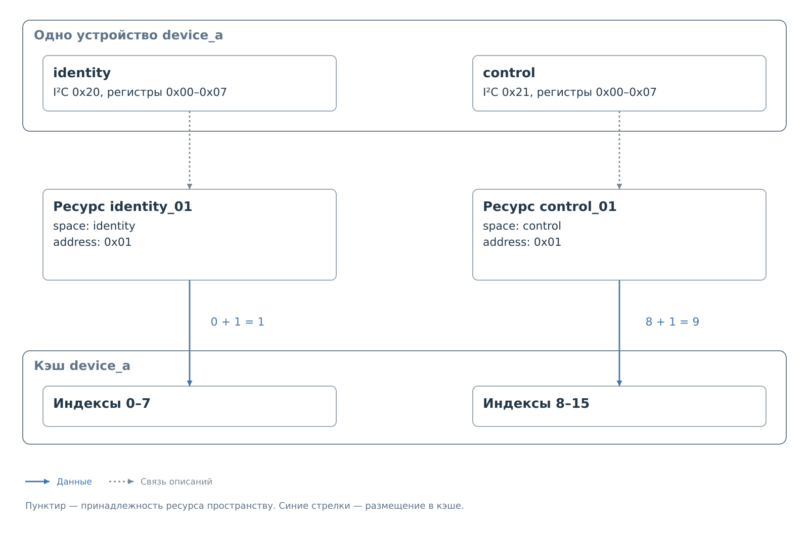

# Два адреса одного устройства

Это другой вариант `device_a`. Устройство имеет два пространства
по восемь регистров: `identity` по адресу `0x20` и `control` по адресу
`0x21`. Они входят в один профиль `config/i2c/device_a/device_a.json`.
Набор `identity` доступен только для чтения.

Общая память кэша содержит 16 записей. Восемь первых принадлежат
`identity`, следующие восемь — `control`. Само устройство получает
локальный адрес регистра, а не индекс в этом общем кэше.

## Полный профиль

```json
{
  "schema_version": 2,
  "id": "device_a",
  "device": {
    "model": "Generic two-address device",
    "class": "generic",
    "label": "device_a"
  },
  "transport": {
    "bus": "i2c",
    "controller": "pl_i2c_0",
    "address_spaces": [
      {"id": "identity", "address": "0x20", "register_count": 8},
      {"id": "control", "address": "0x21", "register_count": 8}
    ]
  },
  "protocol": {
    "driver": "bvstk_i2c_bridge",
    "options": {
      "max_write_value": "0xFF"
    },
    "transfer": {
      "address_bytes": 1,
      "address_order": "big",
      "address_base": "0x0000",
      "read_restart": true,
      "read_sequence": {
        "mode": "wrap"
      },
      "write_sequence": {
        "mode": "linear"
      },
      "write_cycle_ms": 0,
      "verify_write": "none",
      "cache_after_write": "value",
      "host_read": "cache",
      "host_current_read": false
    }
  },
  "defaults": {
    "register": {
      "width_bits": 8,
      "access": "rw",
      "write_mask": "0xFF",
      "cache": {
        "mode": "driver"
      },
      "verify": {
        "mode": "driver"
      }
    }
  },
  "resources": [
    {"id": "identity_00", "kind": "register", "address": "0x00", "space": "identity", "access": "ro"},
    {"id": "identity_01", "kind": "register", "address": "0x01", "space": "identity", "access": "ro"},
    {"id": "identity_02", "kind": "register", "address": "0x02", "space": "identity", "access": "ro"},
    {"id": "identity_03", "kind": "register", "address": "0x03", "space": "identity", "access": "ro"},
    {"id": "identity_04", "kind": "register", "address": "0x04", "space": "identity", "access": "ro"},
    {"id": "identity_05", "kind": "register", "address": "0x05", "space": "identity", "access": "ro"},
    {"id": "identity_06", "kind": "register", "address": "0x06", "space": "identity", "access": "ro"},
    {"id": "identity_07", "kind": "register", "address": "0x07", "space": "identity", "access": "ro"},
    {"id": "control_00", "kind": "register", "address": "0x00", "space": "control"},
    {"id": "control_01", "kind": "register", "address": "0x01", "space": "control", "access": "ro"},
    {"id": "control_02", "kind": "register", "address": "0x02", "space": "control"},
    {"id": "control_03", "kind": "register", "address": "0x03", "space": "control"},
    {"id": "control_04", "kind": "register", "address": "0x04", "space": "control"},
    {"id": "control_05", "kind": "register", "address": "0x05", "space": "control"},
    {"id": "control_06", "kind": "register", "address": "0x06", "space": "control"},
    {"id": "control_07", "kind": "register", "address": "0x07", "space": "control"}
  ],
  "policy": {
    "read": {
      "mode": "blacklist",
      "rules": []
    },
    "write": {
      "mode": "whitelist",
      "rules": [
        {
          "resource": "control_03",
          "match": {
            "value": "0x10",
            "mask": "0xFF"
          }
        }
      ],
      "inactive_rules": []
    }
  },
  "settings": {
    "cache_seed": [
      {"resource": "control_03", "value": "0x00"}
    ]
  }
}
```

## Выбор регистра

В командной консоли FreeRTOS запрос
`i2c device_a r control:0x01` выбирает адрес устройства `0x21`
и передаёт ему адрес регистра `0x01`.
Результат хранится в кэше по индексу 9:
восемь записей первого пространства плюс локальный адрес 1.

Ресурс `identity_01` имеет такой же локальный адрес, но другое
пространство. Его физический адрес устройства — `0x20`,
а индекс кэша — 1. Именно поэтому поле `space` обязательно
у каждого ресурса этого профиля.

Политика разрешает запись `0x10` в `control_03`.
Она не разрешает ту же запись в `identity_03`: это другой ресурс,
к тому же доступный только для чтения. Начальное значение `control_03`
попадает в запись кэша с индексом 11.

Режим политики общий для всего устройства. Изменение режима
затрагивает оба пространства; отдельными остаются правила
для конкретных ресурсов. Общий профиль также задаёт единые
параметры обмена и один маршрут подключения.

Соответствие адресов, ресурсов и кэша показано
в [схеме адресных пространств](../address-spaces.md).

## Размещение в кэше



*Рисунок 1. Локальные адреса и индексы общего кэша.*

Индекс 9 для `control:0x01` нужен PS, но не передаётся на шину.
На I²C выбирается устройство по адресу `0x21`, затем передаётся
локальный префикс `0x01`. API возвращает для `control` вычисленное
`first: 8`; добавлять `first` в профиль нельзя.

## Команды и доступность

В HTTP пространство передаётся отдельным параметром. Операции DCP2
с регистрами используют физический адрес пространства и локальный
регистр. Получение и изменение отдельных правил относятся к выбранному
пространству; смена режима и сохранение политики — ко всему устройству.
Снимок CACHE выбирает устройство по имени и содержит ID ресурсов.

В этом профиле чтение `identity` подтверждает доступность устройства
в целом, поскольку пространство стоит первым. Ошибка обращения
к `control` не отменяет уже полученного подтверждения. Дополнительного
фонового сканирования I²C механизм пространств не запускает.

## Ограничения варианта

Обработчик I²C принимает от одного до восьми пространств с различными
семибитными адресами. В каждом положительное число регистров,
в сумме — не более 256. У всех ресурсов разрядность 8 бит.
Нужен явный `transfer` с `address_bytes`, равным 1 или 2;
`protocol.switch` в том же профиле запрещён.

Маршрут и параметры передачи общие для всех пространств.
Чтение соседних байтов не образует неделимый снимок: если из них
составляется одно измерение, оно могло измениться между операциями.

Далее: [общая глава об адресных пространствах](../address-spaces.md).
