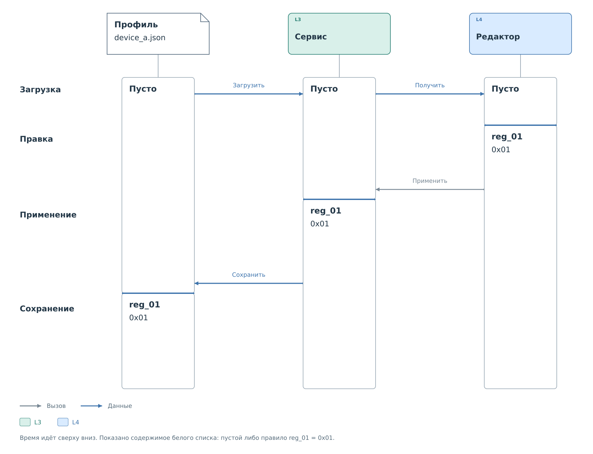

# Применение и сохранение правила

Устройство `device_a` загружено из профиля. Его белый список пуст,
поэтому записи запрещены. Пользователь хочет разрешить пару из
[предыдущего примера](profile-and-policy.md): `reg_01`, значение `0x01`.
Разберём изменение через редактор с отдельными действиями применения
и сохранения.

*Рисунок 1. Содержимое белого списка в трёх местах по ходу редактирования.*

## Изменение рабочего состояния

Сначала редактор получает текущую конфигурацию. Пользователь добавляет
правило в черновик и отправляет его на применение. До завершения этого
действия сервис продолжает использовать пустой белый список.

После успешного применения отдельный запрос записи `0x01` в `reg_01`
проходит проверку политики. Файл на носителе пока содержит прежние правила.

Запрос сохранения относится к рабочим настройкам. Если после применения
их изменил другой клиент, сохраняться будет уже текущее состояние.
Поэтому перед сохранением нужно прочитать его заново. HTTP дополнительно
проверяет ревизию; конкретные запросы приведены в
[примере редактирования через HTTP](../../interfaces/http/examples/device-settings.md).

При успешном сохранении правило оказывается в
`policy.write.rules` файла `device_a.json`. После перезапуска кодек
снова разрешит его ссылку `resource` в адрес регистра, и сервис создаст
тот же белый список. Поля состояния HTTP, такие как `revision` и `saved`,
в файл при этом не записываются.

## Ошибка записи файла

Пусть применение прошло успешно, но сохранить файл не удалось.
Сервис продолжает разрешать выбранную запись. После перезапуска
загрузится прежний пустой список, и та же запись снова будет запрещена.

Исправление ошибки носителя и успешное сохранение устраняют это расхождение.
Повторное применение того же черновика для записи файла не требуется.
Порядок замены файла и различия ОС описаны
в [сохранении конфигурации](../lifecycle.md#сохранение-и-ошибки).

Если вместо редактора изменить только JSON на носителе, порядок обратный:
новое правило уже находится в файле, а сервис продолжает использовать
старое состояние до повторной загрузки. Это следует учитывать при
сопоставлении файла и результата проверки записи.
