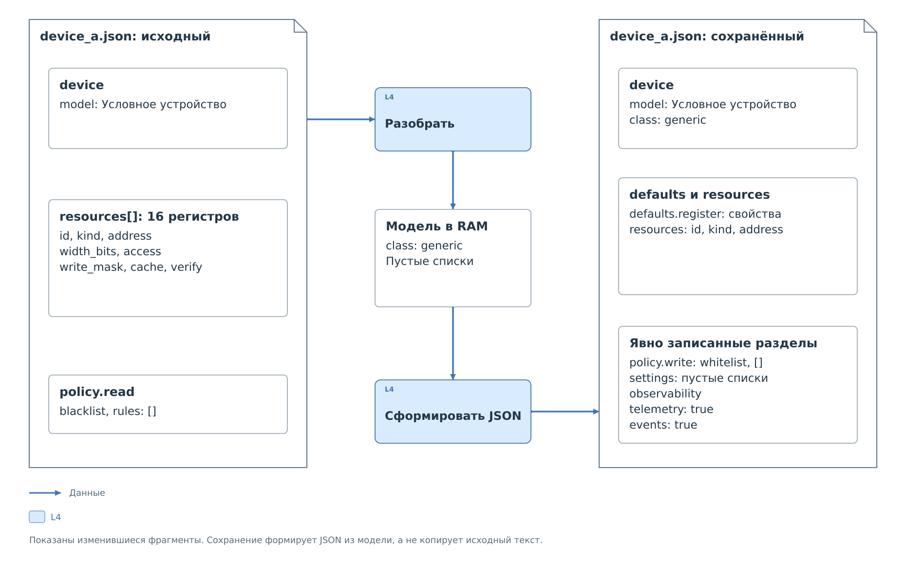

# Значения по умолчанию и сохранение

Возьмём [минимальный профиль `device_a`](full-profiles.md#минимальный-профиль).
В нём нет `device.class`, `policy.write`, `settings` и `observability`,
а одинаковые свойства записаны у каждого ресурса. Рассмотрим загрузку
и повторное формирование JSON без изменения настроек и без захвата
рабочего кэша.



*Рисунок 1. Изменение формы записи профиля после загрузки и сохранения.*

## Разбор исходного файла

Кодек получает 16 регистров с полностью указанными свойствами доступа.
Отсутствие `defaults.register` допустимо: все необходимые сведения
есть непосредственно в элементах `resources`.

Неуказанный класс становится `generic`. Отсутствующая политика записи
превращается в пустой белый список, а списки настроек остаются пустыми.
Сам файл на этом этапе не меняется. Полученные значения существуют
в модели конфигурации, с которой работает сервис.

## Полный файл после сохранения

Сохранение строит документ по этой модели. Ниже показано всё содержимое
профиля с дополнительными переносами строк для чтения:

```json
{
  "schema_version": 2,
  "id": "device_a",
  "device": {
    "model": "Условное устройство",
    "class": "generic"
  },
  "transport": {
    "bus": "i2c",
    "controller": "pl_i2c_0",
    "address": "0x20",
    "address_bits": 7
  },
  "protocol": {
    "driver": "bvstk_i2c_bridge",
    "options": {
      "max_write_value": "0x40",
      "capture_cache_on_save": true
    }
  },
  "defaults": {
    "register": {
      "width_bits": 8,
      "access": "rw",
      "write_mask": "0xFF",
      "cache": {"mode": "driver"},
      "verify": {"mode": "driver"}
    }
  },
  "resources": [
    {"id": "reg_00", "kind": "register", "address": "0x00"},
    {"id": "reg_01", "kind": "register", "address": "0x01"},
    {"id": "reg_02", "kind": "register", "address": "0x02"},
    {"id": "reg_03", "kind": "register", "address": "0x03"},
    {"id": "reg_04", "kind": "register", "address": "0x04"},
    {"id": "reg_05", "kind": "register", "address": "0x05"},
    {"id": "reg_06", "kind": "register", "address": "0x06"},
    {"id": "reg_07", "kind": "register", "address": "0x07"},
    {"id": "reg_08", "kind": "register", "address": "0x08"},
    {"id": "reg_09", "kind": "register", "address": "0x09"},
    {"id": "reg_0a", "kind": "register", "address": "0x0A"},
    {"id": "reg_0b", "kind": "register", "address": "0x0B"},
    {"id": "reg_0c", "kind": "register", "address": "0x0C"},
    {"id": "reg_0d", "kind": "register", "address": "0x0D"},
    {"id": "reg_0e", "kind": "register", "address": "0x0E"},
    {"id": "reg_0f", "kind": "register", "address": "0x0F"}
  ],
  "policy": {
    "read": {"mode": "blacklist", "rules": []},
    "write": {
      "mode": "whitelist",
      "rules": [],
      "inactive_rules": []
    }
  },
  "settings": {
    "desired": [],
    "cache_seed": [],
    "apply_on_startup": false
  },
  "observability": {
    "telemetry": true,
    "events": true
  }
}
```

Появившиеся `class`, `address_bits` и `capture_cache_on_save` явно
фиксируют поведение, уже принятое кодеком. Запрет записи записан как
пустой белый список. Разделы `settings` и `observability` сформированы
в принятом кодеком виде. Все 16 регистров остались теми же; общие свойства
теперь вынесены в `defaults.register`.

Добавление этих полей само по себе не разрешает запись, не создаёт
начальных значений и не выполняет обмен. После повторного разбора
получается та же конфигурация. Изменился способ её записи в JSON.

`register_map` и `view` не появились: в исходном профиле не было ссылок
на дополнительные файлы. `vendor` и `label` также не создаются
автоматически. Допустимые значения по умолчанию определены для конкретных
полей; произвольный пропуск обязательного раздела кодек не восполняет.

## Сохранение после работы устройства

В этом примере модель не менялась. В работающей системе к моменту
сохранения в ней уже могут быть новые правила и начальные значения.
Некоторые операции сохранения предварительно переносят действительные
значения рабочего кэша в модель. Тогда изменится и `cache_seed`;
это отдельный этап подготовки, предшествующий формированию JSON.
Его зависимость от интерфейса описана
в [порядке сохранения](../lifecycle.md#сохранение-и-ошибки).

Данные наблюдения — `valid`, `source`, `updated_ms` — в элементы
`cache_seed` не переносятся. В сохранённой паре остаются ресурс и число.
При следующей загрузке это число снова считается начальным значением
из настроек, а не свежим результатом чтения физического устройства.
