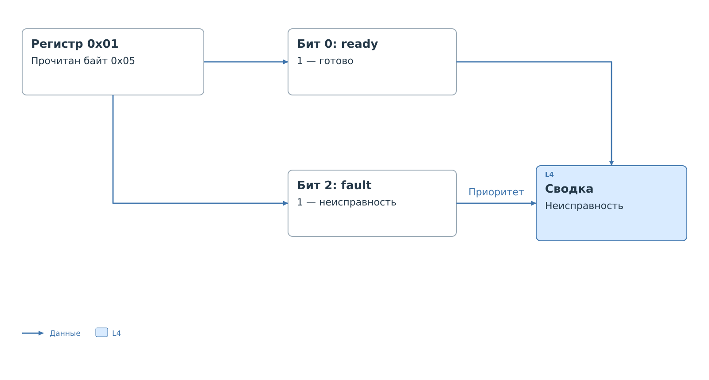

# Карта регистров и форма

Возьмём [прямой профиль `device_a`](direct-device.md).
Добавим в его корневой объект ссылки:

```json
"register_map": "register_map.json",
"view": "view.js"
```

Эти строки — дополнение к полному JSON, а не самостоятельный документ.
Оба файла лежат рядом с `device_a.json`. Если собственная форма
не нужна, поле `view` и файл `view.js` можно не добавлять.
Тогда интерфейс покажет стандартную сводку по карте.

## Расшифровка состояния

В этом примере регистр `0x01` содержит два признака:
бит 0 означает готовность, бит 2 — неисправность.
Остальные биты зарезервированы. В сводке неисправность
имеет приоритет перед готовностью.



*Рисунок 1. Расшифровка состояния и выбор сообщения.*

Из байта `0x05` декодер получает `ready = 1` и `fault = 1`.
В массиве `summary.cases` сначала проверяется неисправность.
Это условие совпадает, и сводка показывает «Неисправность».
Наличие признака готовности не меняет выбранное сообщение.

Если прочитан `0x01`, неисправность не обнаружена, и проверка
доходит до условия готовности. При `0x00` совпадает последний вариант
«Не готово». Если значение вообще не прочитано или получено только
из `cache_seed`, интерфейс не выдаёт его за состояние устройства.

## Полная карта

Карта описывает все 16 регистров и все биты каждого регистра.
У регистра состояния отдельные поля, у остальных — одно поле
на весь байт. В профиле ресурс называется `reg_01`, в карте —
`status`; связь определяется адресом `0x01`.

Объект `source` обязателен по формату карты. Здесь он содержит
учебные сведения и адрес `example.invalid`, который не ведёт
к документации устройства. В рабочей карте указывают источник
описания регистров.

Файл `register_map.json`:

```json
{
  "schema_version": 1,
  "kind": "register_map",
  "id": "device_a_map",
  "device": "Generic 16-register device",
  "bus": "i2c",
  "width_bits": 8,
  "register_count": 16,
  "source": {
    "title": "Учебная модель",
    "document": "device_a",
    "revision": "1",
    "url": "https://example.invalid/device-a"
  },
  "notes": "Условное устройство. Не описывает реальную микросхему.",
  "registers": [
    {"id": "reg_00", "address": 0, "name": "REG_00", "label": "Регистр 0x00", "section": "Регистр 0",
      "fields": [{"id": "value", "label": "Значение", "lsb": 0, "width": 8, "type": "hex", "access": "rw", "reset": "Не задано в учебной модели"}]},
    {
      "id": "status",
      "address": 1,
      "name": "STATUS",
      "label": "Состояние",
      "section": "Регистр 1",
      "fields": [
        {
          "id": "ready",
          "label": "Готовность",
          "lsb": 0,
          "width": 1,
          "type": "enum",
          "access": "ro",
          "reset": "Не задано в учебной модели",
          "values": {
            "0": {
              "label": "Не готово"
            },
            "1": {
              "label": "Готово",
              "tone": "ok"
            }
          }
        },
        {
          "id": "reserved_1",
          "label": "Резерв",
          "lsb": 1,
          "width": 1,
          "type": "reserved",
          "access": "none",
          "reset": "Не задано в учебной модели"
        },
        {
          "id": "fault",
          "label": "Неисправность",
          "lsb": 2,
          "width": 1,
          "type": "enum",
          "access": "ro",
          "reset": "Не задано в учебной модели",
          "values": {
            "0": {
              "label": "Нет"
            },
            "1": {
              "label": "Есть",
              "tone": "bad"
            }
          }
        },
        {
          "id": "reserved_3_7",
          "label": "Резерв",
          "lsb": 3,
          "width": 5,
          "type": "reserved",
          "access": "none",
          "reset": "Не задано в учебной модели"
        }
      ]
    },
    {"id": "reg_02", "address": 2, "name": "REG_02", "label": "Регистр 0x02", "section": "Регистр 2",
      "fields": [{"id": "value", "label": "Значение", "lsb": 0, "width": 8, "type": "hex", "access": "rw", "reset": "Не задано в учебной модели"}]},
    {"id": "reg_03", "address": 3, "name": "REG_03", "label": "Регистр 0x03", "section": "Регистр 3",
      "fields": [{"id": "value", "label": "Значение", "lsb": 0, "width": 8, "type": "hex", "access": "rw", "reset": "Не задано в учебной модели"}]},
    {"id": "reg_04", "address": 4, "name": "REG_04", "label": "Регистр 0x04", "section": "Регистр 4",
      "fields": [{"id": "value", "label": "Значение", "lsb": 0, "width": 8, "type": "hex", "access": "rw", "reset": "Не задано в учебной модели"}]},
    {"id": "reg_05", "address": 5, "name": "REG_05", "label": "Регистр 0x05", "section": "Регистр 5",
      "fields": [{"id": "value", "label": "Значение", "lsb": 0, "width": 8, "type": "hex", "access": "rw", "reset": "Не задано в учебной модели"}]},
    {"id": "reg_06", "address": 6, "name": "REG_06", "label": "Регистр 0x06", "section": "Регистр 6",
      "fields": [{"id": "value", "label": "Значение", "lsb": 0, "width": 8, "type": "hex", "access": "rw", "reset": "Не задано в учебной модели"}]},
    {"id": "reg_07", "address": 7, "name": "REG_07", "label": "Регистр 0x07", "section": "Регистр 7",
      "fields": [{"id": "value", "label": "Значение", "lsb": 0, "width": 8, "type": "hex", "access": "rw", "reset": "Не задано в учебной модели"}]},
    {"id": "reg_08", "address": 8, "name": "REG_08", "label": "Регистр 0x08", "section": "Регистр 8",
      "fields": [{"id": "value", "label": "Значение", "lsb": 0, "width": 8, "type": "hex", "access": "rw", "reset": "Не задано в учебной модели"}]},
    {"id": "reg_09", "address": 9, "name": "REG_09", "label": "Регистр 0x09", "section": "Регистр 9",
      "fields": [{"id": "value", "label": "Значение", "lsb": 0, "width": 8, "type": "hex", "access": "rw", "reset": "Не задано в учебной модели"}]},
    {"id": "reg_0a", "address": 10, "name": "REG_0A", "label": "Регистр 0x0A", "section": "Регистр 10",
      "fields": [{"id": "value", "label": "Значение", "lsb": 0, "width": 8, "type": "hex", "access": "rw", "reset": "Не задано в учебной модели"}]},
    {"id": "reg_0b", "address": 11, "name": "REG_0B", "label": "Регистр 0x0B", "section": "Регистр 11",
      "fields": [{"id": "value", "label": "Значение", "lsb": 0, "width": 8, "type": "hex", "access": "rw", "reset": "Не задано в учебной модели"}]},
    {"id": "reg_0c", "address": 12, "name": "REG_0C", "label": "Регистр 0x0C", "section": "Регистр 12",
      "fields": [{"id": "value", "label": "Значение", "lsb": 0, "width": 8, "type": "hex", "access": "rw", "reset": "Не задано в учебной модели"}]},
    {"id": "reg_0d", "address": 13, "name": "REG_0D", "label": "Регистр 0x0D", "section": "Регистр 13",
      "fields": [{"id": "value", "label": "Значение", "lsb": 0, "width": 8, "type": "hex", "access": "rw", "reset": "Не задано в учебной модели"}]},
    {"id": "reg_0e", "address": 14, "name": "REG_0E", "label": "Регистр 0x0E", "section": "Регистр 14",
      "fields": [{"id": "value", "label": "Значение", "lsb": 0, "width": 8, "type": "hex", "access": "rw", "reset": "Не задано в учебной модели"}]},
    {"id": "reg_0f", "address": 15, "name": "REG_0F", "label": "Регистр 0x0F", "section": "Регистр 15",
      "fields": [{"id": "value", "label": "Значение", "lsb": 0, "width": 8, "type": "hex", "access": "rw", "reset": "Не задано в учебной модели"}]}
  ],
  "summary": [
    {
      "id": "state",
      "label": "Состояние",
      "cases": [
        {
          "when": [
            {
              "field": "status.fault",
              "equals": 1
            }
          ],
          "label": "Неисправность",
          "tone": "bad"
        },
        {
          "when": [
            {
              "field": "status.ready",
              "equals": 1
            }
          ],
          "label": "Готово",
          "tone": "ok"
        },
        {
          "when": [
            {
              "field": "status.ready",
              "equals": 0
            }
          ],
          "label": "Не готово",
          "tone": "offline"
        }
      ]
    }
  ]
}
```

## Форма

Форма получает уже расшифрованную сводку. Она не извлекает биты
повторно и не читает устройство. В этом минимальном варианте
меняется только способ показа результата.

Файл `view.js`:

```javascript
(() => {
  let value;
  let connection;

  window.bvstkView = {
    apiVersion: 1,

    mount(root) {
      const title = document.createElement("h2");
      title.textContent = "Состояние устройства";
      value = document.createElement("p");
      connection = document.createElement("p");
      root.append(title, value, connection);
    },

    update(snapshot) {
      const state = snapshot.summary.find(item => item.id === "state");
      value.textContent = state ? state.label : "Нет данных";
      connection.textContent = snapshot.stale
        ? "Связь с BVSTK потеряна. Показан последний снимок."
        : "";
    }
  };
})();
```

При очередном снимке вызывается `update`. При потере связи форма
сохраняет последнее сообщение и явно помечает его как старое.
Повторное создание элементов при каждом обновлении не требуется.

Каждая ветка JSON разобрана в [описании карты](../register-map.md).
Состав снимка для скрипта приведён в [API формы](../reference/view-api-v1.md).

Далее: [описание жизненного цикла пакета](../lifecycle.md).
