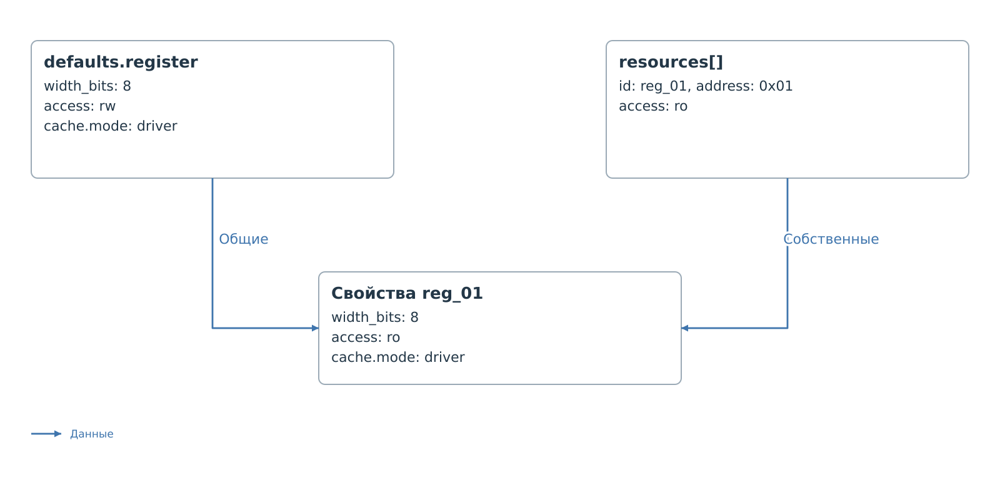
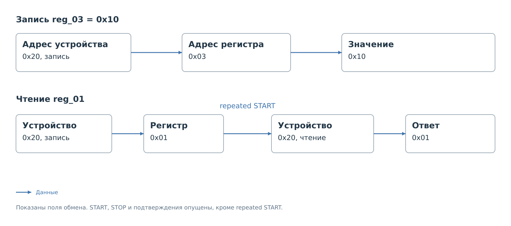

# Прямое подключение

Условное устройство `device_a` подключено непосредственно к I²C
по адресу `0x20`. У него 16 байтовых регистров. Регистр `0x01` доступен
только для чтения, остальные допускают запись при разрешении политики.
Перед чтением или записью передаётся один байт адреса регистра.

Пакет содержит один файл:
`config/i2c/device_a/device_a.json`.
Карта и собственная форма для обмена не требуются. Их добавление
разобрано [отдельно](device-display.md).

## Полный профиль

```json
{
  "schema_version": 2,
  "id": "device_a",
  "device": {
    "model": "Generic 16-register device",
    "class": "generic",
    "label": "device_a"
  },
  "transport": {
    "bus": "i2c",
    "controller": "pl_i2c_0",
    "address": "0x20"
  },
  "protocol": {
    "driver": "bvstk_i2c_bridge",
    "options": {
      "max_write_value": "0xFF"
    },
    "transfer": {
      "address_bytes": 1,
      "address_order": "big",
      "address_base": "0x0000",
      "read_restart": true,
      "read_sequence": {
        "mode": "wrap"
      },
      "write_sequence": {
        "mode": "linear"
      },
      "write_cycle_ms": 0,
      "verify_write": "none",
      "cache_after_write": "value",
      "host_read": "cache",
      "host_current_read": false
    }
  },
  "defaults": {
    "register": {
      "width_bits": 8,
      "access": "rw",
      "write_mask": "0xFF",
      "cache": {
        "mode": "driver"
      },
      "verify": {
        "mode": "driver"
      }
    }
  },
  "resources": [
    {"id": "reg_00", "kind": "register", "address": "0x00"},
    {"id": "reg_01", "kind": "register", "address": "0x01", "access": "ro"},
    {"id": "reg_02", "kind": "register", "address": "0x02"},
    {"id": "reg_03", "kind": "register", "address": "0x03"},
    {"id": "reg_04", "kind": "register", "address": "0x04"},
    {"id": "reg_05", "kind": "register", "address": "0x05"},
    {"id": "reg_06", "kind": "register", "address": "0x06"},
    {"id": "reg_07", "kind": "register", "address": "0x07"},
    {"id": "reg_08", "kind": "register", "address": "0x08"},
    {"id": "reg_09", "kind": "register", "address": "0x09"},
    {"id": "reg_0a", "kind": "register", "address": "0x0A"},
    {"id": "reg_0b", "kind": "register", "address": "0x0B"},
    {"id": "reg_0c", "kind": "register", "address": "0x0C"},
    {"id": "reg_0d", "kind": "register", "address": "0x0D"},
    {"id": "reg_0e", "kind": "register", "address": "0x0E"},
    {"id": "reg_0f", "kind": "register", "address": "0x0F"}
  ],
  "policy": {
    "read": {
      "mode": "blacklist",
      "rules": []
    },
    "write": {
      "mode": "whitelist",
      "rules": [
        {
          "resource": "reg_03",
          "match": {
            "value": "0x10",
            "mask": "0xFF"
          }
        },
        {
          "resource": "reg_03",
          "match": {
            "value": "0x20",
            "mask": "0xFF"
          }
        },
        {
          "resource": "reg_07",
          "match": {
            "value": "0x04",
            "mask": "0xFF"
          }
        }
      ],
      "inactive_rules": []
    }
  },
  "settings": {
    "cache_seed": [
      {"resource": "reg_03", "value": "0x00"}
    ]
  }
}
```

## Результат применения

После загрузки сервис знает адрес устройства и все 16 ресурсов.
Проверка JSON не доказывает, что устройство подключено: первый
физический обмен ещё должен завершиться успешно.

Запись `0x10` в регистр `0x03` разрешена. Сервис передаст префикс
`0x03` и байт `0x10`. После успешного обмена кэш этого регистра
содержит переданное значение с источником записи. В профиле
`verify_write` равен `none`, поэтому обратного чтения для проверки нет.

Запись `0x11` в тот же регистр отклоняется: в белом списке такого
значения нет. Запись в `0x01` также отклоняется, даже если добавить
для неё правило, поскольку у ресурса указан доступ `ro`.

Начальное значение `reg_03 = 0x00` заполняет кэш при загрузке.
Оно не отправляется устройству. Здесь явно задан `transfer`,
поэтому это значение не считается готовым ответом внешнему ведущему.
Первое чтение должно получить данные от устройства. После этого
`host_read: "cache"` позволяет отвечать из достоверного кэша.

Подробная последовательность показана в
[главе работы по профилю](../exchange.md).

## Подключение и ограничения записи

В этой реализации сочетаются `bus: "i2c"`, `controller: "pl_i2c_0"`
и `driver: "bvstk_i2c_bridge"`. Адрес `0x20` — семибитный адрес
устройства, без бита чтения или записи. Допустимый диапазон —
от `0x00` до `0x7F`. Необязательное `address_bits` принимает только `7`.

Объект `options` здесь обязателен из-за `max_write_value`.
Он задаёт предел от `0x00` до `0xFF`. Указанное в файле `0xFF`
позволяет политике работать со всем байтовым диапазоном; уменьшение
предела дополнительно ограничит и записываемые значения, и значения
правил. Поля `autopoll_*` для этого обработчика запрещены.

В каждом правиле I²C обязателен `match` с маской `0xFF`:
сравнивается весь байт. Поэтому правило для `reg_03` со значением
`0x10` не допускает `0x11`. Вариант сравнения отдельных битов
показан в [примере другого обработчика](mdio-device.md).

## Общие и собственные свойства

У всех ресурсов этого профиля разрядность 8 бит, маска записи `0xFF`,
а кэш и проверка управляются драйвером. Эти свойства находятся
в `defaults.register`. Только `reg_01` переопределяет `access`:
вместо общего `rw` он получает `ro`.



*Рисунок 1. Получение свойств регистра `reg_01`.*

Для I²C допустимы `rw` и `ro`, а частичная `write_mask` не поддерживается.
Маска правила политики также полная, но выполняет другую задачу:
определяет совпадение значения, а не состав записываемых битов.

## Передача на шине

`address_bytes: 1` и нулевая база превращают локальный номер регистра
в один байт префикса. Для записи за ним следует значение.
Для чтения после префикса выполняется повторный START, поскольку
`read_restart` равен `true`.



*Рисунок 2. Передача адреса регистра и значения.*

Если поставить `read_restart: false`, после префикса будет STOP,
а чтение начнётся отдельным START. Если устройство требует базу
`0x0100`, локальный регистр `0x03` превращается в префикс `0x0103`:
понадобятся `address_bytes: 2` и подходящий порядок `address_order`.
В префикс должен помещаться весь диапазон регистров.

Внешний ведущий обращается к ядру PL slave. Его последовательное чтение
в этом профиле использует `wrap` по всему пространству: после `0x0F`
указатель возвращается к `0x00`. При `span: 8` он возвращался бы
после `0x07` к `0x00` в первой группе. Последовательность записи
`linear` не выполняет такого возврата.

Эти правила управляют указателем внешнего ведущего. Физический обмен
с оконечным устройством выполняется отдельными байтовыми операциями,
поэтому профиль не обеспечивает неделимость многобайтового значения.
Обработка аппаратных событий описана в
[главе сервисов I²C](../../system/pl-subsystem/i2c/services/services.md).

## Совместимость и границы обработчика

Явный `transfer` используется в этом примере намеренно. При его отсутствии
выбирается прежний путь обслуживания I²C, в том числе другой порядок
использования начальных значений ведомым кэшем. Удаление объекта
не равнозначно заполнению его полей значениями по умолчанию.

Обработчик допускает от 1 до 256 ресурсов с локальными адресами
от `0x00` до `0xFF`. В активном и неактивном списке политики может быть
до 256 правил, в `cache_seed` — до 256 различных ресурсов.
Начальное значение помещается в байт и не обязано удовлетворять
`max_write_value`: загрузка кэша не выполняет запись устройства.

Подключение через `parent` и `channel`, `protocol.switch` и
`transport.address_spaces` относятся к этому обработчику.
Их полные варианты находятся в примерах [маршрута](routed-devices.md)
и [пространств](address-spaces.md). Загрузка профилей обеих целей сборки
описана в [примере запуска](loading.md).

Далее: [работа устройства по загруженному профилю](../exchange.md).
