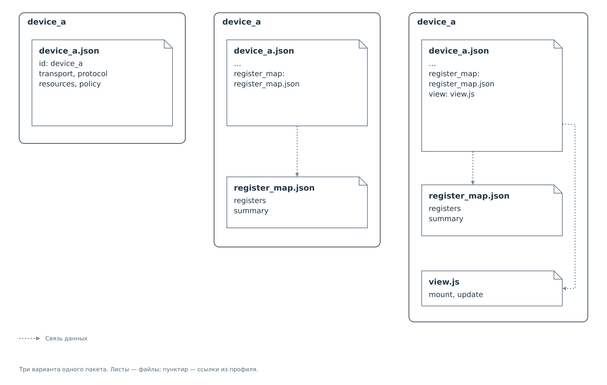

# Сборка пакета устройства

Начнём с одного устройства `device_a`. Сначала нужен только обмен
через сервис. Позднее требуется показывать смысл прочитанных регистров,
а затем — разместить показатели в собственной форме. На каждом шаге
меняется состав одного и того же пакета.



*Рисунок 1. Последовательное добавление файлов и ссылок в пакет `device_a`.*

## Профиль

Создаём каталог `config/<подсистема>/device_a` и помещаем в него
`device_a.json`. Полный исходный документ приведён
в [минимальном профиле](full-profiles.md#минимальный-профиль).
Он задаёт подключение, ресурсы и политику. Дополнительных файлов
для загрузки сервиса не требуется.

Имя каталога и имя основного JSON образуют путь, по которому загрузчик
найдёт пакет. Поле `id` внутри профиля задаёт имя устройства в конфигурации.
В примере везде выбрано `device_a`; аппаратный адрес всё равно указывается
отдельно в `transport.address`.

## Карта регистров

Готовим `register_map.json` и кладём рядом с профилем. В карту записываем
описания регистров и их битовых полей. Профиль дополняем полем верхнего
уровня:

```json
{
  "register_map": "register_map.json"
}
```

Это добавляемый фрагмент `device_a.json`, а не замена его содержимого.
После повторной загрузки профиля ссылка становится доступна интерфейсу.
Браузер запрашивает файл из того же пакета, проверяет карту
и расшифровывает снимок кэша. Подробный пример её связей находится
в [расшифровке регистров](register-decoding.md).

Если только скопировать карту в каталог, профиль продолжит работать
без неё: имя дополнительного файла не определяется поиском по папке.
Обратный случай тоже возможен — ссылка уже указана, но файл ещё
не установлен. Кодек принимает допустимое имя, однако позднее браузер
не сможет загрузить карту. Проверка профиля и проверка карты происходят
в разных частях системы.

## Индивидуальная форма

При необходимости добавляем `view.js` в тот же каталог. Профиль теперь
содержит обе ссылки:

```json
{
  "register_map": "register_map.json",
  "view": "view.js"
}
```

Форма получает уже расшифрованные данные карты, поэтому `view`
допустим только вместе с `register_map`. Кодек отклонит профиль,
если указать одну форму. Минимальный скрипт и порядок его вызовов
приведены в [главе формы](../view-api.md).

У формы нет собственной политики доступа. Она размещает показатели,
а разрешение обмена по-прежнему задаётся в `device_a.json`.
Без `view` интерфейс показывает стандартную сводку карты.

## Итоговое размещение

Все три файла находятся непосредственно в `device_a`:

```text
config/
└── <подсистема>/
    └── device_a/
        ├── device_a.json
        ├── register_map.json
        └── view.js
```

В ссылках профиля остаются только имена файлов. Указывать `config`,
имя устройства или абсолютный путь в `register_map` и `view` не нужно.
На другой ОС меняется начало пути к хранилищу, а внутренние ссылки
пакета остаются прежними. Полные пути описаны
в [размещении файлов](../configuration.md#размещение-и-связи-файлов).

Полный профиль с этими ссылками приведён
в [расширенном варианте](full-profiles.md#профиль-с-политикой-начальным-кэшем-и-отображением).
Копирование файлов на плату описано в [главе о файлах](../../files.md).
