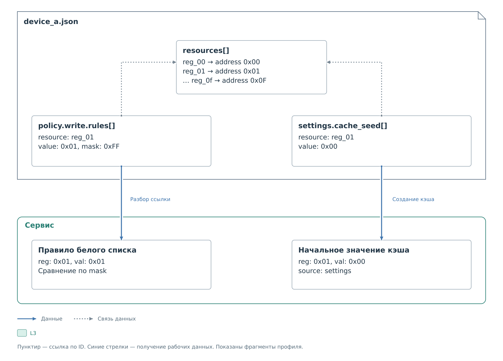

# Ресурс и правило политики

Условное устройство `device_a` имеет 16 регистров. В этом разборе
оставим одно правило: разрешим запись значения `0x01` в `reg_01`,
а остальные записи запретим. Предполагается, что адреса и значения
допустимы для выбранного обработчика. Здесь показаны части профиля; параметры подключения,
общие свойства ресурсов и прочие обязательные поля задаются отдельно
по [справочнику](../reference/device-profile-v2.md).

В [полном расширенном профиле](full-profiles.md#профиль-с-политикой-начальным-кэшем-и-отображением)
это правило входит в список вместе с другими разрешёнными записями.
Здесь проследим две ссылки на один ресурс:



*Рисунок 1. Ресурс профиля, правило допуска и начальное значение кэша.*

## Ссылка на регистр

Ниже показаны первые два элемента `resources`; полный массив
продолжается до `reg_0f` с адресом `0x0F`.

```json
{
  "resources": [
    {"id": "reg_00", "kind": "register", "address": "0x00"},
    {"id": "reg_01", "kind": "register", "address": "0x01"}
  ]
}
```

Кодек запоминает, что `reg_01` обозначает физический адрес `0x01`.
Правило ниже использует именно ID ресурса. Если назвать его иначе,
ссылку в правиле также потребуется изменить.

Связь действует внутри `device_a.json`. Ресурс с таким же ID
в другом профиле не участвует в разрешении этой ссылки.

## Допуск записи

Следующий объект задаёт содержимое корневого поля `policy` в том же
`device_a.json`. Массив `rules` вложен в `write`; каждый его элемент
содержит ссылку `resource` и условие `match`:

```json
{
  "read": {"mode": "blacklist", "rules": []},
  "write": {
    "mode": "whitelist",
    "rules": [
      {
        "resource": "reg_01",
        "match": {"value": "0x01", "mask": "0xFF"}
      }
    ],
    "inactive_rules": []
  }
}
```

Маска сравнивает младшие восемь битов. Для восьмибитного регистра
это всё значение; у более широкого регистра старшие биты не участвуют
в этом сравнении. Возможность использовать маску проверяет обработчик.

| Операция | Результат проверки политики | Причина |
|---|---|---|
| Запись `0x01` в `reg_01` | Разрешена | Совпали ресурс и значимые биты |
| Запись `0x00` в `reg_01` | Запрещена | Значение не совпало |
| Запись `0x01` в `reg_00` | Запрещена | Для ресурса нет правила |

Разрешение означает, что сервис может продолжить операцию. Её аппаратный
результат определяется последующим обменом. Само добавление правила
никаких регистров не записывает.

## Начальное значение того же ресурса

В корневой объект можно добавить:

```json
{
  "settings": {
    "cache_seed": [{"resource": "reg_01", "value": "0x00"}]
  }
}
```

После загрузки программный кэш получает `0x00` с источником `settings`.
Это не нарушает белый список: начальное заполнение кэша не является
физической записью. Правило будет проверено при отдельной операции записи
через сервис. Получение значения от устройства описано
в [жизненном цикле кэша](../lifecycle.md#начальные-значения-кэша).
