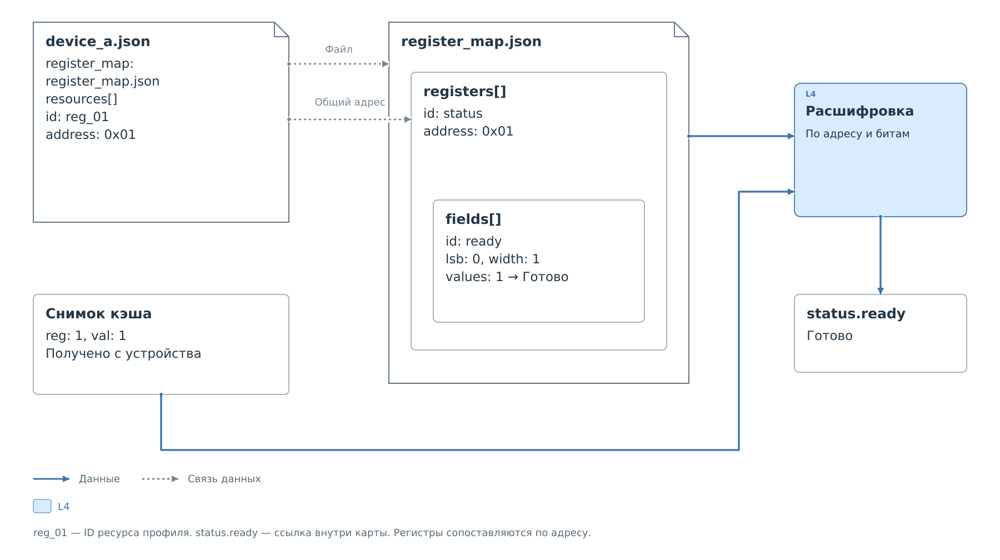

# Расшифровка значений регистров

Рассмотрим условное устройство `device_a`. В его карте есть однобитовые
поля `status.ready` и `diagnostic.fault`. Сначала разберём одно поле, затем
составной показатель. Фрагменты ниже встраиваются в полную карту;
обязательные поля и покрытие всех битов заданы
в [справочнике v1](../reference/register-map-v1.md).

## Связь профиля, карты и кэша

В профиле ресурс назван `reg_01` и имеет адрес `0x01`. Регистр в карте
имеет другой ID — `status`, но тот же адрес. Внутри него описано поле
`ready`. Ссылка `register_map` в профиле выбирает файл карты, числовой
адрес связывает её регистр с записью кэша, а `status.ready` связывает
битовое поле со сводкой.



*Рисунок 1. Три связи: имя файла карты, адрес регистра и ID битового поля.*

Карта заранее содержит положение бита и подписи кодов. После получения
снимка с `reg: 1`, `val: 1` и действительным значением от устройства
браузер создаёт результат `fields["status.ready"]`. В этом результате
появляются код `1`, подпись «Готово», статус достоверности и время
исходного значения. В файл `register_map.json` результат не записывается.

## Готовность

В массиве `fields` регистра `status` по адресу `0x01` находится:

```json
{
  "id": "ready",
  "label": "Готовность",
  "lsb": 0,
  "width": 1,
  "type": "enum",
  "access": "ro",
  "reset": "Не определено",
  "values": {
    "0": {"label": "Не готово"},
    "1": {"label": "Готово"}
  }
}
```

Успешное чтение вернуло `0x01`. Выделение бита 0 даёт код `1`,
которому соответствует подпись «Готово». При значении `0x00` получится
«Не готово». Пока регистр не прочитан, выводится «Нет данных»;
начальное значение из настроек обозначается как «Нет данных от устройства».
Справочное поле `reset` не подставляет недостающий результат чтения.

## Приоритет ошибки

Для второго условия используем регистр `diagnostic` по адресу `0x00`,
с полем `fault` в младшем бите. В корневой массив `summary` карты
добавлен следующий показатель:

```json
{
  "id": "state",
  "label": "Состояние",
  "cases": [
    {
      "when": [{"field": "diagnostic.fault", "equals": 1}],
      "label": "Ошибка",
      "tone": "bad"
    },
    {
      "when": [{"field": "status.ready", "equals": 1}],
      "label": "Готово",
      "tone": "ok"
    },
    {
      "when": [{"field": "status.ready", "equals": 0}],
      "label": "Не готово",
      "tone": "offline"
    }
  ]
}
```

При `fault=1` выбирается первый вариант и выводится «Ошибка».
При `fault=0` проверяется `ready`. Если `fault` ещё неизвестен,
декодер останавливается до проверки готовности.

| `fault` | `ready` | Показатель |
|---|---|---|
| 1 | Любое доступное значение | Ошибка |
| 0 | 1 | Готово |
| 0 | 0 | Не готово |
| Нет данных | 1 | Нет данных |

Если `ready` прочитан позже `fault`, метка составного показателя
остаётся привязана к более старому `fault`. Обновление одного регистра
не подтверждает свежесть всей сводки.

## Числовая шкала

Другое поле содержит пятибитный числовой код. Его диапазоны пересчёта:

```json
{
  "type": "uint",
  "unit": "ед.",
  "ranges": [
    {"min": 0, "max": 15, "scale": 1, "offset": 0},
    {"min": 16, "max": 31, "scale": 2, "offset": -16}
  ]
}
```

Для кода `20` выбирается второй диапазон. Результат равен
`20 × 2 − 16 = 24 ед.` Формула использует исходный код, без вычитания
нижней границы диапазона. Условия `equals` в карте сравнивают код `20`,
даже когда на экране показано `24 ед.`

Общий порядок получения показателей описан
в [главе о карте регистров](../register-map.md).
