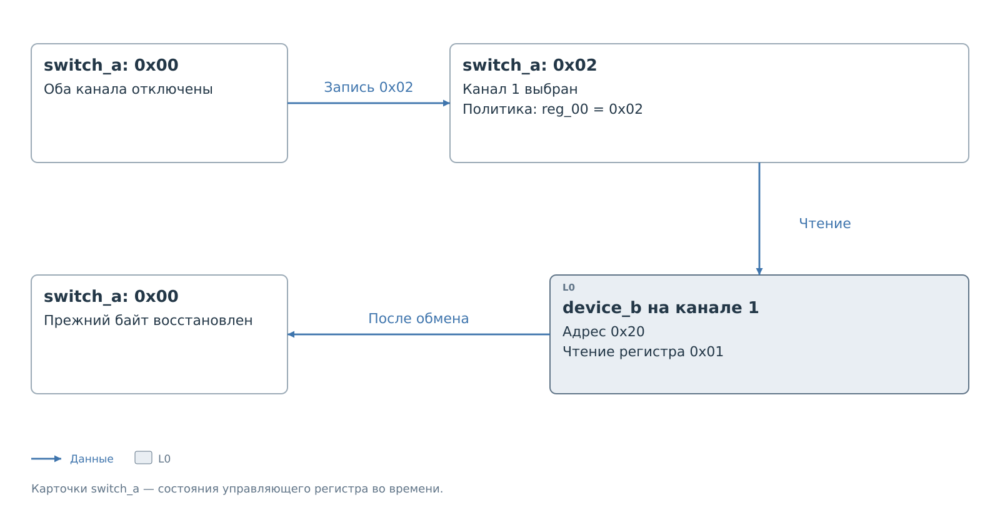

# Два устройства за коммутатором

У `device_a` и `device_b` одинаковый адрес `0x20`.
Они находятся на разных каналах коммутатора `switch_a` по адресу `0x70`.
Коммутатор имеет один управляющий регистр: `0x01` включает канал 0,
`0x02` — канал 1, `0x00` отключает оба. Это условная модель.

Пакеты дочерних устройств лежат внутри пакета коммутатора:

```text
config/i2c/switch_a/
├── switch_a.json
├── device_a/
│   └── device_a.json
└── device_b/
    └── device_b.json
```

Для выбора канала нужна запись в сам коммутатор. Поэтому у него
есть собственная политика. Разрешения конечного устройства
не разрешают эту запись автоматически.

## Профиль коммутатора

Файл `switch_a.json`:

```json
{
  "schema_version": 2,
  "id": "switch_a",
  "device": {
    "model": "Generic two-channel switch",
    "class": "bridge",
    "label": "switch_a"
  },
  "transport": {
    "bus": "i2c",
    "controller": "pl_i2c_0",
    "address": "0x70"
  },
  "protocol": {
    "driver": "bvstk_i2c_bridge",
    "options": {
      "max_write_value": "0x03"
    },
    "transfer": {
      "address_bytes": 0,
      "address_order": "big",
      "address_base": "0x0000",
      "read_restart": true,
      "read_sequence": {
        "mode": "fixed"
      },
      "write_sequence": {
        "mode": "fixed"
      },
      "write_cycle_ms": 0,
      "verify_write": "none",
      "cache_after_write": "invalidate",
      "host_read": "fresh",
      "host_current_read": true
    },
    "switch": {
      "resource": "reg_00",
      "select_mask": "0x03",
      "preserve_mask": "0x00",
      "channels": [
        {"select": "0x01", "match_mask": "0x01"},
        {"select": "0x02", "match_mask": "0x02"}
      ]
    }
  },
  "defaults": {
    "register": {
      "width_bits": 8,
      "access": "rw",
      "write_mask": "0xFF",
      "cache": {
        "mode": "driver"
      },
      "verify": {
        "mode": "driver"
      }
    }
  },
  "resources": [
    {"id": "reg_00", "kind": "register", "address": "0x00"}
  ],
  "policy": {
    "read": {
      "mode": "blacklist",
      "rules": []
    },
    "write": {
      "mode": "whitelist",
      "rules": [
        {
          "resource": "reg_00",
          "match": {
            "value": "0x00",
            "mask": "0xFF"
          }
        },
        {
          "resource": "reg_00",
          "match": {
            "value": "0x01",
            "mask": "0xFF"
          }
        },
        {
          "resource": "reg_00",
          "match": {
            "value": "0x02",
            "mask": "0xFF"
          }
        }
      ],
      "inactive_rules": []
    }
  },
  "settings": {
    "cache_seed": []
  }
}
```

`address_bytes: 0` означает передачу управляющего байта без адресного
префикса. Ресурс всё равно имеет локальный адрес `0x00`:
он нужен для ссылок в политике и `protocol.switch`.

Индекс элемента `channels` задаёт номер канала. Первый элемент
описывает канал 0, второй — канал 1. `select_mask` указывает
изменяемые биты, а `match_mask` — биты, по которым сервис распознаёт
включённый канал.

## Профили оконечных устройств

У каждого устройства собственный набор из 16 ресурсов и собственная
политика. В `device_a` разрешена настройка `reg_03`, в `device_b` —
настройка `reg_07`. Одинаковый адрес на шине не объединяет их правила.

Файл `device_a/device_a.json`:

```json
{
  "schema_version": 2,
  "id": "device_a",
  "device": {
    "model": "Generic 16-register device",
    "class": "generic",
    "label": "device_a"
  },
  "transport": {
    "bus": "i2c",
    "controller": "pl_i2c_0",
    "address": "0x20",
    "parent": "switch_a",
    "channel": 0
  },
  "protocol": {
    "driver": "bvstk_i2c_bridge",
    "options": {
      "max_write_value": "0xFF"
    },
    "transfer": {
      "address_bytes": 1,
      "address_order": "big",
      "address_base": "0x0000",
      "read_restart": true,
      "read_sequence": {
        "mode": "wrap"
      },
      "write_sequence": {
        "mode": "linear"
      },
      "write_cycle_ms": 0,
      "verify_write": "none",
      "cache_after_write": "value",
      "host_read": "cache",
      "host_current_read": false
    }
  },
  "defaults": {
    "register": {
      "width_bits": 8,
      "access": "rw",
      "write_mask": "0xFF",
      "cache": {
        "mode": "driver"
      },
      "verify": {
        "mode": "driver"
      }
    }
  },
  "resources": [
    {"id": "reg_00", "kind": "register", "address": "0x00"},
    {"id": "reg_01", "kind": "register", "address": "0x01", "access": "ro"},
    {"id": "reg_02", "kind": "register", "address": "0x02"},
    {"id": "reg_03", "kind": "register", "address": "0x03"},
    {"id": "reg_04", "kind": "register", "address": "0x04"},
    {"id": "reg_05", "kind": "register", "address": "0x05"},
    {"id": "reg_06", "kind": "register", "address": "0x06"},
    {"id": "reg_07", "kind": "register", "address": "0x07"},
    {"id": "reg_08", "kind": "register", "address": "0x08"},
    {"id": "reg_09", "kind": "register", "address": "0x09"},
    {"id": "reg_0a", "kind": "register", "address": "0x0A"},
    {"id": "reg_0b", "kind": "register", "address": "0x0B"},
    {"id": "reg_0c", "kind": "register", "address": "0x0C"},
    {"id": "reg_0d", "kind": "register", "address": "0x0D"},
    {"id": "reg_0e", "kind": "register", "address": "0x0E"},
    {"id": "reg_0f", "kind": "register", "address": "0x0F"}
  ],
  "policy": {
    "read": {
      "mode": "blacklist",
      "rules": []
    },
    "write": {
      "mode": "whitelist",
      "rules": [
        {
          "resource": "reg_03",
          "match": {
            "value": "0x10",
            "mask": "0xFF"
          }
        },
        {
          "resource": "reg_03",
          "match": {
            "value": "0x20",
            "mask": "0xFF"
          }
        }
      ],
      "inactive_rules": []
    }
  },
  "settings": {
    "cache_seed": [
      {"resource": "reg_03", "value": "0x00"}
    ]
  }
}
```

Файл `device_b/device_b.json`:

```json
{
  "schema_version": 2,
  "id": "device_b",
  "device": {
    "model": "Generic 16-register device",
    "class": "generic",
    "label": "device_b"
  },
  "transport": {
    "bus": "i2c",
    "controller": "pl_i2c_0",
    "address": "0x20",
    "parent": "switch_a",
    "channel": 1
  },
  "protocol": {
    "driver": "bvstk_i2c_bridge",
    "options": {
      "max_write_value": "0xFF"
    },
    "transfer": {
      "address_bytes": 1,
      "address_order": "big",
      "address_base": "0x0000",
      "read_restart": true,
      "read_sequence": {
        "mode": "wrap"
      },
      "write_sequence": {
        "mode": "linear"
      },
      "write_cycle_ms": 0,
      "verify_write": "none",
      "cache_after_write": "value",
      "host_read": "cache",
      "host_current_read": false
    }
  },
  "defaults": {
    "register": {
      "width_bits": 8,
      "access": "rw",
      "write_mask": "0xFF",
      "cache": {
        "mode": "driver"
      },
      "verify": {
        "mode": "driver"
      }
    }
  },
  "resources": [
    {"id": "reg_00", "kind": "register", "address": "0x00"},
    {"id": "reg_01", "kind": "register", "address": "0x01", "access": "ro"},
    {"id": "reg_02", "kind": "register", "address": "0x02"},
    {"id": "reg_03", "kind": "register", "address": "0x03"},
    {"id": "reg_04", "kind": "register", "address": "0x04"},
    {"id": "reg_05", "kind": "register", "address": "0x05"},
    {"id": "reg_06", "kind": "register", "address": "0x06"},
    {"id": "reg_07", "kind": "register", "address": "0x07"},
    {"id": "reg_08", "kind": "register", "address": "0x08"},
    {"id": "reg_09", "kind": "register", "address": "0x09"},
    {"id": "reg_0a", "kind": "register", "address": "0x0A"},
    {"id": "reg_0b", "kind": "register", "address": "0x0B"},
    {"id": "reg_0c", "kind": "register", "address": "0x0C"},
    {"id": "reg_0d", "kind": "register", "address": "0x0D"},
    {"id": "reg_0e", "kind": "register", "address": "0x0E"},
    {"id": "reg_0f", "kind": "register", "address": "0x0F"}
  ],
  "policy": {
    "read": {
      "mode": "blacklist",
      "rules": []
    },
    "write": {
      "mode": "whitelist",
      "rules": [
        {
          "resource": "reg_07",
          "match": {
            "value": "0x04",
            "mask": "0xFF"
          }
        }
      ],
      "inactive_rules": []
    }
  },
  "settings": {
    "cache_seed": []
  }
}
```

Устройство связано с родителем двумя полями: `parent` указывает
профиль коммутатора, `channel` — элемент его массива каналов.
Вложенность папок должна согласоваться с `parent`. Отдельной папки
с номером канала нет.

## Чтение через маршрут



*Рисунок 1. Управляющие байты при чтении через коммутатор.*

Пусть перед запросом оба канала отключены. При чтении `reg_01`
у `device_b` сервис сначала считывает управляющий байт коммутатора
и запоминает `0x00`. Затем он проверяет разрешение на запись `0x02`
в ресурс `reg_00` коммутатора и выбирает канал 1.

Теперь обращение к адресу `0x20` достигает `device_b`.
После чтения сервис восстанавливает прежний байт `0x00`.
Выбор канала, обмен и восстановление выполняются под общей
блокировкой маршрута. Схема этой последовательности находится
в [главе топологии](../topology.md#Обращение%20из%20PS).

Если удалить из политики коммутатора правило для `0x02`,
выбор канала 1 будет запрещён. Даже чтение дочернего устройства
не состоится: перед ним требуется разрешённая запись в коммутатор.

В примере политика разрешает только одиночный выбор канала.
Значение `0x03`, включающее оба канала, отсутствует в белом списке.
Иначе два устройства с одним адресом оказались бы на доступной
ветви одновременно. Если такое состояние всё же наблюдается,
сервис не выбирает одно из устройств наугад.

## Выбор устройства клиентом

Программный запрос по имени `device_b` задаёт единственную цель.
Сервис временно выбирает её канал. Внешний ведущий видит только
адрес I²C `0x20`, поэтому его запрос определяется текущим состоянием
коммутатора: канал 0 соответствует `device_a`, канал 1 — `device_b`.

Прямые команды DCP2 передают физический адрес без имени маршрута.
При совпадающих адресах на разных каналах такого запроса недостаточно
для выбора устройства. Снимки CACHE используют имя экземпляра,
поэтому `device_a` и `device_b` различаются однозначно.

## Ограничения маршрута

В I²C поддерживаются до четырёх коммутаторов в цепочке.
У каждого от 1 до 16 каналов, а `transport.channel` содержит
индекс от 0 до 15, ссылающийся на существующий элемент массива.
Нужен явный `transfer`; `switch` нельзя совместить с адресными
пространствами в одном профиле.

В данном примере выбор кодируется отдельными битами. `0x01` и `0x02`
изолированно выбирают каналы, `0x00` отключает их. Маски ограничены
одним байтом. `select_mask` ненулевая, `preserve_mask` по умолчанию
нулевая и не пересекается с ней. Каждый `match_mask` ненулевой,
а код выбора должен отличать свой канал от всех остальных.

Выбор маршрута увеличивает время ответа внешнему ведущему.
Фильтр PL содержит адреса настроенных устройств, поэтому программный
отказ выбора маршрута не гарантирует NACK уже в адресной фазе I²C.
Внешняя многобайтовая запись также передаётся отдельными байтовыми
операциями; устройство с требованием неделимого пакета потребует
другого алгоритма.

Далее: [общая схема топологии](../topology.md).
