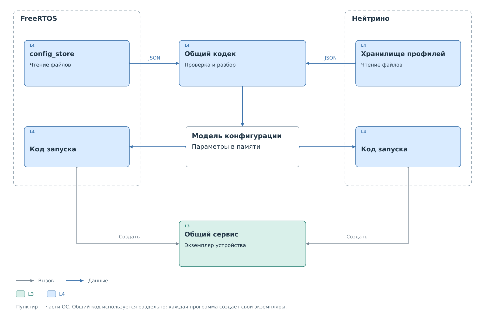
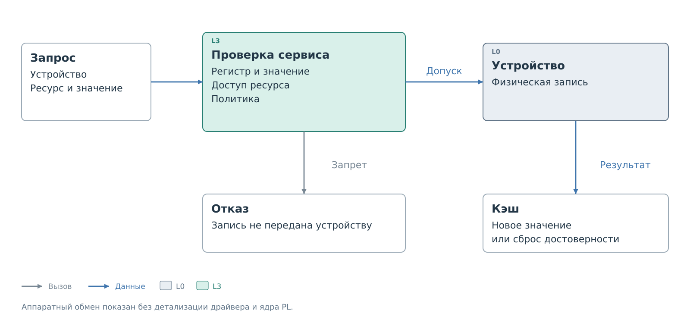
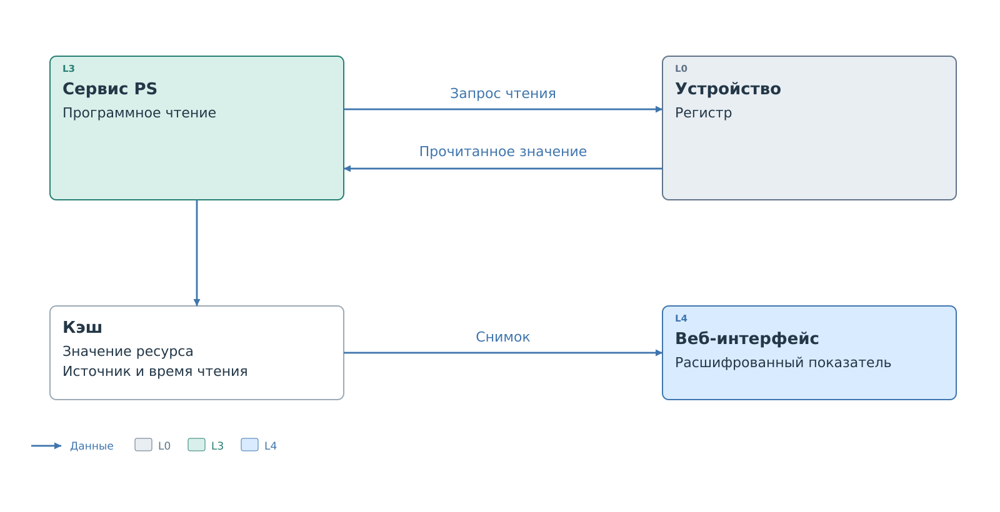
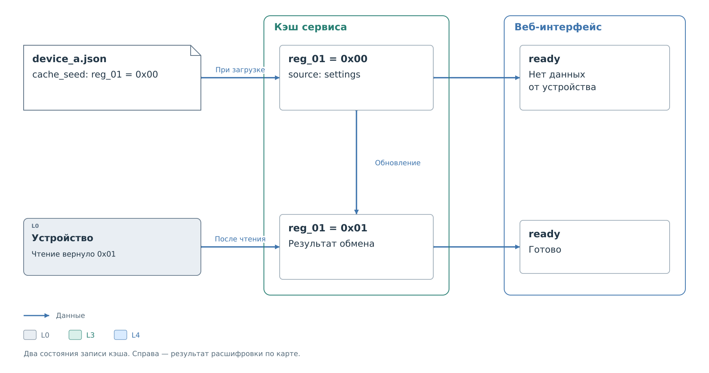

# Работа устройства по профилю

После загрузки профиль становится рабочей конфигурацией сервиса.
Она связывает запрос к ресурсу с адресом устройства, способом обмена
и действующей политикой. Кэш хранится рядом с этими настройками,
но меняется по результатам операций с устройством.

## Загрузка

Программа находит файл устройства, разбирает JSON и проверяет его.
Правило записи должно ссылаться на существующий ресурс, адрес должен
помещаться в диапазон выбранного обработчика, а параметры обмена —
поддерживаться программой. При ошибке загрузка набора останавливается.

*Рисунок 1. Чтение файла и подготовка устройства к работе.*

Разбор профиля общий для FreeRTOS и Нейтрино. Работа с носителем
и подключение экземпляров к задачам или процессам выполняются кодом
соответствующей системы.

После разбора сервис получает описание устройства, политику и кэш.
Текстовые имена ресурсов преобразуются во внутренние номера, по которым
сервис находит данные. Оригинальный JSON не нужен при каждой операции.
Для устройства с несколькими адресами номер также учитывает
[адресное пространство](address-spaces.md).

Успешная загрузка подтверждает пригодность описания. Отвечает ли само
устройство на шине, становится известно при физическом обмене.
В списке настроенных устройств поэтому может присутствовать устройство,
которое сейчас отключено.

## Запись регистра

Клиент BVSTK передаёт запрос записи с указанием устройства,
ресурса и значения. Сервис уже знает адрес устройства и способ обмена.
Перед передачей команды драйверу он проверяет границы регистра и значения,
доступность записи для этого ресурса и действующую политику.

*Рисунок 2. Использование профиля при записи.*

Если хотя бы одна проверка не пройдена, запись отклоняется до обращения
к ресурсу устройства. Белый список требует совпадения с правилом,
чёрный — отсутствия совпадений. Режим доступа ресурса проверяется отдельно:
разрешение политики не позволяет записать в ресурс с `access: "ro"`.

Разрешение политики ещё не подтверждает выполнение команды.
Устройство может не ответить, а обмен — завершиться ошибкой.
Если обработчик поддерживает проверку чтением и она включена в профиле,
после записи он получает значение обратно и сравнивает его с переданным. Несовпадение
считается ошибкой; автоматически повторять запись ради проверки
обработчик не будет.

После успешной операции обработчик обновляет кэш. При поддержке
`cache_after_write` профиль выбирает между сохранением записанного значения
и сбросом достоверности записи кэша.
Второй вариант полезен, когда устройство само меняет записанные биты
и переданное число нельзя считать его последующим состоянием.

Устройство за коммутатором требует дополнительных операций выбора
маршрута. Они разобраны [отдельно](topology.md#Обращение%20из%20PS).

## Чтение и кэш

Программный запрос чтения через сервис обращается к физическому устройству.
При успешном чтении сервис сохраняет полученное значение
в кэше и отмечает его происхождение. Этот снимок уже можно получить
через интерфейсы наблюдения.

*Рисунок 3. Получение нового значения и последующее отображение.*

Действительность записи означает, что сервис располагает значением
с известным происхождением. Она не гарантирует, что физический регистр
с тех пор не изменился. Для текущего состояния требуется новое чтение
или предусмотренный подсистемой опрос. Перерисовка страницы сама по себе
данные на шине не обновляет.

При обращении **внешнего ведущего** к ведомой стороне BVSTK путь
начинается с ядра PL slave. Дальнейшая обработка зависит от подсистемы.
В обработчике с настраиваемой передачей параметр `host_read` определяет,
можно ли взять значение из достоверного кэша или нужно прочитать устройство
заново. При промахе кэша обработчик также обращается к устройству.
Это настройка ведомого пути; она не превращает обычную программную
команду чтения в запрос снимка.

В таком обработчике профиль также определяет адресный префикс
и перемещение указателя регистров. Два пути чтения — программный запрос
и обращение внешнего ведущего — разобраны на конкретном подключении
в [примере](examples/direct-device.md#Передача%20на%20шине).

## Начальные значения

В профиль можно включить `cache_seed` — начальные значения кэша.
При запуске они попадают в память с источником `settings`.
Физической записи этих значений в устройство не происходит.

*Рисунок 4. Начальное заполнение и получение данных от устройства.*

Для профилей с явным `protocol.transfer` такое начальное значение
не используется как готовый ответ внешнему ведущему. Сначала требуется
получить данные от устройства. Веб-интерфейс также не показывает
начальный код как измеренное состояние: для источника `settings`
он сообщает об отсутствии данных от устройства.

Использование начальных значений ведомым трактом определяется
обработчиком и его режимом. Поэтому при переносе настроек следует
сверять их с [примером выбранного обработчика](examples/examples.md).
Значение из файла и значение, подтверждённое обменом, имеют разное
происхождение даже при численном совпадении.

Далее: [хранение и изменение профилей](lifecycle.md). Для подключения
через коммутатор перейдите к [описанию маршрута](topology.md).
