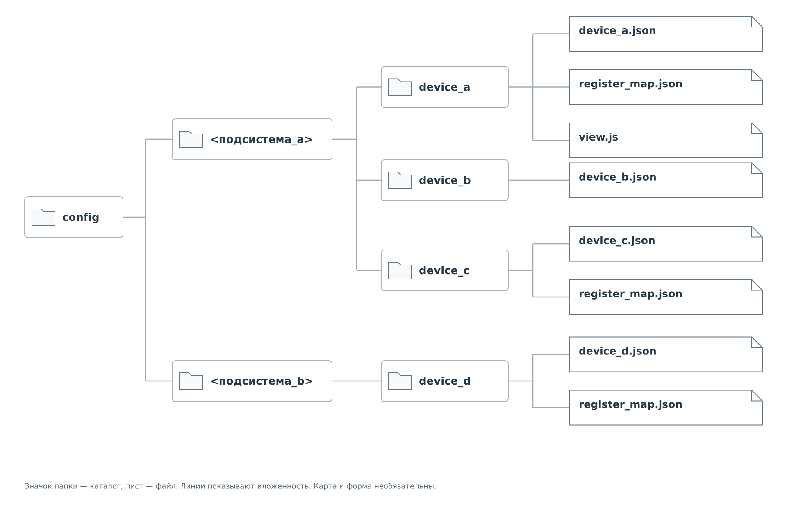
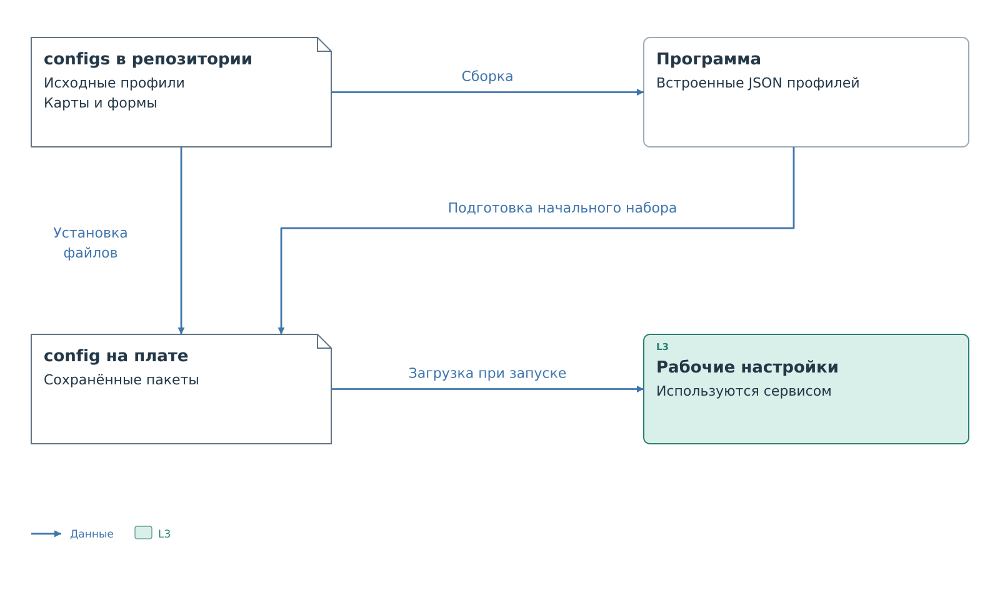
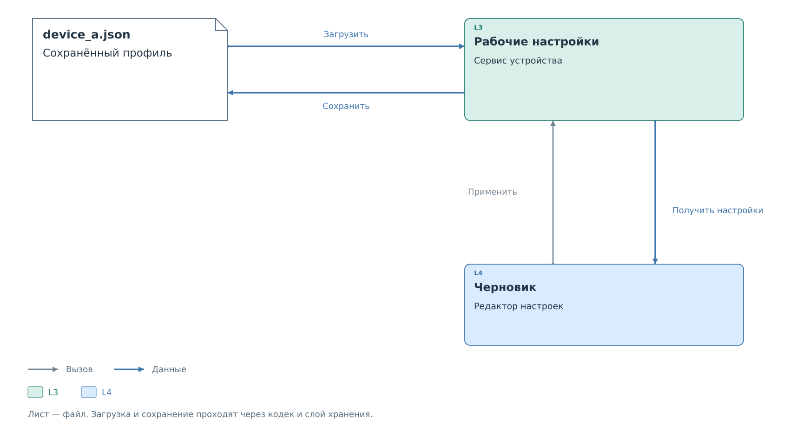

# Хранение и изменение профилей

Работающий сервис использует настройки в оперативной памяти.
Файл профиля нужен для их восстановления при запуске.
Когда пользователь меняет разрешения во время работы, эти два
представления могут временно различаться.

## Размещение на плате

Пакеты находятся внутри `config`, в каталоге своей подсистемы.
Общая форма пути к прямому устройству —
`config/<подсистема>/<id>/<id>.json`. В угловых скобках обозначены
места для имени подсистемы и ID экземпляра. У устройства за коммутатором
перед каталогом устройства добавляется каталог его родителя.

*Рисунок 1. Пакеты на носителе платы.*

В пакетном размещении ID устройства должен совпадать с именем папки.
Основной JSON также носит это имя. При сохранении профиль остаётся
в той же ветви; параметры маршрута не теряются.
У дочернего пакета непосредственный родительский каталог должен
совпадать с `transport.parent`. Вложенность отражает коммутаторы;
отдельного каталога номера канала нет.

Начало пути зависит от файловой системы выбранной среды выполнения.
Внутренняя структура пакета сохраняется. Карты и формы лежат рядом
с профилями, а ссылки в JSON содержат только имена файлов.
Перенос пакета между средами не требует превращать эти ссылки
в абсолютные пути. Полные пути показаны в [примере загрузки](examples/loading.md).

PS проверяет синтаксис ссылок, но не загружает карту как часть профиля.
Её позднее запрашивает браузер. Исправный профиль может работать
при отсутствующей или ошибочной карте, хотя показатели показать
не получится.

## Исходный набор и первый запуск

Каталог `configs` в репозитории содержит исходный набор профилей.
При сборке генератор включает их JSON в программу. Карты и формы
туда не входят: они устанавливаются отдельными файлами.

*Рисунок 2. Исходный набор, файлы на плате и рабочая конфигурация.*

Изменение файла в репозитории не обновляет работающую плату.
Даже после загрузки новой программы сохранённые пользовательские
профили остаются самостоятельным источником конфигурации.
Порядок подготовки зависит от среды и подсистемы.

Встроенный набор служит источником начальной конфигурации. Условия
его установки, дополнения существующих файлов или использования
при недоступном носителе определяет загрузчик подсистемы.
Нельзя считать, что новая программа при каждом запуске перезаписывает
пользовательские профили встроенными.

При переносе старой установки загрузчик также может учитывать прежние
имена файлов и каталоги. Такие места поиска имеют определённый приоритет:
они не образуют набор независимых профилей одного устройства.
Порядок подготовки и поиска для поддерживаемых целей разобран
в [примере загрузки](examples/loading.md).

Ошибка найденного профиля останавливает загрузку набора соответствующей
подсистемы. Программа не подменяет ошибочный файл более старой копией
и не пропускает молча устройство. Для топологии это особенно важно:
без профиля родителя дочерние устройства не образуют рабочий маршрут.

## Рабочие и сохранённые настройки

Обе ОС разделяют применение и сохранение. Локальная консоль Нейтрино,
как и FreeRTOS, меняет политику, адрес и рабочие начальные значения
в RAM. Физическая запись I²C и прежние DCP2 WRITE_REG и POLICY_SET
не записывают профиль. Для сохранения требуется явная команда save.
Порядок операций и изменение прежнего поведения Нейтрино описаны
в [контракте FreeRTOS и Нейтрино](../system/architecture/common-contract.md).

Редактор сначала получает рабочую конфигурацию и создаёт её черновик.
Пока пользователь меняет черновик, сервис продолжает использовать
прежние параметры. После успешного применения новые правила начинают
влиять на последующие запросы.

*Рисунок 3. Рабочая и сохранённая политика.*

Сохранение записывает действующую конфигурацию в профиль.
Если оно не выполнено, перезапуск вернёт прежние настройки из файла.
Если сохранить не удалось, уже применённое правило продолжает
действовать в памяти до перезапуска.

Ручное редактирование JSON даёт обратное расхождение: файл уже изменён,
а сервис работает со старой конфигурацией. В текущей топологии
изменения подключения, ресурсов, адресных пространств и параметров
обмена вводятся при перезапуске. Редактирование политики доступно
во время работы.

Изменение правила и запись физического регистра — отдельные операции.
Применённое разрешение только позволяет последующему запросу пройти
проверку. Оно не отправляет разрешённое значение устройству.

Консоль и DCP2 меняют рабочие правила напрямую. HTTP-редактор
дополнительно проверяет ревизию исходного снимка: чужое изменение
за время редактирования может вызвать конфликт.
Точный порядок запросов описан в
[главе HTTP](../interfaces/http/device-settings.md).

Разбор успешного сохранения и ошибки носителя находится
в [примере изменения политики](examples/editing.md).

## Содержимое сохраняемого файла

Кодек строит профиль из рабочей модели и сохранённых метаданных.
Он сохраняет ID ресурсов, подключение, параметры обмена, политики,
ссылки на дополнительные файлы и подготовленные начальные значения.
Общие свойства регистров могут быть вынесены в `defaults.register`,
а пропущенные автором необязательные поля — записаны явно.
Исходное форматирование JSON при этом не сохраняется.

Список `settings.cache_seed` хранится отдельно от текущего кэша.
Способ сохранения определяет, останутся ли в нём подготовленные значения
или действительные записи кэша будут перенесены в начальные настройки.
Само сохранение не выполняет нового чтения устройства. Различие операций
показано в [примере](examples/editing.md#Начальные%20значения%20при%20сохранении).

Запись профиля не создаёт отсутствующие карту или форму. Замена файла
выполняется средствами выбранной среды; ошибку носителя получает
вызывающая операция. Детали замены файла и восстановления после сбоя
рассмотрены в [примере загрузки](examples/loading.md#Замена%20файла).

## Поля состояния

Профиль описывает устройство и настройки. HTTP добавляет сведения
о работающей системе: `presence`, `revision`, `saved` и записи кэша
с `valid`, `source`, `updated_ms`. Эти поля не следует переносить
обратно в JSON профиля.

`saved` сообщает о соответствии рабочей конфигурации сохранённой.
Он не подтверждает, что физические регистры содержат ожидаемые значения.
`presence` отражает наблюдавшиеся ответы устройства; это тоже
не свойство файла.

Объект `config` в текущем HTTP имеет собственное представление,
отличающееся от полного профиля v2. Для устройства с несколькими
пространствами ответ также содержит вычисленные границы этих пространств.
Файл, рабочие данные и сетевой ответ поэтому нельзя считать
взаимозаменяемыми JSON-документами.

Для подготовки своего пакета можно перейти к
[полным примерам](examples/examples.md). Форматы управляющих
интерфейсов описаны в главах [консоли](../interfaces/console.md),
[HTTP](../interfaces/http/http.md) и
[политик DCP2](../interfaces/dcp2/04-policies.md).

Далее: [примеры профилей](examples/examples.md).
