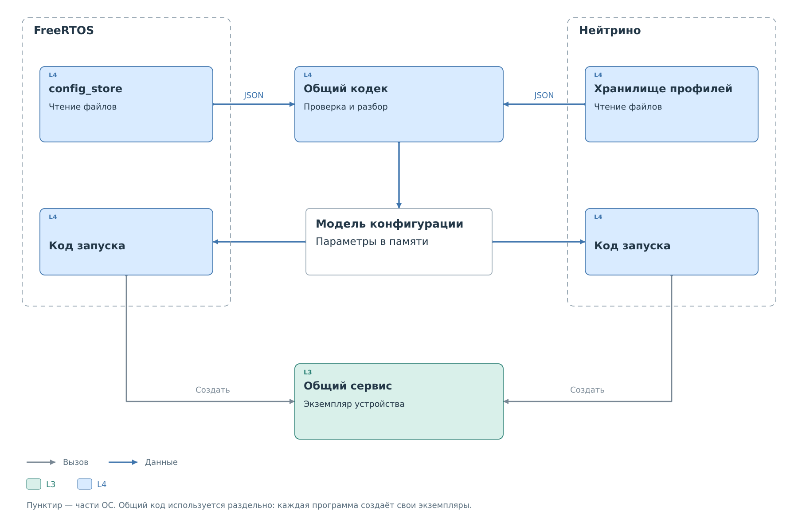
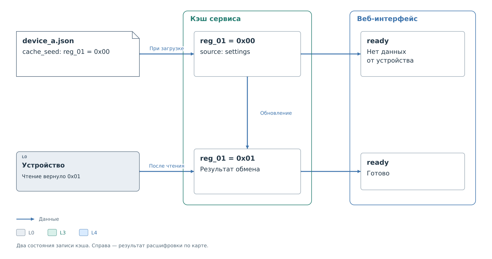

# Загрузка, применение и сохранение

Сервис работает с параметрами в оперативной памяти. При запуске они
загружаются из профиля, затем могут изменяться через интерфейсы BVSTK.
Пока изменения не сохранены в файл, после перезапуска вернутся прежние
настройки.

## Загрузка профиля

Загрузчик находит профиль в [каталоге подсистемы](configuration.md#размещение-и-связи-файлов)
и передаёт JSON общему кодеку `bvstk_device_profile`. Кодек проверяет
[поля профиля](device-profile.md): версию формата, обязательные разделы,
допустимые значения и ссылки на ресурсы.
Например, правило с `resource: "reg_01"` принимается только тогда,
когда такой регистр есть в `resources`. При разборе строковая ссылка
превращается в адрес, который сервис будет использовать в проверках.

*Рисунок 1. Части загрузки, зависящие от ОС, и общий код.*

Файлы читаются средствами выбранной ОС, а правила разбора JSON общие.
Каждая программа создаёт собственную модель конфигурации. Код запуска
связывает её с сервисом, кэшем и драйвером; подробности создания
экземпляров приведены в [рабочей среде BVSTK](../system/runtime/runtime.md).
После этого сервис использует параметры в памяти и не перечитывает
файл при каждой транзакции.

Успешная загрузка означает, что описание принято программой.
Наличие и готовность физического устройства проверяются при обмене.
Устройство может числиться настроенным и при этом не отвечать на шине.

## Файлы и источники конфигурации

В каталоге подсистемы загрузчик распознаёт три варианта размещения.
Для одного имени они выбираются в следующем порядке:

1. `<имя>/<имя>.json` — основной файл пакета.
2. `<имя>/profile.json` — прежнее имя файла внутри пакета.
3. `<имя>.json` — прежний плоский вариант.

Карта регистров не считается профилем. Вложенные папки внутри пакета
загрузчик не обходит: перенесённый туда профиль перестанет загружаться.

Во FreeRTOS сначала читается `config`, затем старый каталог `configs`.
Старая копия того же профиля пропускается. В Нейтрино старый каталог
используется, только если в основном не найдено профилей. Найденный,
но ошибочный профиль в обоих случаях останавливает загрузку подсистемы.
Перехода к старой копии после такой ошибки нет.

Отклоняется весь набор профилей подсистемы. Это сохраняет связь
между составом устройств и их политиками: пропуск одной ошибочной записи
мог бы, например, изменить цель ведомого обмена.

### Встроенные профили

При сборке `gen_default_configs.py` преобразует JSON из каталога
`configs` репозитория в данные программы. Этот набор используется
для подготовки начальной конфигурации. Карты регистров и формы
в него не входят; их устанавливают отдельными файлами.

Отсутствующий профиль и повреждённый профиль обрабатываются по-разному.
Начальные данные могут восполнить отсутствие конфигурации, но не заменяют
файл с ошибкой. Порядок подготовки зависит от целевой программы:

- Во FreeRTOS отсутствующие встроенные профили I²C устанавливаются
  на носитель при запуске. Поэтому удаление такого файла само по себе
  не исключает устройство из следующего запуска. Если сохранённых
  профилей нет и ошибка чтения не зафиксирована, используется встроенный набор.
- Для MDIO во FreeRTOS начальный набор устанавливается при первой
  подготовке каталога. Завершение отмечается файлом `.initialized`;
  при последующих запусках удалённые профили не восстанавливаются
  из встроенного набора. Недоступная QSPI отключает загрузку MDIO.
- В Нейтрино встроенный набор используется, если профилей нет
  ни в основном, ни в старом каталоге. После загрузки программа
  пытается сохранить их в основном каталоге.

Во FreeRTOS устройства сортируются по адресу, затем по имени.
Числовой ID определяется этим порядком и может измениться после добавления
профиля. Для сохранённых команд удобнее использовать имя устройства.
Текущий ведомый путь I²C использует первый профиль: изменение порядка
может изменить и цель ведомого обмена.

## Рабочие и сохранённые настройки

После запуска файл и рабочая конфигурация могут различаться. Редактор
добавляет ещё одно представление — черновик, который пользователь
меняет до отправки в систему.

*Рисунок 2. Переходы между сохранённым профилем, черновиком и рабочими настройками.*

Пусть в `device_a` запись в `reg_01` запрещена. Пользователь добавляет
разрешающее правило:

1. Пользователь получает текущую конфигурацию `device_a` и меняет
   правило в редакторе. Сервис продолжает работать с прежним правилом.
2. Операция **Применить** проверяет допустимость изменения и устанавливает
   новые рабочие настройки. Следующая операция сервиса использует их.
3. Операция **Сохранить** записывает действующую конфигурацию в профиль.
   После следующей загрузки она снова станет основой рабочего состояния.

Применение правила не записывает значение в физический регистр.
Для этого пользователь или другая часть системы отправляет отдельный
запрос обмена. Сервис проверяет его по уже действующей политике.

Редактирование JSON непосредственно на носителе меняет сохранённый
профиль. Работающий сервис продолжает использовать загруженные параметры
до их повторной загрузки. Команды консоли и DCP2 обращаются к рабочей
конфигурации; наличие отдельной операции сохранения нужно учитывать
для выбранного интерфейса.

HTTP защищает применение и сохранение от устаревшего снимка через
`revision`. Например, редактор прочитал конфигурацию, после чего другой
клиент изменил политику. Запрос с прежней ревизией получает ответ `409`.
Нужно заново получить конфигурацию и повторить свои изменения поверх неё;
простая подстановка новой ревизии в старый запрос может затереть чужие
правки. Ревизия проверяет содержимое конфигурации, а не состояние
физических регистров.

Набор доступных изменений и команды приведены в
[HTTP](../interfaces/http/devices.md), [консоли](../interfaces/console.md)
и [управлении политиками DCP2](../interfaces/dcp2/04-policies.md).

## Начальные значения кэша

Кэш хранит значения регистров в оперативной памяти вместе с признаками
достоверности и происхождения. `settings.cache_seed` заполняет его
при создании рабочей среды. Сервис помечает эти начальные значения
источником `settings`.

*Рисунок 3. Происхождение значения в кэше `device_a`.*

Пусть для `reg_01` сохранено `0x00`. После загрузки кэш может содержать
этот код с источником `settings`. Физическое значение регистра ещё
предстоит получить. Если успешное чтение вернуло `0x01`, сервис заменяет
запись кэша и снимает признак начального значения. Дальнейшая интерпретация
учитывает источник, действительность и время обновления записи.

Кэш обслуживает работу подсистемы, поэтому начальные значения могут
участвовать в подготовке ответов внешнему ведущему. Точный порядок
публикации зависит от подсистемы. Веб-интерфейс при этом показывает
для источника `settings` сообщение «Нет данных от устройства»:
начальный код не подтверждает состояние физического регистра.

Загрузка начальных значений оставляет физические регистры без изменений.
Запись настроек в устройство при старте пока не поддерживается:
`settings.desired` принимается только пустым, `apply_on_startup` —
только со значением `false`.

## Сохранение и ошибки

Сохраняется конфигурация, полученная от работающей системы. Кодек
формирует JSON, затем слой хранения заменяет файл профиля. Содержимое
черновика попадает туда после успешного применения.

В JSON сохраняются метаданные устройства, ID ресурсов, активные
и неактивные правила, ссылки на карту и форму. Форматирование заново
создаёт документ, поэтому порядок ключей и оформление исходного файла
могут измениться. Карта регистров и скрипт формы хранятся отдельно;
сохранение профиля не переписывает их содержимое.

Состав сохраняемых начальных значений зависит от подготовки снимка.
Консольное сохранение I²C сначала синхронизирует модель с действительными
значениями рабочего кэша. Они попадают в `cache_seed`, включая прочитанные
значения выше ограничения записи. HTTP сохраняет уже подготовленную
модель и отдельно такой захват не запускает. В MDIO сохраняется
настроенный список начальных значений. Сохранение само по себе
не запрашивает новое чтение устройства.

Если применение прошло успешно, а запись файла завершилась ошибкой,
новая политика продолжает действовать в памяти сервиса. В рассматриваемом примере
запись в `reg_01` уже разрешена. После перезапуска загрузится сохранённый
файл, и прежний запрет может вернуться. Повторять применение из-за ошибки
сохранения не требуется: нужно устранить ошибку записи и сохранить
действующую конфигурацию.

HTTP определяет признак `saved` сравнением текущей конфигурации
с сохранённой. Это позволяет увидеть расхождение и после изменения
через другой интерфейс. Признак не подтверждает физические значения
регистров и не заменяет результат отдельной операции записи устройства.

Во FreeRTOS новый JSON сначала записывается во временный файл. Прежний
профиль переименовывается в `.json.bak`, после чего временный файл занимает
основное имя. При следующем запуске резервная копия восстанавливается,
если основной файл отсутствует. Если основной файл существует,
но содержит неверный профиль, автоматической замены из `.bak` нет.
Этот порядок рассчитан на прерванную замену файла; он не восстанавливает
повреждённую файловую систему.

В Нейтрино слой хранения записывает временный файл, вызывает `fsync`
и заменяет основной файл через `rename`. Механизм восстановления
`.json.bak` FreeRTOS к этому пути не относится.
