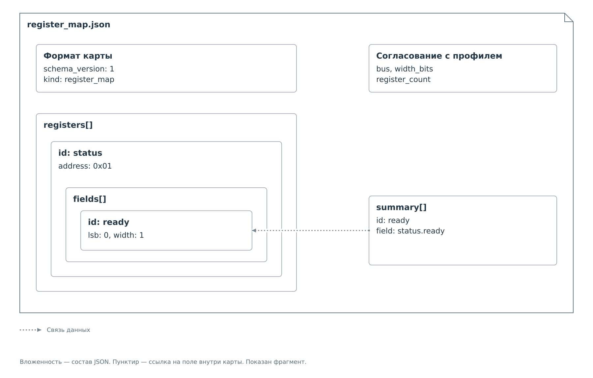

# Карта регистров

В `register_map.json` каждому адресу регистра сопоставлены битовые поля
и способы их расшифровки. Веб-интерфейс применяет это описание к снимку
кэша, полученному от сервиса. Карту выбирает поле `register_map` в профиле.

## Структура карты

Карта — самостоятельный JSON. В корне указаны версия её формата,
шина, разрядность и количество регистров. Последние три свойства
веб-интерфейс сверяет с конфигурацией устройства перед расшифровкой.
Карта должна описывать тот же диапазон адресов, с которым работает сервис.

*Рисунок 1. Вложенные описания регистров и ссылки сводки внутри карты.*

Массив `registers` содержит описание каждого регистра. Его `address`
сопоставляется с адресом записи в кэше, а `id` используется внутри карты.
У регистра находится свой массив `fields`: каждый его элемент описывает
один участок битов. Например, `ready` занимает один бит регистра `status`.
Полная ссылка на это поле имеет вид `status.ready`.

Массив `summary` находится в корне рядом с `registers`. Он выбирает,
что показать в сводке. Простой показатель указывает поле через `field`.
Составной содержит `cases` с условиями, которые ссылаются на несколько
полей. Он не требует нового физического регистра: это вычисление
по уже полученным данным.

Идентификаторы профиля и карты относятся к разным документам.
Ресурс `reg_01` в профиле и регистр `status` в карте могут обозначать
один адрес `0x01`. Политика использует имя `reg_01`, сводка — `status.ready`.
Для связи с данными важен общий числовой адрес. Такой пример полностью
разобран в [связях профиля, карты и кэша](examples/register-decoding.md#связь-профиля-карты-и-кэша).

Битовые поля описываются именно в карте. Одноимённое `resources[].fields`
в формате профиля пока зарезервировано и принимается только пустым.
Размещение расшифровки там не подключит её к интерфейсу.
Полный состав карты приведён в [справочнике v1](reference/register-map-v1.md).

## Расшифровка значения

У `device_a` регистр по адресу `0x01` содержит однобитовое поле `ready`.
Успешное чтение вернуло `0x01`:

*Рисунок 2. Расшифровка поля `status.ready` по карте.*

Сначала веб-интерфейс находит запись кэша по числовому адресу регистра.
Затем извлекает поле: `lsb` указывает младший бит, `width` — число битов.
Для `ready` с `lsb: 0` и `width: 1` результат равен единице. Таблица
`values` сопоставляет этому коду подпись «Готово».

Определение `ready` автор записывает в карту заранее. Подпись «Готово»
появляется в результате расшифровки только после получения соответствующего
значения. При следующем снимке тот же участок карты может дать другой
результат, хотя ни профиль, ни карта на носителе не менялись.

`access` в карте сообщает физические свойства поля. Допуск операций
сервиса определяется отдельно, [политикой профиля](device-profile.md#политики-доступа).

## Достоверность отображения

Интерфейс различает отсутствие значения и неизвестный смысл полученного
кода. Если записи в кэше нет или она недействительна, выводится
«Нет данных». Если значение прочитано, но его код не описан в карте,
выводится «Не описано» вместе с кодом. Во втором случае данные есть —
не хватает их расшифровки.

Источник `settings` означает, что число взято из профиля. Для него
выводится «Нет данных от устройства». Подставлять вместо этого ноль
или справочное значение `reset` нельзя: это создало бы видимость
прочитанного состояния. Происхождение таких записей разобрано
в [начальных значениях кэша](lifecycle.md#начальные-значения-кэша).

Даже достоверное значение относится к последнему обмену, а не обязательно
к текущему моменту. Например, поле с атрибутом `latch_high` может хранить
факт ранее произошедшего события. Перерисовка страницы не меняет время
этого наблюдения. Для нового измерения нужна операция чтения или опрос,
который выполняет сервис.

## Числовые показатели

Поле может задавать код состояния или измеряемую величину. Для кода карта
сопоставляет число с подписью. Для величины она задаёт масштаб, смещение
и единицу измерения. Если у устройства ступенчатая шкала, для разных
диапазонов кодов выбираются разные параметры пересчёта.

Условия в карте сравнивают исходный код поля. Поэтому изменение подписи,
масштаба или единицы измерения не меняет смысл проверки. Это позволяет
отдельно описывать физическое состояние и способ его отображения.

Формулы и ограничения: [пересчёт значений](reference/register-map-v1.md#пересчёт-числовых-значений).

## Сводка из нескольких полей

Подробная расшифровка показывает отдельные поля. Сводка выбирает из них
показатели, по которым пользователь оценивает устройство. Простой
показатель ссылается на одно поле. Составной последовательно проверяет
варианты `cases` и выбирает первый подходящий.

Порядок вариантов задаёт приоритет. Проверку ошибки можно поставить
перед проверкой готовности. Если данных для первой проверки ещё нет,
интерфейс не может уверенно перейти к следующей и сообщить готовность:
результат остаётся неопределённым до получения необходимых значений.
Если же условие заведомо ложно, рассматривается следующий вариант.

Регистры могут обновляться в разное время. Метка составного показателя
учитывает самую старую запись, использованную при выборе результата.
Новое значение одного поля не делает свежими остальные зависимости.
В [примере расшифровки](examples/register-decoding.md) показаны готовность,
ошибка и числовая шкала с конкретными значениями.

Поля `summary` и порядок выбора: [условия и показатели](reference/register-map-v1.md#условия-и-показатели).

## Соответствие карты устройству

Карта выбирается по ссылке в профиле. Дополнительная проверка `identity`
сопоставляет прочитанные идентификационные поля с ожидаемыми значениями.
Если обнаружено несовпадение, интерфейс блокирует сводку и показывает
предупреждение. Сырые значения и подробная расшифровка остаются доступны.

Непрочитанный идентификатор оставляет проверку незавершённой. Отсутствие
условий `identity` тоже не подтверждает модель: интерфейс сообщает,
что проверка не задана. Это отличается от известного несовпадения.

Подготовленные поля и признаки достоверности получает также
[индивидуальная форма](view-api.md). Полный состав JSON, пределы
и точные правила условий приведены в
[справочнике карты v1](reference/register-map-v1.md).
