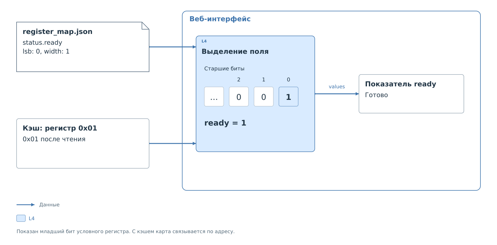
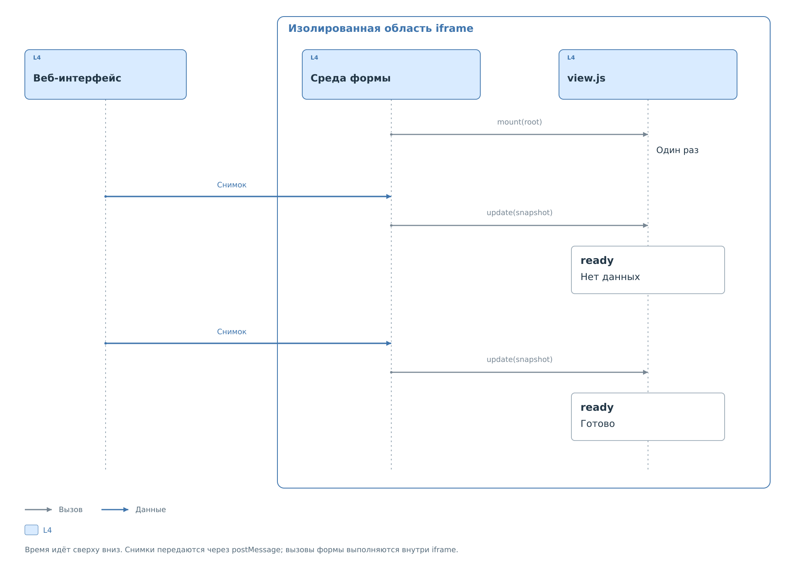

# Карта регистров

Профиль задаёт обращение к устройству. Карта регистров объясняет значения,
которые уже получены: какие биты составляют поле, что означает его код
и как из него получается показатель. Веб-интерфейс загружает карту
по ссылке `register_map` в профиле. Отсутствующая или ошибочная карта
мешает показать показатели, но не отменяет работу самого профиля.

Ниже разбирается отдельный JSON карты. Полное
[дерево карты регистров](register-map-tree.md) содержит ссылки
на объяснения по названиям полей.
Полный файл находится в [примере отображения](examples/device-display.md).

У карты своя версия: **`schema_version`** равен числу `1`,
**`kind`** — строке `"register_map"`. **`id`** задаёт ID карты,
**`device`** — непустое название описываемого устройства, до 600 символов.
В отличие от профиля, `device` здесь строка, а не объект.

**`bus`** обозначает тип шины и совпадает с `transport.bus` профиля.
**`width_bits`** задаёт разрядность значений и совпадает с разрядностью
его ресурсов. **`register_count`** равен числу ресурсов профиля,
включая все адресные пространства. Эти поля обязательны и проверяются
по возможностям обработчика. Они связывают карту с форматом получаемых данных.

Также обязательны `source`, `notes`, `registers`, `summary`.
Только `identity` в корне необязателен.
**`notes`** — непустое общее пояснение.

Карта записывается в JSON UTF-8, до 65536 байт. Неизвестные поля
и неверные типы приводят к отказу проверки всей карты. Комментарии
и завершающие запятые запрещены. Повторять ключи также нельзя,
хотя стандартный JSON-парсер браузера отдельно такой повтор не диагностирует.

ID карты, регистров, битовых полей и показателей содержат до 64 символов:
строчная латинская буква в начале, затем строчные латинские буквы,
цифры и `_`. Дефис, допустимый в ID профиля, здесь не допускается.
Обычные текстовые подписи непустые, до 600 символов. Адреса и коды
можно записывать неотрицательными целыми числами или строками `0x...`
в диапазоне соответствующего поля. Произвольный выполняемый код
в карте не поддерживается.

## Основание описания

Обязательный объект `source` указывает, по какому описанию устройства
составлена карта. Все четыре строки обязательны и непусты:
**`title`** — название, **`document`** — обозначение документа,
**`revision`** — его редакция, **`url`** — адрес с началом `https://`.
К каждой строке применяется предел 600 символов.

Эти сведения позволяют различить карты для разных редакций устройства.
Они не загружают описание автоматически и не участвуют в обмене на шине.

## Регистры

Массив `registers` описывает все регистры профиля. Пропускать незнакомые
адреса нельзя: их можно обозначить зарезервированными. Число элементов
совпадает с `register_count`, адреса не повторяются и покрывают каждый
диапазон целиком.

*Рисунок 1. Связь ресурса профиля с расшифровкой значения.*

ID ресурса профиля и ID регистра карты независимы: одинаковые имена
не требуются. Соответствие устанавливается по адресу,
а при нескольких пространствах —
по паре `space` и `address`. ID карты далее используется в ссылках
на её собственные битовые поля.

### Описание регистра

Обязательное **`id`** уникально среди регистров карты.
**`address`** — локальный адрес внутри диапазона профиля.
**`space`** требуется при наличии пространств и ссылается на их ID
в профиле; без пространств поле запрещено. Индекс кэша получается
прибавлением начала пространства к локальному адресу.

У регистра обязательны **`name`** — обозначение, **`label`** — подпись
в интерфейсе, **`section`** — указание раздела исходного описания,
и массив **`fields`**. Необязательная строка **`note`** содержит пояснение.

**`reserved`** — необязательное логическое значение, по умолчанию `false`.
При `true` все битовые поля этого регистра должны иметь `type: "reserved"`
и `access: "none"`. Зарезервированный регистр всё равно занимает свой
адрес в карте.

### Битовые поля

Массив `fields` содержит от 1 до 32 полей регистра. Все биты должны
быть описаны без пропусков и пересечений. Для неиспользуемых битов
добавляют поля типа `reserved`.

Сумма ширин полей должна покрывать разрядность регистра, а каждый бит
должен принадлежать ровно одному полю. Описание только используемых
флагов с неуказанными промежутками проверку не проходит.
Разметка полного регистра показана в
[примере карты](examples/device-display.md#Расшифровка%20состояния).

#### Описание битового поля

**`id`** обязателен и уникален внутри регистра. Вместе с ID регистра
он образует ссылку `<id регистра>.<id поля>`. **`label`** — обязательная
подпись. **`lsb`** — номер младшего бита с нуля, **`width`** — число битов,
не менее одного. Поле целиком помещается в разрядность регистра.

Обязательное **`type`** определяет представление:

- `enum` заменяет код подписью из `values`.
- `uint` показывает число, при необходимости с пересчётом.
- `hex` показывает шестнадцатеричный код.
- `reserved` отмечает зарезервированные биты.

Обязательное **`access`** принимает `ro`, `rw`, `wo` или `none`.
Это справочное свойство физического поля. Оно не заменяет допуск записи
в сервисе. Поле `wo` не расшифровывается по кэшу чтения.

**`reset`** — обязательное текстовое описание значения при сбросе.
**`note`** — необязательное пояснение, **`unit`** — необязательная единица
измерения до 40 символов. **`write_value`** — необязательный код
в разрядности поля. Он справочный и не выполняет запись на устройство.

Для `uint` можно указать конечные числовые **`scale`** и **`offset`**.
Результат вычисляется как `код × scale + offset`. По умолчанию
коэффициенты равны 1 и 0. Для других типов они запрещены.
Если коэффициент меняется по диапазонам кодов, вместо них используется
`ranges`.

#### Подписи кодов

`values` обязателен у `enum` и запрещён у остальных типов битового поля.
Это объект, в котором ключ — десятичный код без ведущих нулей,
а значение — его описание. Допускается до 256 записей; каждый код
должен помещаться в разрядность поля.

У каждой записи обязательна **`label`**, непустая подпись.
Необязательное **`tone`** выбирает оформление: `ok` — зелёное,
`bad` — красное, `warn` — предупреждение, `unknown` — серое,
`offline` — обычный текст. По умолчанию `offline`.

Код без записи в `values` остаётся неизвестным и показывается вместе
с исходным значением. Сама таблица кодов не делает этот код допустимым
для записи по политике.

#### Диапазоны пересчёта

`ranges` допускается только для `uint`, вместо общих `scale` и `offset`.
В массиве от 1 до 32 диапазонов по возрастанию, без пересечений.

У каждого диапазона обязательны **`min`** и **`max`**, включённые границы
в разрядности поля, а также конечные числа **`scale`** и **`offset`**.
Для попавшего в диапазон кода действует та же формула
`код × scale + offset`: `min` из кода не вычитается. Результат пересчёта
на границах также должен быть конечным.

Диапазоны могут оставлять промежутки. Код вне всех диапазонов считается
неизвестным, а не вычисляется по коэффициентам соседнего диапазона.

#### Атрибуты поля

Необязательный массив `attributes` содержит не более восьми строк.
Допускаются `latch_low` — удержание факта нуля до чтения,
`latch_high` — удержание факта единицы, `read_clear` — очистка чтением,
`self_clear` — самосброс, `nasr` — отсутствие изменения при программном
сбросе, `write_one_clear` — очистка записью единицы,
`write_any_clear` — очистка любой записью.

Это сведения о физическом устройстве. Они не добавляют в обработчик
эмуляцию эффектов и не инициируют обмен, как и `reset` с `write_value`.

## Показатели

Обязательный массив `summary` содержит от 1 до 64 показателей.
Они выделяют нужные читателю результаты из подробной расшифровки:
состояние, число или итог нескольких условий.

В каждом элементе обязательны **`id`**, уникальный среди показателей,
и **`label`**, название. **`note`** добавляет необязательное пояснение.
Далее выбирают один из двух способов получения результата.

Для простого показателя **`field`** ссылается на существующее нерезервное
поле в формате `<id регистра>.<id поля>`.
Необязательное **`values`** переопределяет подписи его исходных кодов;
формат записей тот же, что у битового поля.

Для результата по условиям используется **`cases`**. Одновременные
`field` и `cases` запрещены. На этом уровне `values` без `field`
тоже запрещён: подписи должны иметь источник кодов.

### Варианты показателя

Массив `cases` содержит от 1 до 32 вариантов в порядке проверки.
Вариант имеет обязательный `when` и один из двух результатов:
**`label`** с необязательным **`tone`** для готовой подписи,
либо **`field`** с необязательным **`values`** для значения другого поля.
Смешивать обе формы результата нельзя.

Первый совпавший вариант определяет результат. Если несколько условий
могут выполняться одновременно, их порядок задаёт приоритет результата.
Поэтому перестановка элементов `cases` может изменить показание
при тех же данных кэша.

Если есть известное несовпадение, вариант ложен и проверяется следующий.
Если несовпадения нет, но часть нужных данных не прочитана, выбор
останавливается с неизвестным результатом. Недостающие данные не
превращаются в ложное условие. Если все варианты ложны, показывается
«Не определено». Метка времени результата — самая старая среди
использованных записей кэша.

#### Условия варианта

`when` содержит от 1 до 16 условий, объединённых логическим И.
У каждого обязательны **`field`**, ссылка на существующее нерезервное
поле карты, и **`equals`**, код для сравнения в разрядности этого поля.

Сравнивается исходный код, извлечённый из битов. Коэффициенты пересчёта,
единица измерения и подпись `values` в сравнении не участвуют.

## Проверка модели

Необязательный `identity` содержит от 1 до 16 условий с теми же
**`field`** и **`equals`**, что в `when`. Обычно они относятся к полям,
позволяющим отличить модель устройства.

Если все условия совпали, модель подтверждена. Известное несовпадение
блокирует сводку, но сырые регистры и битовые поля остаются доступны.
При нехватке данных проверка незавершена. Без `identity` модель также
не считается подтверждённой; это само по себе не блокирует отображение.

## Достоверность показателя

Расшифровка использует запись кэша только при `valid: true` и допустимом
значении. Источник `settings` означает начальную настройку, поэтому
не считается данными от устройства. Даже корректно расшифрованное
начальное значение не подтверждает физическое состояние.

Время обновления относится к данным кэша, а не к открытию страницы.
При потере свежести интерфейс сохраняет различие между последним
известным значением и новым наблюдением. Карта не запускает чтение
и не принимает решения об обновлении кэша.

## Индивидуальная форма

`view` находится в профиле и ссылается на отдельный скрипт, а не является
полем JSON карты. Без него веб-интерфейс показывает стандартную форму.
Собственная форма нужна для другого расположения готовых показателей.

*Рисунок 2. Передача данных форме.*

Скрипт объявляет `window.bvstkView` с версией API 1.
`mount(root)` создаёт элементы, `update(snapshot)` обновляет их
из снимка. Повторно разбирать регистры и проверять биты форме не нужно.

Форма работает в изолированной области браузера без доступа к операциям
шины, сетевым запросам и основной странице. Ошибка возвращает стандартное
отображение; при смене вкладки состояние формы уничтожается.
Рабочий код включён в [пример](examples/device-display.md#Форма),
точный состав снимка — в [API формы](reference/view-api-v1.md).

Размещение карты и формы рядом с профилем описано в
[главе хранения](lifecycle.md).

Далее: [полный пример карты и формы](examples/device-display.md).
