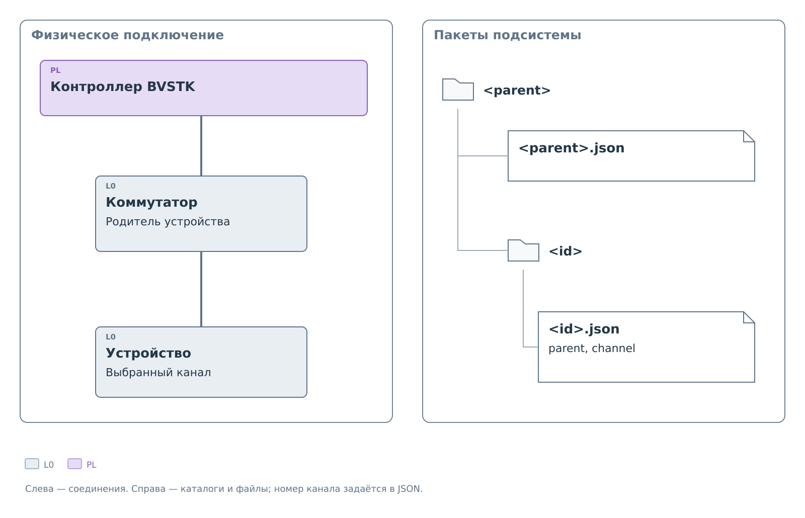
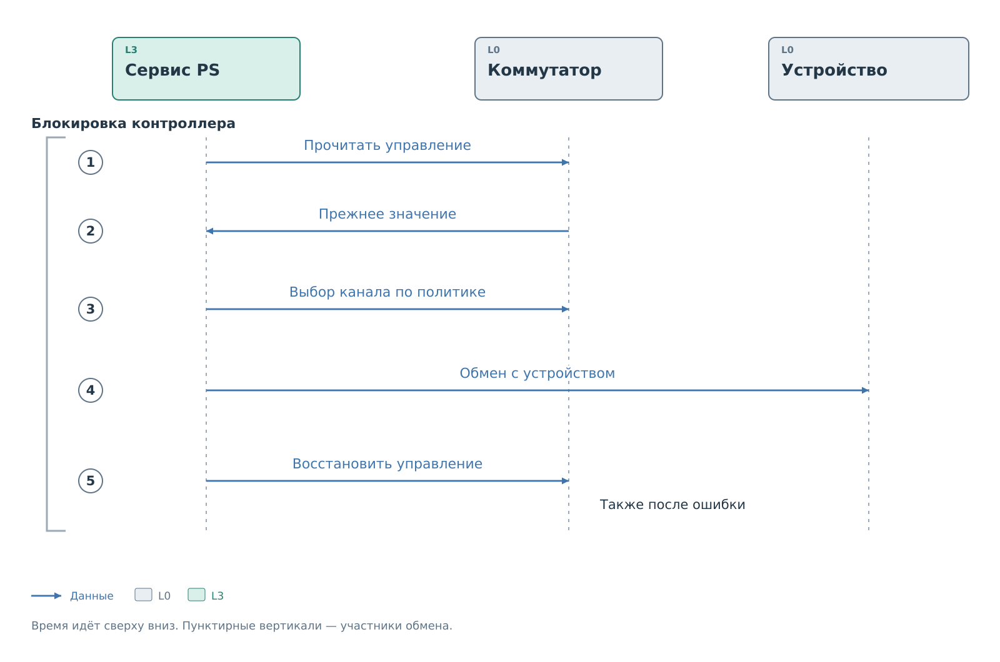
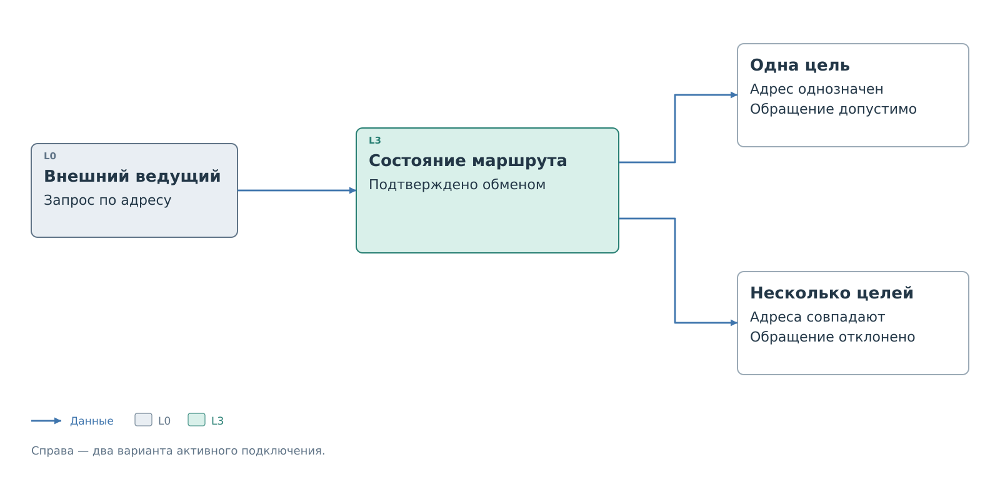

# Подключение через коммутаторы

Устройство может быть подключено к контроллеру через коммутатор.
Перед обменом нужно выбрать канал, который соединит контроллер
с нужным ответвлением. В профиле для этого задаётся маршрут.
Механизм доступен обработчику, поддерживающему `protocol.switch`;
само наличие полей маршрута не добавляет такую возможность другим обработчикам.

Коммутатор тоже является устройством: у него есть адрес на шине,
управляющий ресурс и собственная политика записи. BVSTK описывает
его отдельным профилем. Профили подключённых к нему устройств ссылаются
на этот профиль через `transport.parent` и выбирают канал через `channel`.

## Подключение и размещение пакетов

Связь с родителем выражена и в JSON, и в файловой системе.
Каталог дочернего устройства помещается непосредственно внутрь
пакета родительского коммутатора. Его имя по-прежнему совпадает с ID
устройства. Номер канала хранится только в JSON и отдельной папки не создаёт.

*Рисунок 1. Топология подключения и дерево пакетов.*

Иерархия каталогов проверяется при загрузке. Перенести пакет в другую
папку и оставить прежний `parent` нельзя. Дополнительно проверяются
существование родителей и каналов, отсутствие циклов и неоднозначных адресов.
Если устройства с одинаковым адресом находятся в разных ветвях,
маршрут должен обеспечивать их раздельное подключение.

Родительский коммутатор сам может находиться за другим коммутатором.
Так образуется цепочка от контроллера до устройства. Связи не означают
наследование политики: у каждого участника собственные правила.
Однако обращение к потомку зависит от возможности выбрать каналы родителей.

## Описание коммутатора

Объект `protocol.switch` связывает управляющий ресурс с каналами.
Для каждого канала задаётся код выбора и маска, по которой проверяется
его активность. Остальные параметры указывают, какие биты управления
выбирают каналы и какие требуется сохранить при переключении.

Механизм допускает независимые биты каналов и кодированный выбор.
Имена моделей для выбора алгоритма не используются. Поля описаны
в [ветке коммутатора](device-profile.md#Коммутатор),
коды управления и полные файлы — в [примере маршрута](examples/routed-devices.md).

## Обращение из PS

Программный запрос выбирает устройство по имени. PS получает маршрут
из загруженной топологии и удерживает блокировку ведущего контроллера
на время всей операции. Другая программная операция не сможет поменять
канал между его выбором и обращением к устройству.

*Рисунок 2. Программное обращение к устройству за коммутатором.*

Сначала PS читает текущее управление коммутатором. Затем вычисляет
код нужного канала с сохранением предусмотренных битов и проверяет
эту запись по политике самого коммутатора. Только после успешного
выбора канала выполняется обращение к оконечному устройству.

Поэтому даже чтение потомка может потребовать записи в родительский
коммутатор. Если политика родителя запрещает необходимый код выбора,
чтение не состоится. Правила самого оконечного устройства при этом
могут полностью допускать запрошенную операцию.

По завершении PS восстанавливает прежнее управление. В цепочке
коммутаторов маршрут открывается от корня к устройству, а закрывается
в обратном порядке. Восстановление выполняется и после ошибки обмена.
Оно завершает начатую операцию и не проходит повторную проверку политики.

Если восстановление не удалось, программа перестаёт считать состояние
соответствующего коммутатора известным. Ошибка выбора маршрута также
отличается от ошибки оконечного устройства: обмен с ним мог ещё не начаться.

## Обращение внешнего ведущего

Внешний ведущий на ведомой стороне BVSTK может сам записать управление
коммутатором. После подтверждённого обмена PS запоминает его состояние.
Следующее обращение к адресу сопоставляется с профилем, находящимся
на активном маршруте.

*Рисунок 3. Выбор устройства для внешнего ведущего.*

До подтверждённого чтения или записи управления состояние маршрута
неизвестно. Если одновременно подключены несколько устройств с одним
адресом, единственную цель выбрать нельзя. PS отклоняет такое обращение.

Программный запрос по имени содержит больше сведений: цель известна
заранее, и PS временно выбирает её маршрут. Интерфейс, передающий только
адрес, не позволяет устранить неоднозначность таким способом.
Различие запросов по имени и адресу показано в
[примере](examples/routed-devices.md#Выбор%20устройства%20клиентом).

## Изменение топологии

Параметры топологии и обмена загружаются при запуске.
Политики можно менять во время работы; новое подключение устройства
вводится после перезапуска.

Выбор канала добавляет обмены и увеличивает время ответа. Внешний сброс
коммутатора может сделать запомненное состояние устаревшим; его подтверждают
новым чтением или записью управления. Предельная глубина маршрута
и особенности ведомого ответа разобраны в [примере](examples/routed-devices.md).

Маршрут отвечает за доступ к устройству. Внутри него может быть несколько
независимых диапазонов регистров, описанных в
[главе адресных пространств](address-spaces.md).

Далее: [пример устройств за коммутатором](examples/routed-devices.md).
