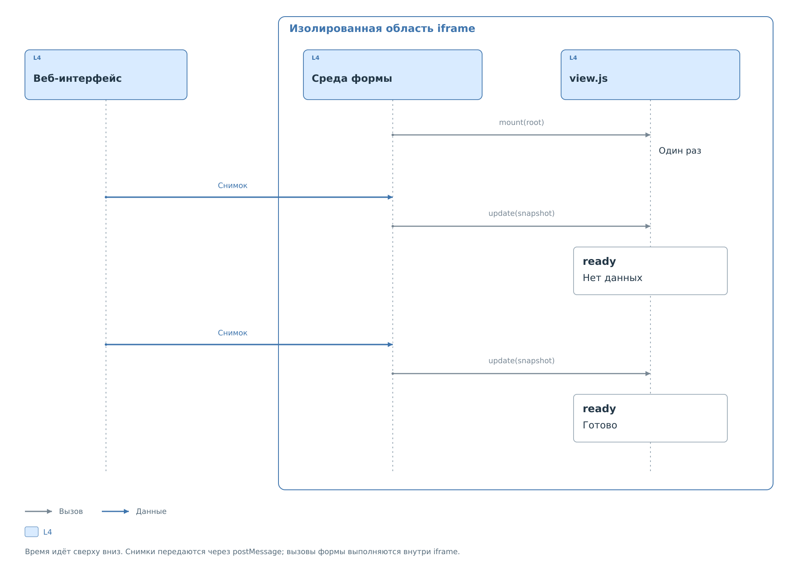

# Индивидуальная форма

Индивидуальная форма нужна, когда стандартной сводки недостаточно:
например, показатели удобнее разместить на схеме устройства.
Профиль подключает её полем `view`. Файл `view.js` получает готовую
расшифровку карты и отвечает за её отображение.

## Создание и обновление

Форма работает в отдельном `iframe`. При открытии вкладки среда вызывает
`mount(root)` для создания элементов. Снимки поступают через `postMessage`;
для каждого среда вызывает `update(snapshot)` внутри iframe.



*Рисунок 1. Вызовы формы при открытии вкладки и обновлении снимка.*

## API формы, версия 1

`view.js` — самостоятельный JS-файл UTF-8 до 65536 байт, без `import`
и внешних зависимостей. Для показателя `ready` из [карты регистров](register-map.md)
достаточно следующей формы:

```js
window.bvstkView = {
  apiVersion: 1,
  mount(root) {
    this.value = document.createElement("p");
    root.append(this.value);
  },
  update(snapshot) {
    const ready = snapshot.summary.find(item => item.id === "ready");
    const label = ready?.label || "Нет данных";
    this.value.textContent = snapshot.stale ? `${label} (связь потеряна)` : label;
  }
};
```

Создавайте элементы в `mount`, меняйте их значения в `update`.
Так обновление не сбрасывает состояние интерактивных элементов.
Строки из снимка вставляйте через `textContent`. При смене вкладки
iframe уничтожается вместе с состоянием и таймерами формы.

## Содержимое снимка

Объект `snapshot` создаёт веб-интерфейс при обновлении данных.
В `map` находится загруженное описание, а `fields` и `summary` содержат
результат его применения к текущему снимку кэша. Поэтому поля карты
и поля этого объекта могут иметь похожие имена, но разные значения:
например, `summary` в файле задаёт правила выбора, а здесь уже содержит
выбранные подписи. Готовый снимок не сохраняют обратно как карту.

| Поле `snapshot` | Значение |
|---|---|
| `api_version` | `1` |
| `device` | `id`, `bus`, `presence` (`responding`, `unavailable`, `unknown`), `address_spaces` |
| `stale` | Нет свежего ответа HTTP; последний снимок сохранён |
| `identity` | `true`, `false` или `null` (неизвестно либо проверка не задана) |
| `map` | Проверенная карта целиком |
| `cache` | Последний массив кэша API: `reg`, `val`, `valid`, `source`, `updated_ms` |
| `fields` | Объект по ключу `register.field` с расшифрованными полями |
| `summary` | Показатели; `id`, `title` (название), `label` (результат), `status`, `tone`, `updated_ms`, необязательные `raw` и `note` |

`device.address_spaces` — массив описаний `id`, `address`, `first`,
`register_count`. Числовое поле `first` задаёт начальный индекс пространства
в `cache`; локальному регистру соответствует `cache.reg = first + address`.
Для обычного профиля массив пуст. Готовые `fields` и `summary` уже учитывают
пространства. Пример: [несколько адресных пространств](address-spaces.md).

У результата поля есть `status`: `known`, `unknown`, `missing` либо
`reserved`; `label`, `tone`, `raw` и `updated_ms`. При наличии реального
значения поле также содержит числовой `value`. Для отсутствующих данных
`raw` и метка равны `null`. Различие между `unknown` и `missing`
разобрано в [достоверности отображения](register-map.md#достоверность-отображения).
При `stale: true` форма получает прежние значения: это нужно обозначать
в собственном представлении, если оно скрывает стандартную индикацию.

## Область выполнения и ошибки

Iframe имеет `sandbox="allow-scripts"`, без
`allow-same-origin`. CSP блокирует запросы сети, формы, внешние ресурсы;
доступа к DOM основной страницы и операциям шины нет.
HTML, CSS и SVG форма создаёт внутри своей области.

Ошибка или отсутствие скрипта возвращает стандартную сводку по карте;
ошибка карты блокирует расшифровку, но не остальные вкладки устройства.

Установка скрипта на плату описана в [главе о файлах](../files.md).
