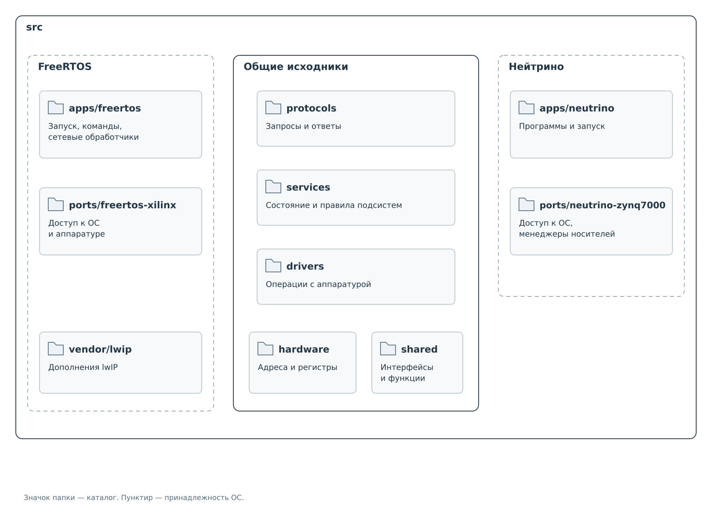
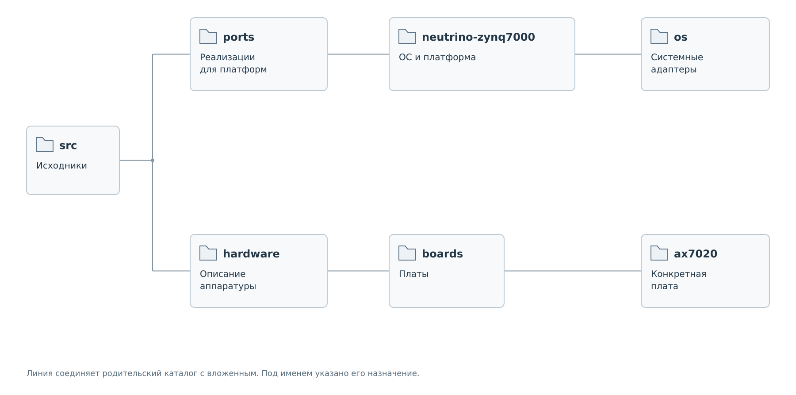

# Карта исходников

Дерево исходников BVSTK построено по ответственности кода и его
зависимостям. Сначала выделяется роль модуля в программе, затем —
подсистема или платформа, к которой он относится. Поэтому код одной
подсистемы может находиться в нескольких ветвях: её алгоритмы,
адаптация к ОС и подключение к приложению решают разные задачи.
При сохранении интерфейса внутреннюю реализацию модуля можно менять
отдельно от кода, который его использует.

Общие алгоритмы отделены от конкретных средств ОС. Для системных
операций они используют интерфейсы, реализации которых выбираются
при сборке. Это позволяет использовать один и тот же код в программах
для разных ОС. Исправление общего алгоритма вносится в одном месте;
изменение способа выполнения системной операции сосредоточено
в адаптации к нужной ОС. При этом общий код может зависеть от устройства
аппаратуры: перенос между ОС и поддержка другого оборудования — разные
задачи.

Создание работающей программы выделено в отдельную обязанность.
Приложение определяет состав модулей, создаёт их экземпляры и связывает
между собой. Зависимости направлены от приложения к используемым
модулям; общие модули не зависят от подключающего их приложения.
Благодаря этому их можно повторно использовать в другом составе
программы.

*Рисунок 1. Назначение каталогов и принадлежность к ОС.*

На рисунке представлены все восемь основных каталогов `src`.
`apps` и `ports` показаны ветвями для каждой ОС, `vendor` — каталогом
`lwip`. Внутренняя структура остальных каталогов свёрнута.

Внутри этих областей путь уточняет назначение кода. Драйверы группируются
по аппаратному интерфейсу, сервисы — по подсистеме, порты — сначала
по ОС, затем по выполняемой функции. Например,
`ports/neutrino-zynq7000/os` содержит системные адаптеры Нейтрино,
а `hardware/boards/ax7020` — описание ресурсов платы.

*Рисунок 2. Чтение пути от общей области к конкретной части исходников.*

## Каталоги исходников

Ниже разобраны каталоги внутри `src`, включая вложенные. Название
каталога в этой таблице ведёт к его описанию; в подробных главах
имена файлов ведут к исходникам. Создаваемые сборкой файлы отмечены
отдельно, с указанием генератора.

| Каталог | Ответственность |
|---|---|
| [shared](source-map/shared.md) | Общие модели, интерфейсы и алгоритмы, которыми пользуются несколько частей программы. Здесь задаются способы взаимодействия модулей. |
| [hardware](source-map/hardware.md) | Программное описание ресурсов платы и регистров ядер PL. Эти сведения связывают драйвер с конкретной аппаратурой. |
| [drivers](source-map/drivers.md) | Выполнение аппаратных операций: подготовка команды, обращение к регистрам и памяти, получение результата. |
| [services](source-map/services.md) | Работа с устройствами и их состоянием: применение политик, поддержание кэша, выполнение операций подсистем. |
| [protocols](source-map/protocols.md) | Перевод сообщений DCP2 в операции системы и формирование протокольных ответов. |
| [ports](source-map/ports.md) | Реализации системных интерфейсов, обработка аппаратных событий и подключение носителей средствами выбранной ОС. |
| [apps](source-map/apps.md) | Состав работающих программ, запуск модулей и обработка пользовательских команд. Разбор разделён на приложения FreeRTOS и Нейтрино. |
| [vendor](source-map/vendor.md) | Включённые в проект сетевые компоненты lwIP, используемые приложением FreeRTOS. |
