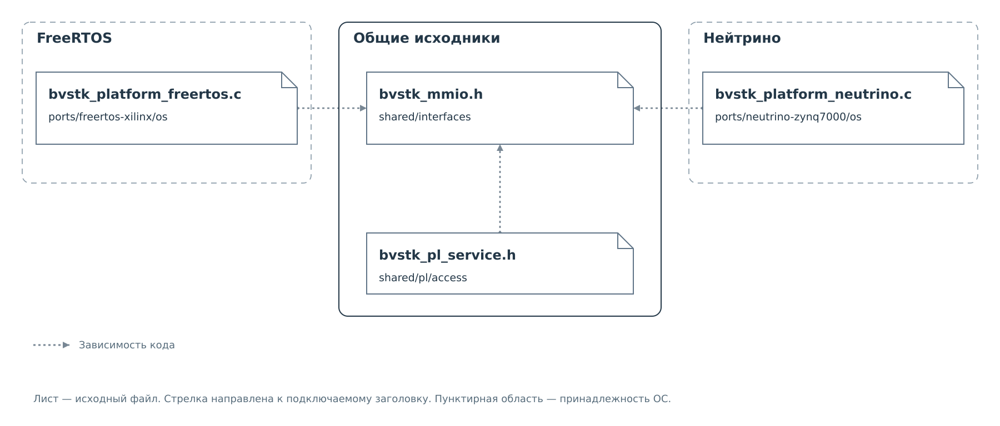

# shared

[Карта исходников](../source-map.md)

В [src/shared](../../../src/shared) находятся части, которыми пользуются
разные модули: типы данных, интерфейсы и самостоятельные алгоритмы.
Здесь есть исполняемый код, в том числе редактор строки и разборщики
профилей. Привязку к системным вызовам обеспечивает [ports](ports.md),
а рабочее состояние конкретной подсистемы находится в [services](services.md).

## shared/base

Базовые типы результатов и преобразования чисел. Они позволяют
передавать ошибки между модулями и одинаково разбирать числовые
аргументы в разных обработчиках.

| Файл | Назначение |
|---|---|
| [bvstk_status.h](../../../src/shared/base/bvstk_status.h) | Определяет общие результаты операций: успех, запрет, тайм-аут, неверный диапазон и другие ошибки. |
| [bvstk_status.c](../../../src/shared/base/bvstk_status.c) | Преобразует результат операции в текстовое имя для вывода. |
| [bvstk_parse.h](../../../src/shared/base/bvstk_parse.h) | Объявляет разбор числа и перестановку байтов в целых значениях. |
| [bvstk_parse.c](../../../src/shared/base/bvstk_parse.c) | Разбирает числовую строку с проверкой остатка и меняет порядок байтов в значениях разной разрядности. |

## shared/interfaces

Эти заголовки задают границы между общими модулями и внешними для них
механизмами. Некоторые интерфейсы представлены обычными функциями,
другие — структурой с контекстом и указателями на функции. Конкретная
реализация подключается при сборке либо передаётся при создании модуля.

*Рисунок 1. Один интерфейс MMIO и исходники, которые его используют.*

`bvstk_pl_service.h` использует тип области памяти из `bvstk_mmio.h`.
Оба файла `bvstk_platform_*.c` включают тот же заголовок и реализуют
объявленные в нём функции средствами своей ОС. В целевую программу
сборка включает подходящую реализацию. Стрелки показывают зависимости
исходников; порядок аппаратных обращений определяется выполняемым кодом.

| Файл | Назначение |
|---|---|
| [bvstk_mmio.h](../../../src/shared/interfaces/bvstk_mmio.h) | Определяет область аппаратной памяти и операции её открытия, закрытия, чтения и записи регистров. |
| [bvstk_clock.h](../../../src/shared/interfaces/bvstk_clock.h) | Предоставляет получение времени и ожидание. Позволяет передать собственные часы; при отсутствии соответствующей функции обращается к реализации платформы. |
| [bvstk_sync.h](../../../src/shared/interfaces/bvstk_sync.h) | Задаёт интерфейс захвата и освобождения блокировки. Сам объект блокировки создаёт его владелец в коде ОС. |
| [bvstk_platform.h](../../../src/shared/interfaces/bvstk_platform.h) | Объявляет начальную подготовку платформы, завершение работы и получение её имени. |
| [bvstk_irq.h](../../../src/shared/interfaces/bvstk_irq.h) | Задаёт таблицу операций подключения, разрешения и отключения IRQ. Текущие адаптеры ведомого I²C используют собственные интерфейсы запуска. |
| [bvstk_output.h](../../../src/shared/interfaces/bvstk_output.h) | Описывает приёмник выводимых байтов: функцию записи и её контекст. Позволяет передавать вывод через разные транспорты. |
| [bvstk_cache_sink.h](../../../src/shared/interfaces/bvstk_cache_sink.h) | Передаёт наблюдателю изменения записи кэша и доступности устройства. Предусматривает защиту изменения и уведомления как одной операции. |

Условия использования времени, блокировок и IRQ разобраны в
[контрактах переноса](../porting.md). Обработчик уведомления о кэше
вызывается синхронно: длительное ожидание или ввод-вывод в нём задержали
бы изменяющий кэш сервис.

## shared/config

Общая модель конфигурации и её преобразование в JSON. Код этого каталога
работает с содержимым профиля. Выбор носителя, загрузка и сохранение
файла относятся к конфигурационному коду [приложений](apps.md).

| Файл | Назначение |
|---|---|
| [bvstk_config_model.h](../../../src/shared/config/bvstk_config_model.h) | Определяет структуры сетевой конфигурации, устройств I²C и MDIO, правил политик, начальных значений и метаданных профиля. |
| [bvstk_device_profile.h](../../../src/shared/config/bvstk_device_profile.h) | Объявляет операции с профилем устройства: определение версии, разбор, формирование JSON и проверку имён связанных ресурсов. |
| [bvstk_device_profile.c](../../../src/shared/config/bvstk_device_profile.c) | Переводит профиль версии 2 в рабочую модель I²C или MDIO и обратно. Проверяет свойства профиля и имена связанных ресурсов. |
| [bvstk_i2c_config_codec.h](../../../src/shared/config/bvstk_i2c_config_codec.h) | Объявляет разбор, проверку и сериализацию конфигурации I²C. |
| [bvstk_i2c_config_codec.c](../../../src/shared/config/bvstk_i2c_config_codec.c) | Поддерживает прежний формат I²C, проверяет параметры и списки правил; обработку профиля версии 2 передаёт модулю профилей. |
| [bvstk_mdio_config_codec.h](../../../src/shared/config/bvstk_mdio_config_codec.h) | Объявляет преобразование конфигурации MDIO и проверку допустимости записи по её правилам. |
| [bvstk_mdio_config_codec.c](../../../src/shared/config/bvstk_mdio_config_codec.c) | Разбирает и формирует конфигурацию MDIO, проверяет её ограничения и применяет правила записи с масками. |

Форматы и порядок применения описаны в
[главе конфигурации](../../system/configuration/configuration.md).

## shared/events

Общий язык событий и журнал. Сервис сообщает о произошедшем через
приёмник событий; приложение решает, куда передать это сообщение
и как защитить совместный доступ к журналу.

| Файл | Назначение |
|---|---|
| [bvstk_event.h](../../../src/shared/events/bvstk_event.h) | Определяет событие, его источник, подсистему, результат и аргументы, а также функцию приёма событий. |
| [bvstk_journal.h](../../../src/shared/events/bvstk_journal.h) | Описывает кольцевые журналы, номера записей и результат чтения очередной порции событий. |
| [bvstk_journal.c](../../../src/shared/events/bvstk_journal.c) | Помещает события в журналы, выбирает записи после заданного номера и сообщает о потерянной истории. Разделяет события и телеметрию. |

Во FreeRTOS защиту журнала добавляет `bvstk_observer.c` из
[приложения](apps/freertos.md). Механизм чтения истории рассмотрен в
[главе наблюдения](../../system/observation/observation.md).

## shared/cli

Редактирование строки и подбор дополнений вынесены из транспортов
консоли. Редактор получает байты, хранит строку и вызывает переданные
ему функции вывода и выполнения команды. Поэтому его можно использовать
в разных оболочках.

| Файл | Назначение |
|---|---|
| [bvstk_line_editor.h](../../../src/shared/cli/bvstk_line_editor.h) | Определяет состояние редактора, историю и функции, которыми оболочка подключает вывод, приглашение, выполнение и дополнение строки. |
| [bvstk_line_editor.c](../../../src/shared/cli/bvstk_line_editor.c) | Обрабатывает ввод, перемещение курсора, удаление, историю и Tab; передаёт завершённую строку обработчику команды. |
| [bvstk_i2c_completion.h](../../../src/shared/cli/bvstk_i2c_completion.h) | Описывает список устройств и результат подбора дополнений для команд I²C. |
| [bvstk_i2c_completion.c](../../../src/shared/cli/bvstk_i2c_completion.c) | Подбирает имена устройств, операции и параметры политики по положению курсора в строке I²C. |
| [bvstk_mdio_completion.h](../../../src/shared/cli/bvstk_mdio_completion.h) | Задаёт данные устройств и интерфейс дополнения команд MDIO. |
| [bvstk_mdio_completion.c](../../../src/shared/cli/bvstk_mdio_completion.c) | Подбирает устройства и ключевые слова команд MDIO. |

## shared/pl

Общая часть прямого доступа к областям PL. Единственный вложенный
каталог `access` объединяет операции по именованным аппаратным регионам.

### shared/pl/access

Модуль связывает [таблицу регионов платы](hardware.md) с интерфейсом
MMIO. Область отображается при первом обращении и остаётся доступной
до завершения работы экземпляра.

| Файл | Назначение |
|---|---|
| [bvstk_pl_service.h](../../../src/shared/pl/access/bvstk_pl_service.h) | Описывает набор открытых регионов и интерфейс чтения или записи слова по идентификатору региона и смещению. |
| [bvstk_pl_service.c](../../../src/shared/pl/access/bvstk_pl_service.c) | Находит описание региона, открывает его через MMIO, выполняет доступ и переводит ошибки в общий статус BVSTK. |

## shared/protocols

Модели сообщений и вспомогательные операции, используемые сетевыми
обработчиками. Общая обработка команд DCP2 расположена отдельно,
в [protocols](protocols.md).

### shared/protocols/dcp2

| Файл | Назначение |
|---|---|
| [bvstk_dcp2_model.h](../../../src/shared/protocols/dcp2/bvstk_dcp2_model.h) | Определяет виды уведомлений DCP2, их данные и фильтр подписки по источнику, подсистеме и классу события. |

### shared/protocols/http

Здесь определены данные HTTP-запроса и общие проверки входных значений.
Обработчики маршрутов находятся в [приложении FreeRTOS](apps/freertos.md).

| Файл | Назначение |
|---|---|
| [bvstk_http.h](../../../src/shared/protocols/http/bvstk_http.h) | Описывает запрос, соединение и функцию чтения тела, через которые сервер передаёт данные обработчику маршрута. |
| [bvstk_http_input.h](../../../src/shared/protocols/http/bvstk_http_input.h) | Объявляет проверки параметров URL, чисел, файлового пути, JSON и вычисление ревизии конфигурации. |
| [bvstk_http_input.c](../../../src/shared/protocols/http/bvstk_http_input.c) | Разбирает и проверяет входные значения, включая повторяющиеся поля JSON и выход пути за разрешённую область; вычисляет ревизию канонического JSON. |
