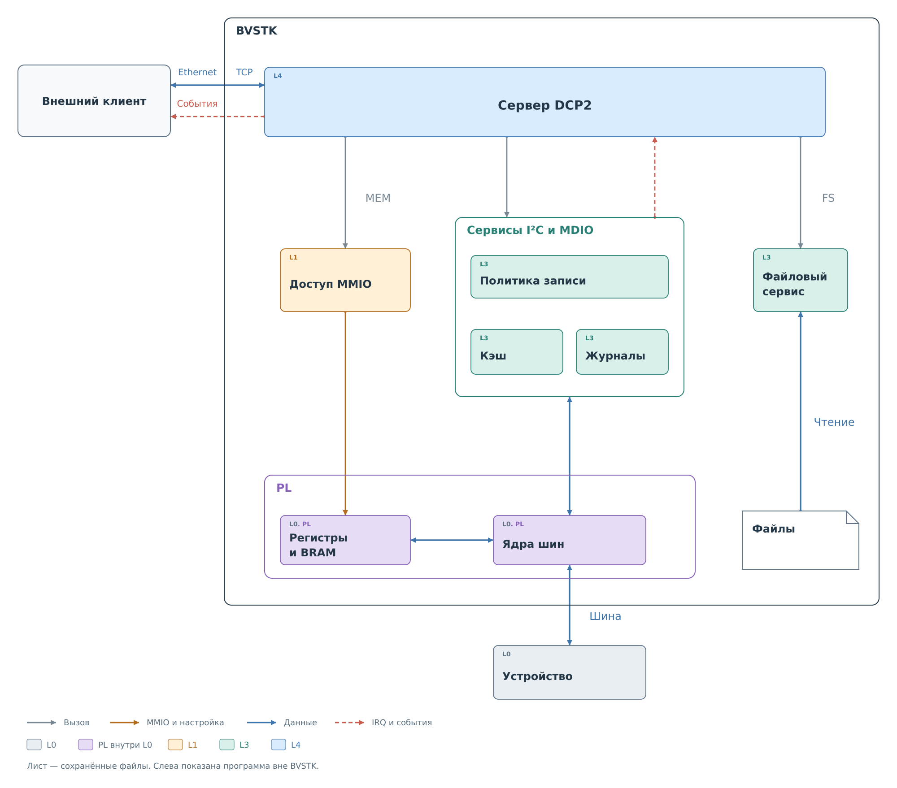

# Назначение DCP2

DCP2 — двоичный протокол, по которому внешняя программа подключается
к BVSTK через Ethernet. Клиент устанавливает TCP-соединение с сервером
на плате, отправляет команды и получает результаты. По умолчанию сервер
слушает порт `8889`. Через подписки клиент также получает уведомления
об изменениях в системе.

*Рисунок 1. Направления обращений через DCP2. Цвета соответствуют
[уровням абстракции BVSTK](../../system/system.md#уровни-абстракции).
Обмен с PL показан без промежуточных драйверов.*

Сервер DCP2 относится к пользовательским функциям L4: он принимает сетевой
запрос и передаёт операцию нужной части системы. Например, команда записи
регистра поступает сервису устройства L3. Сервис проверяет политику записи,
вызывает драйвер и обновляет своё состояние по результату обмена.
Физическую транзакцию выполняет ядро PL.

Клиент может читать и записывать регистры устройств I²C и MDIO,
получать и редактировать их политики записи. Отдельные команды дают доступ к программному кэшу
и наблюдениям. Чтение кэша возвращает уже сохранённое состояние и не запускает
новый обмен на шине. Файловый сервис позволяет читать содержимое носителей;
запись файлов через DCP2 сейчас не предусмотрена.

Команды MEM обращаются к разрешённым аппаратным адресам через механизм MMIO.
Этот путь обходит сервис устройства и его политику записи. Поэтому работа
с регистром ядра PL через MEM и команда записи регистра внешнего устройства —
разные операции, даже если обе меняют состояние аппаратуры.

Обе ОС подключают общую сессию DCP2: PING, MEM, I²C, MDIO, POLICY,
FS, NOTIFY, STREAM и CACHE. Готовность шин и томов проверяется отдельно;
точная сводка приведена в [главе о командах](reference/commands.md#сервисы).

---

Для работы с платой используйте [готовый клиент](client.md): в его главе
собраны команды чтения, изменения политик, работы с файлами и подписками.
Устройство протокола последовательно разобрано в следующих главах:

- [Обмен сообщениями](02-exchange.md).
- [Команды](03-commands.md).
- [Управление политиками](04-policies.md).
- [События и подписки](05-events.md).
- [Файловый сервис](06-fs.md).
- [Кэш](07-cache.md).

Точные определения находятся в справочнике:
[кадр](reference/frame.md), [основные команды](reference/commands.md),
[политики](reference/policies.md), [события](reference/events.md),
[FS](reference/fs.md), [CACHE](reference/cache.md)
и [статусы](reference/statuses.md).

Конкретные сообщения разобраны в `examples`; начать можно
с [проверки соединения](examples/connection.md).
Ссылки на остальные примеры приведены рядом с соответствующими механизмами.
