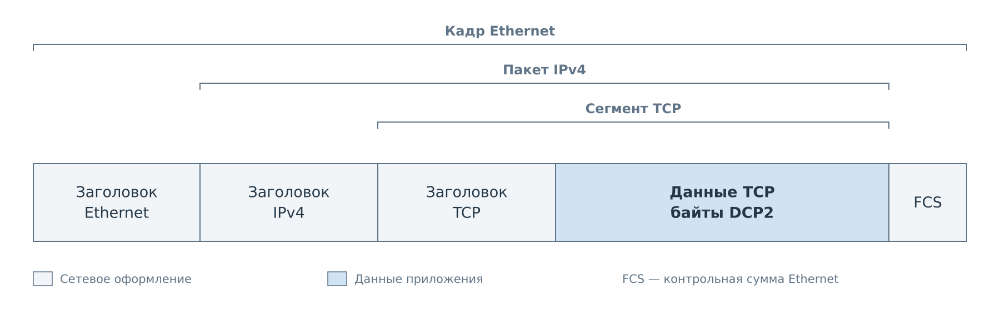
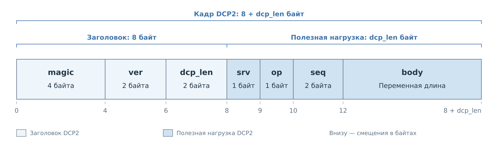
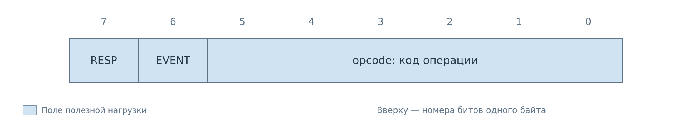
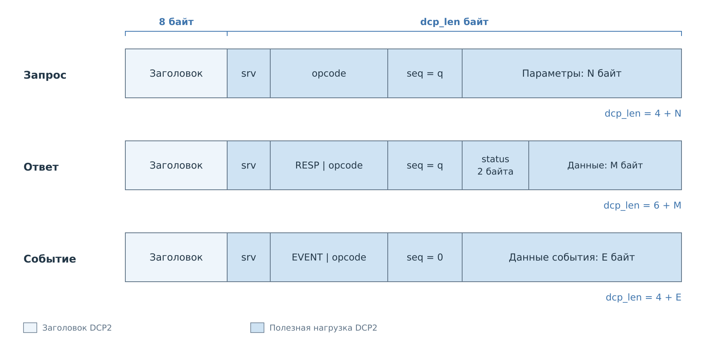
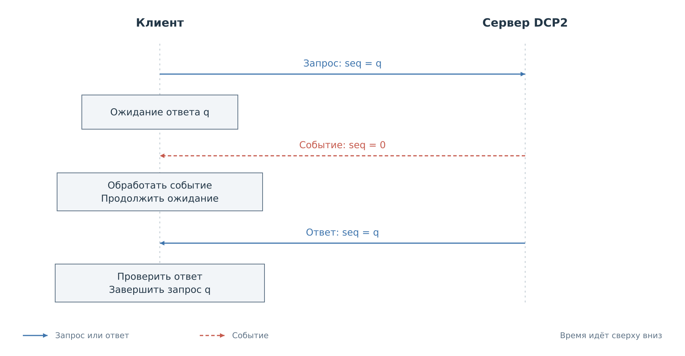

# Обмен DCP2

Клиент и сервер обмениваются сообщениями через TCP. Чтобы получить
результат операции, клиент должен выделить целый кадр из потока байтов,
отличить ответ от события и сопоставить его с отправленным запросом.

## DCP2 внутри сетевого кадра

При передаче через IPv4 кадр Ethernet содержит пакет IPv4, внутри которого
находится сегмент TCP. Байты DCP2 помещаются в полезные данные TCP.

*Рисунок 1. Вложенность сетевых форматов. Скобки обозначают границы структур.
Ширина полей условная; служебные детали опущены.*

Ethernet обеспечивает передачу по локальному участку сети, IPv4 задаёт
адреса отправителя и получателя, а TCP доставляет упорядоченный поток байтов
между клиентом и сервером. Заголовки этих протоколов добавляет и разбирает
сетевой стек. Через TCP-сокет приложение передаёт и получает только байты
DCP2. Контрольная сумма Ethernet, обозначенная как FCS, в них не входит.

Границы сегментов TCP не задают границы сообщений DCP2. Одно сообщение
может передаваться несколькими сегментами, а один сегмент может содержать
несколько сообщений или их части. Поэтому у DCP2 есть собственный
заголовок, по которому получатель определяет длину целого сообщения.

## Структура кадра

Сообщение, или кадр DCP2, состоит из заголовка фиксированной длины
и полезной нагрузки. Заголовок позволяет выделить кадр из потока TCP.
Полезная нагрузка определяет сервис, операцию и передаваемые данные.
Этот формат общий для запросов, ответов и событий.

*Рисунок 2. Общая структура кадра DCP2. Поле `body` имеет переменную длину; ширина ячеек условная.*

В схемах отдельных сервисов `body` раскрывается отдельно под общими полями.
Поля читаются слева направо, при переносе — с начала следующей строки.
Зазоры между ячейками помогают различать поля; дополнительных байтов между ними нет.
В конкретных примерах числовые байты записаны шестнадцатерично. Строка
в кавычках обозначает байты UTF-8 без кавычек и завершающего NUL;
`\n` означает один перевод строки `0x0A`.

## Приём сообщения

Получатель сначала накапливает заголовок. Его сигнатура и версия
позволяют проверить формат, а `dcp_len` определяет, сколько байтов
ещё нужно получить. Остаток содержит сервис, операцию, номер запроса
и тело сообщения. Поиск сигнатуры внутри тела не заменяет расчёт длины:
такие же байты могут встретиться в передаваемых данных.

Один вызов чтения сокета может вернуть часть кадра или несколько кадров.
Поэтому приёмник сохраняет незавершённое сообщение и отдельно обрабатывает
байты следующего. Точная структура и порядок кодирования чисел приведены
в [справочнике кадра](reference/frame.md).

## Запрос, ответ и событие

Клиент выбирает сервис и операцию, помещает её параметры в `body`
и назначает номер `seq`. Сервер возвращает этот номер в ответе вместе
с результатом. Один и тот же код операции может обозначать разные
действия в разных сервисах, поэтому клиент сохраняет и эти сведения.

В поле `op` совмещены код операции и признаки сообщения. При формировании
ответа код операции сохраняется, а отдельный признак отличает ответ
от запроса.

*Рисунок 3. Старшие биты `op` задают тип сообщения, младшие — операцию сервиса.*

У события отдельный признак в `op` и нулевой номер `seq`. Оно сообщает
о наблюдаемом изменении и не завершает ожидающий запрос. Тело ответа
начинается со статуса операции; тело события определяется подпиской.
Уведомление может иметь собственное поле статуса, относящееся
к наблюдаемому действию.

*Рисунок 4. Параметры запроса, статус с результатом и данные события занимают
одну и ту же часть кадра — `body`. Точный состав зависит от операции.*

Значения признаков и правила нумерации: [поля `op` и `seq`](reference/frame.md#сервис-операция-и-номер-запроса).

## Последовательность обмена

Клиент сохраняет номер и тип отправленного запроса, затем принимает целые
кадры. Перед разбором тела он проверяет `op`. Ответ сопоставляется с запросом
по `seq`; дополнительно должны совпасть сервис и код операции. Событие
направляется обработчику уведомлений и не завершает ожидающий запрос.

*Рисунок 5. Ответ сохраняет номер запроса. При действующей подписке клиент
может получить событие во время ожидания ответа.*

Текущие серверы BVSTK выполняют запросы последовательно. При этом в серверном
потоке могут находиться уведомления, подготовленные до обработки очередного
запроса. Поэтому правило «следующий принятый кадр — мой ответ» неверно.
Подтверждение доставки TCP также не означает выполнения операции: результат
приходит в `status` ответа DCP2.

Если клиент держит несколько запросов в ожидании, их номера должны различаться.
Поздний ответ после таймаута нельзя принять за результат новой операции.
Такой ответ нужно полностью прочитать и отделить по номеру; немедленное
повторное использование его `seq` создаёт неоднозначность. Новое соединение
начинает отдельное пространство номеров и новое состояние сервисов.

## Ошибки обмена

При неверном заголовке сервер закрывает соединение: продолжить надёжный
разбор сообщений он не может. Если кадр принят, ошибку параметров
или выполнения обычно можно вернуть в ответе. Клиент сначала проверяет
статус и только при успехе разбирает результат команды.

Ошибка операции не всегда означает, что состояние осталось прежним.
Составное действие могло выполнить часть работы. В таком случае
нужно получить текущее состояние и определить дальнейшее действие.
Числовые коды и их значения собраны
в [справочнике статусов](reference/statuses.md).

## Ожидание и повторная отправка

Истечение времени ожидания означает, что клиент не получил результат вовремя.
Из этого нельзя заключить, что сервер не выполнил запрос. `seq` помогает
сопоставить сообщения, но сервер не использует его для устранения повторных
операций. Даже повтор с прежним номером может снова выполнить запись.

Единого обязательного таймаута и числа повторов для всех команд нет.
Штатный Python-клиент по умолчанию использует таймаут 5 секунд. Поведение
при повторе зависит от операции. Файловый клиент повторяет чтение
по дескриптору и номеру блока. Для записи регистра автоматических повторов нет.
Клиент CACHE после таймаута запроса требует переподключения и нового снимка.
Правила FS и CACHE раскрыты в соответствующих главах.

При сохранении соединения после таймаута приёмник должен сохранять уже
прочитанную часть кадра. Начать чтение нового заголовка посреди прежнего тела
нельзя. Если состояние приёмника потеряно, потребуется новое соединение.

## Доступные операции

Одинаковая версия кадра не означает одинаковый состав сервера.
Подключённые сервисы зависят от приложения и сборки. Поэтому до работы
с устройством клиенту нужно учитывать
[доступность команд](reference/commands.md#сервисы).

Далее: [Выполнение команд](03-commands.md). Конкретные запросы
и ответы разобраны в [примере соединения](examples/connection.md).
