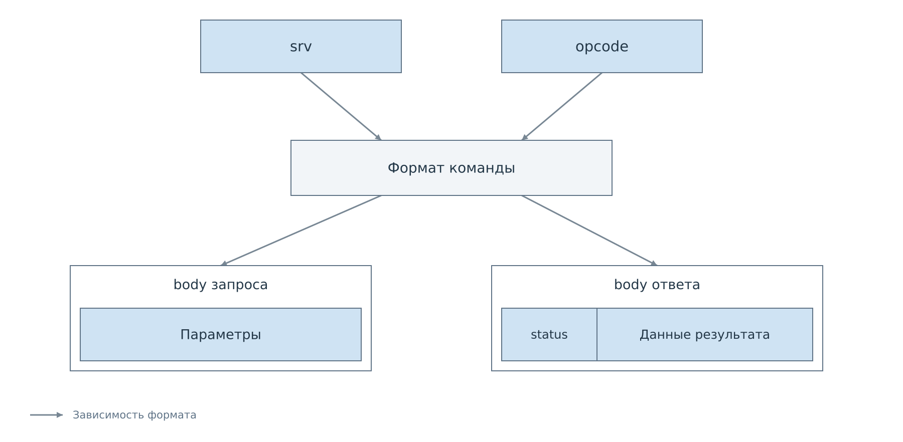
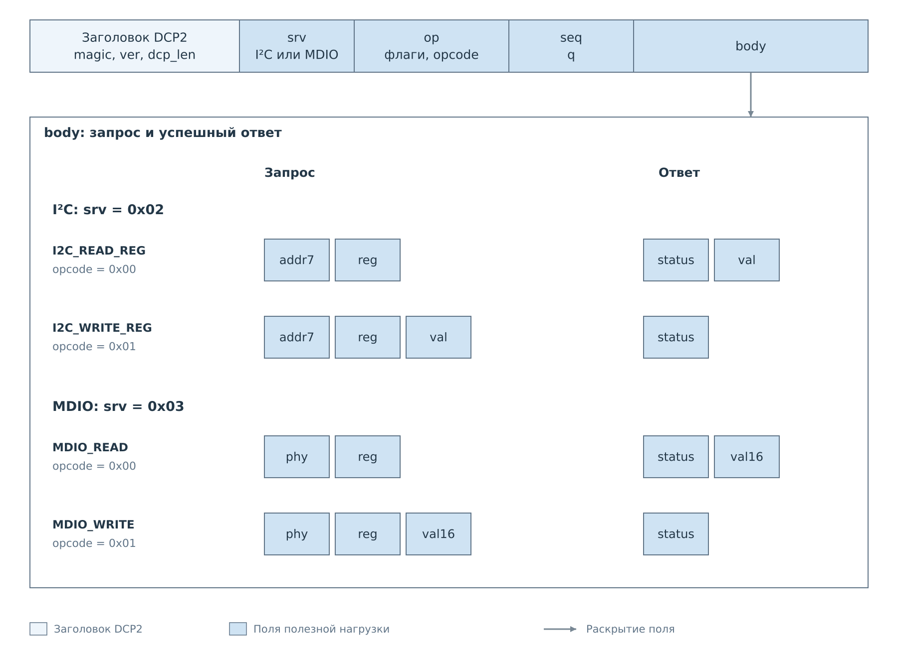
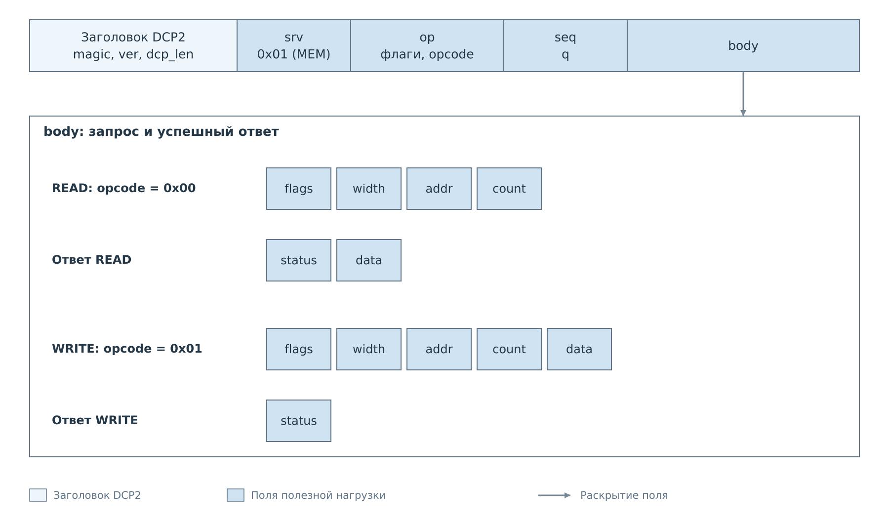

# Команды DCP2

После выделения [целого кадра](02-exchange.md) сервер знает его длину, сервис
и код операции. Теперь нужно разобрать `body`. Для этого сначала выбирается
сервис по `srv`, затем обработчик по `opcode`. Выбранный обработчик определяет
поля запроса, допустимые значения и состав успешного ответа.

## Выбор формата тела

*Рисунок 1. Сервис и код операции определяют две связанные структуры:
параметры запроса и данные результата. Общий заголовок DCP2 сохраняется.*

Например, `opcode=0` в I²C означает чтение байтового регистра, а в MDIO —
чтение 16-битного регистра PHY. Число байтов результата различается, хотя код
операции одинаков. Клиент должен сохранить выбранную команду вместе с `seq`,
чтобы правильно разобрать её ответ.

Точные идентификаторы сервисов и форматы тел собраны
в [справочнике команд](reference/commands.md). Далее рассмотрим,
какая работа происходит за запросом клиента.

## Регистровые операции

Для обращения к регистру устройства клиент передаёт адрес устройства
и номер регистра. Сервер находит уже созданный экземпляр сервиса,
который выполняет обмен через драйвер и ядро PL. Клиенту не требуется
знать адрес аппаратных регистров самого ядра.

*Рисунок 2. I²C передаёт байтовое значение регистра, MDIO — 16-битное.
При записи значение находится в запросе, при чтении — в ответе.*

Типы полей: [регистровые команды](reference/commands.md#регистровые-команды).

Чтение возвращает значение по результату операции сервиса. Запись сначала
проходит проверку политики. При запрете аппаратная операция не начинается;
при разрешении дальнейший результат зависит от обмена с устройством.
Смысл успешного завершения определяется шиной: например, кадр записи MDIO
не имеет подтверждения от PHY. Подробности прослеживаются
в [описании MDIO](../../system/pl-subsystem/mdio/mdio.md).

Политика влияет на последующие записи. Её изменение выполняется отдельными
командами, которые рассматриваются в [следующей главе](04-policies.md).
Чтение, запрет и повторная запись показаны в [примере I²C](examples/i2c.md),
а кадры регистровых операций — в [примере MDIO](examples/mdio.md).

## Прямой доступ к аппаратным адресам

MEM обращается к разрешённой области памяти или регистрам PL по физическому
адресу. Такой запрос проходит через механизм MMIO и обходит политику
оконечного устройства. Он может изменить работу ядра, поэтому смысл
адреса и значения определяется аппаратным описанием платы.

В MEM клиент задаёт разрядность и число элементов. Для чтения массив
значений приходит в ответе; для записи клиент передаёт его вместе
с параметрами доступа.

*Рисунок 3. Параметры доступа MEM одинаковы для чтения и записи; положение
массива `data` зависит от направления обмена.*

При пакетном доступе важно, обращается ли каждый элемент к следующему
адресу или повторяет предыдущий. Для регистров с побочными эффектами
это разные операции. Текущие серверы FreeRTOS и Нейтрино различаются
по поддерживаемым параметрам и продвижению адреса; точные условия
приведены в [таблицах MEM](reference/commands.md#mem-чтение-и-запись-памяти).
Конкретная последовательность адресов показана в [примере](examples/memory.md).

## Готовность сервера и устройств

PING подтверждает, что сервер принимает команды и формирует ответы.
Это не подтверждает готовность носителя, подключение устройства
или наличие всех аппаратных ядер. Доступность нужной подсистемы
определяется её состоянием и составом программы.

## Команды с состоянием соединения

Простая регистровая команда завершается одним ответом. Подписка создаёт
состояние, которое продолжает действовать после её ответа. Файловый `OPEN`
возвращает дескриптор для следующих `READ`, а CACHE выдаёт идентификаторы
снимка и подписки. Такие связи передаются внутри `body` и не заменяют `seq`.

В следующих главах разобрано создание и использование этого состояния.
Поля сообщений вынесены в справочник, а конкретные обмены — в примеры.

Далее: [Управление политиками](04-policies.md).
