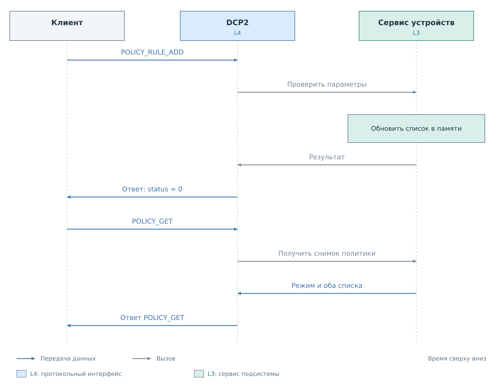
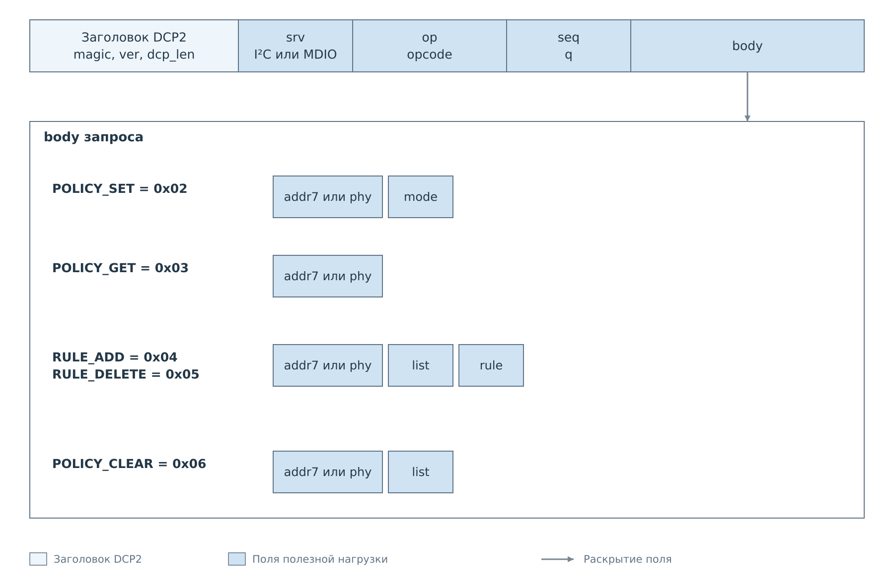
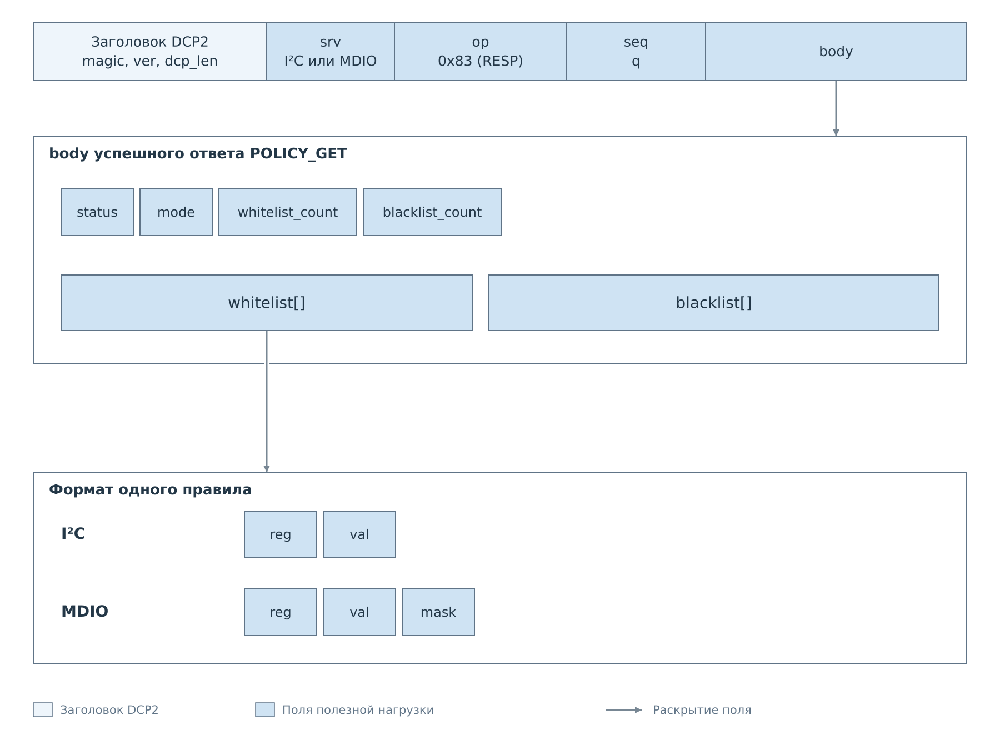

# Управление политиками DCP2

Политика устройства определяет, какие записи сервис передаёт аппаратуре.
Клиент DCP2 может получить действующую политику, выбрать режим, добавить
или удалить правило, очистить один из списков и сохранить профиль устройства.
Редактирование меняет правила работающего сервиса, а команда `POLICY_SAVE`
записывает текущий профиль на носитель. Операции политики обходятся без
транзакций на физической шине.

Команды доступны для I²C и MDIO. Сервис POLICY `0x09` выбирает устройство
по паре ID подсистемы и профиля. Правила ссылаются на ID ресурса из профиля.
Поэтому устройства с одинаковыми адресами на разных каналах свитча имеют
независимые политики. Маршрут определяется конфигурацией PS.
Адресные команды в сервисах I²C и MDIO сохраняют прежние форматы.
В FreeRTOS они работают при наличии соответствующего ядра PL и готового
сервиса. В `bvstkd` Нейтрино подключены I²C и MDIO. Для каждой подсистемы
загружается собственный набор профилей, а сохранение выполняется только по SAVE.

## Действующая политика

У устройства есть режим и два независимых списка. В режиме `WHITELIST`
запись разрешена, если она совпала хотя бы с одним правилом белого списка.
В режиме `BLACKLIST` запись разрешена, если ни одно правило чёрного списка
не совпало. Неактивный список хранится и тоже может редактироваться.

**Пустой белый список запрещает все записи, пустой чёрный — разрешает все
допустимые записи.** Адреса, диапазоны регистров и значений при этом
проверяются отдельно. Политики относятся к записи; чтение регистра
не проверяется этими списками.

Для I²C правило содержит точную пару `reg` и `val`. Например, правило
для регистра `0x10` со значением `0x03` не разрешает значение `0x04`
в том же регистре.

Для MDIO правило дополнительно содержит `mask`. Совпадение определяется
номером регистра и выражением `(value & mask) == (val & mask)`.
Маска `0xFFFF` сравнивает всё значение, `0` принимает любое значение
этого регистра. Разные маски остаются разными правилами.

## Изменение и проверка результата

*Рисунок 1. Успешное добавление правила и последующая проверка через POLICY_GET.*

Каждая команда выбирает устройство. Остальные поля зависят от действия:
переключению нужен режим, редактированию — список и правило.
Для сервиса POLICY цель — `subsystem + device`, регистр выбирается по
`resource`. В адресных командах цель задаётся физическим адресом. Схема
ниже показывает адресный формат.

*Рисунок 2. Состав запроса определяется действием над политикой.*

Коды команд и типы полей: [форматы запросов](reference/policies.md#форматы-запросов).

Сервис проверяет параметры до изменения списка. Если правило уже есть,
повторное добавление возвращает успех и не создаёт вторую запись.
Удаление относится только к выбранному списку; такое же правило в другом
списке сохраняется. Режим меняет только `POLICY_SET`, поэтому заполнение
белого списка не включает его автоматически.

`POLICY_GET` возвращает согласованную копию режима и обоих списков на момент
выполнения команды. В сервисе POLICY большой снимок передаётся страницами,
которые связаны токеном и одним TCP-соединением; клиент собирает их автоматически.
Несколько запросов редактирования не образуют единую
транзакцию: между ними другой клиент или консоль могут изменить политику.
Если требуется подготовить новый список перед включением, сначала заполните
неактивный список, проверьте его через GET, затем переключите режим.

*Рисунок 3. GET возвращает оба списка. Их счётчики задают границы массивов,
а формат отдельного правила совпадает с форматом ADD и DELETE.*

Форматы записей и пределы списков: [ответ GET и правила](reference/policies.md#ответ-policy_get-и-правила).

Номер `seq` связывает запрос с ответом. Он не является ревизией политики
и не защищает от повторного исполнения команды. Штатный клиент отправляет
операцию изменения один раз. После потерянного ответа прочитайте текущую
политику, прежде чем решать, нужна ли повторная команда.

## Рабочая конфигурация и сохранение

Редактирование через DCP2 меняет правила работающего сервиса. Поэтому
результат нужно проверять через `POLICY_GET`: чтение файла профиля
покажет сохранённое состояние, которое может отставать от рабочего.
Изменение правил само по себе не перезапускает опрос и не выполняет
запись физического регистра.

После редактирования отправьте `POLICY_SAVE` с ID подсистемы и устройства.
В прежнем адресном сервисе SAVE принимает адрес устройства.
Команда сохраняет текущий профиль целиком, включая режим, оба списка правил,
настройки и ссылки на карту регистров и представление. Во FreeRTOS файл находится
в `flash:/config/<bus>/<device>/<device>.json`. Успешный ответ приходит после
завершения сохранения. Сбой записи возвращается как ошибка DCP2.

SAVE получает согласованный снимок конфигурации и сохраняет его через штатное
хранилище. Содержимое кэша дополнительно не переносится в стартовые настройки.
Правки, выполненные другим клиентом после получения снимка, потребуют следующего
сохранения. После потери ответа файл можно проверить через FS; GET показывает
только рабочую политику из RAM.

Прежняя команда I²C SET имеет особый путь синхронизации:
он может переносить действительные значения кэша в настройки, но в обеих ОС
не записывает профиль автоматически. Точные различия перечислены
в [таблице сохранения](reference/policies.md#рабочая-конфигурация-и-сохранение).

Успешный ответ сообщает результат команды, но его смысл нужно соотносить
с поведением целевой программы. После ошибки внутренней синхронизации правило уже могло
измениться в сервисе. Повторное чтение позволяет установить фактический
результат до дальнейших действий. Общая связь файла и рабочего состояния
разобрана в [жизненном цикле конфигурации](../../configuration/lifecycle.md).

Поля команд и условия ошибок находятся в
[справочнике политик](reference/policies.md). Добавление правила и работа
с маской разобраны в [примерах](examples/policies.md).
Команды готового клиента приведены в [руководстве](client.md#политики-i²c-и-mdio).

Далее: [События и подписки](05-events.md).
