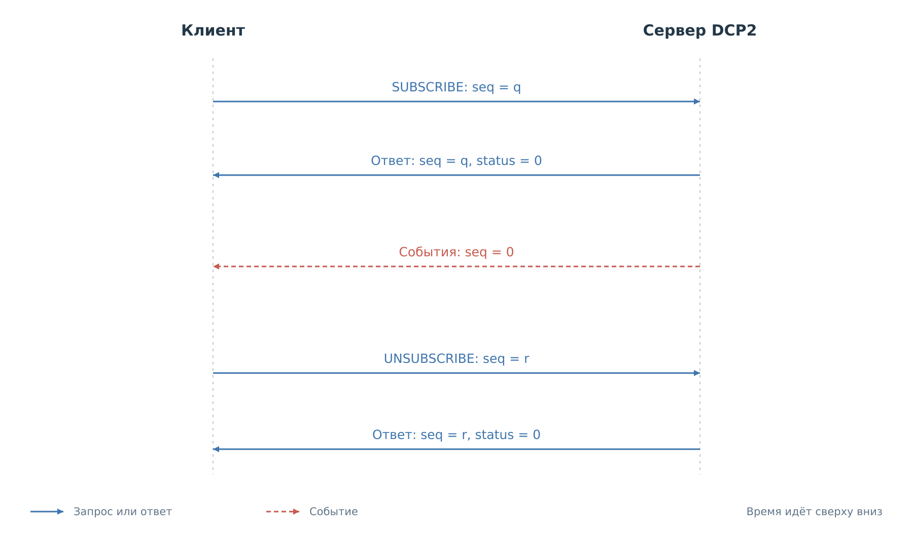
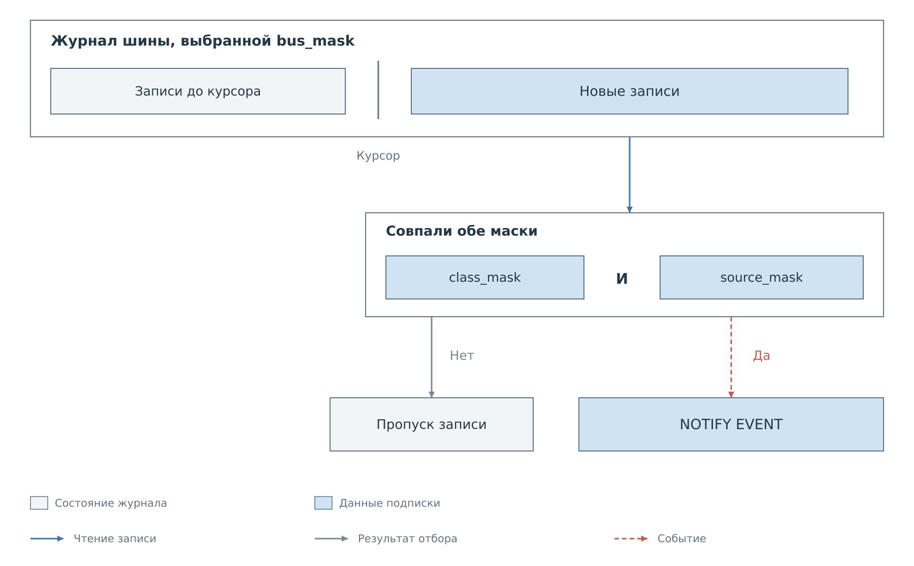
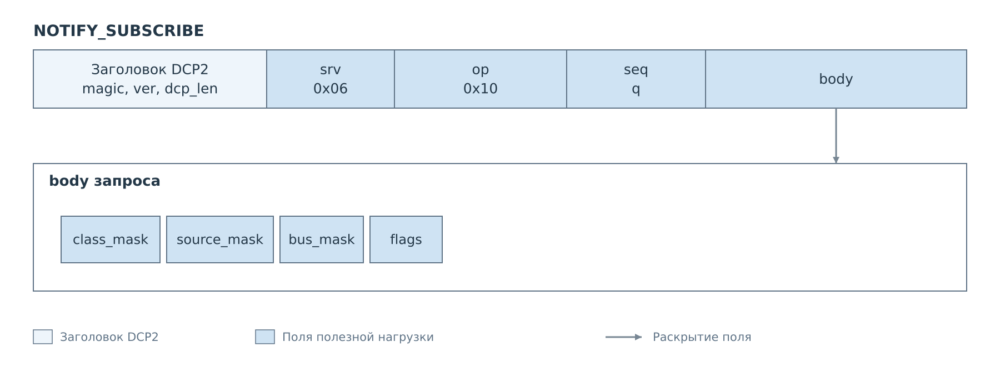
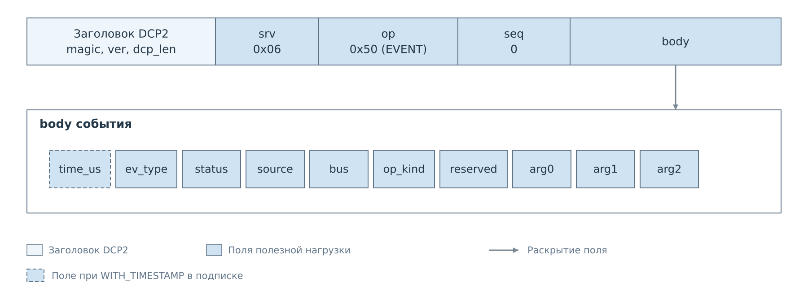
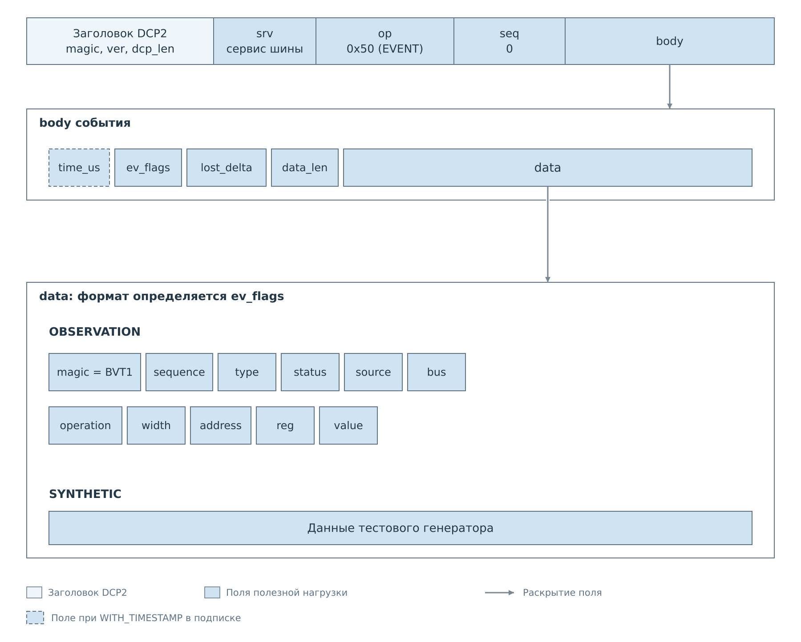

# События и подписки DCP2

В [обычном обмене](03-commands.md) клиент отправляет команду и получает один
ответ. Подписка добавляет к этому обмену уведомления: после подтверждения
подписки сервер может самостоятельно отправлять новые кадры. Они идут
по тому же TCP-соединению, имеют признак `EVENT` и `seq=0`.

## Установка подписки и доставка событий

Запрос подписки оформляется как обычная команда с ненулевым `seq`.
У NOTIFY и STREAM ответ подтверждает установку подписки, а наблюдаемые данные
приходят в последующих событиях. Для отмены клиент отправляет отдельную команду;
закрытие TCP-соединения также уничтожает подписки.

*Рисунок 1. Подписка NOTIFY или STREAM. Подтверждения относятся к запросам
по `seq`. Уведомления имеют нулевой номер и могут приходить между ответами
на другие команды.*

Общая сессия серверов FreeRTOS и Нейтрино поддерживает три семейства уведомлений:

| Семейство | Содержимое | Выбор данных |
|---|---|---|
| NOTIFY | Действия и состояния: попытка записи, результат, отказ, изменение состояния | Маски классов, источников и шин |
| STREAM | Наблюдения обмена и данные тестового генератора | Сервис шины и флаги подписки |
| CACHE | Изменения значений и готовности устройства | Имена подсистемы и устройства |

CACHE возвращает первую страницу снимка уже в ответе на подписку. Начальное
состояние нужно согласовать с последующими изменениями; эта последовательность
разобрана в [главе о кэше](07-cache.md). Текущий
`bvstkd` эти семейства подписок не обслуживает.

## Отбор уведомлений NOTIFY

NOTIFY сообщает о действиях и состояниях: попытке записи, её результате,
отказе политики, изменении состояния. Клиент выбирает классы событий,
источники действий и шины. Для обычной записи должны одновременно
подойти все три условия; внутри каждого можно выбрать несколько значений.

*Рисунок 2. Отбор обычной записи журнала. Маска шин выбирает журнал,
маски класса и источника — записи внутри него.*

Эти условия передаются тремя масками в запросе подписки. Флаги задают
дополнительные свойства, в том числе наличие метки времени.
Номера битов приведены в [таблице масок](reference/events.md#notify-отбор-уведомлений).

*Рисунок 3. Фильтр NOTIFY находится в теле обычного запроса DCP2.*

Сервер хранит позицию чтения каждого выбранного журнала. После подписки
он начинает с текущего конца и рассматривает новые записи. Позиция
продвигается даже тогда, когда запись не проходит фильтр. Поэтому
последующее расширение фильтра не возвращает ранее пропущенные действия.
Повторная подписка заменяет фильтр и снова начинает с текущего конца.

Ответ команды и событие имеют разное назначение. Ответ сообщает результат
запроса клиента. Событие сообщает о наблюдаемом действии, которое могло
быть вызвано этим клиентом, другим интерфейсом или внутренней службой.
Статус внутри уведомления относится к такому действию; его коды определены
переносимым сервисом и перечислены отдельно в
[справочнике статусов](reference/statuses.md#статус-в-notify-и-bvt1).

Уведомление связывает действие с источником и подсистемой. Для записи
регистра аргументы передают устройство, регистр и значение. Клиент
заранее знает из своей подписки, присутствует ли начальная метка времени.

*Рисунок 4. Данные наблюдаемого действия внутри события NOTIFY.
Поле `status` здесь относится к действию, а не к ответу на команду.*

Поля и коды действий: [формат NOTIFY](reference/events.md#формат-события-notify).

## Потеря истории

Журналы находятся в RAM и имеют конечную ёмкость. Если сервер не успевает
прочитать записи, новые вытесняют старые. NOTIFY сообщает об этом
уведомлением `SOFTWARE_LOSS`. Оно проходит независимо от выбора классов
и источников, чтобы сам фильтр не скрыл потерю доставки.

Счётчик потерь относится к журналу выбранной шины до фильтрации.
Поэтому он не показывает точное число потерянных действий, которые
интересовали клиента. После такого уведомления нельзя представлять
полученный журнал как полную историю. Фильтр и обнаружение потерь
разобраны в [примере NOTIFY](examples/notify.md).

## Наблюдения STREAM

STREAM передаёт наблюдения обмена либо данные тестового генератора.
Подписка выбирает сервис шины, а признак в каждом событии сообщает
происхождение данных. Клиент проверяет его до расшифровки содержимого.

*Рисунок 5. В STREAM поле `ev_flags` выбирает формат `data`: запись
наблюдения BVT1 либо данные генератора. Флаги подписки определяют метку времени.*

Типы полей и флаги: [формат STREAM](reference/events.md#stream-наблюдения-и-тестовые-данные).

Реальное наблюдение содержит сведения, доступные программе на PS:
операцию, адрес, регистр, значение и результат. Оно не заменяет полную
запись сигналов шины. В частности, подготовленный байт ведомого ответа
ещё не доказывает, что внешний ведущий его принял.

Тестовый поток проверяет передачу данных через сервер и клиента.
Его наличие не подтверждает аппаратный обмен SPI или другой шины.
Разница показана в [примере STREAM](examples/stream.md).

Подписка каждой шины имеет отдельное состояние. После переподключения
клиент создаёт её заново. Уже потерянная история при этом не возвращается.
Для поддержания полной локальной копии значений предусмотрен
[CACHE](07-cache.md), который связывает начальное состояние
с последующими изменениями.

Маски, флаги и структуры NOTIFY и STREAM находятся
в [справочнике событий](reference/events.md).

Далее: [Файловый сервис](06-fs.md).
