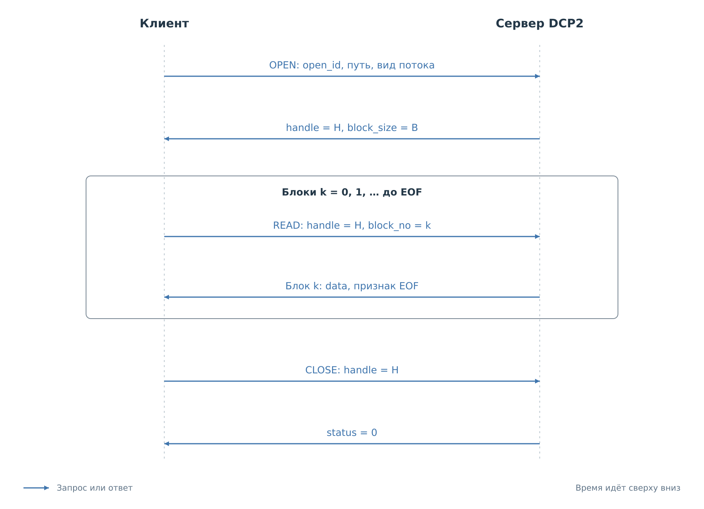
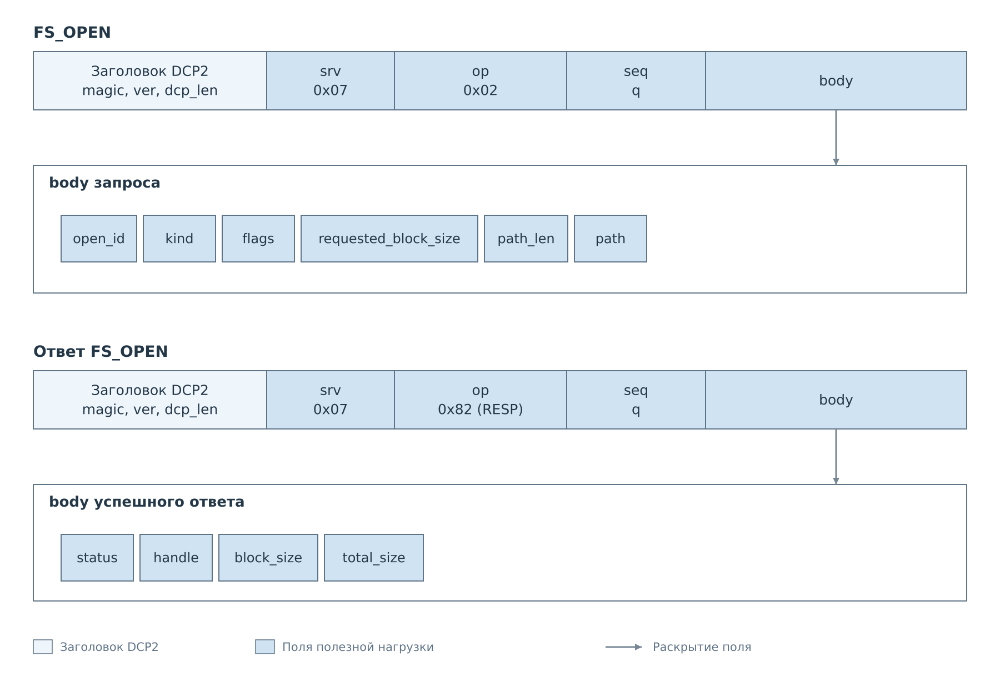
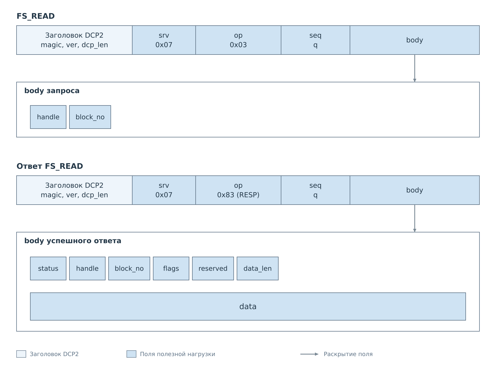
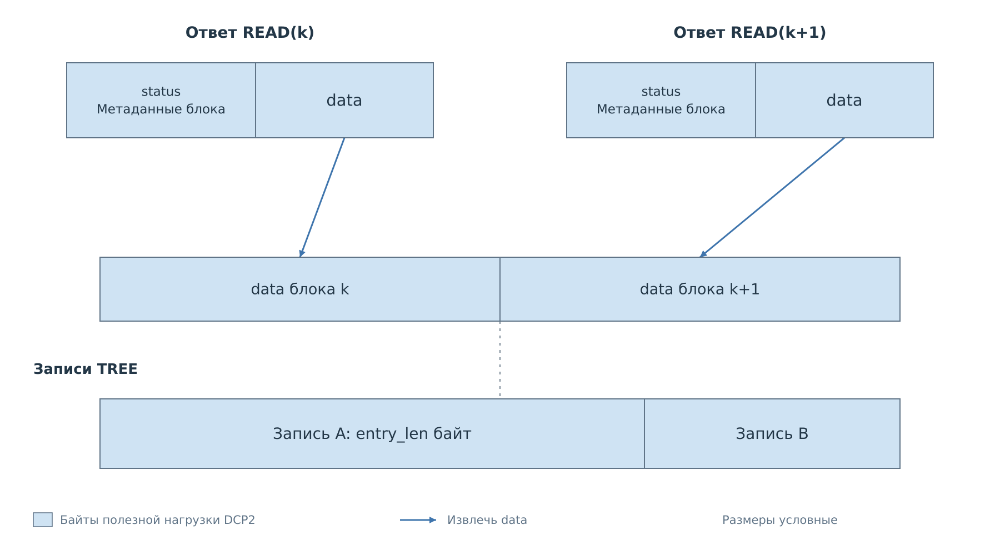

# Файловый сервис DCP2

Сервис FS передаёт содержимое файловой системы порциями. Один файл может
быть значительно больше предела кадра DCP2, поэтому клиент сначала открывает
поток, получает дескриптор, затем читает последовательные блоки и закрывает
поток. Каждый шаг остаётся обычной командой с собственным `seq`.

FS подключён к FreeRTOS и предоставляет чтение
томов `sd`, `flash` и `sd-pl`; их фактическая готовность сообщается сервером.
Записи, удаления и форматирования в FS v1 нет. В текущем `bvstkd` сервис
не подключён. Собственных событий FS не создаёт, но уведомления других
сервисов могут приходить между его ответами.

## Открытие и последовательное чтение

*Рисунок 1. `OPEN` возвращает дескриптор H. Все последующие запросы чтения
используют H, но получают новые номера `seq`. Признак EOF завершает данные;
`CLOSE` освобождает сам поток.*

До открытия клиент может выполнить `FS_INFO`, чтобы узнать версию, тома
и ограничения. В `FS_OPEN` передаются путь, вид потока и желаемый размер
блока. Сервер возвращает `handle` и согласованный `block_size`.
Эти значения понадобятся при проверке каждого ответа чтения.

*Рисунок 2. Запрос OPEN задаёт поток; ответ возвращает сведения для его чтения.*

Параметры открытия: [таблицы FS_OPEN](reference/fs.md#fs_open-создание-потока).

Первый `FS_READ` запрашивает блок 0, следующий — блок 1 и так далее.
Клиент проверяет статус, совпадение `handle` и `block_no`, затем принимает
ровно `data_len` байт. Если установлен EOF, эти байты всё равно относятся
к результату: последний блок может быть непустым. После его обработки
клиент посылает `FS_CLOSE`.

*Рисунок 3. Из ответа READ в содержимое файла входит только `data`.
Остальные поля служат для проверки и продолжения передачи.*

Поля запроса и блока: [таблицы FS_READ](reference/fs.md#fs_read-очередной-блок).

### Идентификаторы обмена

| Поле | Кто назначает | Для чего используется |
|---|---|---|
| `seq` | Клиент, для каждой отправки | Найти ответ на конкретный запрос |
| `open_id` | Клиент, для попытки открытия | Узнать повтор того же `OPEN` |
| `handle` | Сервер, в ответе `OPEN` | Найти открытый поток в этом соединении |
| `block_no` | Клиент, начиная с нуля | Выбрать следующий или повторить последний блок |

При потере ответа `OPEN` клиент может отправить запрос с новым `seq`,
сохранив `open_id` и все параметры. Пока первоначальный поток существует,
сервер вернёт тот же дескриптор. Те же `open_id` с другими параметрами дают
`ERR_MALFORMED`.

Повтор `READ` тоже получает новый `seq`, но сохраняет `handle` и `block_no`.
Сервер хранит последний успешно выданный блок и возвращает его повторно
без продвижения потока. Более старый блок или пропуск номера дают `ERR_RANGE`.
Таким образом, подтверждение приёма предыдущего блока фактически выражается
запросом следующего.

Дескриптор принадлежит одному TCP-соединению. После разрыва или таймаута
неактивности он недействителен; продолжение требует нового открытия.
Уже выданные номера `handle` в рамках соединения не переиспользуются.

## Файлы и каталоги

Открытый поток может передавать содержимое одного файла, перечень
каталога TREE или архив TAR. Во всех случаях клиент выполняет одну
последовательность команд. Выбранный при открытии вид потока определяет,
как использовать полученные данные.

Для файла клиент последовательно записывает блоки и после EOF сверяет
итоговую длину с размером, объявленным при открытии. Произвольного
перехода к смещению внутри файла нет.

TREE передаёт записи об объектах каталога. Запись может пересекать
границу нескольких блоков FS, поэтому клиенту нужны два этапа разбора:
сначала кадры DCP2, затем записи из объединённых данных успешных ответов.

*Рисунок 4. Граница блока FS не обязана совпадать с границей записи TREE.
Клиент объединяет только массивы `data` успешных ответов, затем разбирает записи.*

Без рекурсивного обхода TREE перечисляет непосредственных детей каталога.
При рекурсивном обходе каталог передаётся перед своим содержимым.
Архив TAR всегда включает подкаталоги и формируется по мере чтения.
Полный архив в памяти платы или во временном файле не собирается.

Сервер обращается к уже готовому тому. Файловый запрос сам не запускает
монтирование или форматирование. Известное имя тома ещё не означает,
что его содержимое доступно; клиент проверяет состояние через FS_INFO.
Точные виды потока и правила путей приведены
в [справочнике FS](reference/fs.md).

## Прерывание чтения

После разрыва TCP прежний дескриптор недействителен. Клиент открывает
поток заново и начинает чтение с первого блока. Состояние приёмника
и идентификаторы прежнего соединения переносить нельзя.

Чтение идёт по текущей файловой системе. Если размер или доступная
отметка изменения файла поменялись, сервер может обнаружить это и
остановить поток. Изменение содержимого при прежних размере и отметке
может остаться незамеченным. Обход каталога тоже не фиксирует всё дерево
в одном состоянии. Для согласованной копии нужно исключить параллельные
изменения источника на время чтения.

Ошибка формирования блока завершает нормальное чтение данного потока:
следующие запросы возвращают ту же ошибку до закрытия. Частичный блок
не должен попадать в сохранённый результат. Допустимые повторы и сроки
жизни дескриптора заданы в
[правилах восстановления](reference/fs.md#ошибки-чтения-и-восстановление).

Конкретные кадры представлены в примерах [чтения файла](examples/files.md)
и [получения каталога и архива](examples/directories.md).

Далее: [Кэш](07-cache.md).
