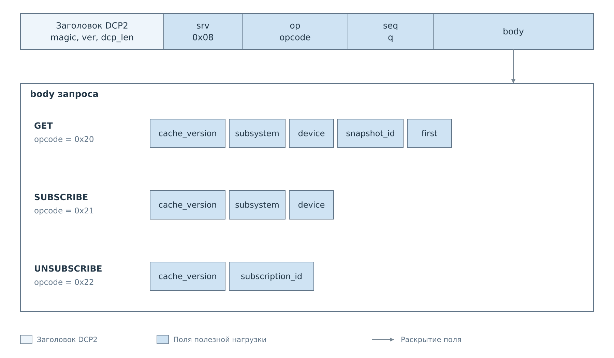
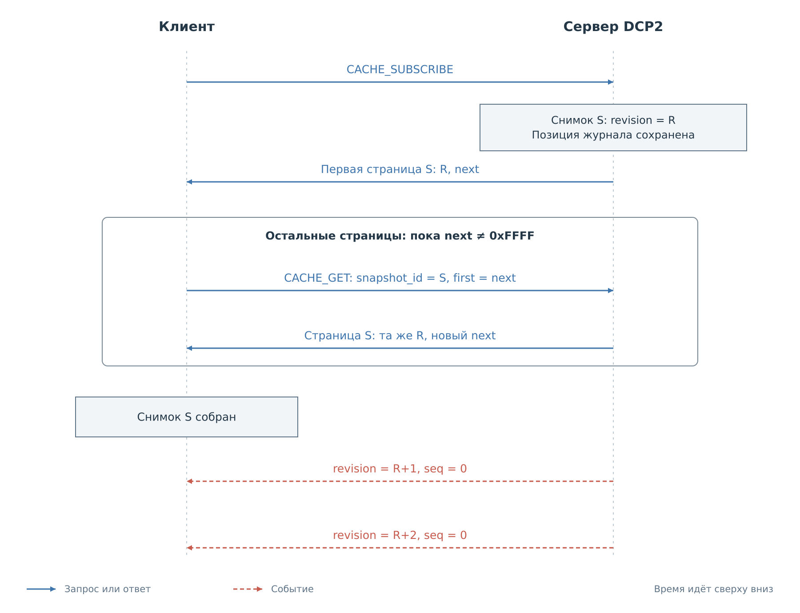
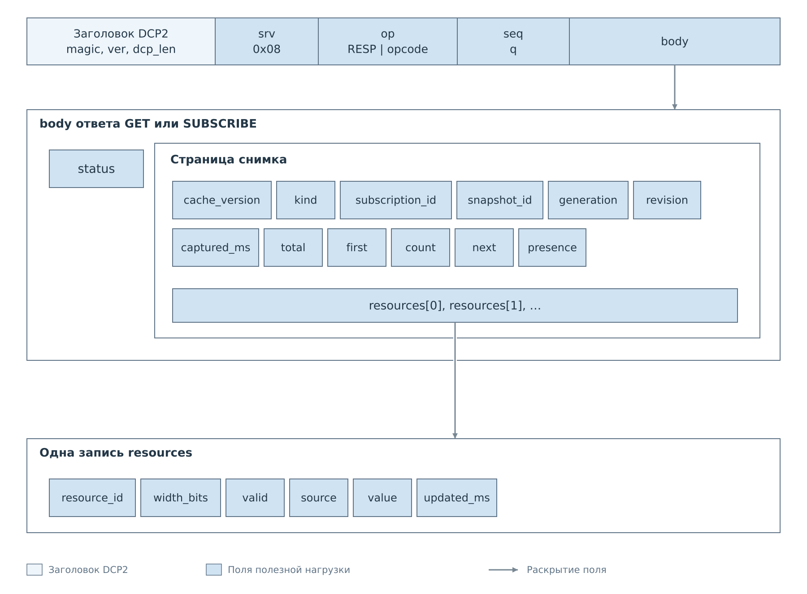
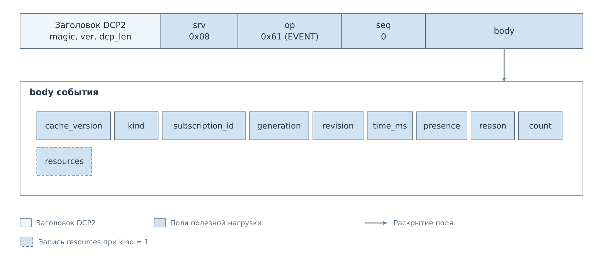
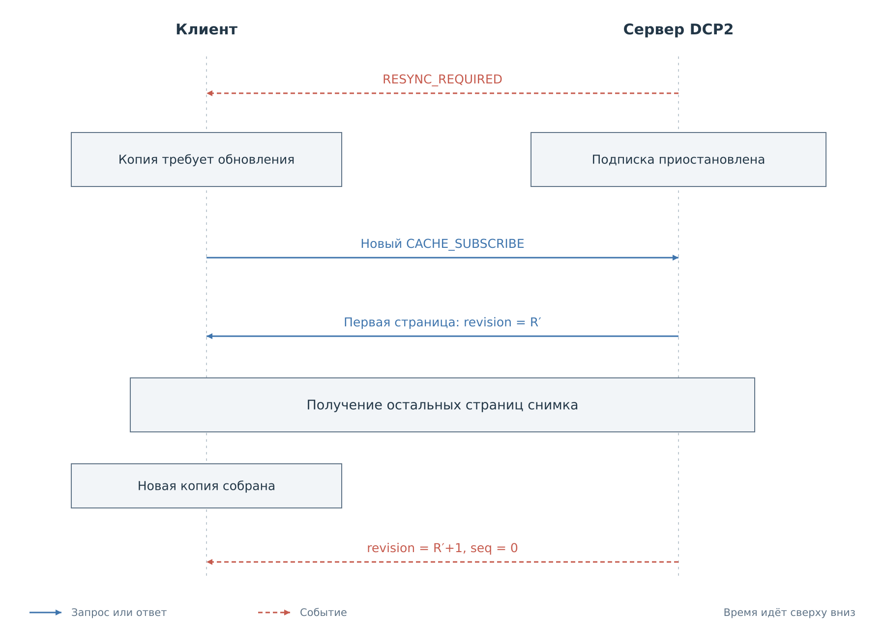

# Кэш DCP2

Сервис CACHE позволяет клиенту получить локальную копию значений устройства
и поддерживать её по уведомлениям. Для этого одного потока событий недостаточно:
клиенту нужно знать исходное состояние и точку, начиная с которой к нему
относятся изменения. CACHE связывает эти две части снимком и ревизией.

Сервис подключён к FreeRTOS. Адаптеры I²C и MDIO
публикуют в него состояние своих программных кэшей. Запрос CACHE не выполняет
физическое чтение шины и не меняет политику записи или настройки опроса.
В `bvstkd` Нейтрино подключён тот же общий каталог и обработчик.

## Адресация и содержимое кэша

Клиент выбирает пару имён `subsystem` и `device`. Первое обозначает подсистему,
второе совпадает с ID устройства в профиле. Внутри устройства значения
адресуются по ID ресурсов профиля. Физические адреса регистров для запроса
CACHE не требуются; смысл ресурса клиент получает из профиля и карты регистров.

Снимок включает все ресурсы, в том числе ещё не заполненные. У каждого значения
есть `valid`, `source` и `updated_ms`. Нулевое значение при `valid=1` достоверно;
при `valid=0` его нельзя использовать как измерение. Начальная пустая запись
содержит `source=unknown`, `value=0`, `updated_ms=0`.

`source=settings` означает значение из настроек, `source=device` — значение
от устройства. Готовность передаётся отдельно через `presence`: профиль
и кэш могут существовать при отключённом устройстве. Сам снимок согласован
по памяти PS, но отдельные регистры могли быть прочитаны с оборудования
в разные моменты. Их метки времени сохраняют это различие.

## Начальный снимок и последующие изменения

Для разового чтения клиент отправляет `CACHE_GET` с `snapshot_id=0`
и `first=0`. Для непрерывного наблюдения — `CACHE_SUBSCRIBE`. В обоих случаях
сервер фиксирует снимок и возвращает первую страницу; при подписке он также
сохраняет позицию журнала, соответствующую моменту фиксации.

*Рисунок 1. GET и SUBSCRIBE выбирают устройство по именам.
UNSUBSCRIBE отменяет уже созданную подписку по её идентификатору.*

Типы полей: [форматы запросов CACHE](reference/cache.md#форматы-запросов).

### Передача страниц

Снимок может не поместиться в один ответ. Пока сервер передаёт его частями,
рабочий кэш продолжает обновляться. Позиция в журнале позволяет затем
передать именно те изменения, которые произошли после фиксации снимка.

*Рисунок 2. Все страницы принадлежат одному снимку с ревизией R.
Изменения после R накапливаются в журнале и передаются после завершения снимка.*

Ответ содержит `snapshot_id` и поле `next`. Если `next` не равно `0xFFFF`,
клиент отправляет `CACHE_GET` с теми же именами, полученным `snapshot_id`
и `first=next`. Меняется только номер запроса `seq` и индекс страницы.
Сервер читает сохранённый снимок, поэтому обновления рабочего кэша не меняют
уже начатую последовательность страниц.

Каждая страница содержит метаданные снимка и целые записи ресурсов.
Идентификатор ресурса связывает значение с описанием в профиле.
Форматы приведены в [таблицах страницы](reference/cache.md#страница-снимка)
и [записи ресурса](reference/cache.md#запись-ресурса).

*Рисунок 3. Вложенность страницы CACHE: метаданные снимка и массив ресурсов.*

Клиент собирает страницы последовательно с индекса 0. До получения всех
ресурсов его локальная копия неполна. Сервер удерживает события этой подписки,
пока последовательно не выданы все страницы. Если весь снимок помещается
в первую страницу, этот этап завершается сразу.

### Последующие изменения

После последней страницы клиент принимает события с ревизиями R+1, R+2
и далее. Они могут относиться к изменениям, случившимся ещё во время передачи
снимка. Таким образом, между начальным состоянием и уведомлениями сохраняется
непрерывная последовательность.

| Поле | Область действия |
|---|---|
| `seq` | Один запрос и его ответ |
| `snapshot_id` | Сохранённый снимок, из которого читаются страницы |
| `subscription_id` | Подписка внутри TCP-соединения |
| `generation` | Поколение каталога ресурсов устройства |
| `revision` | Последовательность изменений внутри поколения |

Поколение меняется при замене каталога ресурсов. Ревизия увеличивается
при публикации значения, изменении готовности или потере достоверности.
Повторное успешное чтение того же значения тоже создаёт ревизию: оно обновляет
время получения данных. Повторная очистка уже пустого ресурса ревизию не создаёт.

Событие содержит сведения о подписке и изменении. При обновлении
значения оно несёт одну запись ресурса в том же формате, что и снимок.
Изменение готовности относится ко всему устройству, поэтому записи ресурса
в таком событии нет.

*Рисунок 4. Событие CACHE продолжает состояние снимка по `generation` и `revision`.
Состав тела задан в [таблице изменения](reference/cache.md#формат-изменения).*

## Потеря согласованности

Журнал изменений конечен. Пока клиент читает страницы или отстаёт от событий,
нужные записи могут быть вытеснены. Сервер тогда отправляет `RESYNC_REQUIRED`
и приостанавливает подписку. Тот же переход требуется при смене поколения
и истечении срока незавершённого начального снимка.

*Рисунок 5. Потеря последовательности делает локальную копию несогласованной.
Работа продолжается после нового снимка и возобновления событий.*

Клиент перестаёт представлять прежнюю копию как актуальную и выполняет новый
`CACHE_SUBSCRIBE` для той же цели. Сервер заменяет её прежнюю подписку новым
снимком и позицией журнала. После сборки всех страниц изменения снова можно
применять последовательно.

Для обычного события проверяются `subscription_id`, совпадение поколения
и увеличение ревизии ровно на единицу. Пропуск ревизии также требует нового
снимка, даже если явное `RESYNC_REQUIRED` не было обработано. После разрыва
TCP прежние идентификаторы теряют смысл; клиент подписывается заново.

## Ожидание и завершение наблюдения

Отсутствие новых событий само по себе не означает потерю согласованности:
значения могли не изменяться. Клиент продолжает принимать кадры, сохраняя
незавершённый кадр при таймауте ожидания события.

Таймаут ответа на команду оставляет неопределённость в состоянии обмена.
Штатный клиент CACHE в таком случае требует переподключения и нового
снимка. Для явного завершения наблюдения используется UNSUBSCRIBE.

Размеры страниц, поля записей, сроки жизни снимка и условия ошибок
приведены в [справочнике CACHE](reference/cache.md). Прохождение снимка
и нескольких изменений с конкретными кадрами показано
в [примере](examples/cache.md).
