# Работа с файловой системой через DCP2

Клиент проходит полный цикл работы с файлом в одном TCP-соединении —
от создания до удаления, включая чтение, замену содержимого и архивирование.

- [Исходные условия](#исходные-условия).
- [Основной сценарий](#основной-сценарий).
- [Ошибки, повторы и восстановление](#ошибки-повторы-и-восстановление).
- [Связанные разделы](#связанные-разделы).

## Исходные условия

TCP-соединение установлено. Форматы команд одинаковы для FreeRTOS
и Нейтрино.

Том `flash:/` готов, имя каталога `flash:/demo` свободно. Клиент создаст в нём
`a.txt` с шестью байтами `BVSTK\n`, прочитает его, заменит содержимое
на `NEW!!!`, получит TREE и TAR, затем переименует и удалит объекты.

Числа на схемах показаны в HEX. Строки кодируются UTF-8 без завершающего
NUL, перевод строки `\n` занимает один байт `0x0A`. Значения `seq` выбраны
для примера, каждый запрос получает свой номер. Новая команда изменения
получает больший `id`, чтение этот счётчик не меняет.

## Основной сценарий

### Проверка возможностей сервера

Клиент запрашивает FS_INFO, чтобы проверить тома и возможности сервера.

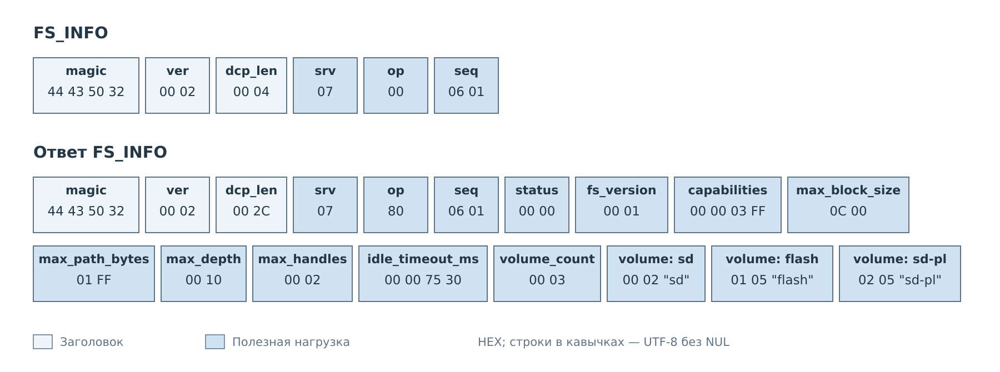

*Рисунок 1. Сервис сообщает версию FS, возможности, пределы и состояния томов.*

Маска `capabilities=0x03FF` разрешает чтение FILE, TREE и TAR, пути UTF-8,
создание каталогов, удаление, переименование и загрузку. В выбранном
ответе flash готов, sd не готов, sd-pl недоступен в сборке.
Клиент проверяет состояния и биты возможностей из ответа своего сервера.

Затем клиент отправляет WRITE_INFO и проверяет пределы загрузки.

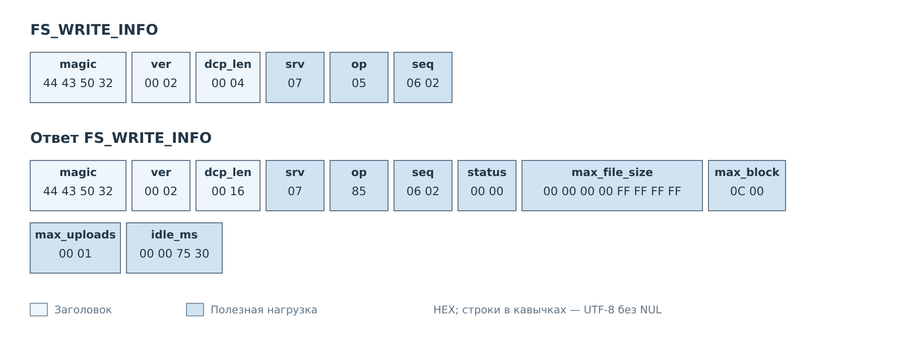

*Рисунок 2. На соединение доступна одна загрузка, максимальный блок равен 3072 байтам.*

Сервер принимает файл размером до `0xFFFFFFFF` байт. Таймаут неактивности
загрузки равен 30 000 мс. Для чтения одновременно доступны два потока.
Определения полей и ограничения приведены в [справочнике FS](../reference/fs.md).

### Создание каталога и загрузка файла

Клиент отправляет MKDIR для `flash:/demo`.

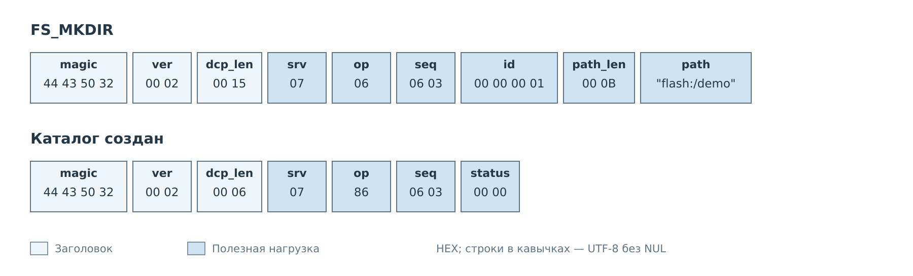

*Рисунок 3. MKDIR с `id=1` создаёт `flash:/demo`.*

После ответа OK каталог существует и пуст. BEGIN объявляет целевой путь,
полный размер и разрешение на замену.

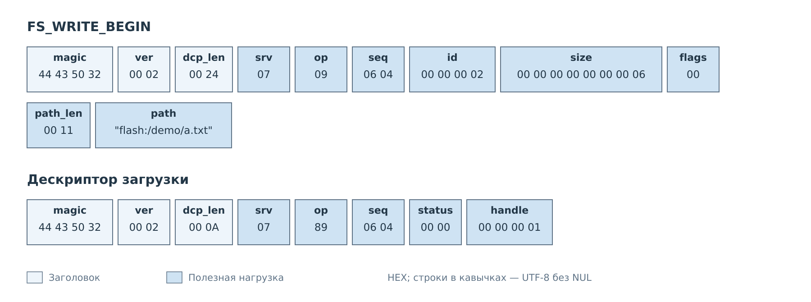

*Рисунок 4. BEGIN с `id=2`, `size=6`, `flags=0` возвращает `handle=1`.*

Сервер создаёт служебный файл на том же томе. Целевой `a.txt` появится
при успешном COMMIT. Клиент передаёт содержимое блоками по четыре и два байта.

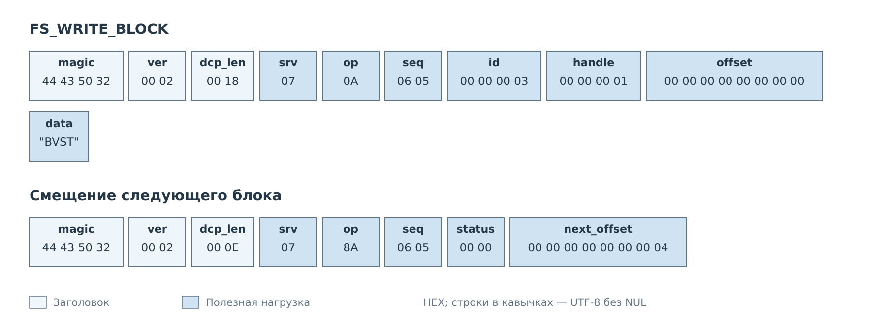

*Рисунок 5. BLOCK с `id=3` передаёт `BVST` со смещения 0 и получает `next_offset=4`.*

Поле `data` занимает остаток тела запроса. Полученное `next_offset`
задаёт смещение следующего блока.

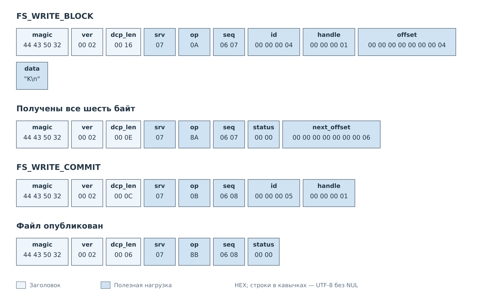

*Рисунок 6. BLOCK с `id=4` завершает данные, COMMIT с `id=5` публикует файл.*

Второй блок содержит `K\n` со смещения 4. Ответ `next_offset=6`
подтверждает приём всей заявленной длины. COMMIT синхронизирует и закрывает
служебный файл, устанавливает его по целевому пути и освобождает дескриптор.
После OK существует `flash:/demo/a.txt` с содержимым `BVSTK\n`.
Для пустого файла достаточно BEGIN с `size=0` и COMMIT.

### Чтение файла

Клиент запрашивает STAT созданного файла в том же соединении.

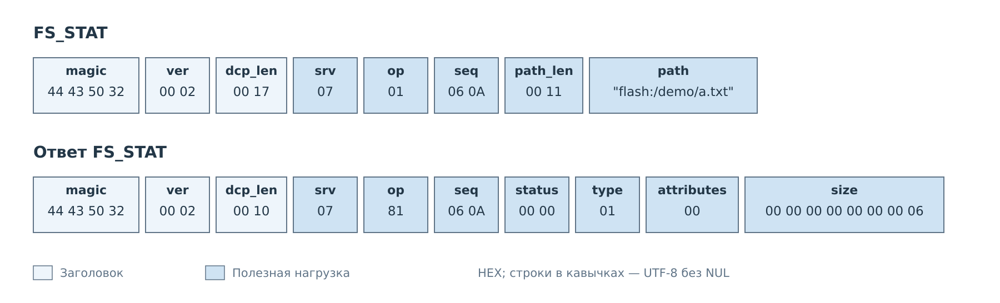

*Рисунок 7. STAT сообщает тип FILE и размер шесть байт.*

Атрибуты зависят от файлового адаптера, в показанном ответе `attributes=0`.
STAT описывает объект на момент запроса. Для чтения клиент открывает FILE.

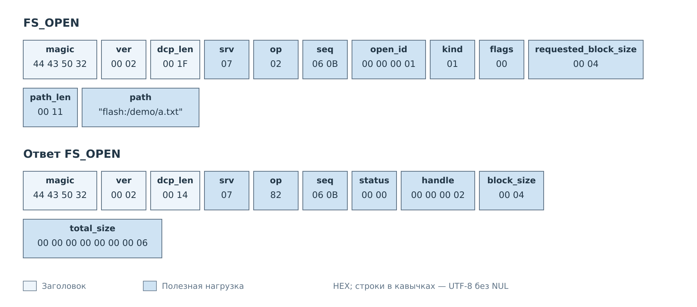

*Рисунок 8. OPEN с `open_id=1` получает `handle=2` и `total_size=6`.*

Дескриптор 1 уже использовался загрузкой, поэтому сервер выдаёт следующий.
`open_id` назначает клиент, `handle` приходит из ответа сервера.

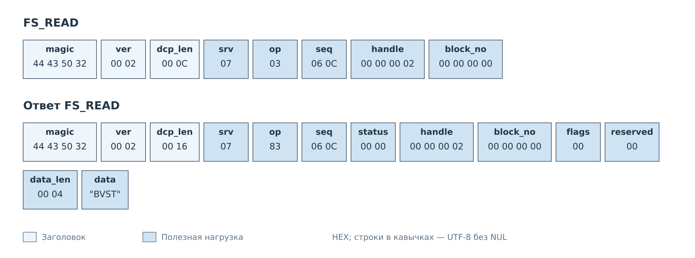

*Рисунок 9. READ с `block_no=0` возвращает четыре байта `BVST`, EOF сброшен.*

Клиент добавляет в результат только `data` успешного ответа, проверив
дескриптор, номер блока и длину.

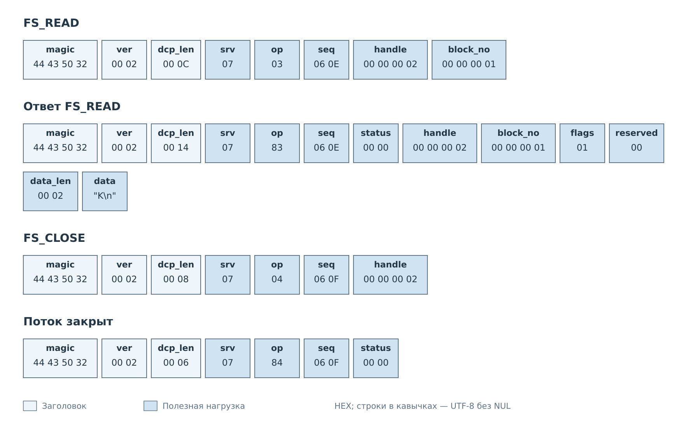

*Рисунок 10. Блок 1 содержит `K\n` и EOF, CLOSE освобождает `handle=2`.*

Собранные шесть байт совпадают с отправленными. Последний блок включается
в файл целиком. Для пустого FILE первый READ сразу возвращает EOF
с `data_len=0`. При изменении источника чтение может завершиться
`ERR_FS_CHANGED`, частично полученный результат требует проверки.

### Замена содержимого

Клиент заменяет тот же `a.txt` шестью байтами `NEW!!!`. Команда BEGIN получает
`flags=1`, разрешающий замену существующего обычного файла.

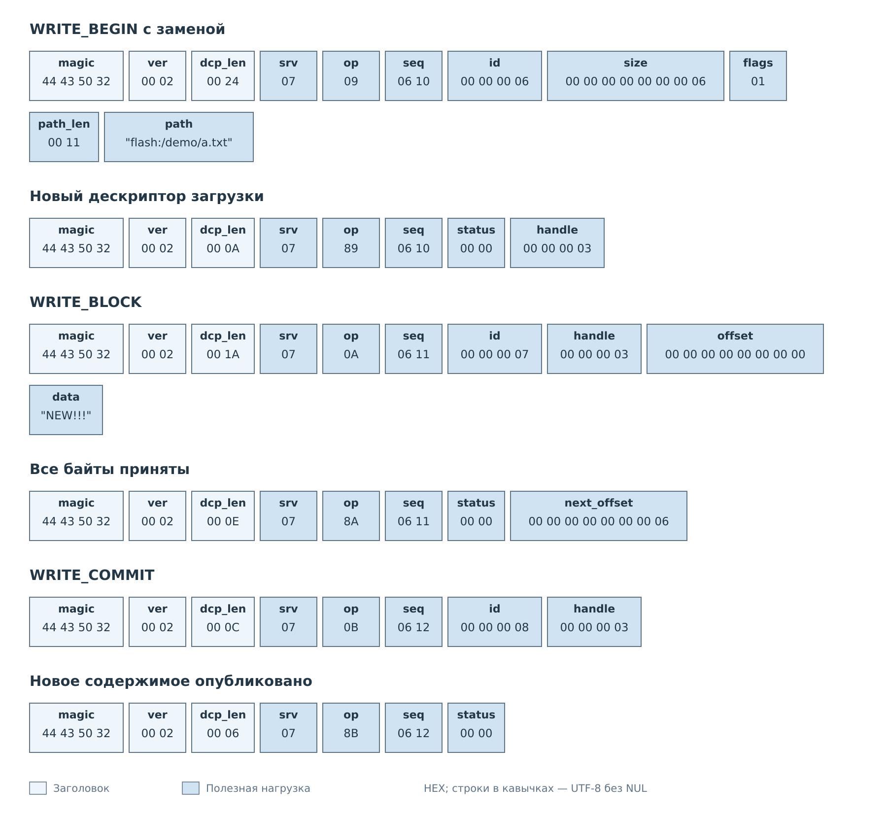

*Рисунок 11. BEGIN, BLOCK и COMMIT используют `id=6`, 7 и 8.*

Новая загрузка получает `handle=3`. До COMMIT чтение целевого пути
возвращает `BVSTK\n`. После успешного COMMIT по тому же пути доступны
`NEW!!!`. Размер остался равным шести байтам, для проверки замены
нужно сравнить содержимое. Последующие операции работают с этой версией.

### Каталоги и архивы

Теперь в `flash:/demo` находится один файл `a.txt` с байтами `NEW!!!`.
Клиент получает перечень TREE, затем архив TAR. Оба потока используют OPEN,
последовательные READ и CLOSE.

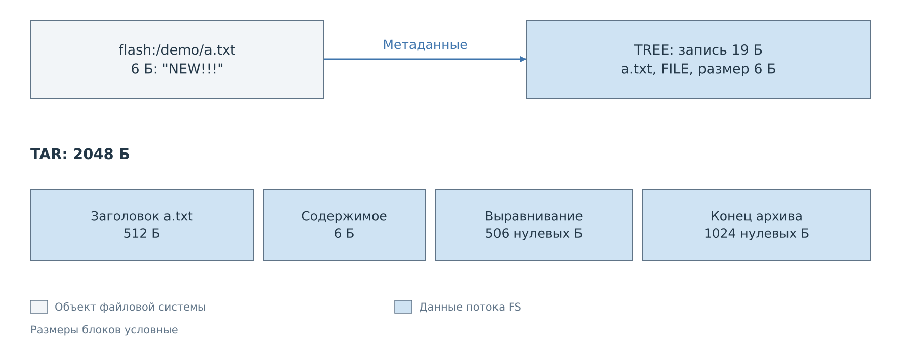

*Рисунок 12. TREE передаёт описание файла, TAR включает также его содержимое.*

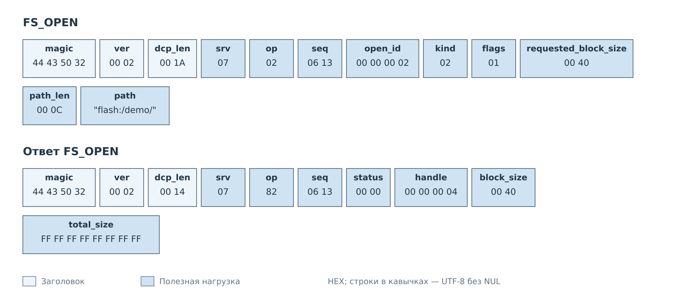

*Рисунок 13. `kind=2`, `flags=1`, `open_id=2` выбирают TREE с `handle=4`.*

Для TREE выбран блок 64 байта. Размер потока заранее неизвестен,
`total_size=0xFFFFFFFFFFFFFFFF`, поэтому клиент читает до EOF.

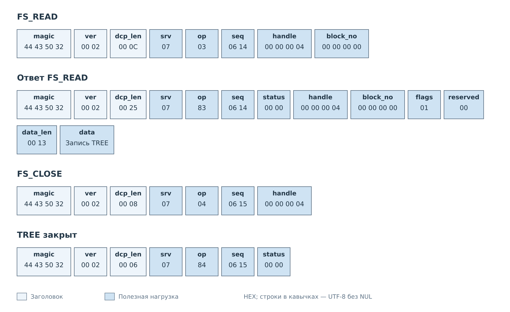

*Рисунок 14. Единственная запись занимает 19 байт, после EOF клиент закрывает поток.*

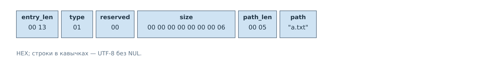

*Рисунок 15. Запись сообщает тип FILE, размер шесть байт и относительное имя `a.txt`.*

Пути TREE относительны каталогу OPEN. Сам корень в список не входит.
При рекурсивном обходе передаются подкаталоги и их содержимое.
Запись может пересечь границу блоков, поэтому клиент собирает её из
последовательных `data`. Этот случай показан в [главе FS](../06-fs.md).

*Рисунок 16. `kind=3`, `flags=0`, `open_id=3` открывают TAR с `handle=5`.*

TAR включает подкаталоги рекурсивно. Для этого потока выбран блок
3072 байта. В нашем архиве заголовок `a.txt` занимает 512 байт,
содержимое — шесть байт, выравнивание — 506 нулевых байт,
конец архива — ещё 1024 нулевых байта. Всего получается 2048 байт.

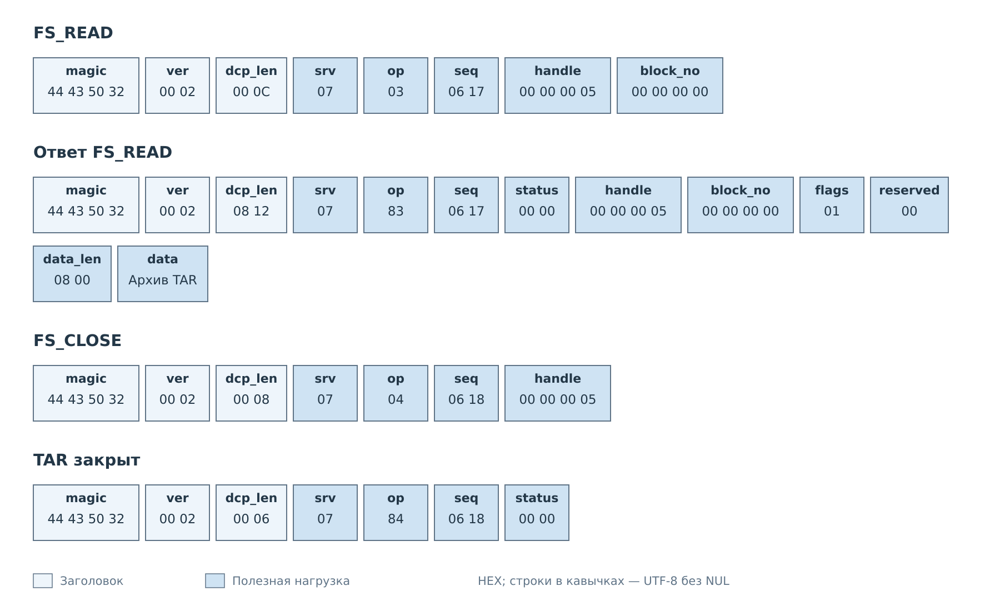

*Рисунок 17. Клиент сохраняет 2048 байт `data` как TAR и закрывает `handle=5`.*

После распаковки `a.txt` содержит `NEW!!!`. Для длинных имён и больших
значений применяются расширения PAX. Формат и выравнивание описаны
в [справочнике](../reference/fs.md#формат-tar). TREE и TAR обходят текущую
файловую систему, поэтому согласованная копия требует отсутствия
параллельных изменений дерева на время чтения.

### Переименование и удаление

Клиент отправляет RENAME для `a.txt`, затем REMOVE для файла и каталога.

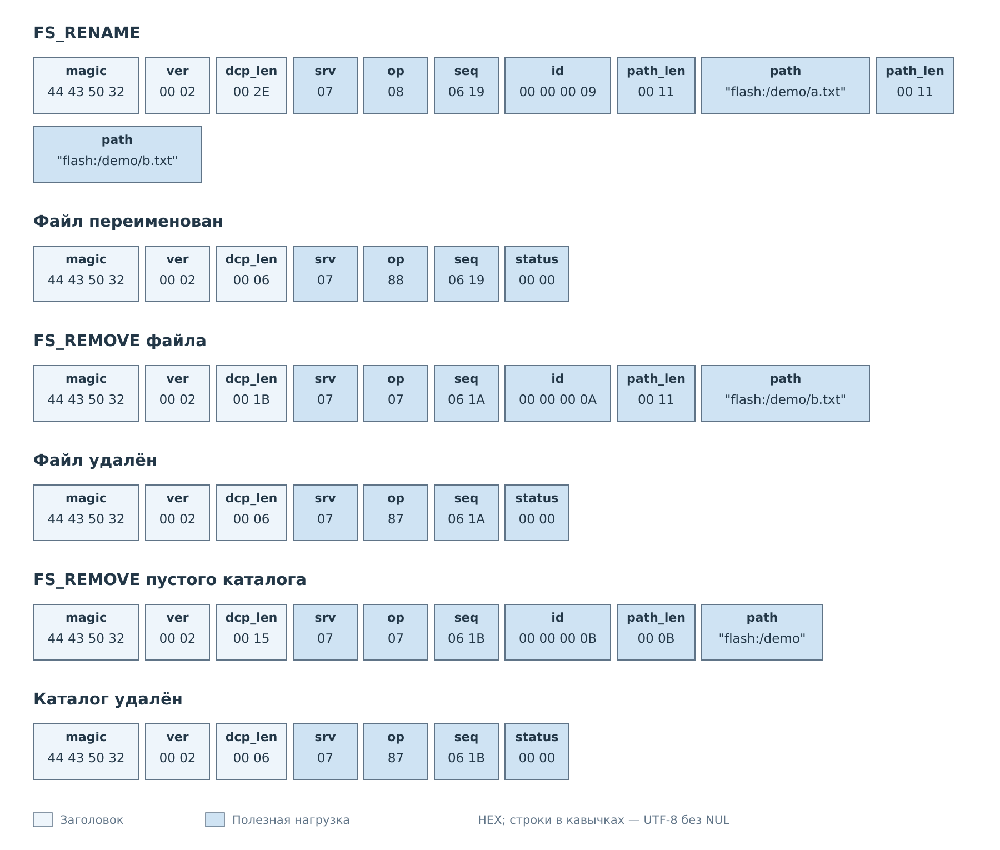

*Рисунок 18. RENAME получает `id=9`, удаления файла и каталога — 10 и 11.*

Сначала `a.txt` переименовывается в `b.txt`, затем файл удаляется,
после него удаляется опустевший `flash:/demo`. Переименование требует
свободного имени назначения на том же томе. Непустой каталог сначала
нужно освободить. После удаления `flash:/demo` отсутствует.

## Ошибки, повторы и восстановление

Примеры повторов показывают ответвления в указанных точках основного
сценария. Пока ответ задерживается, клиент сохраняет смысловые параметры
операции и назначает повторной отправке новый `seq`.

Примеры ошибок, начиная с конфликта имени, выполняются независимо друг
от друга. Для каждого открыто новое TCP-соединение и заранее подготовлены
`flash:/demo/a.txt` с шестью байтами `BVSTK\n` и его родительский каталог.
В каждом случае рассматривается замена существующего файла.

### Повтор READ

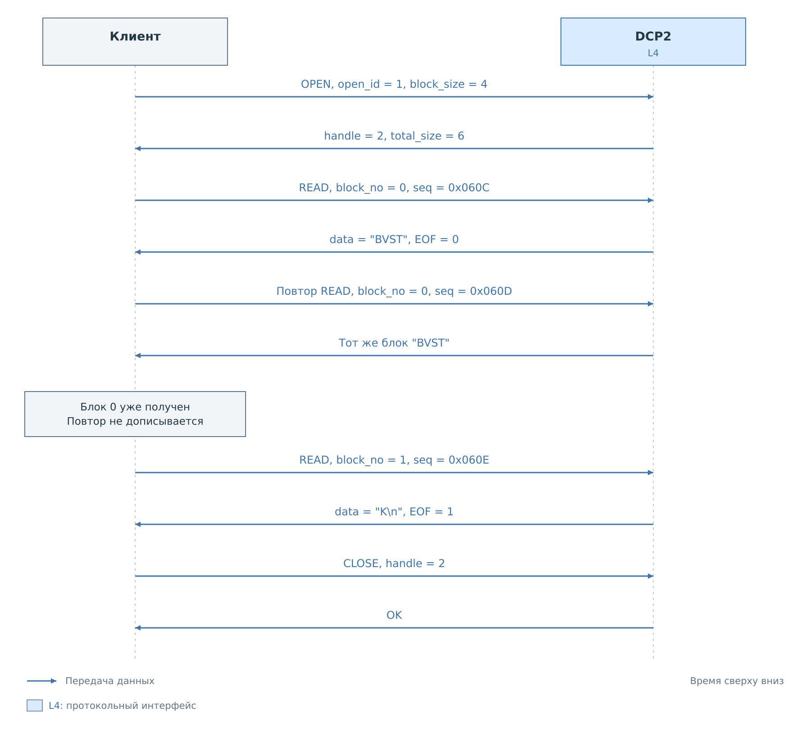

*Рисунок 19. Между первым и вторым блоком клиент повторяет READ блока 0.*

Повтор с `seq=0x060D` сохраняет `handle=2`, `block_no=0`.
Сервер возвращает прежние `BVST`. Если оба ответа дошли, клиент
добавляет эти байты один раз. Затем чтение продолжается блоком 1.

### Повтор WRITE_BLOCK

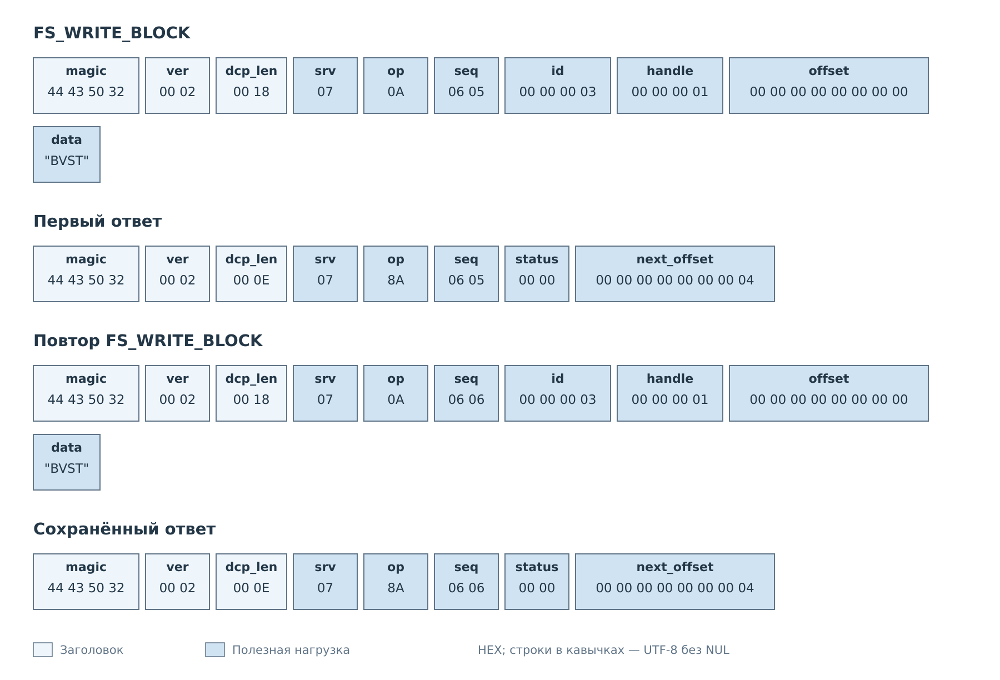

*Рисунок 20. У отправок `seq=0x0605` и `0x0606` одинаковые `id=3` и тело.*

Сохранённый ответ содержит `next_offset=4`. Повтор не продвигает
загрузку. Если передать другие данные с тем же `id`, сервер вернёт
`ERR_MALFORMED`. Полученный ошибочный статус завершает команду
в штатном клиенте. Новая попытка после исправления получает новый `id`.

### Повтор COMMIT

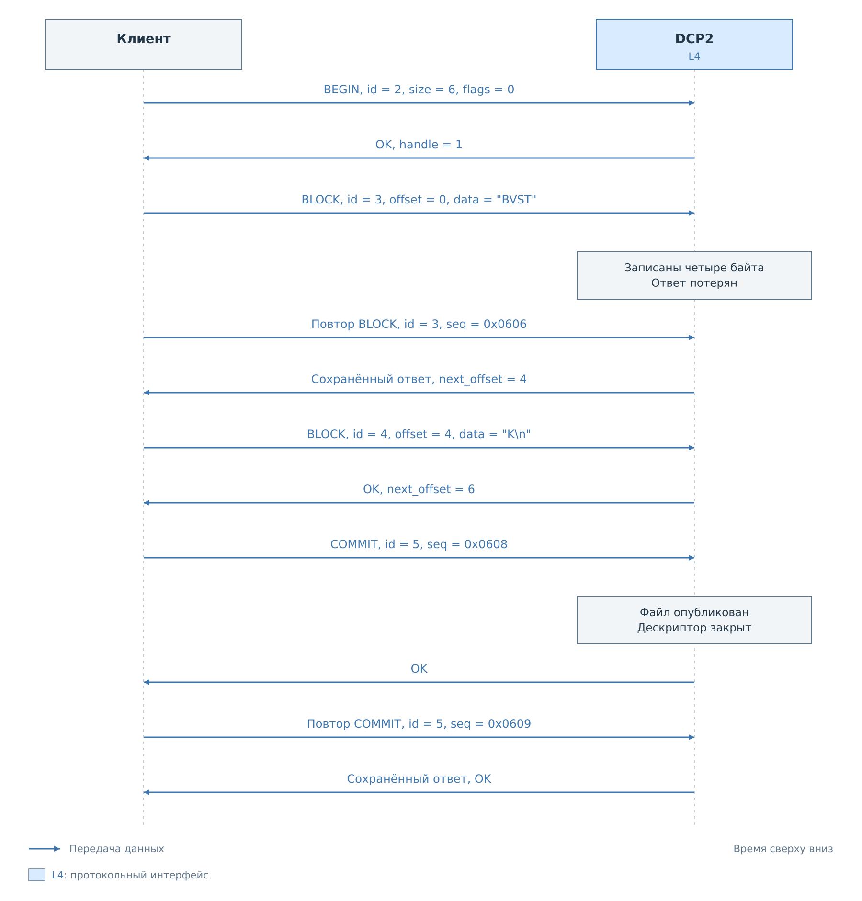

*Рисунок 21. Сохранённый результат COMMIT доступен после закрытия дескриптора.*

После потери ответа `seq=0x0608` клиент повторяет COMMIT с `seq=0x0609`,
прежними `id=5` и `handle=1`. Сервер возвращает OK. Результат последнего
изменения сохраняется до следующей команды изменения или разрыва TCP.
Чтение файла этот результат не вытесняет.

### Конфликт имени и отмена замены

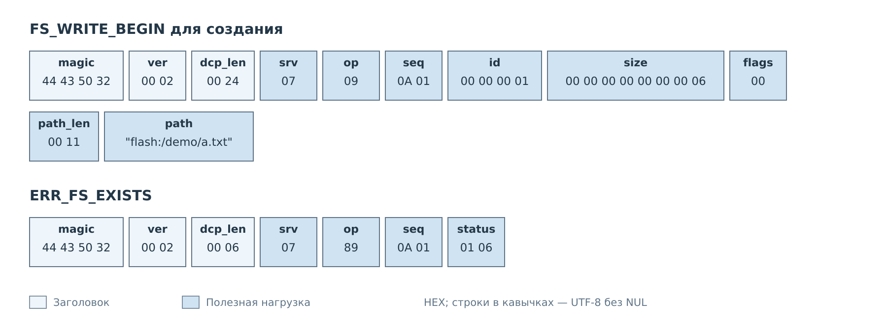

*Рисунок 22. Создание с `flags=0` получает `ERR_FS_EXISTS`, `0x0106`.*

Повтор BEGIN с `id=1` вернёт сохранённую ошибку. Для явной замены
клиент выбирает новый `id` и передаёт `flags=1`.

| `seq` | Команда | Параметры | Данные ответа после OK |
|---|---|---|---|
| `0x0A02` | BEGIN | `id=2`, `size=6`, `flags=1`, `path=flash:/demo/a.txt` | `handle=1` |
| `0x0A03` | BLOCK | `id=3`, `handle=1`, `offset=0`, `data=BVST` | `next_offset=4` |

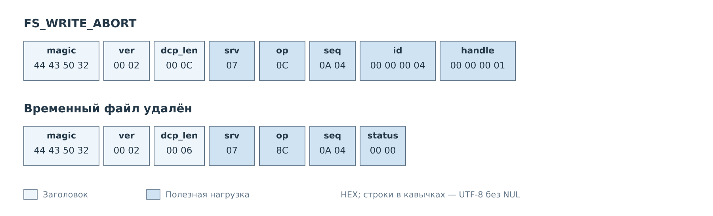

*Рисунок 23. ABORT с `id=4` освобождает дескриптор и удаляет служебный файл.*

После OK прежние байты `a.txt` сохраняются. Досрочный COMMIT вместо
ABORT получил бы `ERR_RANGE` и также завершил загрузку.

### Заполненный том

В новом соединении BEGIN с `id=1`, `size=6`, `flags=1` открывает замену
`a.txt` и выдаёт `handle=1`. Передаваемое содержимое — `NEW!!!`.
Во время записи закончилось место, адаптер принял меньше шести байтов.

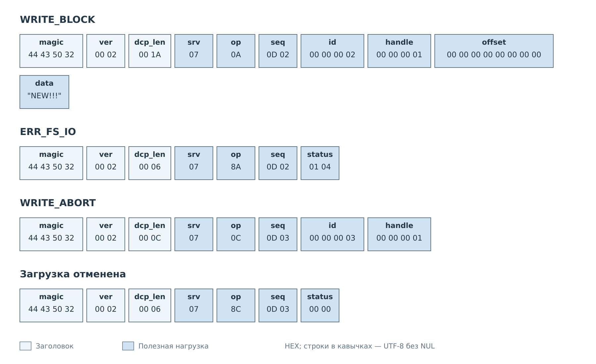

*Рисунок 24. BLOCK возвращает `ERR_FS_IO`, клиент завершает загрузку через ABORT.*

Ошибка адаптера терминальна для дескриптора. После успешного ABORT
клиент освобождает место и начинает загрузку заново. Прежний `a.txt`
содержит `BVSTK\n`. При отказе выделения места FatFs может вернуть
`ERR_DENIED`. Ошибка носителя может также помешать уборке служебного файла,
поэтому статус ABORT проверяется отдельно.

### Занятый файл на FreeRTOS

В новом соединении после BEGIN с `id=1` клиент успешно передаёт все
шесть байт `NEW!!!` командой BLOCK с `id=2`. Другой интерфейс держит
целевой файл открытым, FatFs блокирует его переименование.

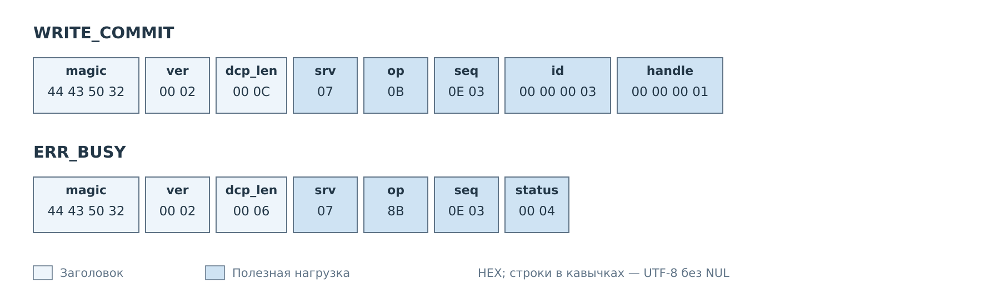

*Рисунок 25. COMMIT с `id=3` возвращает `ERR_BUSY` и завершает загрузку.*

Клиент закрывает мешающий поток. Повтор COMMIT с `id=3` вернёт
сохранённый `ERR_BUSY`. Для следующей попытки нужны новый BEGIN
с большим `id` и повторная передача файла. Прежние байты сохраняются.

### Таймаут загрузки

Новое соединение выполняет BEGIN с `id=1` и получает `handle=1`, затем
бездействует не менее 30 000 мс по часам сервера. Загрузка истекает.

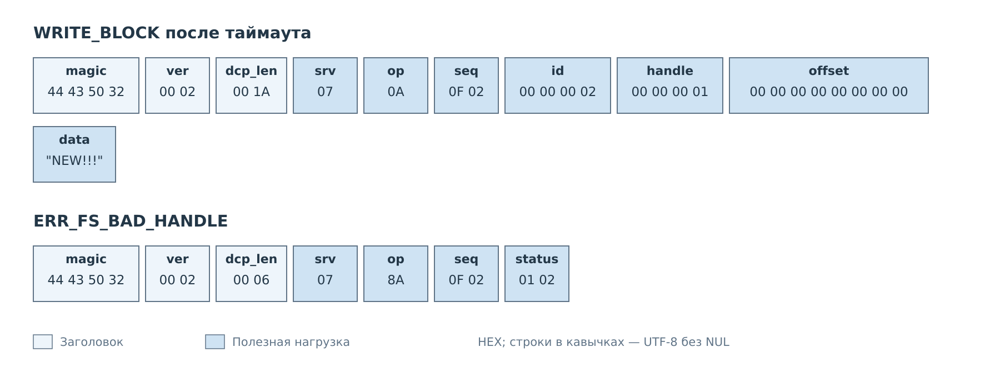

*Рисунок 26. BLOCK после таймаута получает `ERR_FS_BAD_HANDLE`.*

Клиент открывает новую загрузку с новым `id` и начинает передачу
со смещения 0. Повтор успешного BEGIN с прежним `id` после истечения
загрузки тоже возвращает `ERR_FS_BAD_HANDLE`.

### Разрыв соединения во время COMMIT

Клиент передал `NEW!!!` и отправил COMMIT. Сервер успел опубликовать
файл, но соединение оборвалось до приёма ответа.

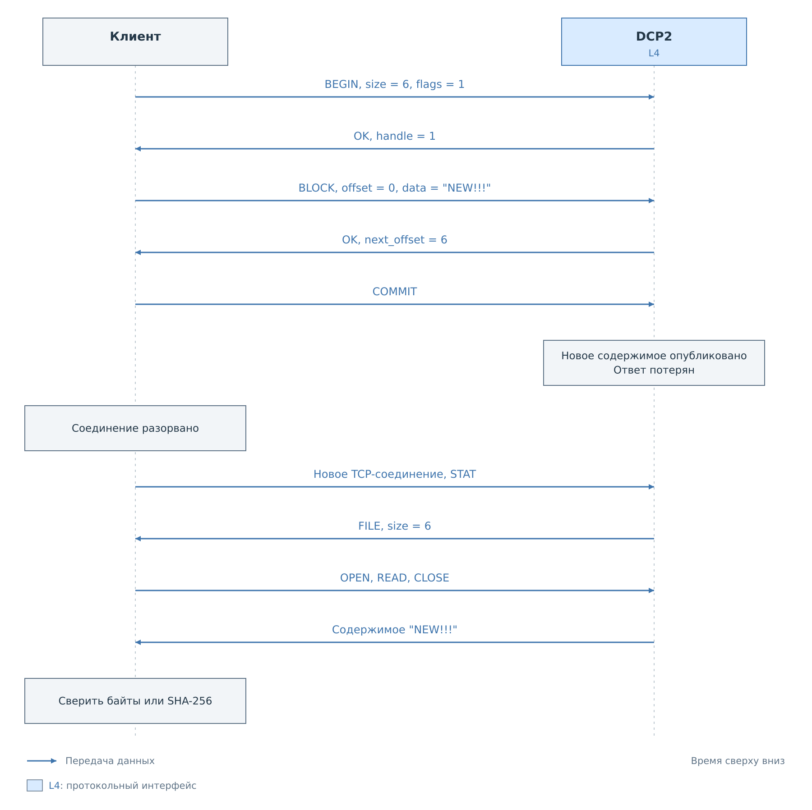

*Рисунок 27. После STAT клиент читает файл и сверяет содержимое.*

Обе версии занимают шесть байт, поэтому размер не позволяет определить
результат замены. OPEN, READ и CLOSE в новом соединении возвращают
`NEW!!!`, клиент сверяет байты или SHA-256. Если разрыв произошёл
до публикации, чтение покажет прежнее содержимое. Сбой носителя во время
установки требует отдельной проверки назначения и служебных файлов.

Полные правила восстановления находятся в
[справочнике FS](../reference/fs.md#ошибки-изменения-и-восстановление).

## Связанные разделы

- Предыдущий пример — [Потоки STREAM](stream.md).
- Следующий пример — [Снимки и изменения кэша](cache.md).
- [Описание файлового сервиса](../06-fs.md).
- [Справочник FS](../reference/fs.md).
- [Клиент FS](../client.md#изменение-файлов-и-каталогов).
