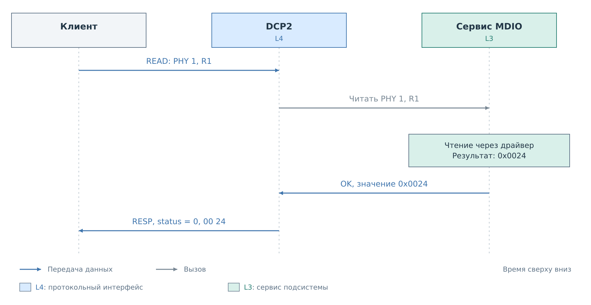
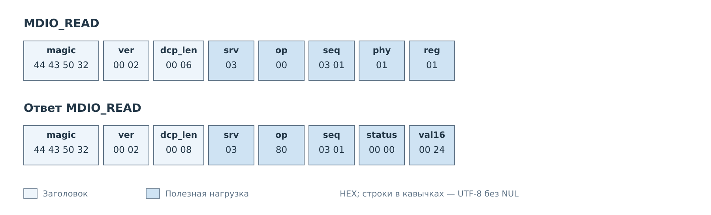
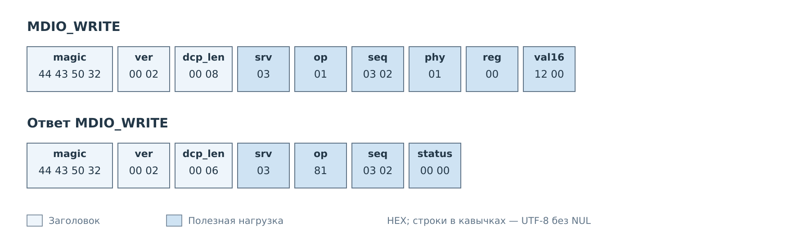

# Регистры MDIO

Клиент читает регистр PHY через MDIO и затем записывает 16-битное
значение. Эта же запись используется в примерах NOTIFY и STREAM.

## Исходные условия

TCP-соединение установлено, PHY с адресом 1 зарегистрирован в готовом
сервисе MDIO. Политика разрешает запись `0x1200` в регистр 0. Команды доступны
в FreeRTOS и Нейтрино при подключённом сервисе MDIO.

Значения ниже иллюстрируют обмен. Их смысл на конкретном PHY определяется
картой регистров.

## Основной сценарий

### Чтение

Клиент отправляет MDIO_READ для `PHY=1`, `reg=1` и ожидает
16-битное значение `0x0024`.

*Рисунок 1. MDIO_READ выполняет чтение через драйвер. Ответ несёт результат
этого обращения к устройству.*

*Рисунок 2. Два байта параметров выбирают PHY и регистр. Значение регистра
занимает два байта ответа.*

Клиент назначает запросу `seq=0x0301`. Успешный ответ содержит `0x0024`;
клиент читает его как одно 16-битное число. Это отличается от I²C, где похожая
команда возвращает один байт. Сам код операции `0x00` не определяет ширину
результата: нужно учитывать и сервис `srv=0x03`.

Обращение идёт к физическому PHY через рабочий сервис. Если нужен его
программный кэш, клиент использует CACHE и имена ресурсов профиля.

### Запись

Клиент отправляет MDIO_WRITE для `PHY=1`, `reg=0`, `val16=0x1200`.

*Рисунок 3. Значение `0x1200` следует за адресом PHY и номером регистра.
В ответе остаётся только статус.*

Статус `0` подтверждает завершение аппаратной записи. Чтение и редактирование
правил политики показаны в [примерах управления политиками](policies.md).

В [примере NOTIFY](notify.md) эта же запись `PHY=1`, `reg=0`, `val16=0x1200`
станет причиной уведомления NOTIFY. Так один обмен можно рассмотреть
с двух сторон: как команду клиента и как событие в журнале системы.

## Ошибки, повторы и восстановление

Если политика отклоняет запись, клиент получает `ERR_DENIED` и проверяет
режим и правила через POLICY_GET. Исправленная операция получает новый `seq`.

При потере ответа разрешённая запись могла выполниться. До повторной отправки
клиент учитывает назначение регистра, включая самосбрасывающиеся биты
и действия, запускаемые записью. Если регистр допускает проверочное чтение,
его состояние можно запросить отдельным MDIO_READ. Автоматического подавления
повторных MDIO_WRITE по `seq` нет.

## Связанные разделы

- Предыдущий пример — [Регистры и политика I²C](i2c.md).
- Следующий пример — [Политики I²C и MDIO](policies.md).
- [Описание команд](../03-commands.md).
- [Справочник MDIO](../reference/commands.md#mdio-регистры-phy).
- [Клиент MDIO](../client.md#регистры-mdio).
