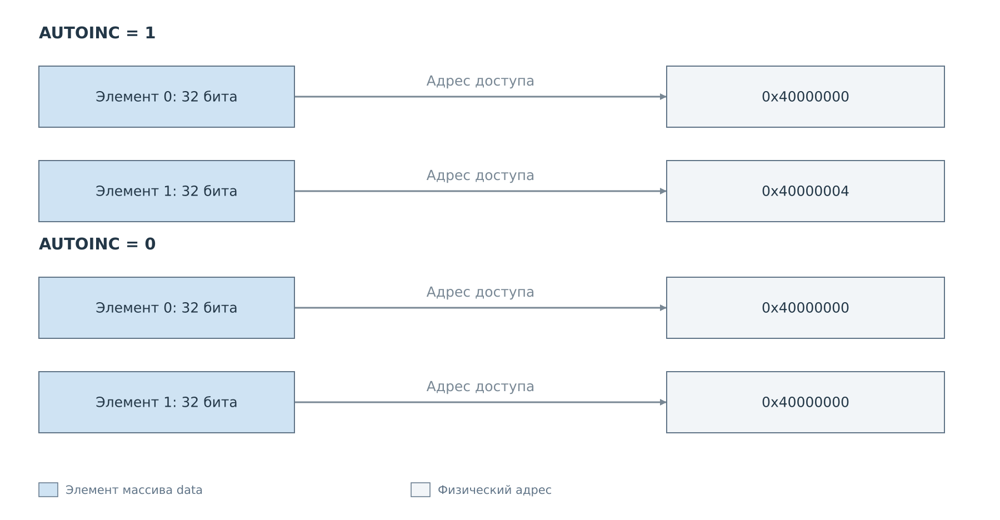
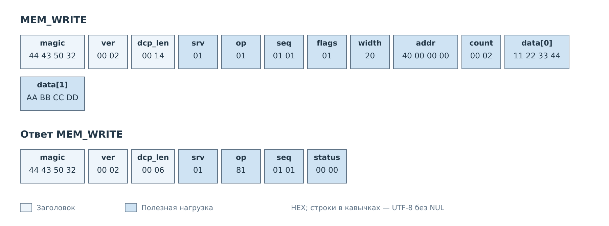
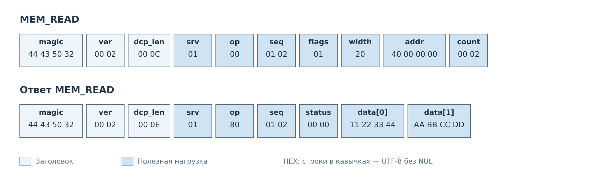

# Доступ к памяти

Клиент записывает два 32-битных слова через MEM и читает их обратно,
используя автоматическое увеличение адреса.

## Исходные условия

TCP-соединение установлено. В примере использован адрес `0x40000000` —
начало BRAM подсистемы I²C в конфигурации AX7020. Предполагается, что выбранные
слова доступны для такого обмена и не меняются другим участником. На работающей
подсистеме эта память занята её данными, поэтому адреса выбираются с учётом
контракта BRAM.

Форматы команд и правила AUTOINC одинаковы для FreeRTOS и Нейтрино.
У Нейтрино весь диапазон должен лежать внутри разрешённого региона PL;
8/16/64-битные обращения доступны для BRAM, регистры управления используют
32-битный доступ. Старым сценариям Нейтрино для соседних слов требуется
явно включить AUTOINC. Остальные ограничения перечислены
в [описании MEM](../reference/commands.md#mem-чтение-и-запись-памяти).

## Основной сценарий

### Адреса элементов

Клиент задаёт `width=32` и `count=2`. Флаг AUTOINC определяет, изменится ли
адрес после первого элемента.

*Рисунок 1. AUTOINC увеличивает адрес на размер элемента.
При нулевом флаге оба доступа направлены в один адрес.*

Для соседних слов нужен `flags=1`: второй доступ произойдёт по адресу
`0x40000004`. При `flags=0` повторится доступ к `0x40000000`. Последний режим
подходит только тогда, когда повторное обращение к одному адресу соответствует
назначению регистра.

### Запись двух слов

Клиент отправляет MEM_WRITE с `width=32`, `count=2`, `flags=1`
и адресом `0x40000000`.

*Рисунок 2. Два элемента `data` следуют за параметрами MEM. Ответ сообщает
результат записи и не повторяет массив.*

Первый элемент равен `0x11223344`, второй — `0xAABBCCDD`. Числовое значение
каждого элемента передаётся старшим байтом вперёд, независимо от представления
чисел в памяти PS. `count` считает элементы, поэтому массив занимает восемь
байт, а не два.

Сервер проверяет разрядность, выравнивание, разрешённый диапазон адресов
и соответствие длины массива. При успехе клиент получает только `status=0`.
Запись MEM не проходит через политику регистрового сервиса I²C или MDIO.

### Чтение результата

Клиент отправляет MEM_READ с теми же адресом, разрядностью, числом
элементов и флагом AUTOINC.

*Рисунок 3. Параметры адресации сохранены, код команды изменён на чтение.
Массив теперь находится в ответе.*

В успешном ответе клиент разбирает восемь байт как два числа по 32 бита.
В выбранных условиях они совпадают с записанными. Если другой участник успел
изменить память, ответ содержит уже прочитанное состояние: пара WRITE и READ
не образует атомарную операцию.

## Ошибки, повторы и восстановление

При ошибке клиент проверяет статус ответа и исправляет параметры перед
новой отправкой. Ответ с ошибкой не содержит массива прочитанных слов.
Ограничения разрядности, адресов и длины приведены в
[справочнике MEM](../reference/commands.md#mem-чтение-и-запись-памяти).

После потери ответа MEM_WRITE запись могла выполниться. Для показанной BRAM
клиент сначала читает выбранные слова и сравнивает их с ожидаемыми.
При обращении к регистрам MMIO возможность повторного чтения или записи
определяется назначением регистра. Новый `seq` служит для сопоставления
ответа с запросом и не предотвращает повторное аппаратное обращение.

## Связанные разделы

- Предыдущий пример — [Проверка соединения и ошибки](connection.md).
- Следующий пример — [Регистры и политика I²C](i2c.md).
- [Описание команд](../03-commands.md).
- [Справочник MEM](../reference/commands.md#mem-чтение-и-запись-памяти).
- [Клиент MEM](../client.md#диагностический-mem).
