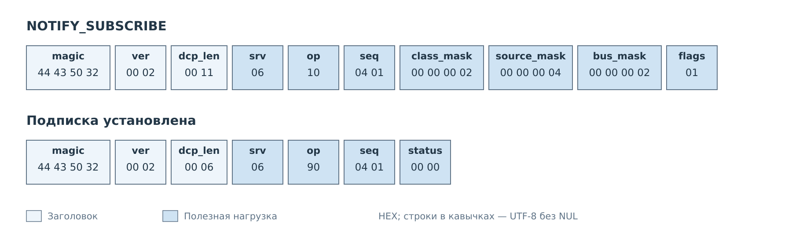
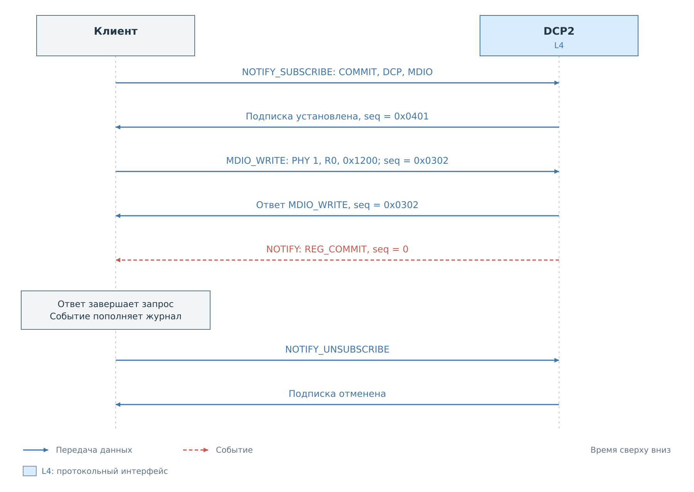
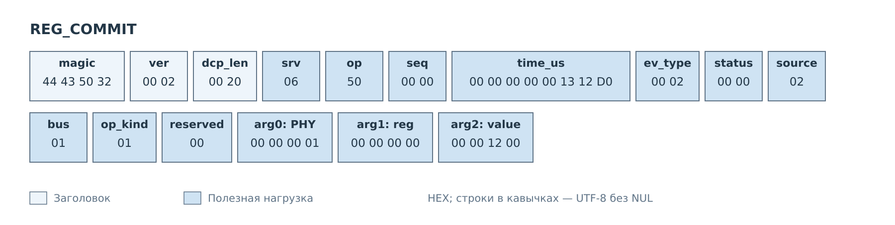
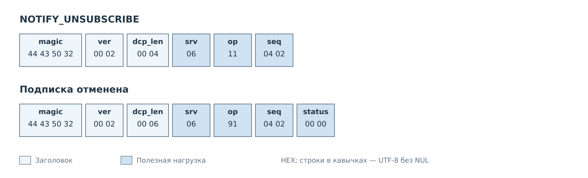
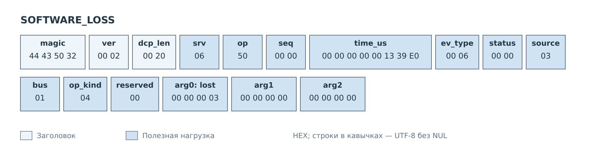

# Уведомления NOTIFY

Клиент подписывается на завершённые операции MDIO, выполняет запись,
принимает уведомление и отменяет подписку.

## Исходные условия

TCP-соединение установлено. NOTIFY подключён в FreeRTOS и Нейтрино.
PHY 1 зарегистрирован в готовом сервисе MDIO, политика разрешает запись
`0x1200` в регистр 0, как в [примере MDIO](mdio.md).

Подписка и команда записи используют одно TCP-соединение. Значения времени
и номера записей далее условные.

## Основной сценарий

### Установка фильтра

Нужное событие должно одновременно соответствовать трём условиям:
класс REG_COMMIT, источник DCP и шина MDIO. Поэтому в запросе используются
маски `0x00000002`, `0x00000004` и `0x00000002`. Это маски выбора,
а не числовые коды полей будущего события.

*Рисунок 1. `flags=1` включает метку времени. Успешный ответ подтверждает
установку фильтра.*

После подтверждения сервер передаёт новые подходящие события. Прошлая
история не воспроизводится. Повторный SUBSCRIBE заменяет действующий фильтр
этого соединения, поэтому его не нужно отправлять перед каждой записью.

### Ответ на команду и событие

После подтверждения подписки клиент отправляет MDIO_WRITE
с `PHY=1`, `reg=0`, `val16=0x1200` и `seq=0x0302`.

*Рисунок 2. Ответ MDIO_WRITE связан с запросом через `seq=0x0302`.
Уведомление NOTIFY имеет `seq=0` и обрабатывается отдельно.*

Здесь показан обмен без других действий системы. В общем случае между
запросами и ответами могут приходить и другие уведомления. Клиент постоянно
разбирает входящие кадры: ответы передаёт ожидающему запросу, события —
обработчику журнала. Событие REG_COMMIT само по себе не завершает ожидание
ответа MDIO_WRITE и не содержит его `seq`.

*Рисунок 3. Тело уведомления с меткой времени занимает 28 байт.*

В событии `source=2` означает DCP, `bus=1` — MDIO, `op_kind=1` — запись.
Аргументы восстанавливают предмет действия: PHY 1, регистр 0, значение
`0x1200`. Время `1 250 000` мкс — условная отметка регистрации события PS,
а не длительность транзакции. Её точность ограничена системным тиком.

Поле `status` внутри события описывает результат действия в шкале общего
C API. Общего статуса ответа перед телом события нет. В данном случае оба
успешных результата равны нулю, но для ошибок эти шкалы нельзя смешивать.
При выключенном WITH_TIMESTAMP первые восемь байт тела отсутствуют;
клиент определяет формат по сохранённым флагам подписки.

### Отмена подписки

Клиент отправляет NOTIFY_UNSUBSCRIBE в том же соединении.

*Рисунок 4. UNSUBSCRIBE не содержит параметров: на соединении один фильтр NOTIFY.*

После обработки отмены новые уведомления этой подписки не формируются.
Клиент завершает ожидание отмены по обычному ответу с её `seq`.

## Ошибки, повторы и восстановление

### Потеря записей журнала

Эта ветвь начинается после записи MDIO, пока фильтр ещё действует,
до отмены подписки в основном сценарии.

Пусть до чтения сервером были вытеснены три записи журнала MDIO.
Тогда приходит отдельное служебное уведомление.

*Рисунок 5. `arg0=3` сообщает о потере записей; поля регистра и значения
в этом событии не используются.*

Уведомление имеет источник INTERNAL и вид STATE_TOGGLE. Оно проходит даже
через выбранный выше узкий фильтр COMMIT и DCP: сообщение о потере учитывает
выбор шины, но обходит маски классов и источников. Клиент отмечает разрыв
в истории. Три потерянные записи могли относиться и к действиям,
которые обычный фильтр всё равно исключил бы.

NOTIFY не восстанавливает значения всех регистров после такого разрыва.
Если задача клиента — поддерживать согласованную копию состояния устройства,
для неё предусмотрена [подписка CACHE](cache.md#подписка-и-изменения).

### Разрыв соединения и потеря ответа

Закрытие TCP уничтожает фильтр NOTIFY. В новом соединении клиент
повторно подписывается и получает только новые подходящие события.
Прежняя история не воспроизводится.

Уведомление не заменяет ответ на MDIO_WRITE. Если ответ потерян, клиент
проверяет результат и возможность повторной записи по правилам
[примера MDIO](mdio.md#ошибки-повторы-и-восстановление).

## Связанные разделы

- Предыдущий пример — [POLICY по ID профиля и страницы GET](policy-profiles.md).
- Следующий пример — [Потоки STREAM](stream.md).
- [Описание событий](../05-events.md).
- [Справочник NOTIFY](../reference/events.md#формат-события-notify).
