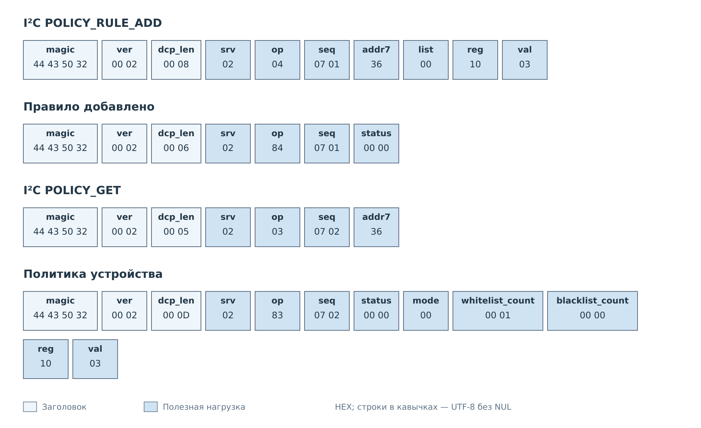
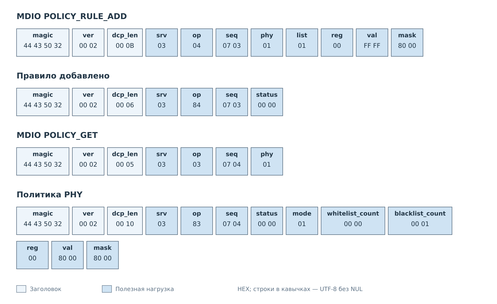

# Политики I²C и MDIO

Клиент изменяет правила политики I²C или MDIO по адресу устройства,
проверяет результат через GET и сохраняет текущий профиль.

## Исходные условия

TCP-соединение установлено. Адресные команды политики доступны в FreeRTOS
и Нейтрино. Устройство должно быть зарегистрировано в соответствующем сервисе.
Ниже разобраны два независимых примера с заранее подготовленными списками.

Устройство I²C с адресом `0x36` работает в WHITELIST, оба списка пусты.
Профиль разрешает регистр `0x10` и значение `0x03`. PHY 1 работает в BLACKLIST
с пустыми списками и допускает запись регистра 0.

Для выбора устройства по ID используется
[сервис POLICY](policy-profiles.md). Он также позволяет прочитать большую
политику по страницам.

## Основной сценарий

### Правило I²C

Клиент добавляет в WHITELIST устройства `0x36` пару `reg=0x10`, `val=0x03`,
затем читает результат через POLICY_GET.



*Рисунок 1. Два запроса с разными `seq`: редактирование и проверка политики.*

После добавления разрешена запись `0x03` в регистр `0x10`; другие пары
не получают разрешения этого белого списка. Никакая запись регистра
не выполняется до отдельной команды обмена. Для удаления клиент отправляет
POLICY_RULE_DELETE с теми же адресом, списком и парой. После этого белый
список снова пуст и запрещает записи. POLICY_CLEAR удаляет все правила
выбранного списка, сохраняя режим и другой список.

### Правило MDIO с маской

Клиент добавляет для регистра 0 PHY 1 правило с `val=0xFFFF`, `mask=0x8000`,
затем читает политику через POLICY_GET.
В чёрном списке оно запрещает записи, у которых установлен старший бит
регистра; остальные биты не участвуют в сравнении.



*Рисунок 2. Переданное значение `0xFFFF` сохраняется как `0x8000` с маской `0x8000`.*

GET показывает одну запись чёрного списка с `val=0x8000`.
POLICY_RULE_DELETE с `val=0x8000` или `val=0xFFFF` при той же маске
удалит её. POLICY_CLEAR очищает весь чёрный список. В обоих случаях
режим BLACKLIST сохраняется; пустой список вновь разрешает все
допустимые записи PHY.

### Сохранение

После проверки режима и списков клиент сохраняет текущий профиль отдельным
запросом. Например, для PHY 1:

```text
Запрос:  srv=0x03, op=0x07, seq=0x0010, body=01
Ответ:   srv=0x03, op=0x87, seq=0x0010, body=00 00
```

Статус `0` подтверждает запись текущего профиля LAN8720 во Flash.
Для I²C с адресом `0x36` используются `srv=0x02` и однобайтовое тело `36`.

Сохраняется текущий профиль целиком. Правки списков меняют рабочую политику,
а подтверждение SAVE относится к записи профиля в хранилище. Для прежней
I²C POLICY_SET действуют особенности, перечисленные в
[справочнике](../reference/policies.md#рабочая-конфигурация-и-сохранение).

## Дополнительные сценарии

### Одинаковые адреса за свитчом

У RTC `pcf8563` адрес `0x51` находится на канале 0 PCA9545A.
Диагностическое пространство SFP с ID `sfp` использует тот же адрес
на канале 1. Для раздельного выбора клиент передаёт сервису POLICY
пары `i2c/pcf8563` и `i2c/sfp`, а правила адресует по ID ресурсов.

SET, CLEAR и SAVE работают со всем логическим устройством. У SFP это оба
пространства `identity` и `diagnostics`. Изменение правила RTC сохраняет
прежнюю политику SFP. Команды политики изменяют разрешения в PS, аппаратная
запись регистра выполняется отдельным запросом.

Разбор кадров приведён в [примере POLICY по ID](policy-profiles.md),
а команды добавления, проверки, сохранения и удаления правил — в
[руководстве клиента](../client.md#одинаковые-адреса-за-свитчом).

## Ошибки, повторы и восстановление

При ошибке параметров клиент исправляет адрес, список или правило
и отправляет новый запрос с новым `seq`. Для DELETE используются те же
параметры правила с учётом нормализации значения маской MDIO.

После потери ответа на изменение клиент читает действующую политику через
GET и определяет оставшиеся действия. Повторная отправка с новым `seq`
сама по себе не гарантирует однократного изменения.

GET показывает состояние в RAM. Если потерян ответ SAVE, результат проверяют
по сохранённому JSON через FS. Условия сохранения и пути профилей описаны
в [справочнике политик](../reference/policies.md#рабочая-конфигурация-и-сохранение).

## Связанные разделы

- Предыдущий пример — [Регистры MDIO](mdio.md).
- Следующий пример — [POLICY по ID профиля и страницы GET](policy-profiles.md).
- [Описание политик](../04-policies.md).
- [Справочник политик](../reference/policies.md).
- [Клиент политик](../client.md#политики-i²c-и-mdio).
