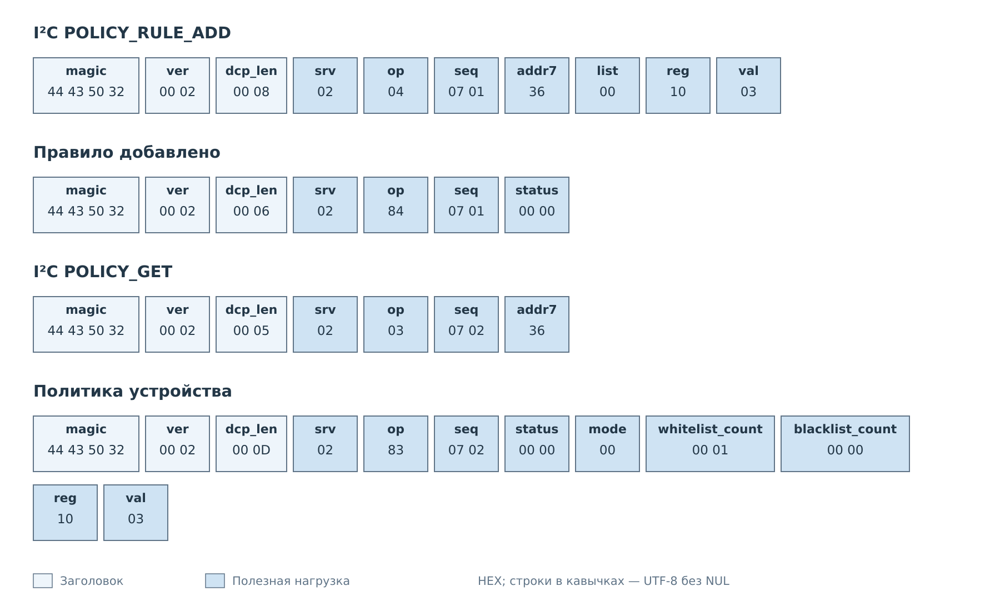
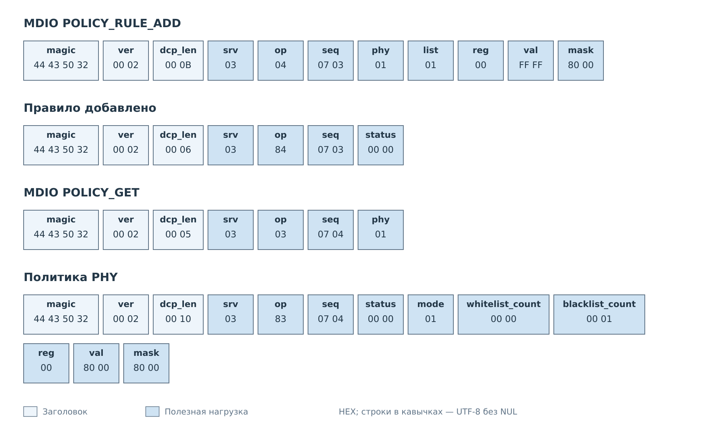

# Политики I²C и MDIO

Рассмотрим добавление правила I²C и правило MDIO с маской.
В каждом обмене клиент сначала изменяет список, затем читает
текущую политику через GET. Общие форматы команд описаны
в [справочнике политик](../reference/policies.md).

## Одинаковые адреса за свитчом

У RTC `pcf8563` адрес `0x51` находится на канале 0 PCA9545A. Диагностическое
пространство SFP с ID `sfp` использует тот же адрес на канале 1. Сервис POLICY
выбирает эти профили независимо:

```sh
python3 scripts/dcp2/dcp2_client.py 192.168.0.10 --policy-get i2c pcf8563
python3 scripts/dcp2/dcp2_client.py 192.168.0.10 --policy-get i2c sfp
```

Добавление правила в BLACKLIST RTC и чтение обеих политик:

```sh
python3 scripts/dcp2/dcp2_client.py 192.168.0.10 --policy-add i2c pcf8563 blacklist reg_01 0xAA
python3 scripts/dcp2/dcp2_client.py 192.168.0.10 --policy-get i2c pcf8563
python3 scripts/dcp2/dcp2_client.py 192.168.0.10 --policy-get i2c sfp
```

У RTC появляется правило `resource=reg_01`, `val=170`, `mask=255`. Политика
SFP сохраняет прежнее состояние. Правило применяется, когда выбран BLACKLIST.
Команды политики не записывают значение `0xAA` в физический регистр RTC.

Отдельное правило диагностического пространства SFP использует ID `a2_6e`:

```sh
python3 scripts/dcp2/dcp2_client.py 192.168.0.10 --policy-add i2c sfp blacklist a2_6e 0x40
python3 scripts/dcp2/dcp2_client.py 192.168.0.10 --policy-get i2c sfp
python3 scripts/dcp2/dcp2_client.py 192.168.0.10 --policy-get i2c pcf8563
```

Для сохранения текущего профиля с политикой:

```sh
python3 scripts/dcp2/dcp2_client.py 192.168.0.10 --timeout 15 --policy-save i2c sfp
```

Удаление добавленных правил:

```sh
python3 scripts/dcp2/dcp2_client.py 192.168.0.10 --policy-delete i2c pcf8563 blacklist reg_01 0xAA
python3 scripts/dcp2/dcp2_client.py 192.168.0.10 --policy-delete i2c sfp blacklist a2_6e 0x40
```

Если профиль был сохранён, повторите SAVE после удаления правила, чтобы
обновить его файл. SET, CLEAR и SAVE работают со всем логическим устройством;
у SFP это оба пространства `identity` и `diagnostics`.

## Правило I²C

Пусть устройство с адресом `0x36` уже зарегистрировано, его режим — WHITELIST,
а оба списка пусты. Профиль разрешает регистр `0x10` и значение `0x03`.
Клиент добавляет эту пару в белый список, затем читает результат.



*Рисунок 1. Два запроса с разными `seq`: редактирование и проверка политики.*

После добавления разрешена запись `0x03` в регистр `0x10`; другие пары
не получают разрешения этого белого списка. Никакая запись регистра
не выполняется до отдельной команды обмена. Для удаления клиент отправляет
POLICY_RULE_DELETE с теми же адресом, списком и парой. После этого белый
список снова пуст и запрещает записи. POLICY_CLEAR удаляет все правила
выбранного списка, сохраняя режим и другой список.

## Правило MDIO с маской

Пусть PHY 1 зарегистрирован и работает в режиме BLACKLIST с пустыми списками.
Клиент добавляет в регистр 0 правило с `val=0xFFFF`, `mask=0x8000`.
В чёрном списке оно запрещает записи, у которых установлен старший бит
регистра; остальные биты не участвуют в сравнении.



*Рисунок 2. Переданное значение `0xFFFF` сохраняется как `0x8000` с маской `0x8000`.*

GET показывает одну запись чёрного списка с `val=0x8000`.
POLICY_RULE_DELETE с `val=0x8000` или `val=0xFFFF` при той же маске
удалит её. POLICY_CLEAR очищает весь чёрный список. В обоих случаях
режим BLACKLIST сохраняется; пустой список вновь разрешает все
допустимые записи PHY.

## Сохранение

После проверки режима и списков клиент сохраняет текущий профиль отдельным
запросом. Например, для PHY 1:

```text
Запрос:  srv=0x03, op=0x07, seq=0x0010, body=01
Ответ:   srv=0x03, op=0x87, seq=0x0010, body=00 00
```

Статус `0` подтверждает запись текущего профиля LAN8720 во Flash.
Для I²C с адресом `0x36` используются `srv=0x02` и однобайтовое тело `36`.
В командной строке тот же обмен запускается так:

```sh
python3 scripts/dcp2/dcp2_client.py 192.168.0.10 --timeout 15 --mdio-policy-save 1
python3 scripts/dcp2/dcp2_client.py 192.168.0.10 --timeout 15 --i2c-policy-save 0x36
```

Правки изменяют рабочую политику. Условия сохранения описаны
в [спецификации](../reference/policies.md#рабочая-конфигурация-и-сохранение),
а команды штатного клиента — в
[руководстве DCP2](../client.md#политики-i²c-и-mdio).

---

Далее: [Уведомления NOTIFY](notify.md).
[Форматы управления политиками](../reference/policies.md).
