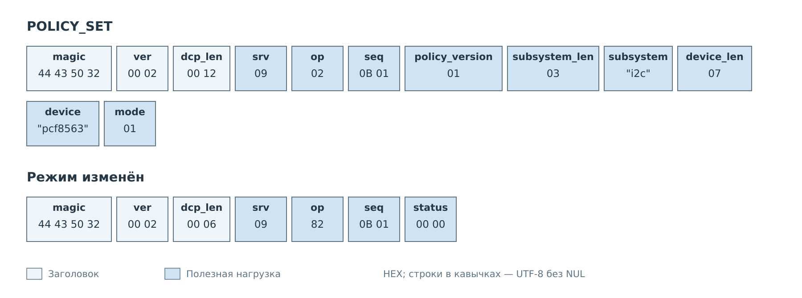
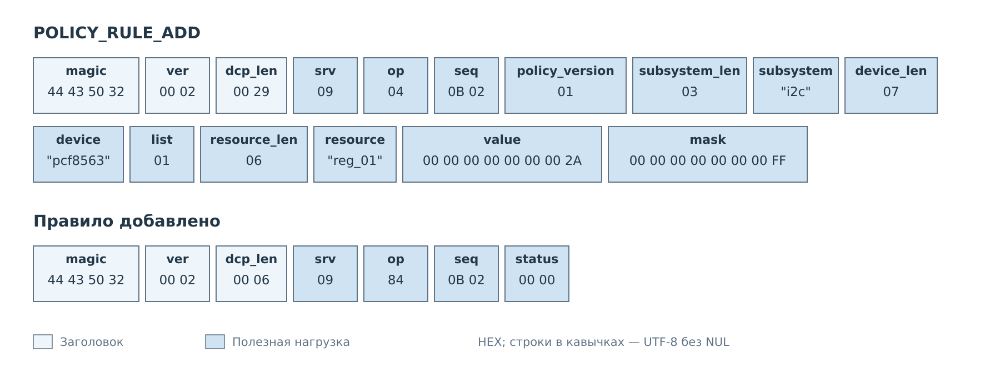
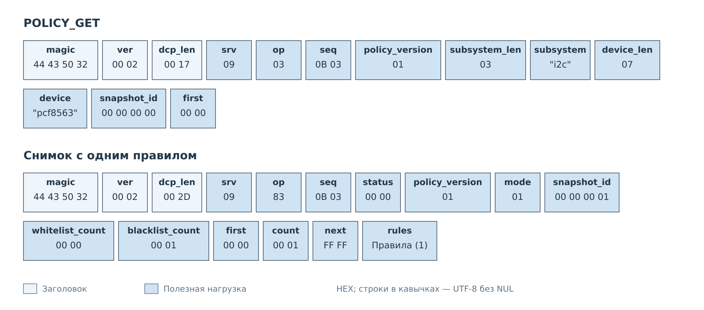
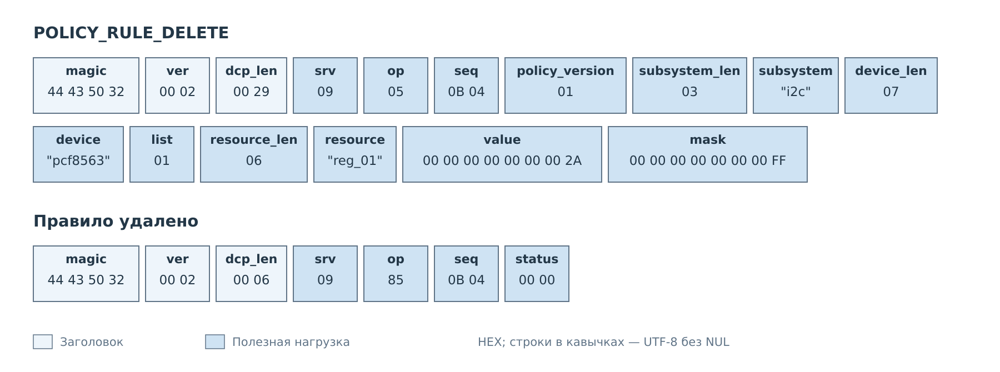
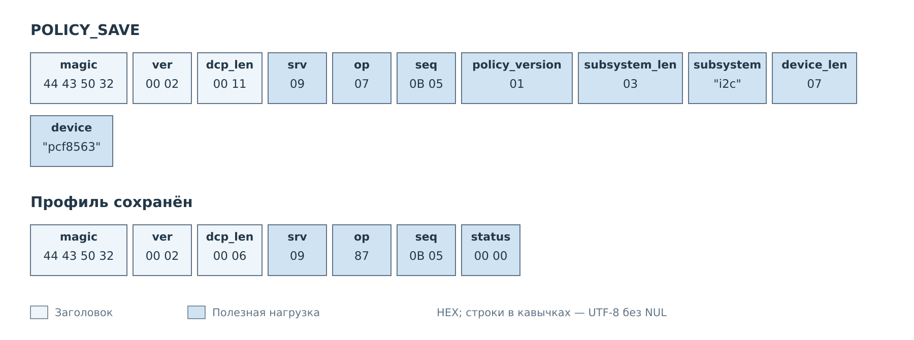
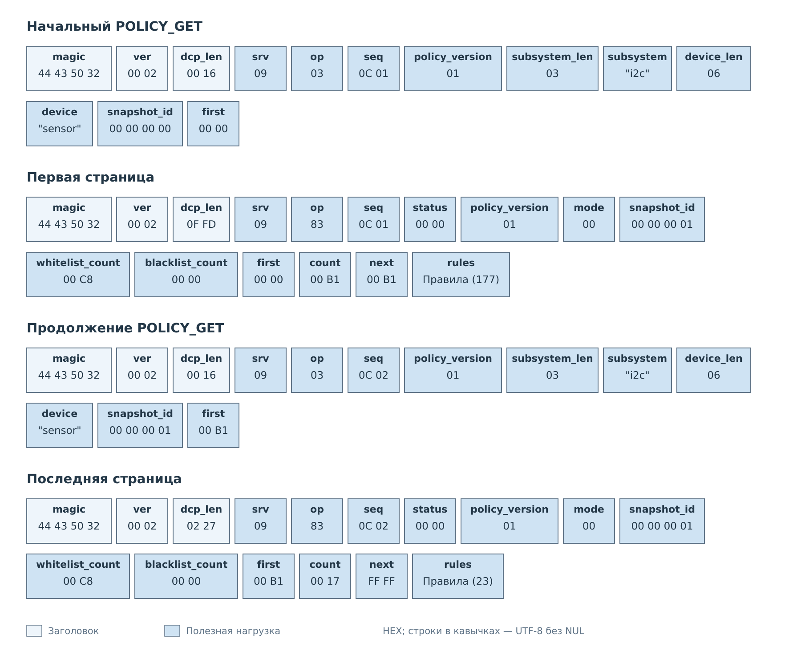
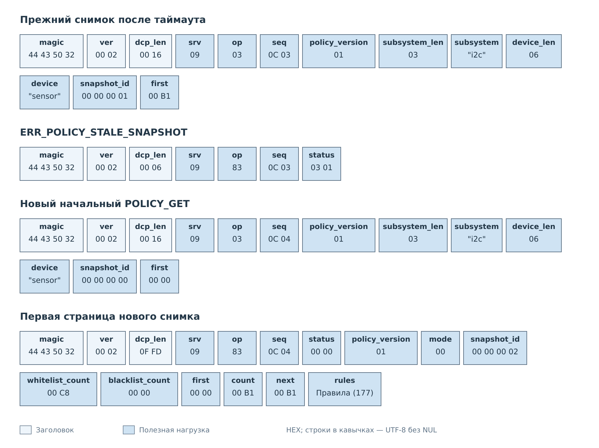
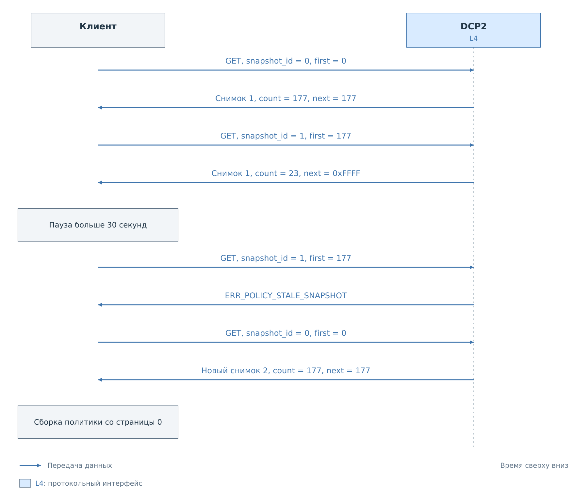

# POLICY по ID профиля и страницы GET

Клиент выбирает профиль по ID, изменяет правило и сохраняет профиль.
Отдельный обмен показывает чтение большой политики по страницам.

- [Исходные условия](#исходные-условия).
- [Основной сценарий](#основной-сценарий).
- [Дополнительные сценарии](#дополнительные-сценарии).
- [Ошибки, повторы и восстановление](#ошибки-повторы-и-восстановление).
- [Связанные разделы](#связанные-разделы).

## Исходные условия

TCP-соединение установлено. Основной сценарий выполняется последовательно
в одном соединении, сервис POLICY подключён и профиль готов. Команды доступны
в FreeRTOS и Нейтрино.

Сервис `srv=0x09` выбирает устройство по `subsystem` и `device`, а правило
по `resource`. Все три имени передаются как длина `u8` и байты ASCII.
Каждый запрос начинается с `policy_version=1`. Значения и маски правил
передаются как `u64` старшим байтом вперёд.

Для первого обмена в сервисе зарегистрирован I²C-профиль `pcf8563`
с ресурсом `reg_01`. Изначально оба списка пусты. Команды изменяют политику
в памяти PS, а SAVE сохраняет профиль.

## Основной сценарий

### Выбор режима и добавление правила

Клиент выбирает BLACKLIST для `i2c/pcf8563`.

*Рисунок 1. SET передаёт ID профиля и `mode=1`.*

Затем клиент добавляет в BLACKLIST правило для `reg_01` со значением `42`
и маской `255`. В HEX это `value=0x2A`, `mask=0xFF`.

*Рисунок 2. ADD передаёт `list=1`. Значение и маска занимают по восемь байт.*

Для I²C маска равна `0xFF`, значение должно входить в диапазон профиля.
Для MDIO выбирается `subsystem=mdio` и ID профиля PHY, а значение и маска
входят в диапазон `0..65535`. При этом размер обоих полей на проводе
сохраняется равным восьми байтам. Сравнение MDIO учитывает маску.

### Проверка, удаление и сохранение

Клиент запрашивает GET с `snapshot_id=0`, `first=0`, чтобы проверить
получившуюся политику.

*Рисунок 3. Запрос с нулевым токеном создаёт снимок. Ответ возвращает токен 1.*

В примере `mode=1`, `whitelist_count=0`, `blacklist_count=1`.
Страница начинается с `first=0`, содержит `count=1` запись и завершается
`next=0xFFFF`. Поэтому возвращённое правило относится к BLACKLIST.
Массив `rules` содержит ID `reg_01`, значение 42 и маску 255.

Клиент удаляет проверенное правило, передавая прежние список, ресурс,
значение и маску.

*Рисунок 4. DELETE получает те же список, ID ресурса, значение и маску.*

Удаление сбрасывает снимок этого соединения. Следующее чтение политики
начинается с нулевого токена. Режим BLACKLIST сохраняется, теперь его
пустой список разрешает допустимые профилем записи.

Клиент сохраняет профиль `i2c/pcf8563` через POLICY_SAVE.

*Рисунок 5. После версии и двух имён тело SAVE завершено.*

Ответ OK приходит после сохранения текущего профиля. В этом обмене
сохраняются режим BLACKLIST и оба пустых списка. GET показывает состояние
сервиса в RAM. Пути профилей и условия сохранения приведены в
[справочнике](../reference/policies.md#рабочая-конфигурация-и-сохранение).

## Дополнительные сценарии

### Постраничный POLICY_GET

После завершения основного обмена клиент закрывает соединение и открывает
новое. Для этого примера подготовлен условный профиль `i2c/sensor`.
Ресурс `reg_00` допускает значения от 0 до 255. В WHITELIST находятся
200 правил с этим ресурсом, значениями `0..199` и маской 255,
BLACKLIST пуст, режим WHITELIST. Состояние подготовлено до первого GET.

Одна запись занимает `1 + 6 + 8 + 8 = 23` байта. После общего префикса
ответа со статусом и 16-байтового заголовка страницы остаётся
`4096 - 6 - 16 = 4074` байта. Поэтому первая страница вмещает 177 правил,
вторая содержит оставшиеся 23. На рисунке массивы сгруппированы,
в метаданных SVG сохранены все передаваемые байты.

*Рисунок 6. `snapshot_id=1` связывает обе страницы, `seq` каждой отправки новый.*

| Запрос | Параметры | Ответ |
|---|---|---|
| Первый GET | `snapshot_id=0`, `first=0` | `snapshot_id=1`, `first=0`, `count=177`, `next=177` |
| Продолжение | `snapshot_id=1`, `first=177` | `snapshot_id=1`, `first=177`, `count=23`, `next=0xFFFF` |

Клиент проверяет токен, режим и общие счётчики списков, затем присоединяет
правила в порядке страниц. Физические размеры страниц зависят от длины
ID ресурсов. В другом профиле число правил на первой странице может
отличаться. Изменения через другие интерфейсы после создания снимка
учитываются при следующем начальном GET.

## Ошибки, повторы и восстановление

### Истечение снимка и восстановление

Эта ветвь продолжает постраничный GET дополнительного сценария.
После второй страницы клиент ждёт больше 30 секунд. Попытка снова
прочитать страницу с прежним токеном возвращает `0x0301`.

*Рисунок 7. Ошибочный ответ содержит только статус. Новый GET выдаёт токен 2.*

*Рисунок 8. После сброса клиент собирает политику заново с первой страницы.*

Для восстановления передаются `snapshot_id=0`, `first=0`. Новый ответ
в примере имеет токен 2 и `next=177`, поэтому чтение продолжается
с `snapshot_id=2`, `first=177`. Тот же порядок нужен после переподключения,
замены снимка новым GET или его сброса командой редактирования.

POLICY задаёт отдельное состояние снимка для TCP-соединения. Подготовка
списков несколькими командами и SAVE выполняются последовательно.
При потере ответа на изменение клиент сначала читает действующую политику
новым GET, затем определяет, какие изменения ещё нужны.

### Потеря ответа SAVE

GET читает рабочую политику из RAM. При потере ответа SAVE клиент проверяет
сохранённый JSON через FS. Проверка только режима и списков через GET
не подтверждает запись файла профиля.

## Связанные разделы

- Предыдущий пример — [Политики I²C и MDIO](policies.md).
- Следующий пример — [Уведомления NOTIFY](notify.md).
- [Описание политик](../04-policies.md).
- [Справочник POLICY по ID](../reference/policies.md#адресация-по-id-профиля).
- [Клиент POLICY по ID](../client.md#выбор-по-id-профиля).
