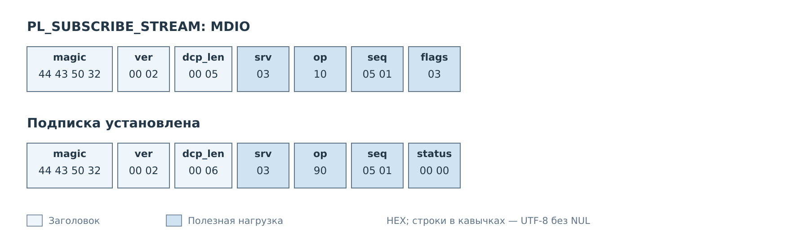
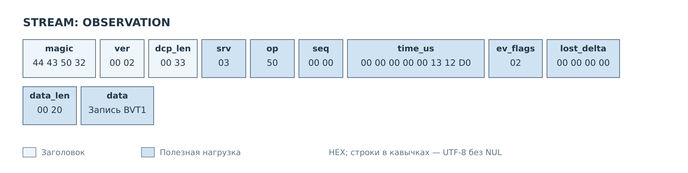
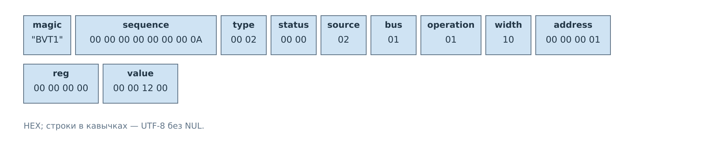
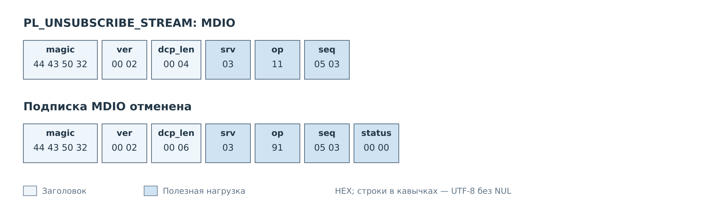
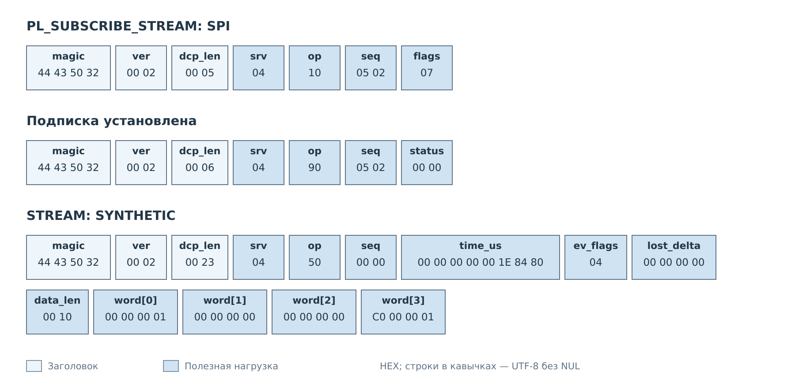

# Потоки STREAM

Клиент получает наблюдение записи MDIO через STREAM и отменяет подписку.
Дополнительный пример разбирает данные тестового генератора SPI.

- [Исходные условия](#исходные-условия).
- [Основной сценарий](#основной-сценарий).
- [Дополнительные сценарии](#дополнительные-сценарии).
- [Ошибки, повторы и восстановление](#ошибки-повторы-и-восстановление).
- [Связанные разделы](#связанные-разделы).

## Исходные условия

TCP-соединение установлено. STREAM подключён в FreeRTOS и Нейтрино.
Для основного сценария готов сервис MDIO, PHY 1 зарегистрирован,
а политика разрешает запись `0x1200` в регистр 0.

Клиент подписывается до выполнения записи из [примера MDIO](mdio.md).
Времена и номера наблюдений условные. Формат оболочки STREAM и массива
`data` описан в [справочнике событий](../reference/events.md#stream-наблюдения-и-тестовые-данные).

## Основной сценарий

### Подписка на наблюдения MDIO

Клиент отправляет PL_SUBSCRIBE_STREAM для MDIO с `flags=3`,
включающим RAW_WORDS и WITH_TIMESTAMP.

*Рисунок 1. `srv=0x03` выбирает поток MDIO. Подписка подтверждается обычным ответом.*

Подписка начинает наблюдение с текущего конца журнала. Она не запускает
транзакцию на шине. Новое действие сервиса должно сначала попасть в журнал,
после чего сервер сможет передать его клиенту.

### Событие и запись BVT1

После подтверждения подписки выполняется MDIO_WRITE
с `PHY=1`, `reg=0`, `val16=0x1200`.

Следующая запись журнала в примере имеет собственный номер 10
и описывает успешную запись `0x1200` в регистр 0 PHY 1. Сервер помещает её
в событие STREAM.

*Рисунок 2. Оболочка события сообщает время, происхождение данных,
потери и длину вложенной записи.*

`ev_flags=2` означает OBSERVATION. `lost_delta=0` сообщает об отсутствии
обнаруженной потери перед этой записью. `data_len=32` позволяет отделить
саму запись BVT1 от полей события.

*Рисунок 3. Полная запись BVT1 остаётся в `data`, в том числе при RAW_WORDS.*

Клиент проверяет сигнатуру BVT1 и разбирает действие: COMMIT, успешный статус,
источник DCP, шина MDIO и операция WRITE. `width=16` описывает регистр MDIO,
хотя поле `value` самой записи занимает 32 бита.

Здесь существуют два разных номера. `seq=0` в DCP2 означает событие,
а `sequence=10` внутри BVT1 — позицию наблюдения в журнале этой шины.
Он не связан с номером команды MDIO_WRITE. В журнале могут быть и другие
действия, например предшествующая попытка записи.

### Отмена подписки

Клиент отправляет PL_UNSUBSCRIBE_STREAM для MDIO в том же соединении.

*Рисунок 4. Отмена адресуется сервису шины.*

После подтверждения новые события MDIO этой подписки не формируются.
Если в соединении есть другие потоковые подписки, они сохраняются.
Например, SPI отменяется отдельным запросом с `srv=0x04` и новым `seq`.

## Дополнительные сценарии

### Тестовый поток SPI

После завершения основного сценария клиент закрывает соединение
и открывает новое для тестового потока SPI.

Для второго примера предполагается, что тестовый генератор SPI уже включён
в режиме COUNTER и формирует по четыре слова. Настройка генератора выполняется
отдельно; команда SUBSCRIBE только подписывает соединение на его выход.
Рассматривается первый набор генератора после его запуска.

Клиент отправляет PL_SUBSCRIBE_STREAM для SPI с `flags=7`.

*Рисунок 5. `srv=0x04`, `ev_flags=4`: передаются синтетические данные SPI.*

`flags=7` включает RAW_WORDS, метку времени и сброс счётчика потерь
генератора. Первое слово содержит номер набора 1, второе — нулевой endpoint
генератора SPI, третье — индекс 0. В четвёртом находится шаблон `0xC0000001`.
В `data` нет BVT1: способ разбора выбран по SYNTHETIC.

Этот набор не подтверждает аппаратный обмен SPI или чтение SD-карты.
В текущих DCP2-серверах обеих ОС обычные команды SPI и UART не подключены;
для этих сервисов доступны `PL_SUBSCRIBE_STREAM` и `PL_UNSUBSCRIBE_STREAM`.

После завершения приёма клиент отменяет подписку запросом
PL_UNSUBSCRIBE_STREAM с `srv=0x04` или закрывает это соединение.

### Другие шины

Формат управления потоком одинаков для четырёх сервисов:

| Шина | `srv` | Источник реальных наблюдений в текущем сервере |
|---|---|---|
| I²C | `0x02` | Журнал I²C |
| MDIO | `0x03` | Журнал MDIO |
| SPI | `0x04` | Аппаратные наблюдения не подключены к этому потоку |
| UART | `0x05` | Аппаратные наблюдения не подключены к этому потоку |

Для I²C можно использовать кадр подписки MDIO, заменив `srv` на `0x02`
и назначив свободный `seq`. В BVT1 поле `width` будет равно 8. Тестовый
генератор выбирается и настраивается отдельно для соответствующего сервиса.

## Ошибки, повторы и восстановление

При потере наблюдений сервер выставляет OVERFLOW, поэтому вместе
с OBSERVATION получится `ev_flags=3`; `lost_delta` содержит число потерянных
записей. Клиент отмечает разрыв. Повторная подписка начинает чтение с текущего
конца и не возвращает утраченную историю.

Разрыв TCP уничтожает все потоковые подписки соединения. Для продолжения
клиент создаёт новое соединение и повторяет нужные подписки. Событие STREAM
не завершает ожидание ответа на аппаратную команду. Потерю ответа MDIO_WRITE
обрабатывают по [правилам MDIO](mdio.md#ошибки-повторы-и-восстановление).

## Связанные разделы

- Предыдущий пример — [Уведомления NOTIFY](notify.md).
- Следующий пример — [Работа с файловой системой через DCP2](files.md).
- [Описание событий](../05-events.md).
- [Справочник STREAM](../reference/events.md#stream-наблюдения-и-тестовые-данные).
