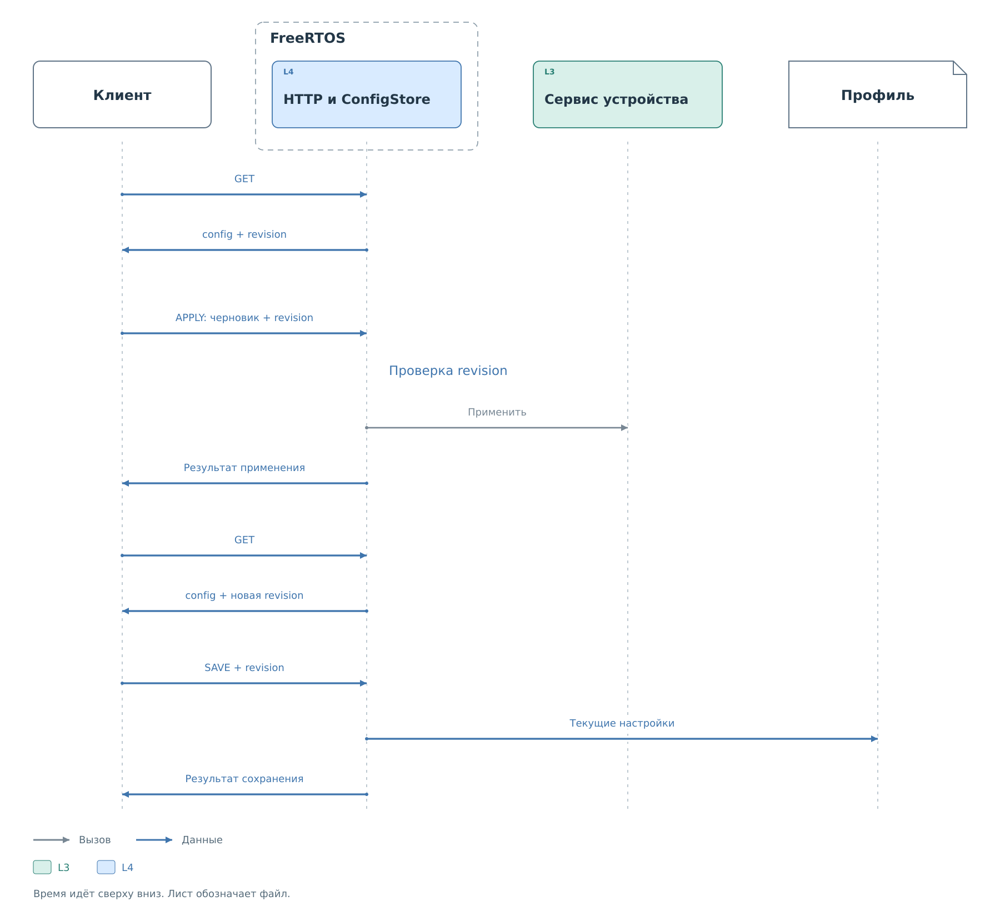

# Настройки устройств через HTTP

HTTP работает с экземплярами устройств, уже созданными в BVSTK.
Сначала клиент получает список подсистемы, затем выбирает устройство
по имени и читает его снимок. В нём находятся рабочая конфигурация,
её ревизия, состояние сохранения и кэш.

Поля снимка: [таблица устройства](reference/devices.md#подсистемы).

## Снимок и черновик

Поле `config` — представление настроек, предназначенное для редактора.
Оно отличается от JSON профиля v2 на носителе: API сохраняет прежние
имена полей, а обработчик переносит изменения в общую модель профиля.
Метаданные устройства, ID ресурсов и ссылки на дополнительные файлы
при этом сохраняются.

Клиент копирует `config` в черновик и сохраняет полученную `revision`.
Пока пользователь редактирует копию, устройство работает с прежними
настройками. Изменения отправляются действием `apply` как полная
конфигурация. Пропуск неизменённых обязательных полей не означает,
что сервер автоматически возьмёт их из прежнего состояния.

## Применение и конфликт версии

С запросом передаётся ревизия исходного снимка. Сервер сравнивает её
с текущими настройками и проверяет допустимость самого изменения.
После успешного применения новые правила начинают действовать в сервисе.

*Рисунок 1. Применение черновика и отдельное сохранение рабочего состояния.*

Если другой клиент изменил конфигурацию после чтения снимка, прежняя
ревизия обычно перестаёт совпадать. Сервер возвращает конфликт.
Нужно получить новое состояние и повторить свои изменения поверх него.
Подстановка новой ревизии в прежний черновик может затереть чужую правку.

Ревизия основана на хеше содержимого и не является атомарной блокировкой
всех интерфейсов. Между последней проверкой и применением возможно
изменение из консоли или DCP2. Для согласованного редактирования
используют одного писателя; после действия снова читают снимок.
Точный формат ревизии и условия ответа описаны
в [таблице действий PUT](reference/devices.md#действия-put).

## Сохранение

`apply` меняет рабочую конфигурацию. Отдельное действие `save` записывает
её текущий снимок через ConfigStore. Поэтому перед сохранением клиент
получает обновлённую ревизию и проверяет, что рабочие настройки
соответствуют его намерению.

После сохранения снимок читается снова. Поле `saved` сообщает результат
сравнения рабочей конфигурации с файлом. Оно может показывать совпадение,
расхождение или невозможность проверки. Этот признак не подтверждает
значения физических регистров. Порядок записи и восстановления файла
объясняется в [жизненном цикле конфигурации](../../configuration/lifecycle.md).

Если файл не удалось сохранить, успешно применённые настройки продолжают
работать в памяти. После перезапуска система загрузит доступный профиль
с носителя. Конкретные запросы и проверка конфликта приведены
в [примере редактирования](examples/device-settings.md).

## Кэш и физический обмен

Чтение снимка возвращает уже сохранённые значения. Для обновления
отображения без конфигурации предусмотрено действие `cache`.
Оно также не обращается к шине. Достоверность каждого значения задают
его источник, признак `valid` и время обновления.

Чтобы получить новое значение от устройства, клиент отправляет действие
`read`. Запись выполняется через `write` и подчиняется политике сервиса.
Изменение самой политики не записывает регистры устройства.
Готовность устройства оценивается отдельно: наличие профиля и начальных
значений кэша не доказывает, что устройство отвечает.

Допустимые изменения, параметры операций и различия подсистем
перечислены в [таблицах кэша и присутствия](reference/devices.md#кэш-и-присутствие-устройства)
и [действий PUT](reference/devices.md#действия-put).
