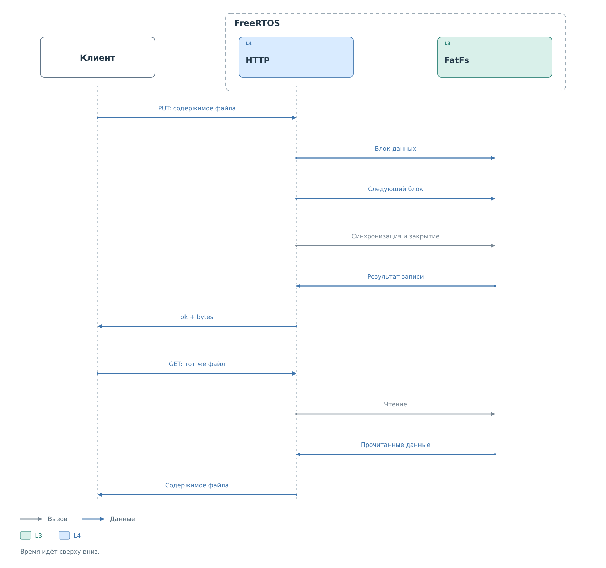

# Передача файлов через HTTP

Файловый API обращается к готовым томам BVSTK. Клиент выбирает том
и путь внутри него. Список томов сообщает их состояние; получение списка
само по себе не монтирует носитель. Путь устройства, например
`flash:/config/`, в запросе задаётся отдельно именем тома и путём `/config/`.

## Чтение

При чтении каталога сервер возвращает порцию записей и позицию следующей.
Клиент продолжает запросы с этой позиции, пока записи не закончатся.
Каталог между запросами не блокируется: при параллельных изменениях
перечисление следует начать заново.

Параметры перечисления: [таблицы каталогов](reference/files.md#каталоги-и-файловые-операции).

Запрос содержимого файла передаёт его байты с объявленной длиной.
Клиент сохраняет полученное во временный локальный файл, проверяет
завершение передачи и только после этого использует результат.
Если чтение носителя завершилось ошибкой после отправки заголовков,
HTTP-код уже мог быть успешным; признаком ошибки становится неполное тело.

Поля запросов чтения и загрузки: [содержимое файла](reference/files.md#содержимое-файла).

## Загрузка

Для нового файла клиент отправляет PUT с содержимым в теле.
По умолчанию существующая цель отклоняется. Явное разрешение перезаписи
позволяет усечь прежний файл и писать новое содержимое прямо в него.

*Рисунок 1. Передача содержимого на носитель и проверка полученного файла.*

Обработчик принимает тело частями и передаёт их файловой системе.
Успешный ответ формируется после синхронизации и закрытия файла.
Если соединение оборвалось во время записи, частичная цель остаётся
на носителе. Повтор без проверки может либо встретить уже созданный файл,
либо снова усечь его при разрешённой перезаписи.

После неопределённого результата клиент получает сведения о цели
и при необходимости читает её содержимое. Сравнение с исходными данными
позволяет решить, завершена ли передача. Конкретная последовательность
приведена в [примере загрузки](examples/file-transfer.md).

Загрузка профиля меняет файл на носителе. Работающий сервис продолжает
использовать прежние настройки до их повторной загрузки или применения
через интерфейс конфигурации. Связь этих состояний описана
в [жизненном цикле профиля](../../configuration/lifecycle.md).

## Архивы и прежние маршруты

Для копирования каталога предусмотрены маршруты TAR. Архив формируется
по мере чтения файлов. Обход не фиксирует дерево в одном состоянии,
поэтому изменения файлов во время передачи могут попасть в копию частично.
При восстановлении ошибка распаковки не откатывает уже записанные файлы.

У прежних файловых URL и семейства `/api/ui/` различаются ответы,
проверки путей и поведение при перезаписи. Для новой программы предпочтительно
использовать `/api/ui/`; TAR имеет собственные маршруты.
Точные условия перечислены в [справочнике файлов](reference/files.md).
