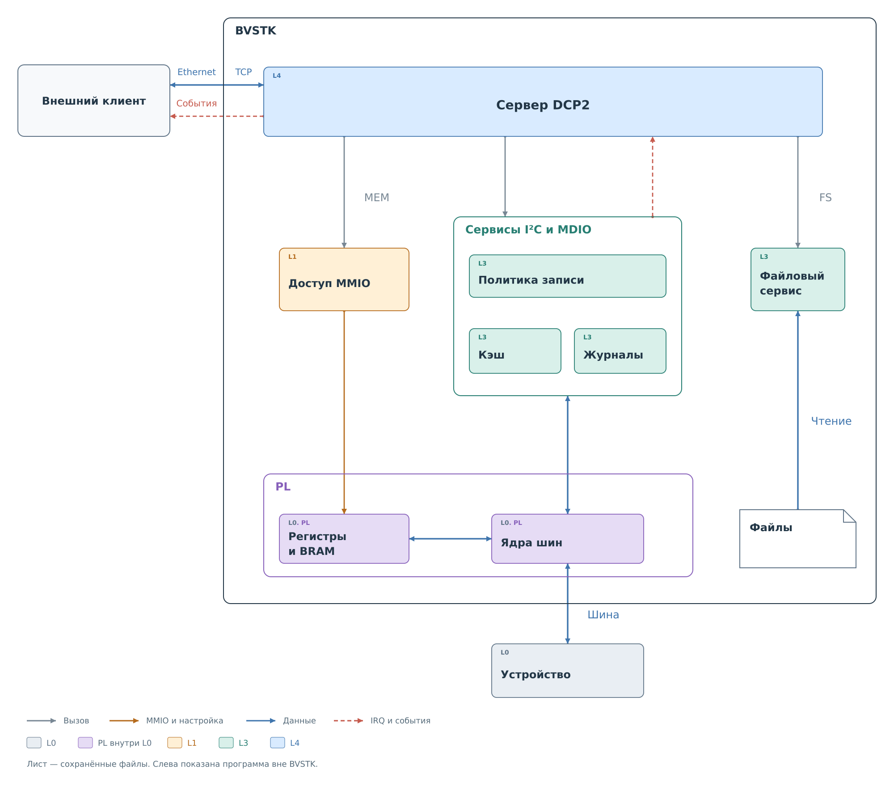

# Назначение DCP2

DCP2 — двоичный протокол, по которому внешняя программа подключается
к BVSTK через Ethernet. Клиент устанавливает TCP-соединение с сервером
на плате, отправляет команды и получает результаты. По умолчанию сервер
слушает порт `8889`. Через подписки клиент также получает уведомления
об изменениях в системе.

*Рисунок 1. Направления обращений через DCP2. Цвета соответствуют
[уровням абстракции BVSTK](../../system/system.md#уровни-абстракции).
Обмен с PL показан без промежуточных драйверов.*

Сервер DCP2 относится к пользовательским функциям L4: он принимает сетевой
запрос и передаёт операцию нужной части системы. Например, команда записи
регистра поступает сервису устройства L3. Сервис проверяет политику записи,
вызывает драйвер и обновляет своё состояние по результату обмена.
Физическую транзакцию выполняет ядро PL.

Клиент может читать и записывать регистры устройств I²C и MDIO,
получать и редактировать их политики записи. Отдельные команды дают доступ к программному кэшу
и наблюдениям. Чтение кэша возвращает уже сохранённое состояние и не запускает
новый обмен на шине. Файловый сервис позволяет читать содержимое носителей;
запись файлов через DCP2 сейчас не предусмотрена.

Команды MEM обращаются к разрешённым аппаратным адресам через механизм MMIO.
Этот путь обходит сервис устройства и его политику записи. Поэтому работа
с регистром ядра PL через MEM и команда записи регистра внешнего устройства —
разные операции, даже если обе меняют состояние аппаратуры.

Набор возможностей зависит от приложения. Схема охватывает направления,
подключённые в сервере FreeRTOS. В текущем `bvstkd` для Нейтрино доступен
меньший набор; точная сводка приведена в [главе о командах](03-commands.md#сервисы).

---

Далее: [Кадр и правила обмена](02-frame.md).
