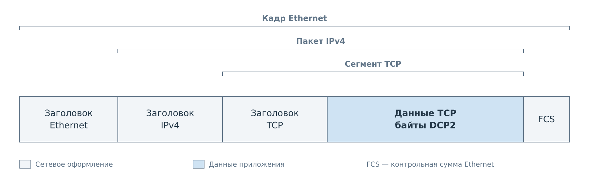
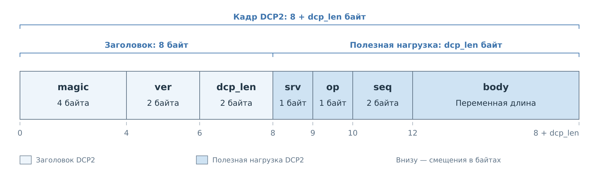
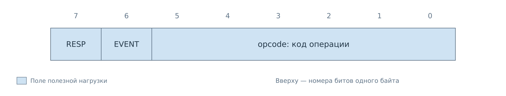
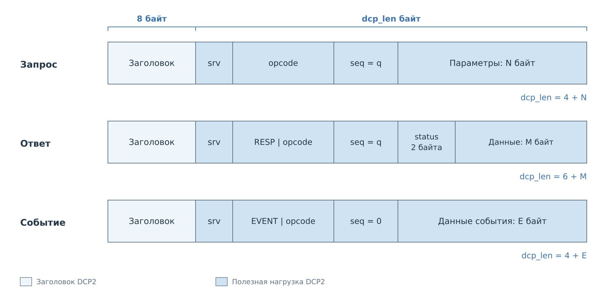
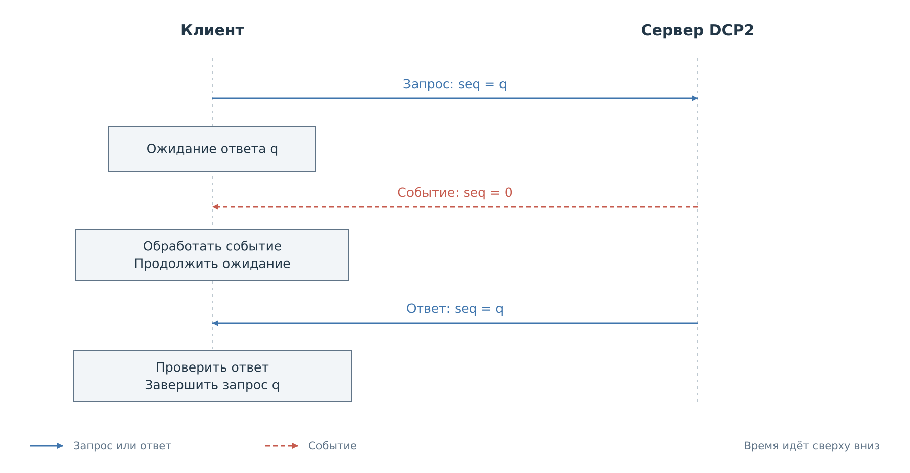

# Кадр и правила обмена DCP2

Обмен между клиентом и BVSTK начинается с передачи байтов по сети.
Сначала рассмотрим место DCP2 в сетевом кадре, затем разберём само сообщение:
как получатель определяет его границы, выбирает операцию и связывает ответ
с запросом.

## DCP2 внутри сетевого кадра

При передаче через IPv4 кадр Ethernet содержит пакет IPv4, внутри которого
находится сегмент TCP. Байты DCP2 помещаются в полезные данные TCP.

*Рисунок 1. Вложенность сетевых форматов. Скобки обозначают границы структур.
Ширина полей условная; служебные детали опущены.*

Ethernet обеспечивает передачу по локальному участку сети, IPv4 задаёт
адреса отправителя и получателя, а TCP доставляет упорядоченный поток байтов
между клиентом и сервером. Заголовки этих протоколов добавляет и разбирает
сетевой стек. Через TCP-сокет приложение передаёт и получает только байты
DCP2. Контрольная сумма Ethernet, обозначенная как FCS, в них не входит.

Границы сегментов TCP не задают границы сообщений DCP2. Одно сообщение
может передаваться несколькими сегментами, а один сегмент может содержать
несколько сообщений или их части. Поэтому у DCP2 есть собственный
заголовок, по которому получатель определяет длину целого сообщения.

## Структура кадра

Сообщение, или кадр DCP2, состоит из заголовка фиксированной длины
и полезной нагрузки. Заголовок позволяет выделить кадр из потока TCP.
Полезная нагрузка определяет сервис, операцию и передаваемые данные.
Этот формат общий для запросов, ответов и событий.

*Рисунок 2. Общая структура кадра DCP2. Смещения отсчитываются от его начала.
Поле `body` имеет переменную длину; ширина ячеек условная.*

## Заголовок и граница кадра

Заголовок занимает первые восемь байт. Сигнатура и версия фиксированы,
а длина зависит от содержимого сообщения.

| Смещение | Поле | Размер | Содержание |
|---:|---|---:|---|
| 0 | `magic` | 4 | ASCII-строка `DCP2`, байты `44 43 50 32` |
| 4 | `ver` | 2 | Версия общего формата; сейчас `00 02` |
| 6 | `dcp_len` | 2 | Число байтов после заголовка |

Многобайтовые числа записываются старшим байтом вперёд: значение `0x0120`
занимает два байта `01 20`. Правило относится к длинам, номерам, статусам
и числовым параметрам операций. Поля следуют подряд, без выравнивания.
Строки и содержимое файлов передаются как последовательности байтов;
к ним перестановка байтов не применяется.

Обозначения `u8`, `u16`, `u32`, `u64` в следующих главах означают беззнаковые
числа размером 1, 2, 4 и 8 байт. Они описывают сетевой формат; отправлять
содержимое C-структуры с возможными промежутками между полями нельзя.

`dcp_len` включает весь остаток сообщения: `srv`, `op`, `seq` и `body`.
Поэтому **размер полного кадра равен `8 + dcp_len`**. Допустимый диапазон
нагрузки — 4–4096 байт, полного кадра — 12–4104 байта. Ограничение относится
к одному кадру DCP2 и не определяет размер сегмента TCP.

Получатель накапливает восемь байт, проверяет заголовок и дочитывает
`dcp_len` байт. Чтений сокета для этого может понадобиться несколько.
Если в буфере уже есть начало следующего кадра, эти байты остаются для
следующего разбора. Поиск строки `DCP2` внутри тела не заменяет расчёт длины:
такое сочетание байтов может быть частью данных.

## Сервис, операция и номер запроса

Сразу после заголовка находятся четыре байта, определяющие дальнейшую
обработку. `srv` выбирает сервис. `op` задаёт операцию внутри этого сервиса
и тип сообщения. `seq` связывает ответ с ожидающим запросом.

Один и тот же код операции может иметь разный смысл в разных сервисах.
Получатель выбирает формат тела по сочетанию `srv` и младших шести бит `op`.
Список сервисов и команды приведены в [следующей главе](03-commands.md).

*Рисунок 3. Один байт `op`. Старшие биты определяют тип сообщения,
младшие шесть — код операции внутри выбранного сервиса.*

| Тип сообщения | `RESP`, бит 7 | `EVENT`, бит 6 | Значение `op` |
|---|---:|---:|---|
| Запрос | 0 | 0 | `opcode` |
| Ответ | 1 | 0 | `0x80 \| opcode` |
| Событие | 0 | 1 | `0x40 \| opcode` |

Комбинация с двумя установленными признаками не используется. Для извлечения
кода операции применяется `opcode = op & 0x3F`.

Клиент назначает запросу `seq` от 1 до 65535. Сервер возвращает тот же номер
в ответе; у события номер всегда равен нулю. Номер имеет смысл только внутри
текущего TCP-соединения. Он не обозначает номер сетевого пакета, адрес
устройства или позицию данных в файле.

## Тело запроса, ответа и события

Тело `body` занимает остаток полезной нагрузки: `dcp_len - 4` байта.
Его форма определяется типом сообщения.
В запросе это параметры операции. В ответе сначала расположен `status`,
затем данные результата. У события тело имеет собственный формат сервиса.

*Рисунок 4. Общие поля и различия трёх видов кадров. Буквы N, M и E обозначают
длину параметров, данных результата и данных события соответственно.*

Пустые параметры допустимы для тех команд, которым они не нужны. Успешный
ответ без данных всё равно содержит двухбайтовый `status`. В ответе его
смещение от начала кадра равно 12, данные результата начинаются со смещения
14. Для них остаётся не более 4090 байт.

**Общий `status` присутствует только в ответе.** Сервис может иметь поле
с таким же именем внутри события, но его положение и смысл определяются
форматом этого события. Например, `status` уведомления NOTIFY описывает
результат наблюдаемого действия.

## Последовательность обмена

Клиент сохраняет номер и тип отправленного запроса, затем принимает целые
кадры. Перед разбором тела он проверяет `op`. Ответ сопоставляется с запросом
по `seq`; дополнительно должны совпасть сервис и код операции. Событие
направляется обработчику уведомлений и не завершает ожидающий запрос.

*Рисунок 5. Ответ сохраняет номер запроса. При действующей подписке клиент
может получить событие во время ожидания ответа.*

Текущие серверы BVSTK выполняют запросы последовательно. При этом в серверном
потоке могут находиться уведомления, подготовленные до обработки очередного
запроса. Поэтому правило «следующий принятый кадр — мой ответ» неверно.
Подтверждение доставки TCP также не означает выполнения операции: результат
приходит в `status` ответа DCP2.

Если клиент держит несколько запросов в ожидании, их номера должны различаться.
Поздний ответ после таймаута нельзя принять за результат новой операции.
Такой ответ нужно полностью прочитать и отделить по номеру; немедленное
повторное использование его `seq` создаёт неоднозначность. Новое соединение
начинает отдельное пространство номеров и новое состояние сервисов.

## Ошибки кадра и ошибки операции

Некорректные `magic`, версия или длина мешают выделить допустимое сообщение.
Текущие серверы закрывают такое соединение. Они не ищут следующую сигнатуру
внутри произвольных данных. Закрытие сокета посреди кадра также не даёт
клиенту полного ответа.

Если кадр принят, ошибку его параметров или выполнения обычно можно сообщить
ответом с ненулевым `status`. Клиент сначала читает этот статус и только
при успехе разбирает данные результата. Код ошибки сам по себе не гарантирует
откат уже выполненных действий: составная операция могла завершить часть работы.

| Код | Имя | Значение |
|---|---|---|
| `0x0000` | `OK` | Успех |
| `0x0001` | `ERR_MALFORMED` | Неверный формат параметров |
| `0x0002` | `ERR_UNSUPPORTED` | Операция или возможность не поддерживается |
| `0x0003` | `ERR_DENIED` | Отказ по политике доступа |
| `0x0004` | `ERR_BUSY` | Нужный ресурс занят или пока недоступен |
| `0x0005` | `ERR_TIMEOUT` | Обработчик не дождался завершения |
| `0x0006` | `ERR_RANGE` | Параметр вне допустимого диапазона |
| `0x0007` | `ERR_INTERNAL` | Внутренняя ошибка |
| `0x0100` | `ERR_FS_NOT_FOUND` | Файловый объект или том не найден |
| `0x0101` | `ERR_FS_NOT_READY` | Том не готов |
| `0x0102` | `ERR_FS_BAD_HANDLE` | Файловый дескриптор недействителен |
| `0x0103` | `ERR_FS_TYPE` | Неверный тип файлового объекта |
| `0x0104` | `ERR_FS_IO` | Ошибка файлового ввода-вывода |
| `0x0105` | `ERR_FS_CHANGED` | Изменился читаемый файл |
| `0x0200` | `ERR_CACHE_NOT_FOUND` | Устройство или подписка кэша не найдены |
| `0x0201` | `ERR_CACHE_STALE_SNAPSHOT` | Снимок кэша истёк или заменён |

Это коды ответа DCP2. Коды общего C API и поля наблюдений имеют отдельные
правила преобразования; они описаны в [справочнике результатов](../status-codes.md).

## Ожидание и повторная отправка

Истечение времени ожидания означает, что клиент не получил результат вовремя.
Из этого нельзя заключить, что сервер не выполнил запрос. `seq` помогает
сопоставить сообщения, но сервер не использует его для устранения повторных
операций. Даже повтор с прежним номером может снова выполнить запись.

Единого обязательного таймаута и числа повторов для всех команд нет.
Штатный Python-клиент по умолчанию использует таймаут 5 секунд. Поведение
при повторе зависит от операции. Файловый клиент повторяет чтение
по дескриптору и номеру блока. Для записи регистра автоматических повторов нет.
Клиент CACHE после таймаута запроса требует переподключения и нового снимка.
Правила FS и CACHE раскрыты в соответствующих главах.

При сохранении соединения после таймаута приёмник должен сохранять уже
прочитанную часть кадра. Начать чтение нового заголовка посреди прежнего тела
нельзя. Если состояние приёмника потеряно, потребуется новое соединение.

## Версия и доступность сервисов

Текущие серверы принимают `ver=2`. Номер версии определяет общий формат,
но не гарантирует наличие всех сервисов. Подключённые возможности зависят
от приложения и сборки; сводка находится в [главе о командах](03-commands.md#сервисы).

Отдельной команды `CAPABILITIES` сейчас нет. Файловый сервис сообщает свои
возможности через `FS_INFO`, сервис CACHE можно проверить запросом к известному
устройству. У FS и CACHE есть собственные версии формата, обе сейчас равны 1.
Они передаются внутри общей версии DCP2 и не заменяют поле `ver` заголовка.

---

Далее: [Команды DCP2](03-commands.md).
[Оглавление DCP2](dcp2.md).
