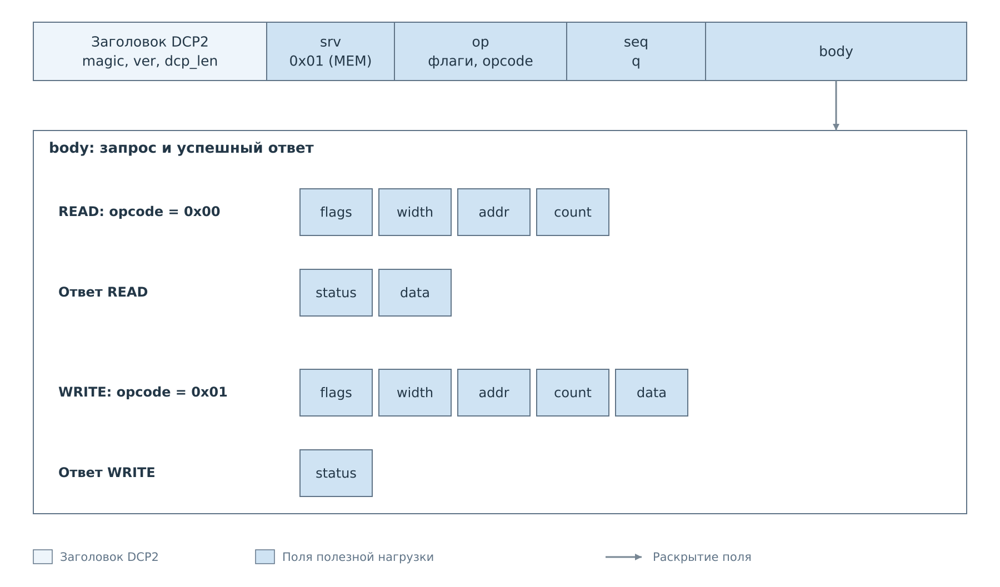
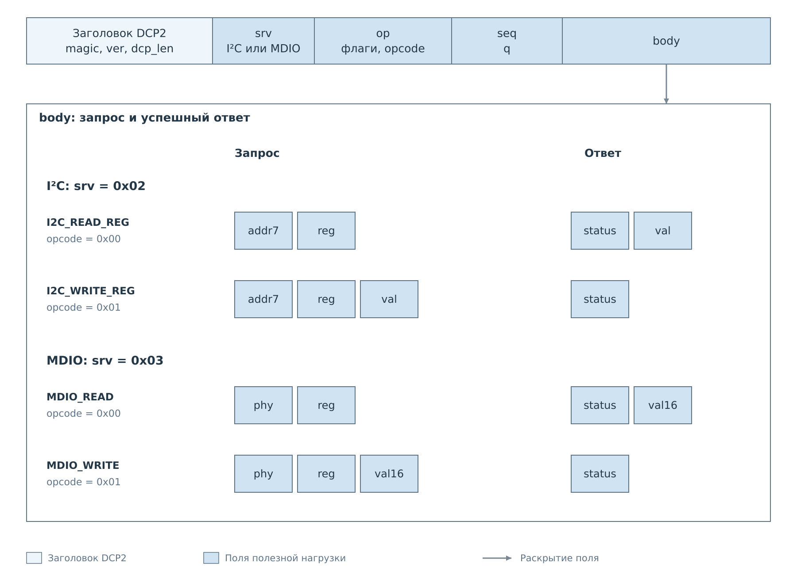

# Команды DCP2

После выделения [целого кадра](02-frame.md) сервер знает его длину, сервис
и код операции. Теперь нужно разобрать `body`. Для этого сначала выбирается
сервис по `srv`, затем обработчик по `opcode`. Выбранный обработчик определяет
поля запроса, допустимые значения и состав успешного ответа.

## Выбор формата тела

*Рисунок 1. Сервис и код операции определяют две связанные структуры:
параметры запроса и данные результата. Общий заголовок DCP2 сохраняется.*

Например, `opcode=0` в I²C означает чтение байтового регистра, а в MDIO —
чтение 16-битного регистра PHY. Число байтов результата различается, хотя код
операции одинаков. Клиент должен сохранить выбранную команду вместе с `seq`,
чтобы правильно разобрать её ответ.

На схемах ниже раскрывается `body`: параметры запроса и тело ответа
с общим `status`. Таблицы уточняют типы полей и допустимые значения.

## Сервисы

| `srv` | Сервис | Назначение |
|---|---|---|
| `0x00` | PING | Проверка ответа сервера |
| `0x01` | MEM | Доступ к разрешённым областям памяти и регистрам PL |
| `0x02` | I2C | Регистры I²C, политика записи и подписка на наблюдения |
| `0x03` | MDIO | Регистры PHY, политика записи и подписка на наблюдения |
| `0x04` | SPI | Идентификатор SPI; доступные операции зависят от приложения |
| `0x05` | UART | Идентификатор UART; доступные операции зависят от приложения |
| `0x06` | NOTIFY | [Уведомления о действиях и состоянии](05-events.md) |
| `0x07` | FS | [Чтение файлов и каталогов](06-fs.md) |
| `0x08` | CACHE | [Снимки кэша и изменения](07-cache.md) |

В FreeRTOS подключены PING, MEM, NOTIFY, FS и CACHE; команды I²C и MDIO
зависят от состава PL и готовности сервисов. Для SPI и UART сетевой сервер
сейчас принимает управление потоковыми подписками, а обычные команды обмена
возвращают `ERR_UNSUPPORTED`. Наличие подписки не подтверждает наличие
работающего аппаратного обмена: источник данных может быть тестовым.

В текущем `bvstkd` подключены PING, MEM и сервис I²C. Обработчики MDIO и SPI
есть в общем коде, но соответствующие сервисы в этом приложении не подключены.
NOTIFY, потоковые подписки, FS и CACHE там не обслуживаются. Общая версия
протокола у обоих приложений одинакова.

## PING

При `srv=0x00`, `opcode=0x00` запрос не содержит параметров. Успешный ответ
содержит только общий `status=0`. Это подтверждает обмен с сервером DCP2;
готовность отдельных устройств определяется их собственными операциями.
Проверка соединения и обработка ошибок показаны в [примере PING](examples/connection.md).

## MEM: чтение и запись памяти

MEM работает с физическим адресом в разрешённом пространстве платы.
Данные передаются элементами заданной разрядности. Размер массива
зависит от числа элементов: `data_size = count × width / 8`.

*Рисунок 2. В MEM_READ массив `data` приходит в ответе, в MEM_WRITE — передаётся
в запросе. Параметры доступа к памяти у этих команд одинаковы.*

| Поле | Тип | Значение |
|---|---|---|
| `flags` | `u8` | В FreeRTOS бит 0 — `AUTOINC`; остальные биты должны быть нулевыми |
| `width` | `u8` | Разрядность элемента в битах: 8, 16, 32 или 64 в FreeRTOS |
| `addr` | `u32` | Начальный физический адрес, выровненный по размеру элемента |
| `count` | `u16` | Число элементов |
| `data` | Массив элементов разрядности `width` | `count` значений в порядке доступа |

При `AUTOINC=1` адрес каждого следующего элемента увеличивается на размер
элемента. При `AUTOINC=0` FreeRTOS повторяет доступ к одному адресу. Это важно
для регистров с побочными эффектами: повторное чтение такого регистра и чтение
соседних адресов имеют разный смысл. Числовые элементы массива тоже передаются
старшим байтом вперёд.

Для чтения должно выполняться `6 + data_size <= 4096`: ответу нужны четыре
общих байта и два байта статуса. Для записи проверяется
`4 + 8 + data_size <= 4096`: к данным добавляются общие поля и параметры MEM.
Длина массива должна точно соответствовать `count` и `width`.

В `bvstkd` доступ MEM отличается: принимаются только `flags=0`, `width=32`
и `count` от 1 до 256; адрес при этом увеличивается на 4 для каждого элемента.
Таким образом, пакетная операция MEM с нулевыми флагами сейчас имеет разную
семантику в двух приложениях. Разрешённые адреса также задаются платформой.
Эти различия нужно учитывать при создании общего клиента.
Раскладка данных и изменение адреса разобраны в [примере MEM](examples/memory.md).

## Регистровые команды

I²C и MDIO адресуют регистр парой значений: устройство и номер регистра.
При записи к ним добавляется новое значение. В отличие от MEM, физический
адрес регистра PL клиенту не нужен: операцию выполняет сервис подсистемы.

*Рисунок 3. Форматы регистровых команд. Справа показано полное тело успешного
ответа, включая общий `status`.*

## I²C: регистр и политика записи

Сервис I²C использует `srv=0x02`. Запрос адресуется устройству, которое уже
зарегистрировано в рабочем сервисе. `addr7` содержит семибитный адрес без
бита чтения; `reg` выбирает байтовый регистр. Сервер находит устройство
по адресу и передаёт операцию сервису подсистемы.

Все параметры I²C и возвращаемое значение имеют тип `u8`.
Поскольку запрос идёт через сервис, запись подчиняется его политике.
При запрете клиент получает `ERR_DENIED` до выполнения запрещённой записи.

Для чтения и редактирования политики используются
[отдельные команды](04-policies.md). Режим выбирает действующий список правил.
В [примере I²C](examples/i2c.md) показаны чтение, отказ в записи и изменение политики.

## MDIO: регистры PHY

Для MDIO используется `srv=0x03`. В текущем сервере FreeRTOS `phy` и `reg`
задают пятибитные адреса PHY и регистра Clause 22. PHY должен быть известен
сервису. Один прочитанный регистр содержит 16 бит и занимает два байта ответа.

Поля `phy` и `reg` имеют тип `u8`, значение `val16` — `u16`.

Запись проверяется политикой сервиса MDIO. Полный путь операции через сервис,
драйвер и ядро PL описан в [статье о подсистеме MDIO](../../system/pl-subsystem/mdio/mdio.md).
Общий кадр DCP2 при этом остаётся тем же; меняется только способ выполнения
команды внутри BVSTK.
Режим и списки MDIO редактируются теми же [командами политики](04-policies.md),
но правило дополнительно содержит 16-битную маску.
Соответствующие кадры приведены в [примере MDIO](examples/mdio.md).

## Команды с состоянием соединения

Простая регистровая команда завершается одним ответом. Подписка создаёт
состояние, которое продолжает действовать после её ответа. Файловый `OPEN`
возвращает дескриптор для следующих `READ`, а CACHE выдаёт идентификаторы
снимка и подписки. Такие связи передаются внутри `body` и не заменяют `seq`.

В следующих главах сначала показана последовательность этих операций,
затем приведены их поля. Это позволяет читать формат запроса, уже понимая,
откуда клиент берёт каждое значение.

---

Далее: [Управление политиками](04-policies.md).
