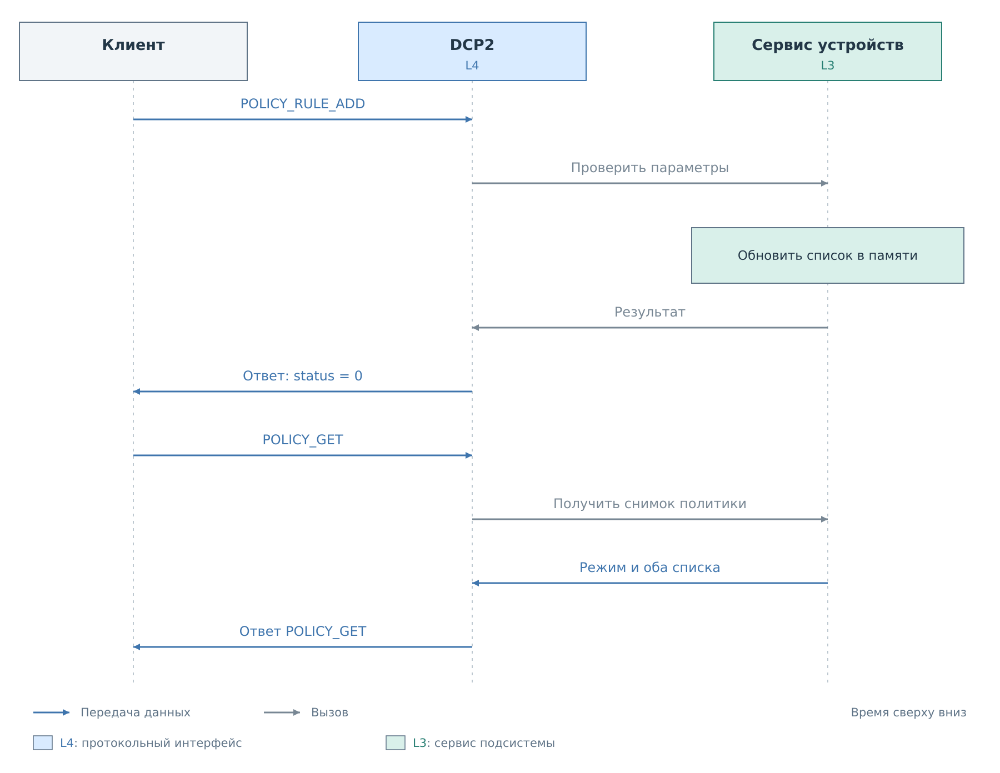
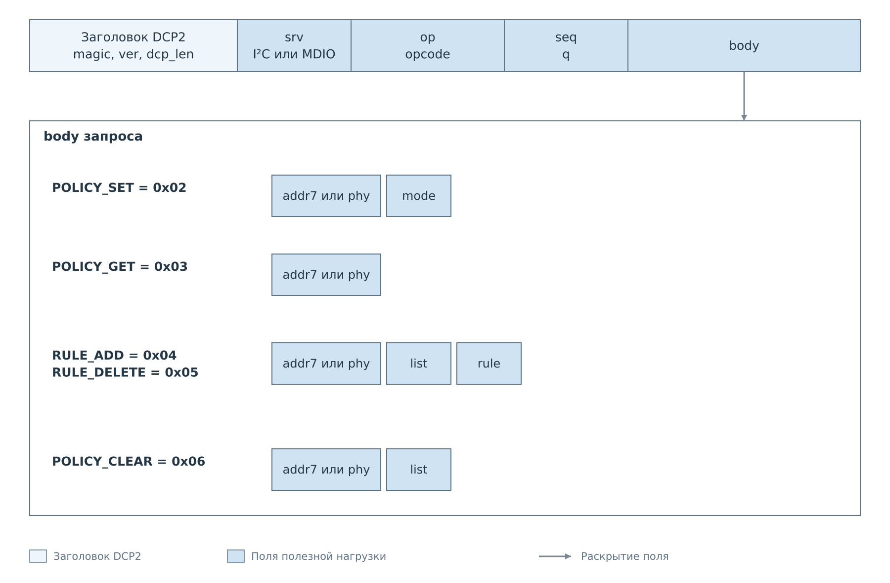
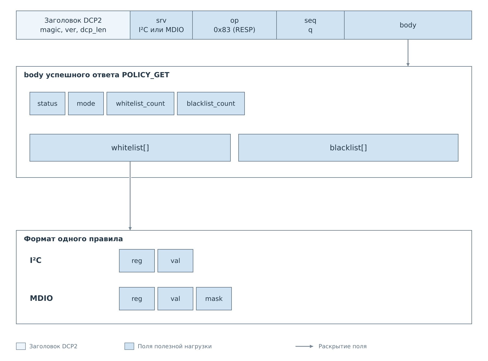

# Управление политиками DCP2

Политика устройства определяет, какие записи сервис передаёт аппаратуре.
Клиент DCP2 может получить действующую политику, выбрать режим, добавить
или удалить правило и очистить один из списков. Эти операции изменяют
правила работающего сервиса. Сами они не выполняют транзакцию на шине.

Команды доступны для I²C и MDIO и используют тот же сервис, что
[регистровые операции](03-commands.md): `srv=0x02` для I²C, `srv=0x03` для MDIO.
В FreeRTOS они работают при наличии соответствующего ядра PL и готового
сервиса. В текущем `bvstkd` подключена только I²C; команды политики MDIO
общий код поддерживает, но экземпляра этого сервиса в приложении нет.

## Действующая политика

У устройства есть режим и два независимых списка. В режиме `WHITELIST`
запись разрешена, если она совпала хотя бы с одним правилом белого списка.
В режиме `BLACKLIST` запись разрешена, если ни одно правило чёрного списка
не совпало. Неактивный список хранится и тоже может редактироваться.

**Пустой белый список запрещает все записи, пустой чёрный — разрешает все
допустимые записи.** Адреса, диапазоны регистров и значений при этом
проверяются отдельно. Политики относятся к записи; чтение регистра
не проверяется этими списками.

Для I²C правило содержит точную пару `reg` и `val`. Например, правило
для регистра `0x10` со значением `0x03` не разрешает значение `0x04`
в том же регистре.

Для MDIO правило дополнительно содержит `mask`. Совпадение определяется
номером регистра и выражением `(value & mask) == (val & mask)`.
Маска `0xFFFF` сравнивает всё значение, `0` принимает любое значение
этого регистра. Разные маски остаются разными правилами.

## Изменение и проверка результата

*Рисунок 1. Успешное добавление правила и последующая проверка через POLICY_GET.*

Сервис проверяет параметры до изменения списка. Если правило уже есть,
повторное добавление возвращает успех и не создаёт вторую запись.
Удаление относится только к выбранному списку; такое же правило в другом
списке сохраняется. Режим меняет только `POLICY_SET`, поэтому заполнение
белого списка не включает его автоматически.

`POLICY_GET` возвращает согласованную копию режима и обоих списков на момент
выполнения команды. Несколько запросов редактирования не образуют единую
транзакцию: между ними другой клиент или консоль могут изменить политику.
Если требуется подготовить новый список перед включением, сначала заполните
неактивный список, проверьте его через GET, затем переключите режим.

Номер `seq` связывает запрос с ответом. Он не является ревизией политики
и не защищает от повторного исполнения команды. Штатный клиент отправляет
операцию изменения один раз. После потерянного ответа прочитайте текущую
политику, прежде чем решать, нужна ли повторная команда.

## Форматы запросов

*Рисунок 2. Общие форматы запросов I²C и MDIO. Поле `rule` раскрыто на рисунке 3.*

| `opcode` | Команда | Действие |
|---|---|---|
| `0x02` | `POLICY_SET` | Переключить режим, сохранив оба списка |
| `0x03` | `POLICY_GET` | Прочитать режим и оба списка |
| `0x04` | `POLICY_RULE_ADD` | Добавить правило в выбранный список |
| `0x05` | `POLICY_RULE_DELETE` | Удалить правило из выбранного списка |
| `0x06` | `POLICY_CLEAR` | Очистить выбранный список, сохранив режим |

Устройство выбирается по `addr7:u8` для I²C или `phy:u8` для MDIO.
Это адрес уже зарегистрированного устройства: команда политики не создаёт
устройство и не меняет его адрес.

`mode:u8` и `list:u8` принимают `0` для WHITELIST и `1` для BLACKLIST.
Первое поле выбирает действующий режим, второе — список для редактирования.
Поле списка отсутствует у GET и SET.

Успешный ответ SET, ADD, DELETE и CLEAR содержит только общий `status=0`.
Ошибочный ответ содержит ненулевой статус без дополнительных данных.
Состав успешного ответа GET описан ниже. Все многобайтовые числа передаются
старшим байтом вперёд; лишние поля в запросе отклоняются.

Существующая команда `I2C_POLICY_SET` сохраняет свой код и формат:
второй байт тела, ранее названный `policy`, обозначает режим `mode`.
Общий формат DCP2 остаётся версии 2.

## Ответ POLICY_GET и правила

*Рисунок 3. После общего статуса идут режим, два счётчика и записи списков.
Один и тот же формат правила используется в GET, ADD и DELETE.*

Счётчики `whitelist_count` и `blacklist_count` передаются как `u16`.

Правило I²C содержит `reg:u8`, затем `val:u8`. Значения ограничены
числом регистров и `max_value_code` устройства из профиля.
Правило MDIO содержит `reg:u8`, `val:u16`, `mask:u16`; регистр должен
входить в настроенный диапазон, не превышающий 32 регистра Clause 22.

Добавление MDIO сохраняет `val & mask`. Поэтому значения, различающиеся
только за пределами маски, описывают одно правило. Для удаления достаточно
передать тот же регистр, маску и совпадающие значимые биты. Если загруженный
профиль содержит несколько таких правил, удаление убирает все эквивалентные
записи из выбранного списка. GET возвращает существующие записи профиля
без их предварительной нормализации.

В каждом списке помещается до 256 правил I²C или 64 правил MDIO.
Оба полных списка укладываются в один ответ DCP2, постраничного чтения нет.
Клиент разбирает ровно объявленное число записей каждого списка
и проверяет, что после них не осталось лишних данных.

Кадры добавления правила I²C и работы с маской MDIO разобраны
в [примерах управления политиками](examples/policies.md).

## Рабочая конфигурация и сохранение

GET читает рабочий сервис. ADD, DELETE и CLEAR изменяют его состояние
в памяти и не записывают профиль на носитель. У I²C также обновляется
копия политики в рабочей конфигурации, чтобы последующие консольные
правки и сохранение использовали новые списки. При этом значения кэша
не переносятся в стартовые настройки регистров.

Во FreeRTOS SET тоже работает в памяти. Для сохранения используется
`i2c <устройство> save` или `mdio <устройство> save` в консоли.
У MDIO SET изменяет только режим. Существующий I²C SET сохраняет прежний
путь синхронизации рабочей конфигурации, который также переносит значения
кэша, помеченные `valid`, в настройки. В `bvstkd` эта прежняя команда дополнительно
пытается сохранить конфигурацию на носитель. Её успешный статус подтверждает
смену режима, но не подтверждает успешную запись файла.

В Нейтрино консольное редактирование политики сохраняет конфигурацию.
Оно использует обновлённую рабочую копию и сохраняет новые правила DCP2.
Протокол не вводит отдельной команды SAVE. Практические команды клиента
приведены в [руководстве DCP2](../../operations/dcp2.md#политики-i²c-и-mdio).

Изменение политики не перестраивает кэш, не меняет адрес устройства
и не перезапускает опрос MDIO. У этих команд нет отдельных событий DCP2:
результат подтверждается ответом и проверяется через GET.

## Ошибки

| Статус | Причина |
|---|---|
| `ERR_MALFORMED` | Неверное тело, режим или номер списка |
| `ERR_UNSUPPORTED` | Неизвестная команда или подсистема отсутствует в сборке |
| `ERR_BUSY` | Сервис ещё не готов или не подключён к приложению |
| `ERR_TIMEOUT` | Истекло ожидание блокировки сервиса |
| `ERR_RANGE` | Устройство или правило не найдены, регистр или значение вне диапазона, список заполнен |
| `ERR_INTERNAL` | Внутренняя ошибка, в том числе сбой обновления рабочей конфигурации |

Для совместимости FreeRTOS I²C SET по-прежнему возвращает `ERR_UNSUPPORTED`
при неизвестном режиме; общий обработчик возвращает `ERR_MALFORMED`.
Проверка GET и новых команд в обеих реализациях одинакова.

Ошибка проверки параметров не меняет политику. При `ERR_INTERNAL`
изменение уже могло примениться в сервисе: клиент сверяет результат через GET.
Попытка удалить отсутствующее правило возвращает `ERR_RANGE`; повторное
добавление существующего правила и очистка уже пустого списка успешны.

---

Далее: [События и подписки](05-events.md).
