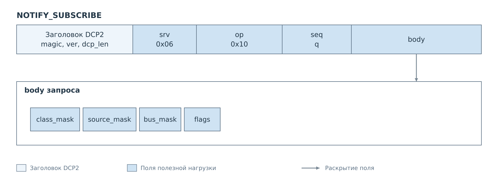
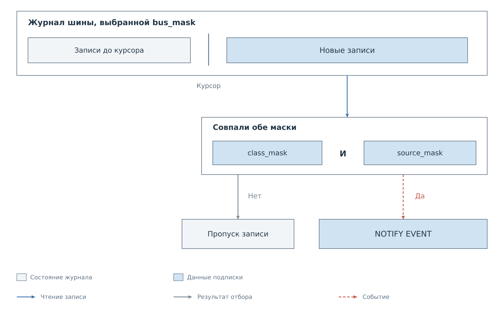
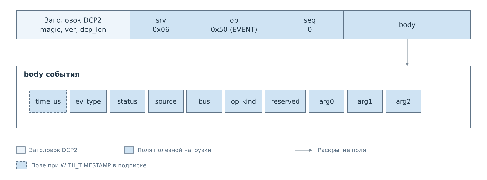
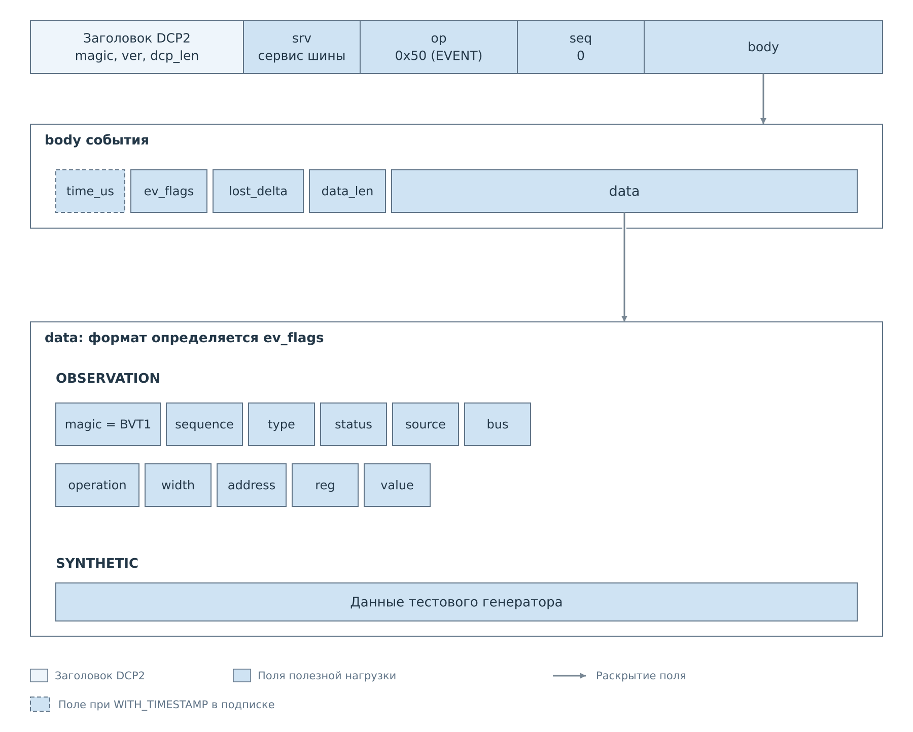

# События и подписки DCP2

В [обычном обмене](03-commands.md) клиент отправляет команду и получает один
ответ. Подписка добавляет к этому обмену уведомления: после подтверждения
подписки сервер может самостоятельно отправлять новые кадры. Они идут
по тому же TCP-соединению, имеют признак `EVENT` и `seq=0`.

## Установка подписки и доставка событий

Запрос подписки оформляется как обычная команда с ненулевым `seq`.
У NOTIFY и STREAM ответ подтверждает установку подписки, а наблюдаемые данные
приходят в последующих событиях. Для отмены клиент отправляет отдельную команду;
закрытие TCP-соединения также уничтожает подписки.

*Рисунок 1. Подписка NOTIFY или STREAM. Подтверждения относятся к запросам
по `seq`. Уведомления имеют нулевой номер и могут приходить между ответами
на другие команды.*

В сервере FreeRTOS предусмотрены три семейства уведомлений:

| Семейство | Содержимое | Выбор данных |
|---|---|---|
| NOTIFY | Действия и состояния: попытка записи, результат, отказ, изменение состояния | Маски классов, источников и шин |
| STREAM | Наблюдения обмена и данные тестового генератора | Сервис шины и флаги подписки |
| CACHE | Изменения значений и готовности устройства | Имена подсистемы и устройства |

CACHE возвращает первую страницу снимка уже в ответе на подписку. Начальное
состояние нужно согласовать с последующими изменениями; эта последовательность
разобрана в [главе о кэше](07-cache.md). Текущий
`bvstkd` эти семейства подписок не обслуживает.

## NOTIFY: отбор уведомлений

Сервис NOTIFY использует `srv=0x06`. Клиент задаёт три маски. Обычное
событие доставляется, когда одновременно совпали его класс, источник
и шина. Внутри каждой маски разрешено выбрать несколько битов.

*Рисунок 2. Фильтр передаётся в `body` команды NOTIFY_SUBSCRIBE.*

Маски имеют тип `u32`, поле `flags` — `u8`. Для отмены используется
`NOTIFY_UNSUBSCRIBE` с `opcode=0x11` и пустым телом. Ответы обеих команд
содержат только общий статус.

На соединении хранится один фильтр NOTIFY. Повторная подписка заменяет его
и устанавливает курсоры на текущий конец журналов. Курсор — сохранённая
позиция чтения: сервер просматривает новые записи и продвигает её, даже если
запись не прошла фильтр. Старые записи не переигрываются.

*Рисунок 3. Отбор обычной записи журнала. Маска шин выбирает журнал,
маски класса и источника — записи внутри него.*

| Бит | `class_mask` | `source_mask` | `bus_mask` |
|---:|---|---|---|
| 0 | `REG_ATTEMPT` | `TELNET` | `I2C` |
| 1 | `REG_COMMIT` | `HOST` | `MDIO` |
| 2 | `REG_DENIED` | `DCP` | `SPI` |
| 3 | `STATE_CHANGED` | `INTERNAL` | `UART` |
| 4 | `FAULT` | `WEB` | `SYS` |

Каждая маска должна быть ненулевой, биты выше 4 — нулевыми. Нарушение даёт
`ERR_RANGE`. Наличие бита шины в формате не гарантирует, что подключённый
журнал создаёт события этой шины.

| Бит `flags` | Имя | Поведение |
|---:|---|---|
| 0 | `WITH_TIMESTAMP` | Добавить `time_us` в начало каждого события |
| 1 | `SNAPSHOT_ON_SUBSCRIBE` | Принимается текущим сервером, но отдельный снимок состояния не формируется |

Остальные биты должны быть нулевыми, иначе возвращается `ERR_MALFORMED`.
Клиент сохраняет флаги успешной подписки: по ним определяется наличие
метки времени в последующих телах событий.

## Формат события NOTIFY

*Рисунок 4. Тело события NOTIFY. Наличие начального `time_us` зависит
от флагов установленной подписки.*

Поле `status` внутри уведомления относится к наблюдаемому действию.
Это часть данных события; общего статуса ответа перед ними нет.

| Поле | Тип | Содержание |
|---|---|---|
| `time_us` | `u64`, необязательное | Время регистрации события PS, в микросекундах |
| `ev_type` | `u16` | Тип действия или состояния |
| `status` | `u16` | Результат наблюдаемого действия |
| `source` | `u8` | Источник действия |
| `bus` | `u8` | Подсистема |
| `op_kind` | `u8` | Вид операции |
| `reserved` | `u8` | Ноль |
| `arg0`, `arg1`, `arg2` | `u32` каждый | Аргументы действия |

Метка времени выражена в микросекундах, но разрешение определяется системным тиком PS.

| `ev_type` | Событие |
|---|---|
| `0x0001` | `REG_ATTEMPT`: попытка операции |
| `0x0002` | `REG_COMMIT`: выполненная операция |
| `0x0003` | `REG_DENIED`: отказ по политике |
| `0x0004` | `STATE_CHANGED`: изменение состояния |
| `0x0005` | `FAULT`: ошибка |
| `0x0006` | `SOFTWARE_LOSS`: потеря записей журнала |

Поле `status` здесь содержит статус переносимого сервиса: кроме значений
0–6 встречаются 7 `NOT_READY`, 8 `NOT_FOUND`, 9 `IO`, 10 `INTERNAL`.
Используйте [шкалу общего C API](../status-codes.md#общий-c-api).
В обычном ответе DCP2 значение 7 имеет другой смысл — `ERR_INTERNAL`.

Значения `source` и `bus` равны номерам битов соответствующих масок.
`op_kind` принимает 0 `READ`, 1 `WRITE`, 2 `POLICY_CHANGE`, 3 `CONFIG_APPLY`
или 4 `STATE_TOGGLE`.

Для записи регистра `arg0` содержит адрес устройства, `arg1` — регистр,
`arg2` — значение. В событии `SOFTWARE_LOSS` поле `arg0` содержит число
перезаписанных записей RAM выбранной шины, с насыщением до `UINT32_MAX`.
Это уведомление о доставке проходит независимо от масок классов и источников,
но учитывает маску шин. Потеря возникает до фильтрации и не обязательно
означает потерю именно тех действий, которые выбрал клиент.
Конкретный фильтр и полученные уведомления разобраны в [примере NOTIFY](examples/notify.md).

## STREAM: наблюдения и тестовые данные

Управление STREAM адресуется сервису шины: I²C `0x02`, MDIO `0x03`,
SPI `0x04` или UART `0x05`. На соединении можно держать отдельную подписку
для каждой из этих шин.

| `opcode` | Команда | Тело запроса | Данные после `status` |
|---|---|---|---|
| `0x10` | `PL_SUBSCRIBE_STREAM` | `flags:u8` | — |
| `0x11` | `PL_UNSUBSCRIBE_STREAM` | Пусто | — |

Флаги подписки:

| Бит | Имя | Значение |
|---:|---|---|
| 0 | `RAW_WORDS` | Данные трактуются как 32-битные слова; размер кратен четырём |
| 1 | `WITH_TIMESTAMP` | Добавить метку времени в тело события |
| 2 | `RESET_LOST_COUNTERS` | Сбросить счётчик потерь тестового генератора |

Биты выше 2 должны быть нулевыми. Подписка начинает чтение журнала
наблюдений с текущего конца. `RESET_LOST_COUNTERS` не возвращает уже
утраченные наблюдения.

*Рисунок 5. Вложенность данных STREAM: кадр DCP2, тело события и массив `data`.
Его формат выбирается по `ev_flags`.*

| Поле | Тип | Содержание |
|---|---|---|
| `time_us` | `u64`, необязательное | Метка времени |
| `ev_flags` | `u8` | Происхождение данных и признак потери |
| `lost_delta` | `u32` | Число потерянных единиц данных |
| `data_len` | `u16` | Длина следующего массива в байтах |
| `data` | Массив из `data_len` байт | Данные наблюдения или генератора |

Включение метки времени определяется флагом `WITH_TIMESTAMP` подписки,
а не полем `ev_flags` события. Эти два набора флагов клиент хранит и разбирает отдельно.

| Бит `ev_flags` | Имя | Содержание `data` или состояние |
|---:|---|---|
| 0 | `OVERFLOW` | Обнаружена потеря данных |
| 1 | `OBSERVATION` | Запись наблюдения PS в формате `BVT1` |
| 2 | `SYNTHETIC` | Данные тестового генератора |

`OBSERVATION` и `SYNTHETIC` не устанавливаются вместе. Это различие нужно
проверять до интерпретации `data`: тестовые значения не описывают транзакцию
аппаратного ядра. Реальные наблюдения сейчас поступают из журналов I²C
и MDIO; их полнота ограничена событиями, которые доступны программной части.

При `OBSERVATION=1` массив содержит одну запись размером 32 байта:

| Поле | Тип | Содержание |
|---|---|---|
| `magic` | 4 байта | ASCII `BVT1` |
| `sequence` | `u64` | Номер наблюдения в журнале шины |
| `type` | `u16` | Тип наблюдаемого действия |
| `status` | `u16` | Результат действия |
| `source`, `bus`, `operation` | `u8` каждое | Источник, шина и вид операции |
| `width` | `u8` | 8 для I²C и 16 для MDIO |
| `address`, `reg`, `value` | `u32` каждое | Устройство, регистр и значение |

`sequence` нумерует наблюдения отдельно для каждой шины и не заменяет `seq`
общего кадра. `lost_delta` относится к перезаписанным записям её журнала
и насыщается до `UINT32_MAX`. `RAW_WORDS` сохраняет всю запись `BVT1` вместе
с её заголовком. Типы и статусы совпадают с
[HTTP-журналом наблюдений](../http/observation.md#журналы-наблюдений).
Оба варианта `data` показаны в [примере STREAM](examples/stream.md):
наблюдение MDIO и набор тестового генератора SPI.

Состояние подписки живёт в соединении. После переподключения клиент
подписывается заново; автоматического воспроизведения прежней истории нет.
Для поддержания полной локальной копии значений используется механизм CACHE,
который дополнительно связывает снимок с последовательностью изменений.

---

Далее: [Файловый сервис](06-fs.md).
