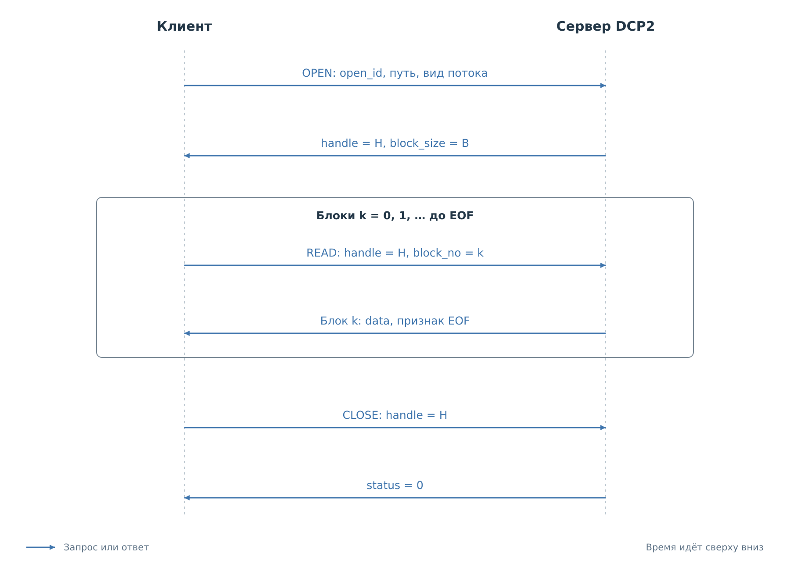
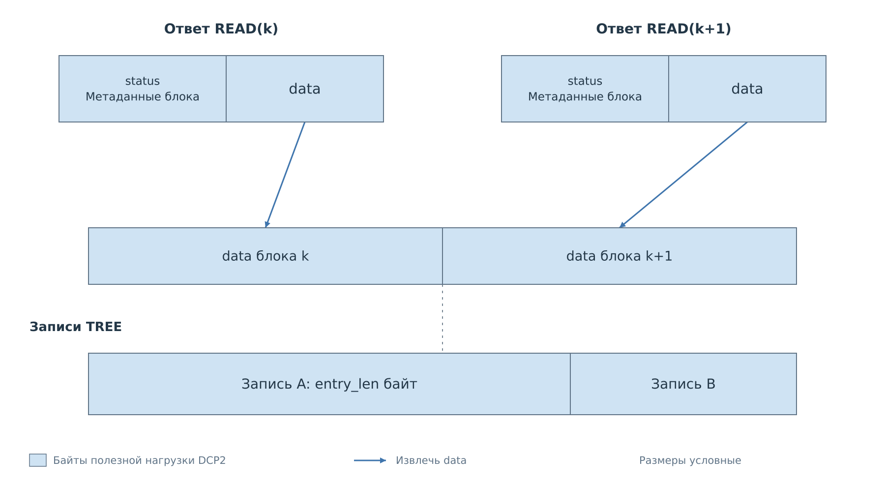

# Файловый сервис DCP2

Сервис FS передаёт содержимое файловой системы порциями. Один файл может
быть значительно больше предела кадра DCP2, поэтому клиент сначала открывает
поток, получает дескриптор, затем читает последовательные блоки и закрывает
поток. Каждый шаг остаётся обычной командой с собственным `seq`.

FS использует `srv=0x07`. Он подключён к FreeRTOS и предоставляет чтение
томов `sd`, `flash` и `sd-pl`; их фактическая готовность сообщается сервером.
Записи, удаления и форматирования в FS v1 нет. В текущем `bvstkd` сервис
не подключён. Собственных событий FS не создаёт, но уведомления других
сервисов могут приходить между его ответами.

## Открытие и последовательное чтение

*Рисунок 1. `OPEN` возвращает дескриптор H. Все последующие запросы чтения
используют H, но получают новые номера `seq`. Признак EOF завершает данные;
`CLOSE` освобождает сам поток.*

До открытия клиент может выполнить `FS_INFO`, чтобы узнать версию, тома
и ограничения. В `FS_OPEN` передаются путь, вид потока и желаемый размер
блока. Сервер возвращает `handle` и согласованный `block_size`.
Эти значения понадобятся при проверке каждого ответа чтения.

Первый `FS_READ` запрашивает блок 0, следующий — блок 1 и так далее.
Клиент проверяет статус, совпадение `handle` и `block_no`, затем принимает
ровно `data_len` байт. Если установлен EOF, эти байты всё равно относятся
к результату: последний блок может быть непустым. После его обработки
клиент посылает `FS_CLOSE`.

### Идентификаторы обмена

| Поле | Кто назначает | Для чего используется |
|---|---|---|
| `seq` | Клиент, для каждой отправки | Найти ответ на конкретный запрос |
| `open_id` | Клиент, для попытки открытия | Узнать повтор того же `OPEN` |
| `handle` | Сервер, в ответе `OPEN` | Найти открытый поток в этом соединении |
| `block_no` | Клиент, начиная с нуля | Выбрать следующий или повторить последний блок |

При потере ответа `OPEN` клиент может отправить запрос с новым `seq`,
сохранив `open_id` и все параметры. Пока первоначальный поток существует,
сервер вернёт тот же дескриптор. Те же `open_id` с другими параметрами дают
`ERR_MALFORMED`.

Повтор `READ` тоже получает новый `seq`, но сохраняет `handle` и `block_no`.
Сервер хранит последний успешно выданный блок и возвращает его повторно
без продвижения потока. Более старый блок или пропуск номера дают `ERR_RANGE`.
Таким образом, подтверждение приёма предыдущего блока фактически выражается
запросом следующего.

Дескриптор принадлежит одному TCP-соединению. После разрыва или таймаута
неактивности он недействителен; продолжение требует нового открытия.
Уже выданные номера `handle` в рамках соединения не переиспользуются.

## Содержимое потока

Одна последовательность `OPEN`, `READ`, `CLOSE` обслуживает три вида данных.
Поле `kind` задаётся при открытии и сохраняется у клиента: каждый ответ
`READ` не повторяет описание формата содержимого.

| `kind` | Вид | Содержимое последовательности блоков |
|---:|---|---|
| 1 | FILE | Исходные байты одного файла |
| 2 | TREE | Записи о файлах и каталогах |
| 3 | TAR | Один несжатый архив каталога |

FILE читается последовательно, произвольного смещения нет. После EOF число
принятых байтов должно совпасть с `total_size` из ответа открытия.
TREE и TAR формируются по мере чтения, их полный размер заранее не объявляется.

*Рисунок 2. Граница блока FS не обязана совпадать с границей записи TREE.
Клиент объединяет только массивы `data` успешных ответов, затем разбирает записи.*

TREE без флага `RECURSIVE` перечисляет непосредственных детей каталога.
С этим флагом выполняется обход в глубину: каталог предшествует своим
потомкам, порядок соседей задаётся файловой системой. Корень обхода в результат
не включается. Пустые каталоги имеют собственные записи.

Запись `FS_TREE_ENTRY` передаётся в таком порядке:

| Смещение в записи | Поле | Тип | Значение |
|---:|---|---|---|
| 0 | `entry_len` | `u16` | Полная длина записи: `14 + path_len` |
| 2 | `type` | `u8` | 1 — файл, 2 — каталог |
| 3 | `reserved` | `u8` | Ноль |
| 4 | `size` | `u64` | Размер файла; для каталога ноль |
| 12 | `path_len` | `u16` | Длина относительного пути в байтах UTF-8 |
| 14 | `path` | `path_len` байт | Путь относительно корня обхода |

Клиент сначала накапливает `entry_len`, затем всю запись указанной длины.
EOF внутри незавершённой записи означает ошибку потока. Это второй уровень
сборки: сначала выделяются кадры DCP2, затем записи из объединённых `data`.

TAR всегда рекурсивен. Архив содержит относительные пути и пустые каталоги;
используется ustar, а для длинных или не-ASCII имён и больших размеров —
локальные PAX-заголовки `path` и `size`. UID, GID и mtime равны нулю,
режим файлов — `0644`, каталогов — `0755`. Архив заканчивается двумя нулевыми
блоками по 512 байт. Его границы также могут пересекать блоки FS.
Полный архив в памяти устройства и временный файл на flash не создаются.

## Пути и готовность томов

FS принимает абсолютные пути вида `flash:/config/`. Поле `path_len` считает
байты UTF-8, завершающий NUL не передаётся. Имя тома содержит 1–15 строчных
ASCII-букв, цифр или дефисов. Числовые обозначения томов FatFs наружу не выдаются.

Конечный `/` каталога нормализуется. Компоненты `.` и `..`, пустые промежуточные
компоненты, NUL, управляющие символы U+0000–U+001F и U+007F запрещены.
Внутри компонентов также запрещены `\`, `:`, `*`, `?`, `"`, `<`, `>` и `|`.
Некорректный UTF-8 и превышение предела длины отклоняются; путь не усекается.

Обращение FS проверяет готовность тома и не запускает монтирование или
форматирование. Если имя невозможно представить в кодировке носителя,
возвращается `ERR_RANGE`. Имя тома в `FS_INFO` и его готовность — разные поля:
том может быть известен серверу, но недоступен для чтения.

## Форматы команд

Во всех таблицах поля перечислены в порядке передачи. Смещения относятся
к указанному телу операции. У ответа перед приведёнными данными всегда
находится общий `status:u16`; при ошибке FS дополнительных данных не отправляет.

### FS_INFO: возможности сервиса

`opcode=0x00`, тело запроса пустое. Успешный ответ содержит:

| Поле | Тип | Содержание |
|---|---|---|
| `fs_version` | `u16` | Версия FS, сейчас 1 |
| `capabilities` | `u32` | Поддерживаемые возможности |
| `max_block_size` | `u16` | Максимум `data_len`, сейчас 3072 |
| `max_path_bytes` | `u16` | Предел абсолютного пути, сейчас 511 |
| `max_depth` | `u16` | Глубина стека каталогов с учётом корня, сейчас 16 |
| `max_handles` | `u16` | Число потоков на соединение, сейчас 2 |
| `idle_timeout_ms` | `u32` | Таймаут неактивного потока, сейчас 30000 мс |
| `volume_count` | `u16` | Число следующих записей томов |
| `volume[]` | Переменный массив | Записи `FS_VOLUME` |

Фиксированная часть занимает 20 байт. Каждая запись тома содержит
`state:u8`, `name_len:u8`, затем `name_len` байт имени без NUL и без `:/`.
Состояние 0 означает неготовый том, 1 — готовый, 2 — неподдерживаемый сборкой.

Биты `capabilities` от 0 до 5 означают соответственно FILE, TREE,
TREE_RECURSIVE, TAR, UTF8_PATHS, LIVE_READ. Последний указывает на чтение
текущей файловой системы без атомарного снимка. Сейчас маска равна `0x3F`;
неизвестные биты клиент игнорирует.

### FS_STAT: сведения об объекте

`opcode=0x01`. Запрос содержит `path_len:u16`, затем `path[path_len]`.
Ответ после статуса содержит `type:u8`, `attributes:u8`, `size:u64` —
всего 10 байт.

`type=1` обозначает файл, `type=2` — каталог. Биты `attributes` от 0 до 3
означают readonly, hidden, system, archive; остальные нулевые.
Для каталога `size=0`. Время изменения FS v1 не передаёт.

### FS_OPEN: создание потока

`opcode=0x02`. Тело запроса:

| Смещение | Поле | Тип | Значение |
|---:|---|---|---|
| 0 | `open_id` | `u32` | Ненулевой номер попытки открытия |
| 4 | `kind` | `u8` | FILE, TREE или TAR |
| 5 | `flags` | `u8` | Бит 0 — `RECURSIVE` для TREE |
| 6 | `requested_block_size` | `u16` | 0 — максимум сервера, иначе размер от 1 до максимума |
| 8 | `path_len` | `u16` | Длина пути |
| 10 | `path` | `path_len` байт | Файл для FILE, каталог для TREE или TAR |

Для FILE и TAR все флаги нулевые; для TREE допустим только бит 0.
Тело занимает `10 + path_len` байт, нагрузка DCP2 — `14 + path_len`.

Ответ после статуса содержит `handle:u32`, `block_size:u16`,
`total_size:u64` — 14 байт. Для FILE `total_size` равен размеру файла,
для TREE и TAR — `0xFFFFFFFFFFFFFFFF`, то есть размер заранее неизвестен.

### FS_READ: очередной блок

`opcode=0x03`. Запрос содержит `handle:u32`, `block_no:u32` — 8 байт.
Успешный ответ после статуса устроен так:

| Смещение | Поле | Тип | Значение |
|---:|---|---|---|
| 0 | `handle` | `u32` | Дескриптор из запроса |
| 4 | `block_no` | `u32` | Номер из запроса |
| 8 | `flags` | `u8` | Бит 0 — EOF, остальные нулевые |
| 9 | `reserved` | `u8` | Ноль |
| 10 | `data_len` | `u16` | Число байтов данных, не больше `block_size` |
| 12 | `data` | `data_len` байт | Фрагмент потока |

Здесь `data_len` описывает только массив данных. Полная нагрузка DCP2
равна `4 + 2 + 12 + data_len`, то есть `18 + data_len`. В ней учтены общие
поля, статус и метаданные блока.

Для пустого FILE или TREE блок 0 содержит `data_len=0` и EOF. Пустого
успешного блока без EOF быть не должно. Последний блок, в том числе пустой,
можно повторно запросить до закрытия или истечения таймаута.

### FS_CLOSE: освобождение потока

`opcode=0x04`. Запрос содержит `handle:u32`, ответ — только общий статус.
Нулевой дескриптор даёт `ERR_FS_BAD_HANDLE`. Закрытие ненулевого дескриптора,
который уже отсутствует, возвращает успех, поэтому повтор CLOSE допустим.

## Ошибки чтения и восстановление

Сервер освобождает поток после 30 секунд неактивности или закрытия TCP.
Новый запрос со старым дескриптором получает `ERR_FS_BAD_HANDLE`.
Клиент открывает поток заново и не переносит прежний номер блока в новый
дескриптор: чтение нового потока начинается с нуля.

Файловый клиент проекта сохраняет частично полученный кадр при таймауте
ожидания. Для повторов он использует новые `seq` и прежние идентификаторы FS;
поздние ответы отделяет по номеру. По умолчанию предусмотрено до двух повторов
при таймауте, `ERR_BUSY`, `ERR_TIMEOUT` или `ERR_FS_NOT_READY`.
Ошибка отправки, которая могла передать только часть запроса, завершает обмен.

Ошибка формирования блока становится терминальной для дескриптора:
следующие READ возвращают её же до закрытия. Продолжать поток с частично
сформированным блоком нельзя. Общие и файловые коды перечислены
в [главе о кадре](02-frame.md#ошибки-кадра-и-ошибки-операции).

Чтение идёт по текущей файловой системе. Сервер проверяет размер файла
и доступную отметку изменения; обнаруженная подмена, удаление или досрочный
конец дают `ERR_FS_CHANGED`. Изменение содержимого при сохранении размера
и той же отметки может остаться незамеченным. Параллельные изменения дерева
каталогов также не дают согласованного снимка. В CACHE задача согласования
решается отдельно — через снимок памяти и журнал изменений.

---

Далее: [Кэш](06-cache.md).
[Оглавление DCP2](dcp2.md).
