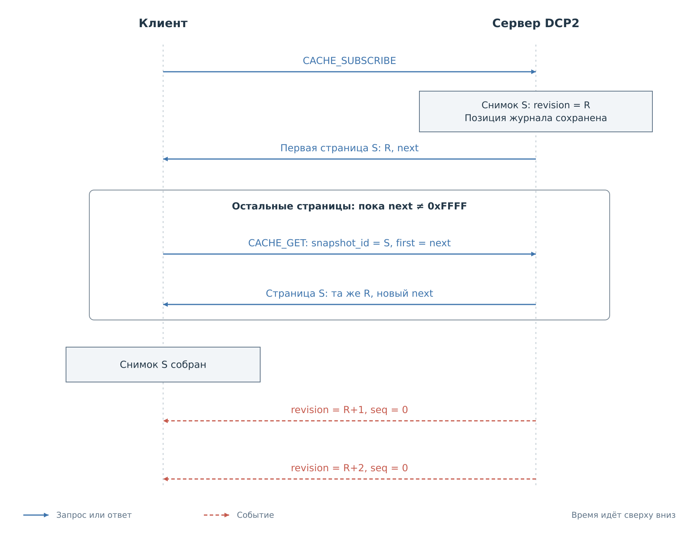
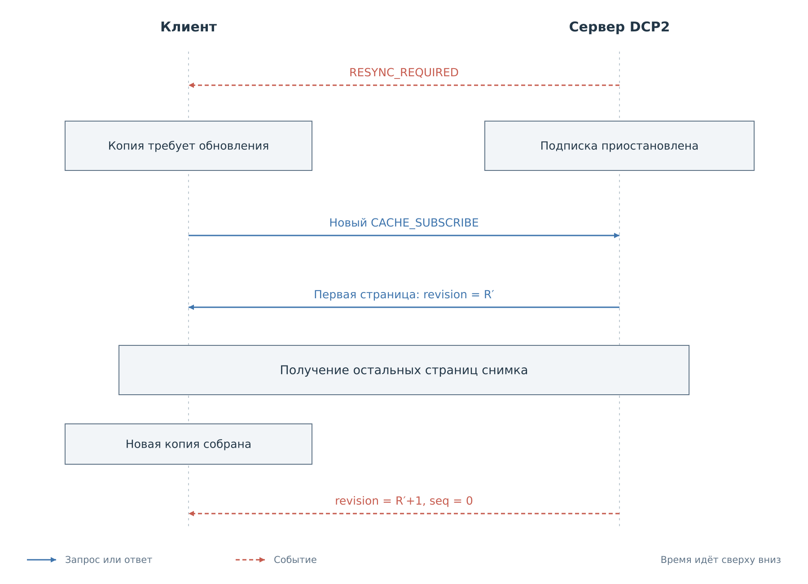
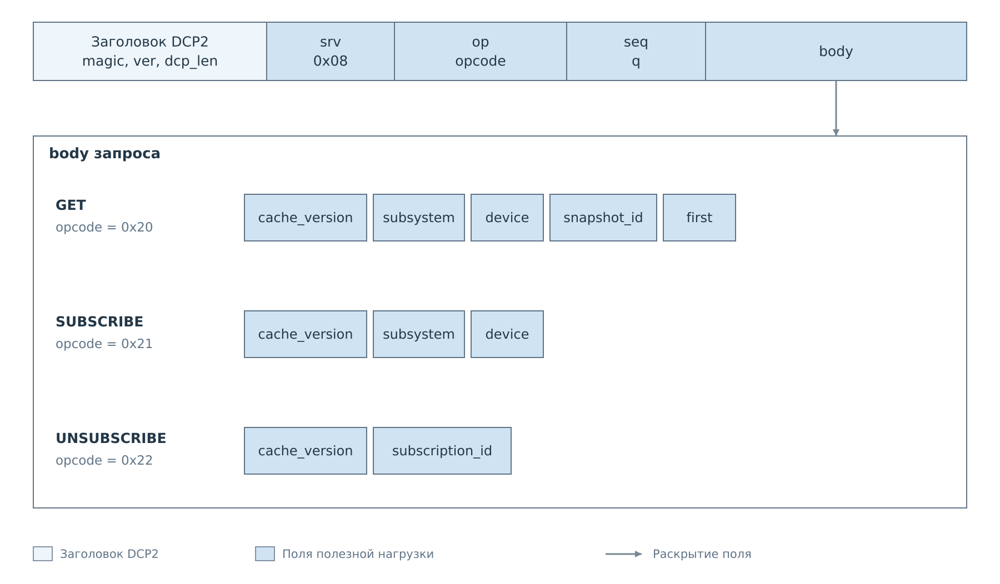
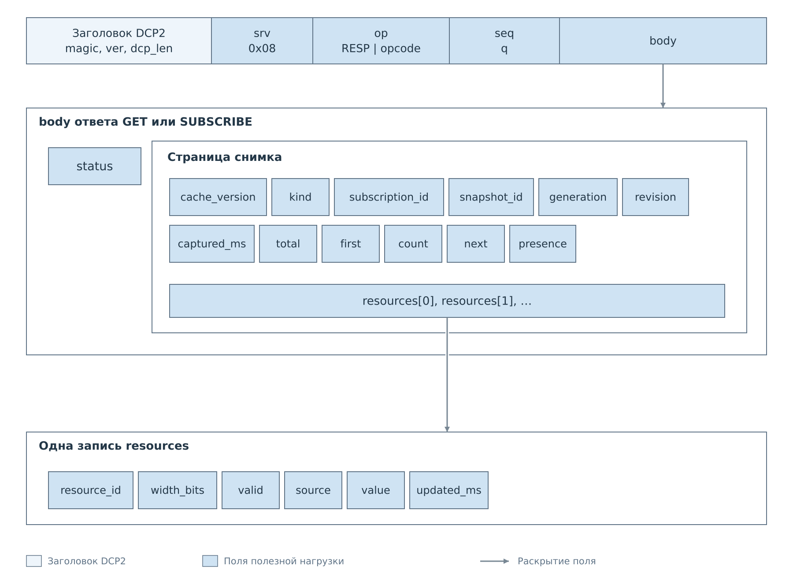
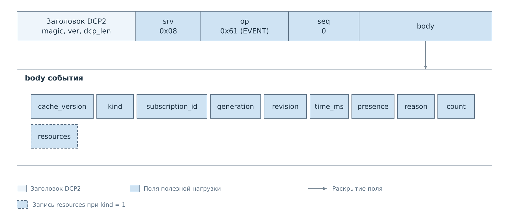

# Кэш DCP2

Сервис CACHE позволяет клиенту получить локальную копию значений устройства
и поддерживать её по уведомлениям. Для этого одного потока событий недостаточно:
клиенту нужно знать исходное состояние и точку, начиная с которой к нему
относятся изменения. CACHE связывает эти две части снимком и ревизией.

Сервис использует `srv=0x08` и подключён к FreeRTOS. Адаптеры I²C и MDIO
публикуют в него состояние своих программных кэшей. Запрос CACHE не выполняет
физическое чтение шины и не меняет политику записи или настройки опроса.
В текущем `bvstkd` сервис не подключён.

## Адресация и содержимое кэша

Клиент выбирает пару имён `subsystem` и `device`. Первое обозначает подсистему,
второе совпадает с ID устройства в профиле. Внутри устройства значения
адресуются по ID ресурсов профиля. Физические адреса регистров для запроса
CACHE не требуются; смысл ресурса клиент получает из профиля и карты регистров.

Снимок включает все ресурсы, в том числе ещё не заполненные. У каждого значения
есть `valid`, `source` и `updated_ms`. Нулевое значение при `valid=1` достоверно;
при `valid=0` его нельзя использовать как измерение. Начальная пустая запись
содержит `source=unknown`, `value=0`, `updated_ms=0`.

`source=settings` означает значение из настроек, `source=device` — значение
от устройства. Готовность передаётся отдельно через `presence`: профиль
и кэш могут существовать при отключённом устройстве. Сам снимок согласован
по памяти PS, но отдельные регистры могли быть прочитаны с оборудования
в разные моменты. Их метки времени сохраняют это различие.

## Начальный снимок и последующие изменения

Для разового чтения клиент отправляет `CACHE_GET` с `snapshot_id=0`
и `first=0`. Для непрерывного наблюдения — `CACHE_SUBSCRIBE`. В обоих случаях
сервер фиксирует снимок и возвращает первую страницу; при подписке он также
сохраняет позицию журнала, соответствующую моменту фиксации.

*Рисунок 1. Все страницы принадлежат одному снимку с ревизией R.
Изменения после R накапливаются в журнале и передаются после завершения снимка.*

Ответ содержит `snapshot_id` и поле `next`. Если `next` не равно `0xFFFF`,
клиент отправляет `CACHE_GET` с теми же именами, полученным `snapshot_id`
и `first=next`. Меняется только номер запроса `seq` и индекс страницы.
Сервер читает сохранённый снимок, поэтому обновления рабочего кэша не меняют
уже начатую последовательность страниц.

Клиент собирает страницы последовательно с индекса 0. До получения всех
ресурсов его локальная копия неполна. Сервер удерживает события этой подписки,
пока последовательно не выданы все страницы. Если весь снимок помещается
в первую страницу, этот этап завершается сразу.

После последней страницы клиент принимает события с ревизиями R+1, R+2
и далее. Они могут относиться к изменениям, случившимся ещё во время передачи
снимка. Таким образом, между начальным состоянием и уведомлениями сохраняется
непрерывная последовательность.

| Поле | Область действия |
|---|---|
| `seq` | Один запрос и его ответ |
| `snapshot_id` | Сохранённый снимок, из которого читаются страницы |
| `subscription_id` | Подписка внутри TCP-соединения |
| `generation` | Поколение каталога ресурсов устройства |
| `revision` | Последовательность изменений внутри поколения |

Поколение меняется при замене каталога ресурсов. Ревизия увеличивается
при публикации значения, изменении готовности или потере достоверности.
Повторное успешное чтение того же значения тоже создаёт ревизию: оно обновляет
время получения данных. Повторная очистка уже пустого ресурса ревизию не создаёт.

## Потеря согласованности

Журнал изменений конечен. Пока клиент читает страницы или отстаёт от событий,
нужные записи могут быть вытеснены. Сервер тогда отправляет `RESYNC_REQUIRED`
и приостанавливает подписку. Тот же переход требуется при смене поколения
и истечении срока незавершённого начального снимка.

*Рисунок 2. Потеря последовательности делает локальную копию несогласованной.
Работа продолжается после нового снимка и возобновления событий.*

Клиент перестаёт представлять прежнюю копию как актуальную и выполняет новый
`CACHE_SUBSCRIBE` для той же цели. Сервер заменяет её прежнюю подписку новым
снимком и позицией журнала. После сборки всех страниц изменения снова можно
применять последовательно.

Для обычного события проверяются `subscription_id`, совпадение поколения
и увеличение ревизии ровно на единицу. Пропуск ревизии также требует нового
снимка, даже если явное `RESYNC_REQUIRED` не было обработано. После разрыва
TCP прежние идентификаторы теряют смысл; клиент подписывается заново.

## Форматы запросов

Общий [кадр DCP2](02-frame.md#заголовок-и-граница-кадра) имеет `ver=2`, а внутри тела CACHE
передаётся `cache_version=1`. Это разные уровни версии формата.

Тип `string` здесь означает `length:u8`, затем `length` ASCII-байт без NUL.
Длина имени — от 1 до 31, допустимы латинские буквы, цифры, `_`, `-` и `.`.
Имена чувствительны к регистру. Числа передаются старшим байтом вперёд.

*Рисунок 3. GET и SUBSCRIBE адресуются по именам. Для отмены используется
полученный от сервера `subscription_id`.*

| Поля | Тип |
|---|---|
| `cache_version` | `u8` |
| `subsystem`, `device` | `string` каждое |
| `snapshot_id` | `u32` |
| `first`, `subscription_id` | `u16` каждое |

У нового GET `snapshot_id=0` и `first=0`. У продолжения передаётся токен
полученного снимка. Успешные GET и SUBSCRIBE после общего статуса возвращают
страницу; UNSUBSCRIBE — только статус. При ошибке дополнительных данных нет.

## Страница снимка

*Рисунок 4. Три вложенные структуры: тело ответа, страница снимка и запись
одного ресурса. Общий `status` предшествует странице.*

| Поле | Тип | Содержание |
|---|---|---|
| `cache_version` | `u8` | 1 |
| `kind` | `u8` | 0, снимок |
| `subscription_id` | `u16` | 0 для самостоятельного GET |
| `snapshot_id` | `u32` | Ненулевой токен снимка |
| `generation` | `u32` | Поколение ресурсов |
| `revision` | `u64` | Ревизия снимка |
| `captured_ms` | `u64` | Время фиксации, мс работы системы |
| `total` | `u16` | Число ресурсов во всём снимке |
| `first` | `u16` | Индекс первой записи страницы |
| `count` | `u16` | Число записей страницы |
| `next` | `u16` | Индекс следующей страницы; `0xFFFF` — конец |
| `presence` | `u8` | 0 unknown, 1 ready, 2 unavailable |
| `resources` | Массив | `count` целых записей ресурсов |

Фиксированная часть страницы занимает 37 байт. Общая нагрузка DCP2 равна
`6 + 37 + размер записей` и ограничена 4096 байтами. Ресурс не разбивается
между страницами. Число записей зависит от длины их ID, поэтому клиент
использует `count` и `next`, а не вычисляет фиксированный размер страницы.

Повторный запрос страницы сохранённого снимка возвращает те же данные.
Однако произвольное чтение индексов не заменяет последовательное получение
всех страниц: сервер отдельно учитывает прогресс начального снимка подписки.

### Запись ресурса

| Поле | Тип | Содержание |
|---|---|---|
| `resource_id` | `string` | ID из профиля |
| `width_bits` | `u8` | Разрядность от 1 до 64 |
| `valid` | `u8` | 0 или 1 |
| `source` | `u8` | 0 unknown, 1 settings, 2 device |
| `value` | `u64` | Беззнаковое значение |
| `updated_ms` | `u64` | Время получения значения |

Запись занимает `20 + длина ID` байт. `value` всегда имеет размер 8 байт,
даже если физический регистр восьмибитный. Поле `width_bits` описывает смысл
значения, а не длину его представления в этом формате.

## Формат изменения

*Рисунок 5. Событие относится к подписке по `subscription_id`. Запись ресурса
передаётся только при изменении ресурса; её формат тот же, что в снимке.*

Тело начинается с `cache_version`; общего `status` ответа перед ним нет.
Метаданные изменения передаются и при `count=0`, когда массива ресурсов нет.

| Поле | Тип | Содержание |
|---|---|---|
| `cache_version` | `u8` | 1 |
| `kind` | `u8` | 1 ресурс, 2 готовность, 3 `RESYNC_REQUIRED` |
| `subscription_id` | `u16` | Подписка, к которой относится изменение |
| `generation` | `u32` | Поколение ресурсов |
| `revision` | `u64` | Ревизия |
| `time_ms` | `u64` | Время изменения или уведомления о потере |
| `presence` | `u8` | Готовность устройства |
| `reason` | `u8` | Для обычного изменения 0 |
| `count` | `u16` | 1 для ресурса, иначе 0 |
| `resources` | Массив | При `kind=1` одна [запись ресурса](#запись-ресурса) |

Причины повторной синхронизации: 1 — переполнение журнала, 2 — смена
поколения, 3 — истечение срока начального снимка. В таком событии
`generation` и `revision` описывают последнее согласованное состояние
подписки. Поле `presence` игнорируется; старое состояние устройства из него
восстановить нельзя.

## Ограничения и ошибки

| Ресурс | Текущий предел |
|---|---:|
| Устройства в реестре | 48 |
| Ресурсы одного устройства | 256 |
| Записи общего журнала | 512 |
| Подписки на соединение | 8 |
| Сохранённые снимки на соединение | 1 |
| Неактивность снимка до истечения | 30 секунд |

Новый снимок заменяет прежний токен. Пока начальный снимок подписки не дочитан,
начать другой нельзя: сервер возвращает `ERR_BUSY`. Для отмены используется
UNSUBSCRIBE. Успешное чтение страницы продлевает срок снимка. Истечение уже
дочитанного снимка не останавливает активную подписку на изменения.

Журнал общий, поэтому интенсивные изменения другого устройства также могут
вытеснить нужные записи. В текущем сервере FreeRTOS одно TCP-соединение DCP2
обслуживается за раз; несколько подписок размещаются внутри него.

| Код | Значение | Действие клиента |
|---|---|---|
| `ERR_MALFORMED` | Неверное тело запроса | Исправить поля и длины |
| `ERR_UNSUPPORTED` | Операция или версия не поддерживается | Проверить доступность сервиса и формат |
| `ERR_BUSY` | Заняты подписки или не завершён снимок | Завершить либо отменить текущую работу |
| `ERR_RANGE` | Неверный индекс страницы | Проверить `first` и `next` |
| `ERR_CACHE_NOT_FOUND` | Устройство или ID подписки не найдены | Проверить цель или состояние подписки |
| `ERR_CACHE_STALE_SNAPSHOT` | Токен истёк, заменён или принадлежит другой цели | Получить новый снимок |

Пустой кэш является корректным результатом с `status=0` и `total=0`.
После таймаута запроса штатный клиент CACHE завершает обмен: новое соединение
и снимок восстанавливают известную точку начала. Таймаут ожидания очередного
события сам по себе не означает потерю согласованности; клиент сохраняет
частично принятый кадр и продолжает ждать.

---

Пример: [Получение снимка и обработка изменений](examples/cache.md).
