# Снимки и изменения кэша

Клиент хочет показать значения регистров устройства и затем обновлять
их по уведомлениям. Для этого он выбирает цель `subsystem="mdio"`,
`device="lan8720"`. Имена берутся из действующей конфигурации BVSTK.
Они адресуют программный кэш; PHY и номер аппаратного регистра в запрос
CACHE не передаются.

В профиле LAN8720 проекта 32 ресурса: от `reg_00` до `reg_1f`.
Для примера примем, что только два уже получили значения от устройства:
`reg_00=0x1200` и `reg_01=0x0024`. Остальные пока недостоверны.
Ревизии, времена и значения далее условные.

## Разовое получение снимка

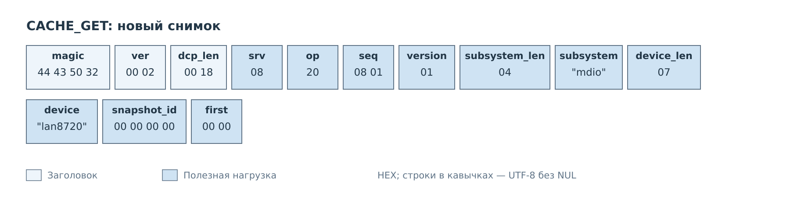

*Рисунок 1. Нулевые `snapshot_id` и `first` начинают новый снимок.*

Сервер копирует состояние кэша PS и возвращает его страницу. Аппаратного
чтения MDIO этот запрос не вызывает. Даже при успешном статусе отдельный
ресурс может ещё не содержать достоверного значения.

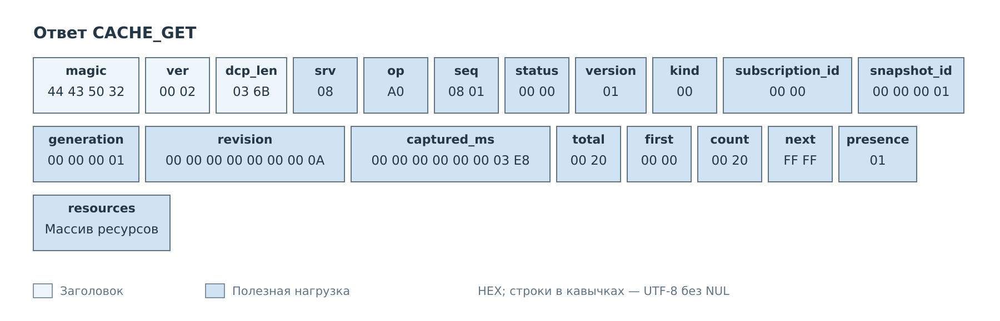

*Рисунок 2. Все ресурсы помещаются в одну страницу: `count=total=32`,
`next=0xFFFF`.*

Клиент получает `snapshot_id=1`, `generation=1`, `revision=10` и время
фиксации 1000 мс. `subscription_id=0`: это разовое чтение, после которого
события CACHE сами по себе не начнут приходить.

Массив содержит 32 записи по 26 байт. Его длина зависит от шестибайтовых
имён ресурсов, а не от ширины регистров MDIO. На рисунке массив свёрнут;
одна запись раскрыта отдельно.

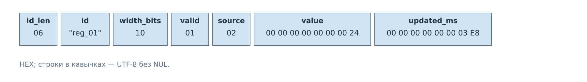

*Рисунок 3. Поле `value` всегда занимает восемь байт. `width_bits=16`
сообщает разрядность значения ресурса.*

У `reg_01` установлены `valid=1` и `source=2`, то есть значение получено
от устройства. `updated_ms=1000` относится к получению этого значения;
`captured_ms` в заголовке страницы — к фиксации всего снимка. В примере
они совпали, но при обычной работе регистры обновляются в разное время.

В оставшихся тридцати записях примера `valid=0`, `source=0`, значение
и время равны нулю. Клиент отображает их как неизвестные. Нулевой `value`
при сброшенном valid не означает прочитанный ноль из регистра.

## Подписка и изменения

Чтобы продолжить наблюдение, клиент отправляет CACHE_SUBSCRIBE.
Для того же состояния он получает новый снимок и идентификатор подписки.

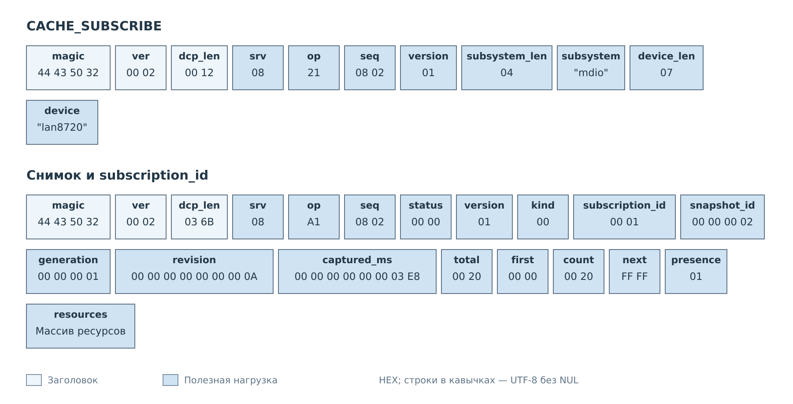

*Рисунок 4. SUBSCRIBE передаёт только версию и имена цели. Ответ добавляет
`subscription_id=1` и новый `snapshot_id=2`.*

После полного снимка клиент может применять следующие изменения.
В нашем случае снимок одностраничный, поэтому дополнительный GET не нужен.

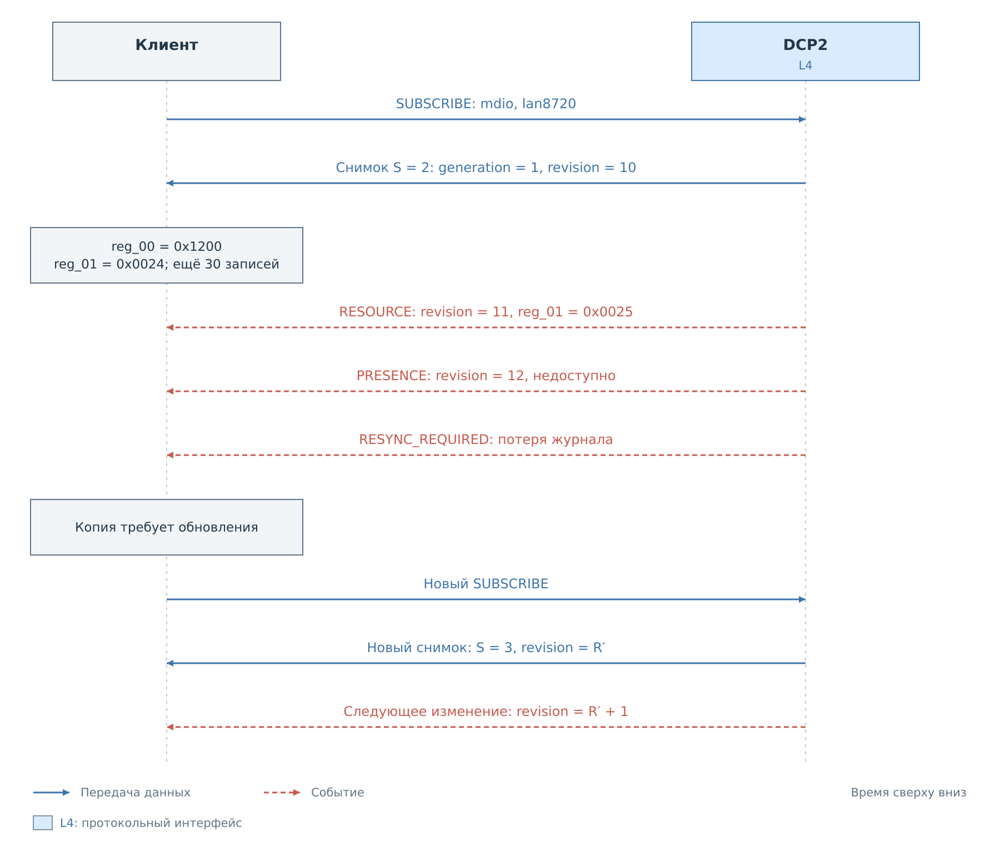

*Рисунок 5. Ревизия связывает исходное состояние с последовательностью изменений.*

Пусть сервис публикует новое значение `reg_01=0x0025` в момент 1200 мс.
Сервер отправляет событие RESOURCE.

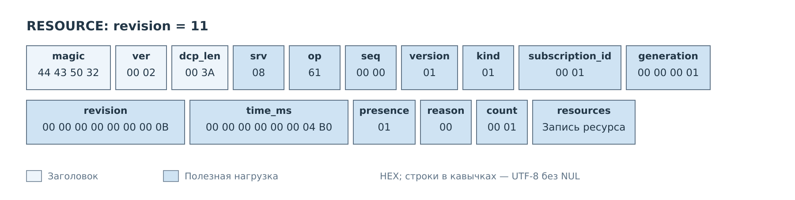

*Рисунок 6. `op=0x61` и `seq=0` обозначают событие подписки CACHE.*

*Рисунок 7. Новое значение и время обновления передаются в том же формате
ресурса, что и в снимке.*

Клиент сначала находит подписку 1, проверяет прежнее поколение 1
и следующую ревизию 11. Затем заменяет у себя запись `reg_01` целиком
и сохраняет последнюю применённую ревизию. Сравнивать только `value`
недостаточно: очередное чтение того же значения тоже может обновить его время
и создать новую ревизию.

Пусть затем устройство становится недоступным. Это отдельное изменение
готовности, а не новое значение регистра.

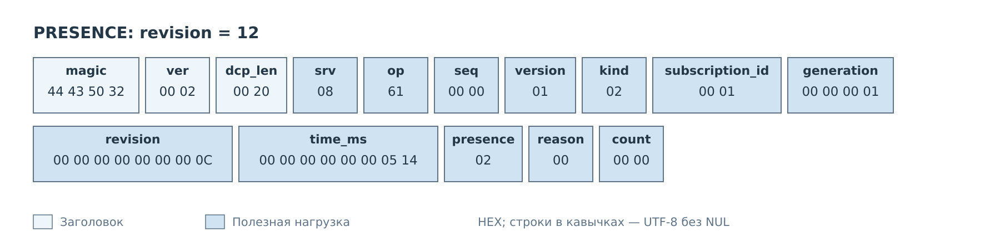

*Рисунок 8. PRESENCE не содержит массива ресурсов: `count=0`.*

Клиент сохраняет `presence=2` и ревизию 12. Поля valid отдельных ресурсов
этим сообщением не переписываются. Последние значения и доступность
устройства — разные части состояния, которые интерфейс клиента должен
показывать раздельно.

## Восстановление после потери журнала

Предположим, что клиент отстал, а нужные изменения были вытеснены из журнала.
Сервер больше не может доставить непрерывную последовательность после
ревизии 12.

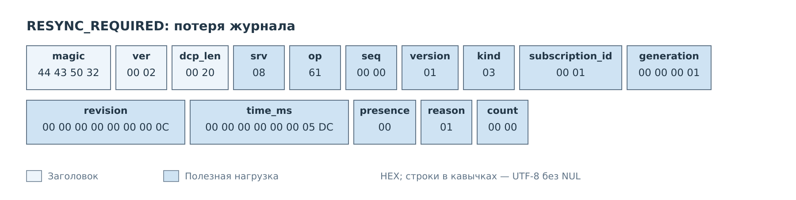

*Рисунок 9. В событии остаётся последняя переданная ревизия 12.
`reason=1` указывает на потерю изменений.*

Сервер приостанавливает подписку. Клиент помечает свою копию как требующую
обновления и повторяет SUBSCRIBE для `mdio`, `lan8720`, например с `seq=0x0803`.
Формат запроса тот же, что на рисунке 4. Полученный `snapshot_id` будет новым;
в этом обмене — 3. Прежняя подписка на ту же цель заменяется с сохранением
её идентификатора 1.

Клиент собирает новый снимок, принимает его ревизию за исходную и затем
снова применяет изменения по порядку. Нельзя добавить событие с пропущенной
ревизией к прежней копии и объявить её актуальной. Такой же переход нужен
при смене поколения или истечении времени незавершённого снимка;
их коды приведены в [описании CACHE](../06-cache.md).

## Снимок в нескольких страницах

32 регистра LAN8720 помещаются в один ответ. Для примера с продолжением
возьмём отдельно зарегистрированное условное устройство I²C с ID `demo`
и 200 ресурсами `reg00`–`regC7`. Каждый имеет пятибайтовое имя и восьмибитное
значение. Такой набор нужен здесь, чтобы размер снимка действительно
превысил вместимость кадра.

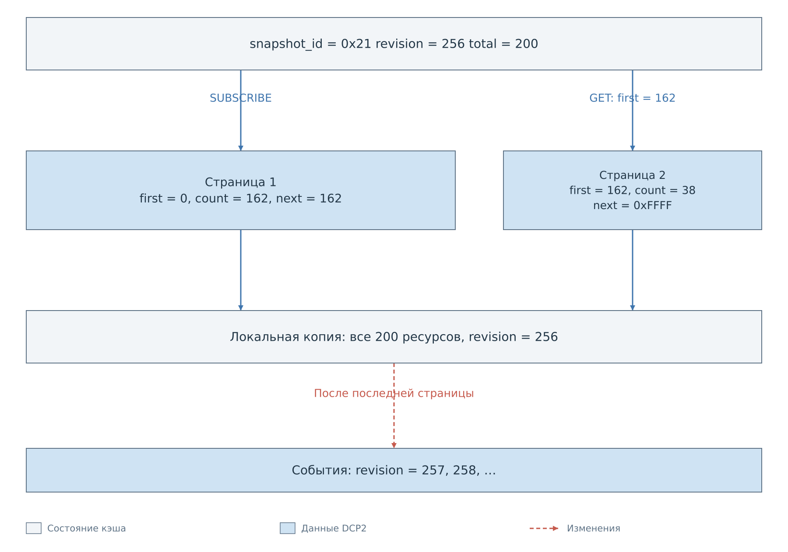

*Рисунок 10. Обе страницы относятся к снимку `0x21` с ревизией 256.
Изменения начинают передаваться после завершения снимка.*

Одна запись занимает 25 байт. Из 4090 байт данных успешного ответа
37 нужны заголовку страницы, поэтому первая страница вмещает 162 записи.
Остаются 38. Номера и размер здесь получены из действующего формата;
сервер не делит небольшой снимок на страницы произвольного размера.

Клиент отправляет SUBSCRIBE для `i2c`, `demo` с `seq=0x0811`.
Предположим, что сервер выдал токен `0x21`. В первом ответе `next=162`.
Клиент переносит это число в `first` следующего GET и сохраняет тот же токен.

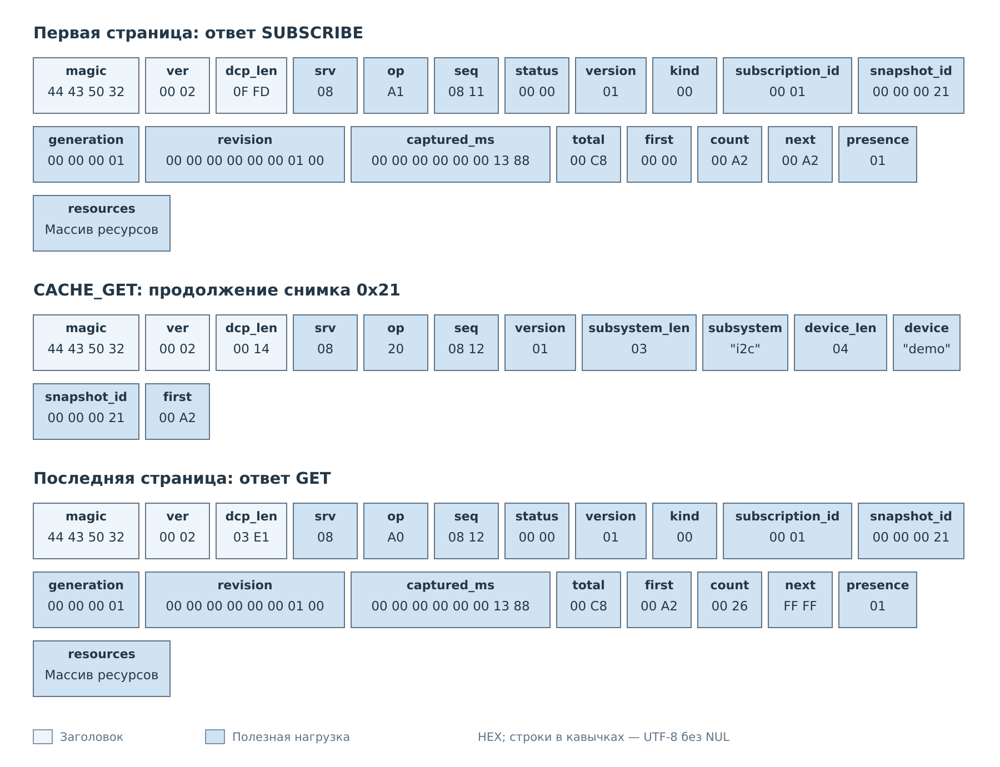

*Рисунок 11. GET продолжает сохранённый снимок. Заголовок второй страницы
сохраняет поколение, ревизию и время первой.*

Клиент объединяет записи по индексам. `next=0xFFFF` во втором ответе завершает
снимок. Пока он передавался, рабочий кэш мог измениться, но содержимое
зафиксированных страниц осталось прежним. Последующие события начинаются
после ревизии 256 и доводят собранную копию до нового состояния.

## Отмена подписки

Вернёмся к подписке MDIO с идентификатором 1. Для её отмены имена устройства
и токен снимка уже не нужны.

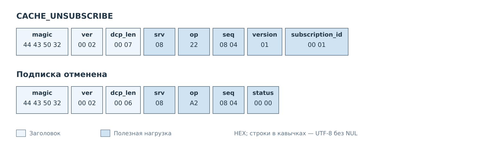

*Рисунок 12. Успешный ответ завершает подписку 1 в данном соединении.*

После разрыва TCP прежние подписки и снимки также исчезают. Новое соединение
начинает синхронизацию заново; сохранённые значения на клиенте до получения
нового снимка остаются только последним известным состоянием.

---

[Все примеры](../07-examples.md). [Оглавление DCP2](../dcp2.md).
