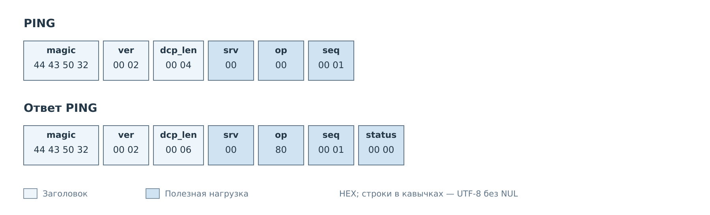
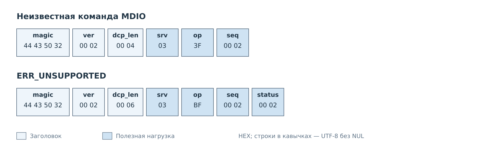
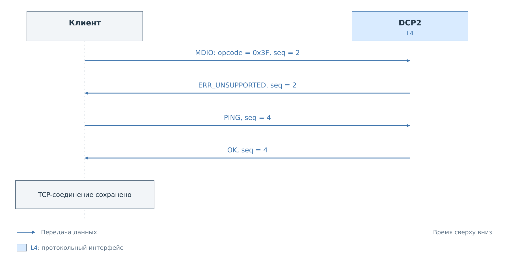
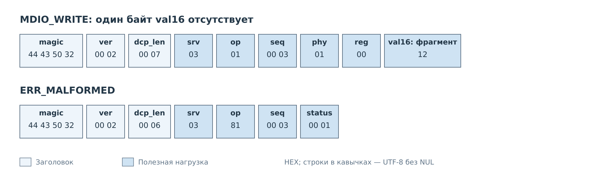

# Проверка соединения и ошибки

Начнём с обмена, которому не нужны ни устройство на шине, ни файл, ни профиль.
Клиент уже установил TCP-соединение с сервером DCP2. Теперь он отправляет PING
и проверяет, что получает корректный ответ протокола.

## PING

*Рисунок 1. PING с номером запроса 1. В ответ добавляется двухбайтовый статус.*

У запроса нет параметров, поэтому его нагрузка состоит только из `srv`, `op`
и `seq`. Клиент ждёт ответ с теми же сервисом, кодом команды и номером запроса.
После проверки признака RESP он читает `status`. Ноль означает, что сервер
обработал PING. Готовность I²C, MDIO или файловой системы этим не проверяется.

## Неподдерживаемая команда

Теперь отправим в сервис MDIO код `0x3F`, которого нет среди его команд.
Заголовок и длина запроса корректны, поэтому сервер может разобрать сообщение
и сформировать обычный ответ с ошибкой.

*Рисунок 2. Ответ сохраняет код операции и добавляет RESP: получается `op=0xBF`.*

Клиент сопоставляет ответ с `seq=2`, видит `ERR_UNSUPPORTED` и завершает
ожидание этой команды. Данных результата после статуса нет. Соединение остаётся
пригодным для следующего запроса.

*Рисунок 3. Следующий PING проходит в том же TCP-соединении.*

## Неполные параметры

Для `MDIO_WRITE` нужны адрес PHY, номер регистра и **два** байта значения.
В следующем запросе передаётся только один байт значения. Поле `dcp_len`
честно описывает переданные семь байт нагрузки: транспортный кадр целый,
но его тело не соответствует выбранной команде.

*Рисунок 4. Ошибка обнаруживается при разборе параметров, до записи регистра.*

Ответ `ERR_MALFORMED` не содержит частичного результата. Клиент исправляет
тело и назначает новому запросу новый `seq`.

Ошибка заголовка обрабатывается иначе. Если неверны `magic`, версия или
допустимая длина кадра, сервер закрывает соединение. Например, `dcp_len=3`
не оставляет места даже для общих полей нагрузки. Ожидать в таком случае
ответ ERR_MALFORMED нельзя. Правила чтения TCP-потока и проверки заголовка
разобраны в [главе о кадре](../02-frame.md).

---

Далее: [Доступ к памяти](memory.md).
[Кадр и правила обмена](../02-frame.md).
