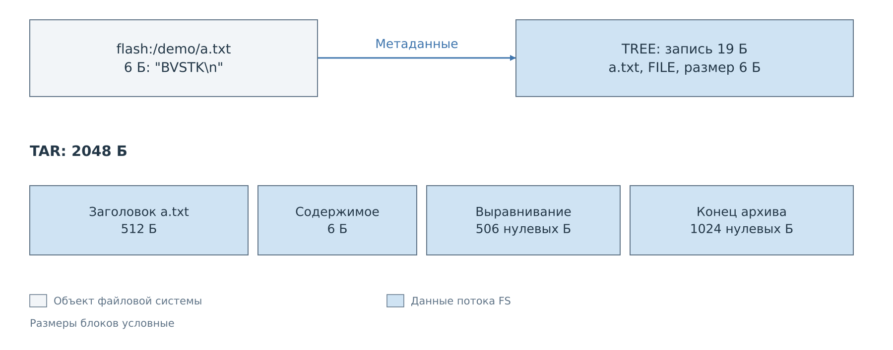
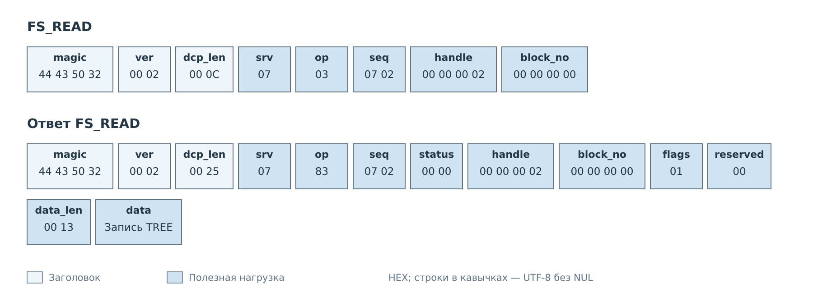
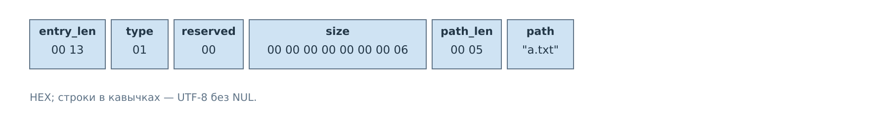
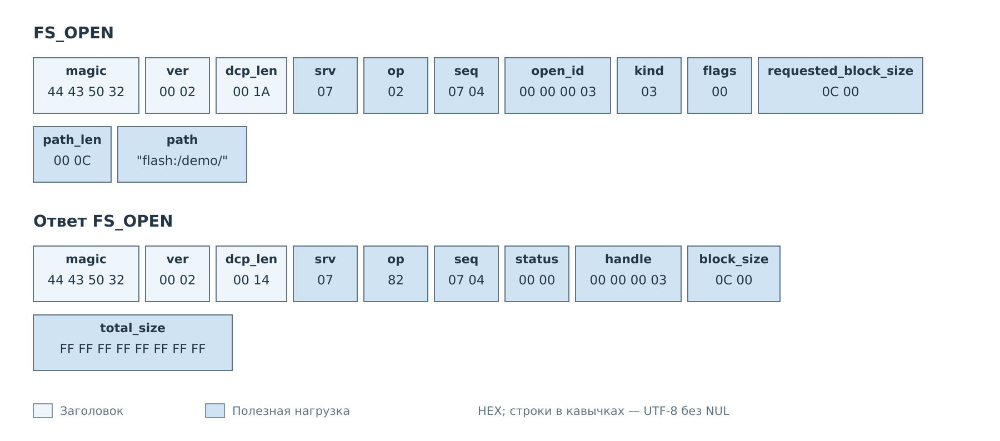
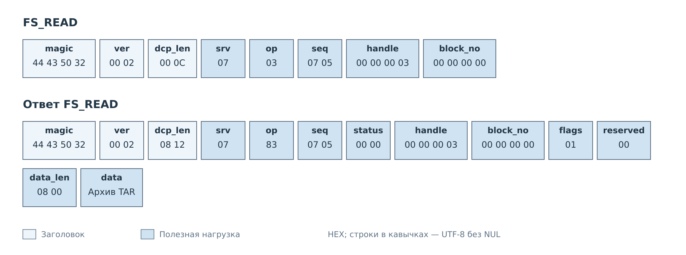

# Каталоги и архивы

FS использует один порядок OPEN, READ и CLOSE для трёх видов содержимого:
FILE, TREE и TAR. В [примере файла](files.md) клиент собирал исходные байты
объекта. Теперь он открывает каталог `flash:/demo/`, в котором находится
файл `a.txt` с содержимым `BVSTK` и переводом строки.

Для перечисления имён нужен TREE. Для получения каталога вместе с содержимым
файлов — TAR. Выбор делается при OPEN; последующие READ имеют тот же формат.

*Рисунок 1. TREE передаёт сведения о файле. TAR включает также его содержимое,
выравнивание и признак конца архива.*

## Перечисление TREE

*Рисунок 2. `kind=2` выбирает TREE, `flags=1` разрешает рекурсивный обход.*

В запросе выбраны блоки по 64 байта. Сервер возвращает `handle=2` и неизвестный
заранее размер потока: все биты `total_size` равны единице. Клиент читает
до EOF, а не пытается заранее вычислить число запросов по размеру каталога.

Включённая рекурсия добавляет записи вложенных каталогов и файлов. Их пути
относительны корню OPEN: например, `sub/b.txt`. Сам корень `flash:/demo/`
в список не включается. При `flags=0` перечисляются только непосредственные
дети корня.

*Рисунок 3. Единственная запись занимает 19 байт и помещается в блок 0.*

*Рисунок 4. `entry_len` охватывает всю запись, включая собственные два байта.*

Из `data` клиент получает тип FILE, размер шесть байт и относительное имя
`a.txt`. Содержимого файла здесь нет. После EOF он закрывает `handle=2`
командой FS_CLOSE, например с `seq=0x0703`.

Для большого каталога запись TREE может пересечь границу блоков FS.
Тогда клиент сохраняет неполную запись и дополняет её `data` следующего
ответа. Начало каждого FS_READ не обязано совпадать с началом нового имени.
Этот случай отдельно показан в [описании границ блоков](../06-fs.md).

## Архив TAR

После закрытия TREE клиент открывает тот же каталог с `kind=3`.
У TAR флаги нулевые, обход каталога рекурсивный. Для этого потока выбран
максимальный блок 3072 байта.

*Рисунок 5. Новое открытие имеет новый `open_id` и получает новый дескриптор.*

Архив создаётся по мере чтения. Для короткого имени `a.txt` достаточно одного
заголовка ustar размером 512 байт. За ним идут шесть байт файла, 506 байт
выравнивания нулями и два завершающих нулевых блока по 512 байт.
Итого в выбранном примере — 2048 байт.

*Рисунок 6. Архив целиком помещается в один ответ. Массив `data` показан
единым блоком вместо развёртывания всех 2048 байт.*

Клиент сохраняет `data` как байты TAR и после EOF закрывает `handle=3`.
Метаданные DCP2 и FS в архив не попадают. Для большого дерева он так же
последовательно дописывает данные следующих блоков; границы FS_READ
могут проходить внутри заголовка или содержимого файла TAR.

Длинные имена и другие значения, не помещающиеся в ustar, используют
расширения PAX. Поэтому размер произвольного архива нельзя получить
умножением числа файлов на размер рисунка 1. И TREE, и TAR читают текущую
файловую систему: изменения каталога во время обхода не дают гарантий снимка.

---

Далее: [Снимки и изменения кэша](cache.md).
[Файловый сервис](../06-fs.md).
